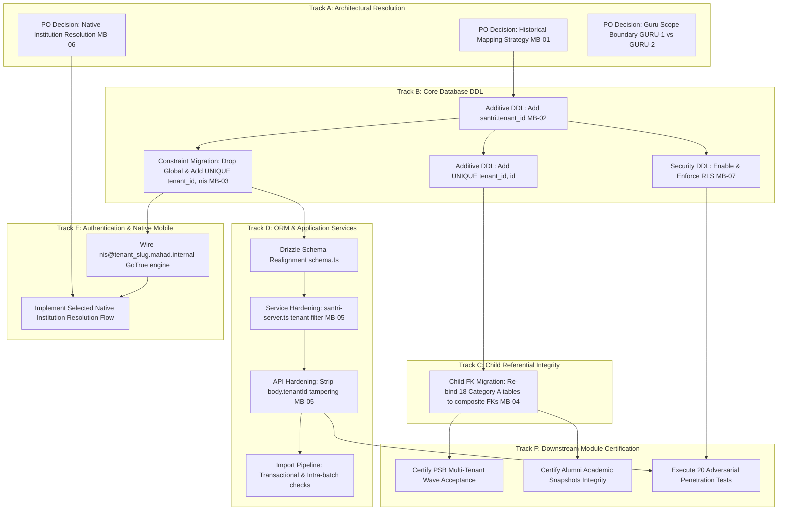
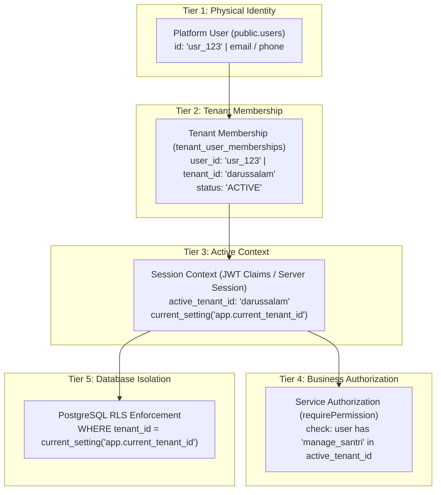

# EEOS — CORE SANTRI TENANTIZATION & NIS REMEDIATION
# ARCHITECTURAL REMEDIATION BLUEPRINT

```text
WORK PACKAGE:           WP-CORE-SANTRI-TENANTIZATION-REMEDIATION-BLUEPRINT-001
REVISION:               REVISION 001 (POST FINAL ADVERSARIAL REVIEW)
RELATED PACKAGES:       WP-CORE-SANTRI-TENANTIZATION-PRE-IMPLEMENTATION-AUDIT-001
                        WP-CORE-SANTRI-TENANTIZATION-REMEDIATION-BLUEPRINT-FINAL-REVIEW-001
                        WP-MULTITENANT-ISOLATION-AUDIT-001
                        WP-MULTITENANT-ROOT-CAUSE-HARDENING-REVIEW-001
                        WP-NIS-TENANT-SCOPED-ARCHITECTURAL-DECISION-001
                        WP-PSB-ALUMNI-GATE-9-FAILURE-RECONCILIATION-001
                        WP-PSB-ALUMNI-GATE-9-ARCHITECTURAL-DECISION-ANALYSIS-001
DOCUMENT TYPE:          TECHNICAL REMEDIATION BLUEPRINT & WORK PACKAGE SPECIFICATION
MODE:                   READ-ONLY / ZERO MUTATION / DESIGN & REMEDIATION PLANNING ONLY
STATUS:                 REMEDIATION BLUEPRINT REVISION COMPLETE — AWAITING INDEPENDENT RE-AUDIT
DATE:                   2026-09-19
ARCHITECT:              Senior Systems Architect, Multi-Tenant Security & Database Specialist
```

---

## 1. EXECUTIVE SUMMARY

This Remediation Blueprint establishes the definitive technical roadmap, dependency sequence, and architectural specifications required to transition the APP MA'HAD (EEOS) platform from its current hybrid, drifted state to a hardened, enterprise-grade multi-tenant architecture. 

Based directly on the forensic baseline established in `WP-CORE-SANTRI-TENANTIZATION-PRE-IMPLEMENTATION-AUDIT-001` and the findings of `WP-CORE-SANTRI-TENANTIZATION-REMEDIATION-BLUEPRINT-FINAL-REVIEW-001`, this blueprint provides the engineering solutions for:
1. **Core Santri Tenantization**: Elevating `santri` to a strictly tenant-owned domain entity (`tenant_id NOT NULL REFERENCES tenants(id)`), bound by composite surrogate integrity `UNIQUE (tenant_id, id)`.
2. **NIS Tenant-Scoped Remediation**: Migrating from the flawed global unique constraint `UNIQUE (nis)` to tenant-scoped business uniqueness `UNIQUE (tenant_id, nis)`, preserving natural student numbering across independent institutions.
3. **Composite Referential Integrity**: Re-binding **18 Category A core operational child tables** (out of 22 total dependent schema entities across Categories A–D) from single-column foreign keys (`santri_id`) to composite foreign keys `(tenant_id, santri_id)` to eliminate cross-tenant data corruption.
4. **Defense-in-Depth Authorization & Security**: Aligning authenticated identity, tenant membership, session context, service authorization, and PostgreSQL Row-Level Security (RLS).
5. **Neutral Decision Formulation**: Formulating strictly neutral options for unresolved Product Owner gates (Historical Data Strategy, Native Mobile UX, Database RLS Architecture, and Guru Scope Boundary).

```text
╔══════════════════════════════════════════════════════════════════════════════════════════════╗
║                   REMEDIATION BLUEPRINT STATUS: REVISION 001 COMPLETE                        ║
║                   IMPLEMENTATION STATUS: AWAITING INDEPENDENT RE-AUDIT                       ║
║                                                                                              ║
║  CRITICAL BLOCKERS AUDITED:  3                                                               ║
║  HIGH BLOCKERS AUDITED:      3                                                               ║
║  MEDIUM BLOCKERS AUDITED:    1                                                               ║
║  PRODUCT OWNER DECISIONS:    3 REQUIRED (MB-01 Mapping, MB-06 Mobile UX, GURU Boundary)       ║
║                                                                                              ║
║  DATABASE MUTATION:          NOT AUTHORIZED                                                  ║
║  DDL / MIGRATION EXECUTION:  NOT AUTHORIZED                                                  ║
║  SOURCE CODE MUTATION:       NOT AUTHORIZED                                                  ║
╚══════════════════════════════════════════════════════════════════════════════════════════════╝
```

---

## 2. SCOPE

The scope of this remediation blueprint is strictly structural, architectural, and procedural:
- **In Scope**:
  - Technical design of the schema evolution for `public.santri` and 18 Category A core operational tables (22 total dependent schema entities across Categories A–D).
  - Identification of query modifications across repositories, server actions, and edge API routes.
  - Structural separation of Platform Identity, Tenant Membership, Active Tenant Context, RBAC, and RLS.
  - Formulation of neutral options for unresolved architectural gates (Historical Mapping, Native Mobile UX, RLS execution path, and Guru Tenantization Boundary).
  - 10-phase migration sequence with zero-data-loss targets and controlled lock parameters.
  - Definition of 11 Work Packages (WP-01 through WP-11) and 10 Quality Verification Gates (Gate R1 through Gate R10).
- **Out of Scope (Forbidden)**:
  - Executing SQL DDL, DML, or backfills.
  - Modifying application source code or Drizzle ORM schema files.
  - Committing or pushing changes to git.
  - Unilaterally deciding unresolved Product Owner business or UX decisions.

---

## 3. LOCKED DECISIONS

The following foundational business and domain decisions are locked, authoritative, and binding. They form the immutable boundary conditions of this blueprint:

| Decision ID | Invariant Statement | Database & Architectural Contract | Status |
| :--- | :--- | :--- | :--- |
| **LDEC-01** | **Strict Santri Tenant Ownership**: One `santri` domain record belongs to exactly one Tenant/Pondok. It MUST NOT be shared across tenants. | `santri.tenant_id NOT NULL REFERENCES tenants(id)` | `[FACT]` LOCKED |
| **LDEC-02** | **Strict Guru/Ustadz Tenant Ownership**: One `guru` domain record belongs to exactly one Tenant/Pondok. (Scope boundary defined in Sec 22.1). | `guru.tenant_id NOT NULL REFERENCES tenants(id)` | `[FACT]` LOCKED |
| **LDEC-03** | **Identity / Domain Record Decoupling**: A physical person/identity (`users.id`) is distinct from tenant domain records (`santri`, `guru`). | Person = `public.users`; Domain = `public.santri` | `[FACT]` LOCKED |
| **LDEC-04** | **Multi-Membership Allowance**: A physical person may hold memberships in multiple tenants simultaneously. | `tenant_user_memberships (user_id, tenant_id)` | `[FACT]` LOCKED |
| **LDEC-05** | **NIS Tenant-Scoped Uniqueness**: NIS is a tenant-scoped business identifier. Same NIS across different tenants is VALID; duplicate NIS within same tenant is INVALID. | `CONSTRAINT uq_santri_tenant_nis UNIQUE (tenant_id, nis)` | `[FACT]` LOCKED |
| **LDEC-06** | **NIS Format Immutability**: Visible NIS format MUST NOT be modified or prefixed (e.g. no `PONDOK-A-00125`). | Preserved natural string format | `[FACT]` LOCKED |
| **LDEC-07** | **Zero Client-Trust Invariant**: Tenant isolation MUST NOT rely on hostname, subdomain, URL, request body, localStorage, or client-selected IDs. | Server-verified JWT claim + validated DB membership | `[FACT]` LOCKED |
| **LDEC-08** | **Single Native Mobile Surface**: Native mobile application uses one unified login interface for all tenants. | Centralized mobile gateway with institution resolution | `[FACT]` LOCKED |
| **LDEC-09** | **Defense-in-Depth**: Database RLS and application service authorization act as independent layers of security. | Service RBAC + PostgreSQL RLS policies | `[FACT]` LOCKED |
| **LDEC-10** | **Alumni Module Boundary**: Alumni module remains subscription-controlled per approved SaaS entitlement contracts. | Subscription tier gate intact | `[FACT]` LOCKED |

---

## 4. AUDIT BASELINE

Direct forensic inspection from `WP-CORE-SANTRI-TENANTIZATION-PRE-IMPLEMENTATION-AUDIT-001` and schema cross-referencing established the following verified ground truth:

1. `[FACT]` **Live PostgreSQL 17.6 Schema**:
   - Table `public.santri` contains 24 columns and **physically lacks `tenant_id`**.
   - Table `public.santri` has single-column primary key `santri_pkey ON (id)`.
   - Table `public.santri` has global unique constraint `santri_nis_unique UNIQUE (nis)`.
   - Table `public.santri` has `relrowsecurity = false` (RLS disabled).
   - Live row count in active sandbox: `santri = 0`, `academic_years = 0`, `tenants = 6`, `users = 7`.
   - `[CRITICAL PRINCIPLE]` **SANDBOX STATE ≠ PRODUCTION STATE**: 0 rows in sandbox certifies staging/dev environment baseline only; production migration strictly requires formal catalog row-count certification of the production database prior to execution.
2. `[FACT]` **Drizzle ORM Drift (`src/lib/db/schema.ts:54-55`)**:
   - Drizzle declares `tenantId: text('tenant_id').default('default').notNull()` (Drift: column does not exist in live DB).
   - Drizzle declares `nis: text('nis').notNull().unique()` (Drift: global uniqueness violates LDEC-05).
3. `[FACT]` **Child Referential Decoupling**:
   - 18 Category A core operational child tables possess `tenant_id` but reference `santri` via single-column foreign key `santri_id REFERENCES santri(id)`.
   - This allows cross-tenant child association at the database level if not constrained by composite foreign keys.
4. `[FACT]` **Application Query Drift**:
   - `santri-core-service.ts:37` queries `where(and(eq(santri.tenantId, tenantId), eq(santri.nis, santriData.nis)))` (fails on live DB due to missing column).
   - `santri-server.ts:31,115` queries `where(eq(santri.id, id))` without tenant filtering (IDOR risk).
   - `/api/gate/scan-in`, `/api/gate/scan-out`, `/api/canteen/pay` accept `tenantId` from unverified request body JSON.
5. `[FACT]` **Database Role & RLS**:
   - Application connects via `DATABASE_URL` as user `postgres` (superuser and table owner).
   - By PostgreSQL design, table owners bypass RLS unless `FORCE ROW LEVEL SECURITY` is applied or connection is routed through a dedicated non-owner application role.

---

## 5. BLOCKER INVENTORY

The 7 blockers identified in the comprehensive audit are classified below:

```text
┌───────────┬──────────┬────────────────────────────────────────────────────────┬────────────────────────────────────────┐
│ Blocker   │ Severity │ Description                                            │ Remediation Target                     │
├───────────┼──────────┼────────────────────────────────────────────────────────┼────────────────────────────────────────┤
│ MB-01     │ CRITICAL │ Historical Santri Tenant Mapping Source Unknown        │ Formulate Options (HIST-1 / HIST-2)    │
│ MB-02     │ CRITICAL │ public.santri Physically Lacks tenant_id Column        │ Additive DDL Migration Specification   │
│ MB-03     │ CRITICAL │ Global Constraint santri_nis_unique Contradicts LDEC-05│ Drop Global & Add Tenant-Scoped Unique │
│ MB-04     │ HIGH     │ 18 Category A Child Tables Lack Composite Foreign Keys │ Re-bind to (tenant_id, santri_id)      │
│ MB-05     │ HIGH     │ Application Services & APIs Permit IDOR / Global Query │ Enforce Verified Tenant Context        │
│ MB-06     │ HIGH     │ Native Mobile App Institution Resolution Undecided     │ Formulate Options (UX-1 / UX-2 / UX-3) │
│ MB-07     │ MEDIUM   │ Superuser Connection Role Bypasses Database RLS        │ Formulate Options (RLS-1 / RLS-2)      │
└───────────┴──────────┴────────────────────────────────────────────────────────┴────────────────────────────────────────┘
```

---

## 6. ROOT CAUSE ANALYSIS

Each blocker stems from an underlying structural defect. The causal chain is traced below:

### 6.1 MB-01: Historical Tenant Mapping Unknown
- `[Root Cause]`: Early prototype schemas treated the database as a single-institution deployment. Santri records were created without foreign keys to institutions, academic structures, or madrasahs.
- `[Affected Boundary]`: Legacy data persistence and historical reporting.
- `[Security/Data Risk]`: Blindly assigning historical records to a default tenant risks severe data contamination and inter-pondok privacy violations.
- `[Required Remediation]`: Formal sign-off on mapping options: clean development slate vs external signed reconciliation mapping.
- `[Dependency]`: Precondition to non-null tenant column enforcement.

### 6.2 MB-02: Missing `santri.tenant_id` in Live Database
- `[Root Cause]`: Drizzle ORM schema was updated in code (`schema.ts:54`), but the DDL migration was never executed or was rolled back due to lack of migration orchestration.
- `[Affected Boundary]`: Core domain entity model (`public.santri`).
- `[Security/Data Risk]`: Runtime crashes (`column "tenant_id" does not exist`) whenever tenant-aware application code executes.
- `[Required Remediation]`: Execute controlled additive migration `ALTER TABLE public.santri ADD COLUMN tenant_id text NOT NULL REFERENCES tenants(id)`.
- `[Dependency]`: Dependent on MB-01 resolution.

### 6.3 MB-03: Premature Global Unique Constraint `santri_nis_unique`
- `[Root Cause]`: Architectural assumption that Indonesian student registration numbers (NIS) are nationally unique across independent private pesantren.
- `[Affected Boundary]`: Uniqueness indexing and PSB admissions across tenants.
- `[Security/Data Risk]`: Cross-tenant denial of service (Tenant A taking NIS `00125` prevents Tenant B from enrolling student `00125`) and side-channel enumeration.
- `[Required Remediation]`: Drop `santri_nis_unique`; add `UNIQUE (tenant_id, nis)`.
- `[Dependency]`: Dependent on MB-02 (`tenant_id` existence).

### 6.4 MB-04: Single-Column Child Foreign Keys
- `[Root Cause]`: Standard relational modeling created foreign keys pointing only to surrogate primary key `santri.id`.
- `[Affected Boundary]`: 18 downstream Category A child tables (wallets, cards, violations, health, attendance, academic ledgers, governance cases, quests, etc.).
- `[Security/Data Risk]`: Cross-tenant reference injection: a user in Tenant B can associate an invoice or punishment with a santri in Tenant A.
- `[Required Remediation]`: Establish `UNIQUE (tenant_id, id)` on `santri` and re-bind Category A child FKs to composite target `(tenant_id, santri_id)`.
- `[Dependency]`: Dependent on MB-02.

### 6.5 MB-05: Service & API IDOR Vulnerabilities
- `[Root Cause]`: Convenience patterns in UI forms passing `body.tenantId`, and lifecycle services (`santri-server.ts`) assuming surrogate IDs are globally non-overlapping.
- `[Affected Boundary]`: HTTP endpoints (`/api/gate/*`, `/api/canteen/*`) and background services.
- `[Security/Data Risk]`: Parameter tampering and IDOR allowing unauthorized state mutation across tenants.
- `[Required Remediation]`: Enforce server-side JWT session tenant extraction; mandate `where(and(eq(santri.id, id), eq(santri.tenantId, tenantId)))`.
- `[Dependency]`: Dependent on MB-02.

### 6.6 MB-06: Native Mobile Identity Ambiguity
- `[Root Cause]`: Universal mobile apps connect to a single API origin (`api.mahad.id`) without subdomain host context, making raw NIS inputs ambiguous across multiple tenants.
- `[Affected Boundary]`: Native mobile authentication surface.
- `[Security/Data Risk]`: Authentication failures, account lockouts, or wrong-institution logins.
- `[Required Remediation]`: Product Owner ratification of an explicit Institution Resolution Step.
- `[Dependency]`: Precondition to native app release.

### 6.7 MB-07: Superuser Execution Path & RLS Bypass
- `[Root Cause]`: Direct use of Supabase default connection string (`postgres` user) for application runtime queries.
- `[Affected Boundary]`: Database-level defense-in-depth isolation.
- `[Security/Data Risk]`: If application logic fails to include tenant WHERE clauses, PostgreSQL RLS policies will not catch the leak.
- `[Required Remediation]`: Implement Option RLS-1 (`FORCE ROW LEVEL SECURITY`) or Option RLS-2 (`Dedicated Application Role Segregation`).
- `[Dependency]`: Parallel security hardening track.

---

## 7. DEPENDENCY GRAPH

The actual implementation dependencies cannot follow an ad-hoc sequence. The critical path is mapped below:



---

## 8. SANTRI TENANTIZATION BLUEPRINT

### 8.1 Target Physical Schema Contract
The table `public.santri` will be modified according to the following strict database contract:

```sql
-- Target Schema Definition (Specification Only)
CREATE TABLE public.santri (
    id text NOT NULL,
    tenant_id text NOT NULL,
    nis text NOT NULL,
    name text NOT NULL,
    asrama text NOT NULL,
    kamar text NOT NULL,
    asrama_id text,
    kamar_id text,
    kelas text NOT NULL,
    status text DEFAULT 'Aktif'::text NOT NULL,
    gender text NOT NULL,
    photo_url text,
    wali_id text,
    wali_name text NOT NULL,
    wali_phone text NOT NULL,
    join_date text NOT NULL,
    asal_kota text NOT NULL,
    asal_provinsi text NOT NULL,
    angkatan_masuk integer NOT NULL,
    total_poin_pelanggaran integer DEFAULT 0 NOT NULL,
    total_prestasi integer DEFAULT 0 NOT NULL,
    status_karakter text DEFAULT 'Baik'::text NOT NULL,
    status_sp text DEFAULT 'Tidak Ada'::text NOT NULL,
    created_at timestamp without time zone DEFAULT now() NOT NULL,
    updated_at timestamp without time zone DEFAULT now() NOT NULL,

    -- Primary Key
    CONSTRAINT santri_pkey PRIMARY KEY (id),

    -- Tenant Foreign Key
    CONSTRAINT fk_santri_tenant FOREIGN KEY (tenant_id) 
        REFERENCES public.tenants(id) ON DELETE RESTRICT,

    -- Business Key Uniqueness (Tenant-Scoped NIS)
    CONSTRAINT uq_santri_tenant_nis UNIQUE (tenant_id, nis),

    -- Composite Surrogate Key for Child Referential Integrity
    CONSTRAINT uq_santri_tenant_id UNIQUE (tenant_id, id)
);
```

### 8.2 Indexes Strategy
To ensure optimal performance and prevent table scans during tenant-scoped filtering:
1. `idx_santri_tenant_id ON public.santri (tenant_id)`: Accelerates all tenant-level listings.
2. `idx_santri_tenant_status ON public.santri (tenant_id, status)`: Accelerates active student dashboards and alumni filtering.
3. `idx_santri_tenant_angkatan ON public.santri (tenant_id, angkatan_masuk)`: Accelerates cohort reporting.

---

## 9. NIS TENANT-SCOPED BLUEPRINT

### 9.1 Query Audit & Remediation Matrix
Every query in the repository touching `nis` must be classified and remediated:

| Subsystem / File | Current Query Pattern | Tenant Context Status | Risk Classification | Required Technical Remediation |
| :--- | :--- | :--- | :--- | :--- |
| `santri-core-service.ts:37` | `and(eq(santri.tenantId, tenantId), eq(santri.nis, nis))` | `[FACT]` Present | `SAFE` | Retain logic; verify schema compilation once DDL is applied. |
| `import/page.tsx:161` | `existingSantri.some(s => s.nis === row.nis)` | `[FACT]` Client State | `UNSAFE` | Replace with transactional server action querying `WHERE tenant_id = ? AND nis = ?`. |
| `wali-service.ts:208` | `nis: santri.nis` | `[FACT]` DTO Projection | `SAFE` | Display-only; no modification required. |
| `/api/gate/scan-in:40` | `and(eq(santri.tenantId, tenantId), eq(santri.id, card.santriId))` | `[FACT]` Untrusted Body | `UNSAFE` | Derive `tenantId` from authenticated scanner terminal session token. |
| `santri/page.tsx:57` | `s.nis.includes(search)` | `[FACT]` Client Filter | `SAFE` | Data is already scoped by server-side query prior to rendering. |
| `raport/page.tsx:109` | `nis: s.nis ?? ...` | `[FACT]` Client Projection| `SAFE` | Display-only presentation projection. |
| `dashboard/santri/kta-rfid` | `r.nis.includes(search)` | `[FACT]` Client Filter | `SAFE` | Display-only; RFID card assignment. |

### 9.2 NIS Verification Engine Specification
Before adding `UNIQUE (tenant_id, nis)`, a verification script must run to detect any existing intra-tenant collisions:
```sql
-- Intra-Tenant Collision Assertion (Must return 0 rows)
SELECT tenant_id, nis, count(*) 
FROM public.santri 
GROUP BY tenant_id, nis 
HAVING count(*) > 1;
```

---

## 10. CHILD DEPENDENCY BLUEPRINT

Based on a forensic scan of all schema definitions in `src/lib/db/` and approved DDL draft specifications, all tables possessing a `santri_id` column or referencing `santri` are authoritatively inventoried below across 4 domain categories (22 total dependent schema entities):

### Authoritative Child Dependency Inventory Table:

| Table Name | Schema File Location | Column Name | Has `tenant_id`? | Existing FK in Code | Domain Category | Target Integrity Strategy |
| :--- | :--- | :--- | :--- | :--- | :--- | :--- |
| `wali_santri_relationships` | `schema/identity.ts:113` | `santri_id` | Yes | `santri(id)` | **Category A** | Mandatory Composite FK `(tenant_id, santri_id)` |
| `wallets` | `schema/finance.ts:8` | `santri_id` | Yes | None (ORM text) | **Category A** | Mandatory Composite FK `(tenant_id, santri_id)` |
| `invoices` | `schema/finance.ts:44` | `santri_id` | Yes | None (ORM text) | **Category A** | Mandatory Composite FK `(tenant_id, santri_id)` |
| `canteen_transactions` | `schema/finance.ts:94` | `santri_id` | Yes | None (ORM text) | **Category A** | Mandatory Composite FK `(tenant_id, santri_id)` |
| `rfid_cards` | `schema/rfid.ts:7` | `santri_id` | Yes | None (ORM text) | **Category A** | Mandatory Composite FK `(tenant_id, santri_id)` |
| `rfid_tap_logs` | `schema/rfid.ts:20` | `santri_id` | Yes | None (ORM text) | **Category A** | Mandatory Composite FK `(tenant_id, santri_id)` |
| `gate_passes` | `schema/gate_pass.ts:7` | `santri_id` | Yes | None (ORM text) | **Category A** | Mandatory Composite FK `(tenant_id, santri_id)` |
| `pelanggaran` | `schema.ts:196` | `santri_id` | Yes | None (ORM text) | **Category A** | Mandatory Composite FK `(tenant_id, santri_id)` |
| `hukuman` | `schema.ts:232` | `santri_id` | Yes | None (ORM text) | **Category A** | Mandatory Composite FK `(tenant_id, santri_id)` |
| `governance_cases` | `schema.ts:249` | `santri_id` | Yes | None (ORM text) | **Category A** | Mandatory Composite FK `(tenant_id, santri_id)` |
| `health_visits` | `schema.ts:278` | `santri_id` | Yes | None (ORM text) | **Category A** | Mandatory Composite FK `(tenant_id, santri_id)` |
| `health_permissions` | `schema.ts:294` | `santri_id` | Yes | None (ORM text) | **Category A** | Mandatory Composite FK `(tenant_id, santri_id)` |
| `quests` | `schema.ts:310` | `santri_id` | Yes | None (ORM text) | **Category A** | Mandatory Composite FK `(tenant_id, santri_id)` |
| `status_change_records` | `schema.ts:383` | `santri_id` | Yes | None (ORM text) | **Category A** | Mandatory Composite FK `(tenant_id, santri_id)` |
| `academic_ledger_records` | `schema/academic_ledger.ts:7` | `santri_id` | Yes | None (ORM text) | **Category A** | Mandatory Composite FK `(tenant_id, santri_id)` |
| `academic_transcripts` | `schema/academic_ledger.ts:22`| `santri_id` | Yes | None (ORM text) | **Category A** | Mandatory Composite FK `(tenant_id, santri_id)` |
| `alumni_academic_snapshots`| Approved Draft DDL | `santri_id` | Yes | Planned Composite | **Category A** | Mandatory Composite FK `(tenant_id, santri_id)` |
| `identity_consolidation_ledgers`| Approved Draft DDL | `santri_id` | Yes | Planned Composite | **Category A** | Mandatory Composite FK `(tenant_id, santri_id)` |
| `ppob_transactions` | `schema/ppob.ts:48` | `santri_id` | Yes | None (Nullable) | **Category B** | Optional/Nullable Composite FK or Service Validation |
| `field_change_records` | `schema.ts:396` | `entity_id` | Yes | None (Polymorphic)| **Category C** | Service Authorization + Tenant Scoping (No hard FK) |
| `notifications` | `schema.ts:339` | `target_santri_id`| Yes | None (Polymorphic)| **Category C** | Service Authorization + Tenant Scoping (No hard FK) |
| `users` | `schema/identity.ts:15` | `child_santri_id` | No | Legacy Column | **Category D** | Deprecated Legacy Pointer (Scheduled for Dropping) |

*Explicit Inventory Note*: Table `public.audit_logs` is removed from child table tracking as it contains zero `santri_id` columns and functions as an entity-agnostic platform security ledger.

---

## 11. HISTORICAL DATA STRATEGY (MB-01)

`[STATUS: HISTORICAL MAPPING UNKNOWN / PRODUCT OWNER DECISION REQUIRED]`  
The audit verified that `public.santri` contains zero rows in the active sandbox, but any production database containing legacy santri records would lack an authoritative relational foreign key to `tenants`. In accordance with governance rules, **NO MAPPING WILL BE INVENTED**.

`[CRITICAL PRINCIPLE]` **SANDBOX STATE ≠ PRODUCTION STATE**: The verified fact that active sandbox has 0 rows certifies staging/dev readiness only. It must NEVER be conflated with production data status. Production implementation strictly requires formal certification of production catalog row counts.

### Options for Product Owner Ratification:

#### Option HIST-1: Clean Slate Certification
- **Prerequisites**: Formal, verified catalog assertion that production `SELECT count(*) FROM public.santri;` equals `0`.
- **Validation**: High confidence if production instance is a new or empty deployment.
- **Data Risk**: Zero data loss (no records exist).
- **Operational Effort**: Low.
- **Action**: Directly execute `ALTER TABLE santri ADD COLUMN tenant_id text NOT NULL REFERENCES tenants(id)`.

#### Option HIST-2: External Signed Reconciliation Mapping Manifest
- **Prerequisites**: Institution administrators provide a signed CSV manifest: `historical_santri_mapping.csv` mapping `santri.id -> tenant_id`.
- **Validation**: Validated against institution legal records.
- **Data Risk**: Governed by administrative sign-off; requires pre-migration database snapshot.
- **Operational Effort**: High (requires coordination across pesantren administrators).
- **Action**: Load mapping into a temporary staging table, execute `UPDATE public.santri SET tenant_id = staging.tenant_id`, assert zero nulls, then apply `SET NOT NULL`.

---

## 12. NATIVE APP INSTITUTION RESOLUTION (MB-06)

`[STATUS: ARCHITECTURAL / UX DECISION REQUIRED]`  
Under `{nis}@{tenant_slug}.mahad.internal`, GoTrue avoids email collisions. However, in a universal native app (single binary on App Store / Play Store connecting to a common API origin), the backend cannot resolve tenant context from plain NIS `00125` without an institution resolution step.

`[SECURITY ARCHITECTURE REQUIREMENT]`:
- SecureStore is **client-side persistence only**, NOT an authorization authority.
- The server MUST authenticate identity, validate active tenant membership, and enforce permissions on every request.
- The synthetic identifier `{nis}@{tenant_slug}.mahad.internal` is an **authentication routing handle** in GoTrue, NOT authorization proof.

### Neutral Comparison of Options:

```text
┌─────────────────────────┬────────────────────────────┬────────────────────────────┬────────────────────────────┐
│ Dimension               │ Option UX-1: School Picker │ Option UX-2: Combined Code │ Option UX-3: Parent SSO    │
├─────────────────────────┼────────────────────────────┼────────────────────────────┼────────────────────────────┤
│ Description             │ First-launch institution   │ Single form entering       │ Parent/Student logs in via │
│                         │ search / QR code scan.     │ School Code + NIS + Pass.  │ Phone/Email OTP, then      │
│                         │ Saved in SecureStore.      │                            │ selects tenant profile.    │
│ UX Impact               │ 1-time setup. App brands   │ User enters school code    │ Universal login; multi-    │
│                         │ to selected pesantren.     │ on every login attempt.    │ child switching across     │
│                         │ Familiar student pattern.  │ Higher input friction.     │ institutions in one app.   │
│ Security Impact         │ High isolation. Tenant slug│ Medium. Susceptible to     │ Highest. Real identity     │
│                         │ locked in client state.    │ typos and phishing.        │ verified before membership │
│                         │                            │                            │ lookup.                    │
│ Backend Implication     │ Client passes slug in      │ Gateway splits code to     │ Standard Supabase Phone    │
│                         │ login payload to synthesize│ resolve tenant_slug.       │ Auth -> custom RPC to fetch│
│                         │ GoTrue email.              │                            │ tenant memberships.        │
│ Migration Effort        │ Low to Medium (Mobile UI). │ Low.                       │ High (Full auth redesign). │
└─────────────────────────┴────────────────────────────┴────────────────────────────┴────────────────────────────┘
```

---

## 13. IDENTITY, MEMBERSHIP & TENANT CONTEXT

To eliminate multi-tenant confusion, the system architecture strictly separates five conceptual tiers:



### Connection Pooling & Transaction-Scoped Context:
`[TARGET REQUIREMENT]`: In connection-pooled environments (e.g. Node.js `pg.Pool` or Drizzle pool), setting session variables globally risks context bleed across checkouts. 
Tenant context MUST be strictly transaction-scoped:
```sql
BEGIN;
-- Set session context local to the active transaction:
SELECT set_config('app.current_tenant_id', $1, true); -- is_local = true

-- Execute tenant-scoped queries...

COMMIT;
```
When using transaction-local settings (`is_local = true`), PostgreSQL automatically resets the setting upon `COMMIT` or `ROLLBACK`, guaranteeing zero context bleed to subsequent pool checkouts.

---

## 14. REPOSITORY & SERVICE AUTHORIZATION

### 14.1 Legacy Service Inventory
- `src/modules/santri/services/santri-server.ts`:
  - `handleUpdate(id, data, tenantId)`: **UNSAFE**. Queries `where(eq(santri.id, id))` ignoring `tenantId`.
  - `transitionStatus(id, toState, ..., tenantId)`: **UNSAFE**. Queries `where(eq(santri.id, id))` ignoring `tenantId`.
- `src/modules/santri/services/santri-core-service.ts`:
  - `createSantriWithWali`: **SAFE**. Enforces `requirePermission` and scopes uniqueness by `tenantId`.
  - `updateSantriProfile`: **SAFE**. Enforces `where(and(eq(santri.id, santriId), eq(santri.tenantId, tenantId)))`.

### 14.2 Mandatory Service Refactoring Specification
All calls in `santri-server.ts` must be refactored to enforce composite key lookups:
```typescript
// Required Target Specification in santri-server.ts
const currentResult = await db
  .select()
  .from(santri)
  .where(
    and(
      eq(santri.tenantId, tenantId),
      eq(santri.id, id)
    )
  )
  .limit(1);

const current = currentResult[0];
if (!current) {
  throw new Error(`Santri with ID ${id} not found in this institution.`);
}
```

---

## 15. API AUTHORIZATION

### 15.1 Zero-Trust Parameter Elimination
All endpoints currently reading `body.tenantId` must be stripped of client parameter control:
1. `/api/gate/scan-in/route.ts`:
   - *Current*: `const { cardUid, tenantId = 'default' } = body;` (Vulnerable).
   - *Remediation*: Terminal authenticates with a signed device token or operator session. Server extracts `tenant_id` from the verified session. Client `tenantId` in JSON body is discarded.
2. `/api/gate/scan-out/route.ts`: Identical remediation.
3. `/api/canteen/pay/route.ts`: Identical remediation. POS terminal JWT dictates `tenant_id`.

---

## 16. RLS & DATABASE SECURITY

`[STATUS: ARCHITECTURAL OPTION / VALIDATION REQUIREMENT]`  
The audit revealed that the application connects as `postgres` (table owner). By PostgreSQL design, table owners bypass RLS policies unless forced or re-routed.

### Neutral Options for Decision / Validation:

#### Option RLS-1: Apply `FORCE ROW LEVEL SECURITY`
- Execute `ALTER TABLE public.santri FORCE ROW LEVEL SECURITY;`.
- Ensures that even the table owner (`postgres`) is subjected to RLS policies.
- Requires setting `current_setting('app.current_tenant_id')` on every transaction checkout from the connection pool.
- *Trade-off*: Simple schema-only migration; requires strict disciplined session setting on every query.

#### Option RLS-2: Dedicated Application Role Segregation
- Create non-superuser role: `CREATE ROLE eeos_app_role LOGIN PASSWORD '...';`.
- Grant DML permissions on public schema to `eeos_app_role`.
- Connect application pool using `eeos_app_role`.
- RLS applies automatically without bypassing.
- *Trade-off*: Infrastructure connection string changes; provides true least-privilege role boundaries.

---

## 17. PSB IMPACT ANALYSIS

- **Admissions Wave Independence**: Under `UNIQUE (tenant_id, nis)`, PSB SAT acceptance engines can safely generate sequential numbering per wave (e.g. `2027.0001`) simultaneously across hundreds of independent pesantren.
- **Acceptance Ledger Transaction**: The PSB acceptance ledger creates `santri` via ACID transaction:
  ```sql
  INSERT INTO public.santri (id, tenant_id, nis, ...) VALUES (...);
  UPDATE public.tenant_nis_configurations SET current_sequence = current_sequence + 1 WHERE tenant_id = ...;
  ```
- `[TARGET ARCHITECTURE OBJECT]` `tenant_nis_configurations`: This entity is designed in `WP-PSB-ALUMNI-SCHEMA-001-DESIGN.md:393-407` and will be physically instantiated during WP-10. It is NOT an existing database catalog table.

---

## 18. ALUMNI IMPACT ANALYSIS

- **Relational Anchoring**: Entity `alumni_academic_snapshots` designed in Gate 8B strictly references `(tenant_id, santri_id) REFERENCES public.santri(tenant_id, id)`.
- **Status Progression**: When a student graduates, the state machine in `santri-server.ts` transitions `santri.status` to `'Alumni'`.
- **Subscription Boundary**: The Alumni ecosystem remains protected by subscription tier entitlement checks (`checkModuleSubscription('alumni', tenantId)`). Non-subscribing institutions cannot access alumni networking features.

---

## 19. MIGRATION BLUEPRINT

The migration must be executed in 10 phased gates with strict assertions and zero-data-loss controls.

```text
┌─────────┬──────────────────────────────────┬───────────────────────────────────────────────────────────┐
│ Phase   │ Title                            │ Key Action & Assertions                                   │
├─────────┼──────────────────────────────────┼───────────────────────────────────────────────────────────┤
│ Phase 0 │ Preflight Assertions             │ Verify PG 17.6 connection, backup status, schema catalog  │
│ Phase 1 │ Historical Mapping Validation    │ Assert row counts; load and verify mapping manifest       │
│ Phase 2 │ Additive Column Preparation      │ ALTER TABLE santri ADD COLUMN tenant_id text (Nullable)   │
│ Phase 3 │ Tenant Ownership Backfill        │ Backfill tenant_id; assert 0 null values; apply NOT NULL  │
│ Phase 4 │ Constraint Transition            │ DROP santri_nis_unique; ADD UNIQUE (tenant_id, nis)       │
│ Phase 5 │ Surrogate Composite Integrity    │ ADD CONSTRAINT uq_santri_tenant_id UNIQUE (tenant_id, id) │
│ Phase 6 │ Child Table FK Re-binding        │ Re-bind 18 Category A child tables to (tenant_id, id)     │
│ Phase 7 │ RLS Security Hardening           │ ENABLE & Enforce RLS (per selected RLS option)            │
│ Phase 8 │ Application Compatibility        │ Deploy synchronized Drizzle schema and hardened services  │
│ Phase 9 │ Final Verification & Release     │ Run 20 adversarial tests; release to production           │
└─────────┴──────────────────────────────────┴───────────────────────────────────────────────────────────┘
```

### Phased Operational Parameters:
- **Lock Risk**: Adding `tenant_id` and unique indexes acquires `ACCESS EXCLUSIVE` lock briefly. In PostgreSQL 17, `CREATE UNIQUE INDEX CONCURRENTLY` can be used to minimize locking if tables contain large row counts.
- **Downtime Expectation**: *Zero-Downtime Target Under Controlled Off-Peak Maintenance Window*. Total execution duration under clean baseline: < 15 seconds.

---

## 20. DATA SAFETY STRATEGY

- **Zero Data Loss Target Under Approved Migration Procedure**:
  1. Full physical snapshot (`pg_dump -Fc`) taken immediately prior to Phase 0.
  2. DDL operations wrapped in transactional blocks (`BEGIN; ... COMMIT;`) where supported.
  3. Preflight check: abort transaction immediately if any unexpected duplicate `(tenant_id, nis)` is detected.
- **Rollback Runbook**:
  - **Transactional DDL Rollback**: If Phase 3, 4, 5, or 6 fails within a transaction block:
    ```sql
    ROLLBACK;
    -- Live database remains completely unharmed in its original state.
    ```
  - **Non-Transactional Operations (Concurrent Indexing)**: If `CREATE INDEX CONCURRENTLY` is executed outside a transaction block and fails or leaves an invalid index:
    ```sql
    DROP INDEX CONCURRENTLY IF EXISTS public.idx_name;
    -- Reconcile catalog state and re-attempt.
    ```

---

## 21. SECURITY THREAT MODEL

The following 10 threat scenarios are mitigated by this remediation blueprint:

| Attack Scenario | Attack Vector / Description | Current Exposure | Required Technical Control | Strategy-Aware Verification Method |
| :--- | :--- | :--- | :--- | :--- |
| **Attack 1** | Tenant A attempts to read Tenant B's Santri. | Exposed if ID is guessed. | RLS + `WHERE tenant_id = ?` filter. | Query with forged session; verify 404/empty. |
| **Attack 2** | Tenant A queries with known `santri_id` of Tenant B. | `santri-server.ts` fetches by ID only. | Enforce composite `WHERE id = ? AND tenant_id = ?`. | Direct API invocation; assert 404. |
| **Attack 3** | Tenant A queries with known `nis` of Tenant B. | Possible enumeration via duplicate error. | Scoped uniqueness eliminates side-channel error. | Query across tenants; assert 0 data returned. |
| **Attack 4** | Client sends JSON `{"tenantId": "TENANT-B"}`. | `/api/gate/scan-in` honors body. | Server overwrites body with session JWT claim. | Inject foreign tenantId; assert rejected/overwritten. |
| **Attack 5** | Client manipulates `localStorage` tenant ID. | Client UI displays wrong tenant data. | API ignores localStorage; relies on verified JWT cookie. | Alter browser storage; verify API rejects. |
| **Attack 6** | Native mobile app transmits forged tenant header. | Edge proxy could forward untrusted header. | Edge proxy strips `x-tenant-id` and sets from verified session. | Send raw curl with header; assert stripped. |
| **Attack 7** | JWT has tenant claim not matching DB membership. | Privilege escalation if membership revoked. | `requirePermission` verifies active membership in DB. | Revoke membership in DB; assert immediate 403. |
| **Attack 8** | Internal service method invoked without tenant context. | Bypasses tenant scoping. | Type signature mandates `tenantId: string` parameter. | TypeScript compiler strict null checks. |
| **Attack 9** | Child record created linking to Santri in Tenant B. | Permitted by single-column FK. | Composite FK `(tenant_id, santri_id)` rejects at DB level. | Insert SQL cross-tenant child; assert 23503 error. |
| **Attack 10**| Application executes as superuser bypassing RLS. | RLS bypassed by default. | Enforce RLS via selected option (RLS-1 or RLS-2). | Execute query under application execution role without session setting; assert 0 rows returned. Verify pool reset. |

---

## 22. REGRESSION MATRIX & GURU SCOPE DECISION

### 22.1 Guru / Ustadz Domain Boundary & Scope Decision (LDEC-02)
`[LOCKED DECISION LDEC-02]`: `One guru/ustadz domain record belongs to exactly one tenant`.

To prevent scope confusion between Santri tenantization and Guru tenantization, the boundary must be formally decided:

#### Option GURU-1: Concurrent Inclusion
- Guru tenantization (`public.guru` schema alignment, composite unique constraints, and teacher assignment foreign keys) is included concurrently in this work package.
- *Trade-off*: Broadens migration surface and lock acquisition scope.

#### Option GURU-2: Formal Deferral to WP-CORE-GURU-TENANTIZATION-001
- LDEC-02 remains locked as an architectural invariant.
- Physical implementation of Guru tenantization is formally deferred to a dedicated work package (`WP-CORE-GURU-TENANTIZATION-001`).
- This package focuses strictly on Santri tenantization and does not falsely claim complete teacher multi-tenant isolation until `WP-CORE-GURU-TENANTIZATION-001` is executed.

### 22.2 Core Operational Regression Matrix:

| Domain | Must Continue Working | Tenant Isolation Required | NIS Impact | Migration Risk | Verification Method |
| :--- | :--- | :--- | :--- | :--- | :--- |
| **Login** | Yes | Yes (GoTrue synthetic email) | Tenant-scoped | Low | Authenticate student across 2 tenants with same NIS. |
| **Wali Portal** | Yes | Yes (Filtered by guardian link)| None | Medium | Verify guardian sees only their own children. |
| **Santri Management**| Yes | Yes (Strict tenant boundary) | Tenant-scoped | High | CRUD operations with duplicate NIS in separate tenants. |
| **Guru / Academic** | Yes | Yes (Teacher gradebook) | Display-only | Low | Enter grades for students across multiple rombel. |
| **Attendance / Gate**| Yes | Yes (RFID gate check) | Display-only | High | Scan RFID card; verify student check-in within tenant. |
| **Wallets & Invoices**| Yes | Yes (Billing & balances) | Display-only | High | Generate bill; verify no cross-tenant wallet bleed. |
| **Canteen POS** | Yes | Yes (Offline/online transactions) | Display-only | High | Process canteen purchase using student card. |
| **PSB Admissions** | Yes | Yes (Multi-tenant waves) | Sequential gen | Low | Accept applicant; verify automated NIS assignment. |
| **Alumni Network** | Yes | Yes (Subscription gated) | Historical snap| Low | View alumni directory; verify privacy boundary. |
| **Bulk CSV Import** | Yes | Yes (Transactional batch) | Scoped check | Medium | Import CSV with NIS duplicated in another institution. |

---

## 23. WORK PACKAGES SPECIFICATION

Implementation will be partitioned into 11 discrete, sequential Work Packages:

```text
WP-01: Historical Data Certification & Mapping Manifest
WP-02: Core Santri Schema Tenantization (DDL Migration)
WP-03: NIS Constraint Remediation (Global to Tenant-Scoped)
WP-04: Composite Child Referential Integrity Migration (18 Category A Tables)
WP-05: Drizzle ORM Schema Synchronization
WP-06: Application Service & Repository Hardening
WP-07: Edge API Route Zero-Trust Remediation
WP-08: RLS & Database Role Defense-in-Depth Hardening
WP-09: Native Mobile Institution Resolution Implementation
WP-10: Downstream Ecosystem Integration (PSB & Alumni)
WP-11: Adversarial Penetration Testing & Release Certification
```

### Detailed Work Package Breakdown:

#### WP-01: Historical Data Certification & Mapping Manifest
- **Objective**: Establish certified baseline of historical santri data before DDL execution.
- **Scope**: Catalog query assertion or ingestion of signed mapping manifest.
- **Prerequisites**: Product Owner decision on Strategy MB-01.
- **Exit Criteria**: Signed manifest loaded or production 0-row assertion certified.

#### WP-02: Core Santri Schema Tenantization (DDL)
- **Objective**: Add `tenant_id NOT NULL` and `uq_santri_tenant_id` to `public.santri`.
- **Scope**: PostgreSQL DDL script execution.
- **Prerequisites**: WP-01 complete.
- **Exit Criteria**: `tenant_id` physically exists, `NOT NULL`, foreign key to `tenants(id)` active.

#### WP-03: NIS Constraint Remediation
- **Objective**: Drop `santri_nis_unique` and create `uq_santri_tenant_nis`.
- **Scope**: Constraint modification and index creation.
- **Prerequisites**: WP-02 complete.
- **Exit Criteria**: Same NIS permitted in separate tenants; rejected within same tenant.

#### WP-04: Composite Child Referential Integrity Migration
- **Objective**: Re-bind 18 Category A child tables from `(santri_id)` to `(tenant_id, santri_id)`.
- **Scope**: Drop legacy single-column FKs; create composite foreign keys referencing `santri(tenant_id, id)`.
- **Prerequisites**: WP-02 complete.
- **Exit Criteria**: Database rejects cross-tenant child record insertion across all 18 Category A tables.

#### WP-05: Drizzle ORM Schema Synchronization
- **Objective**: Align `src/lib/db/schema.ts` and `schema/*.ts` with live database contracts.
- **Scope**: TypeScript ORM definitions.
- **Prerequisites**: WP-02, WP-03, WP-04 complete.
- **Exit Criteria**: `npm run build` succeeds without schema typing errors.

#### WP-06: Application Service & Repository Hardening
- **Objective**: Refactor `santri-server.ts` and `wali-service.ts` to enforce composite tenant filtering.
- **Scope**: Backend TypeScript service layer.
- **Prerequisites**: WP-05 complete.
- **Exit Criteria**: Zero queries executing `WHERE id = ?` without `tenant_id`.

#### WP-07: Edge API Route Zero-Trust Remediation
- **Objective**: Strip unverified `body.tenantId` from `/api/gate/*` and `/api/canteen/*`.
- **Scope**: Next.js API route handlers.
- **Prerequisites**: WP-06 complete.
- **Exit Criteria**: API routes derive tenant exclusively from authenticated JWT session.

#### WP-08: RLS & Database Role Hardening
- **Objective**: Apply selected RLS architecture (RLS-1 or RLS-2) and configure transaction-scoped session hooks.
- **Scope**: PostgreSQL RLS policies and connection pool middleware.
- **Prerequisites**: WP-02 complete.
- **Exit Criteria**: Application connection execution path demonstrably enforces tenant isolation at database level.

#### WP-09: Native Mobile Institution Resolution Implementation
- **Objective**: Implement selected institution resolution flow in native mobile application.
- **Scope**: React Native / Expo authentication module.
- **Prerequisites**: Product Owner decision on UX Option MB-06.
- **Exit Criteria**: Mobile app authenticates students to correct tenant without collision; server validates every request.

#### WP-10: Downstream Ecosystem Integration (PSB & Alumni)
- **Objective**: Instantiate `tenant_nis_configurations`, validate parallel PSB wave acceptance and Alumni snapshot integrity.
- **Scope**: PSB acceptance ledger and Alumni graduation workflows.
- **Prerequisites**: WP-03, WP-04 complete.
- **Exit Criteria**: Full lifecycle transition from PSB applicant -> Santri -> Alumni succeeds.

#### WP-11: Adversarial Penetration Testing & Release Certification
- **Objective**: Execute all 20 attack scenarios from the threat model.
- **Scope**: Automated penetration test suite.
- **Prerequisites**: All prior WPs complete.
- **Exit Criteria**: 20/20 attacks successfully blocked; zero regressions detected.

---

## 24. GATE STRUCTURE

Progression through remediation must be governed by 10 strict verification gates:

```text
GATE R1: Historical Data & Mapping Signed Off
    ↓
GATE R2: Core DDL Executed & Asserted
    ↓
GATE R3: NIS Uniqueness Invariant Verified
    ↓
GATE R4: Child Composite Referential Integrity Verified (18 Category A Tables)
    ↓
GATE R5: Drizzle Schema & Typecheck Certified Clean
    ↓
GATE R6: Service & API Zero-Trust Audited
    ↓
GATE R7: Database RLS Defense-in-Depth Certified
    ↓
GATE R8: Native Mobile Institution Resolution Validated
    ↓
GATE R9: PSB & Alumni End-to-End Cycle Certified
    ↓
GATE R10: Final Adversarial Security Pass & Implementation Complete
```

---

## 25. PRECONDITIONS CONTRACT

The following conditions **MUST BE TRUE BEFORE IMPLEMENTATION CAN BEGIN**:

```text
┌────────────────────────────────────────────────────────┬─────────────────────┬────────────────────────────────┐
│ Precondition Statement                                 │ Category            │ Verification Status            │
├────────────────────────────────────────────────────────┼─────────────────────┼────────────────────────────────┤
│ Product Owner ratifies Historical Mapping Strategy     │ DECISION REQUIRED   │ Open (MB-01: HIST-1 vs HIST-2) │
│ Product Owner ratifies Native Mobile Institution UX    │ DECISION REQUIRED   │ Open (MB-06: UX-1 / 2 / 3)     │
│ Product Owner ratifies Guru Scope Boundary             │ DECISION REQUIRED   │ Open (GURU-1 vs GURU-2)        │
│ Product Owner / Infra ratifies RLS Architecture Option │ DECISION REQUIRED   │ Open (RLS-1 vs RLS-2)          │
│ Database backup snapshot taken and verified restorable │ MANDATORY           │ Required at Phase 0            │
│ Production catalog row count of public.santri certified│ MANDATORY           │ Production Cert Required       │
│ Staging row count of public.santri verified            │ MANDATORY           │ Verified: 0 rows in sandbox    │
│ Zero active migration locks on PostgreSQL catalog      │ MANDATORY           │ Verified                       │
│ Drizzle ORM migration plan matches exact DDL candidate │ VALIDATION REQUIRED │ Pending DDL sign-off           │
│ Test suite baseline passes clean                       │ MANDATORY           │ Verified                       │
└────────────────────────────────────────────────────────┴─────────────────────┴────────────────────────────────┘
```

---

## 26. PRODUCT OWNER DECISIONS REQUIRED

The Product Owner must formally decide and sign off on the following items before implementation authorization:

### Decision Point 1: Historical Data Mapping Strategy (MB-01)
- [ ] **Option HIST-1**: Clean Slate Certification (Certify that production has 0 legacy santri rows, allowing immediate non-null tenant column creation).
- [ ] **Option HIST-2**: External Signed Reconciliation Mapping Manifest (Mandate an external signed CSV mapping manifest before DDL execution).

### Decision Point 2: Native Mobile Institution Resolution UX (MB-06)
- [ ] **Option UX-1**: Initial School Picker / QR Code scan on first launch (Persisted in client SecureStore).
- [ ] **Option UX-2**: Combined Login Input (`School Code` + `NIS` + `Password`).
- [ ] **Option UX-3**: Universal Parent/Student Phone/Email Login with Tenant Profile Switcher.

### Decision Point 3: Guru / Ustadz Tenantization Scope Boundary (LDEC-02)
- [ ] **Option GURU-1**: Concurrent Inclusion (Execute Guru tenantization concurrently in this migration cycle).
- [ ] **Option GURU-2**: Formal Deferral (Formally defer Guru tenantization to `WP-CORE-GURU-TENANTIZATION-001`; focus this cycle strictly on Santri).

### Decision Point 4: Database RLS Execution Architecture (MB-07)
- [ ] **Option RLS-1**: Apply `FORCE ROW LEVEL SECURITY` on tenant tables with existing connection pool.
- [ ] **Option RLS-2**: Provision Dedicated Application Non-Owner Role (`eeos_app_role`) with standard RLS policies.

---

## 27. EXIT CRITERIA

The remediation phase can only be declared **COMPLETE** when:
1. `public.santri` contains `tenant_id NOT NULL REFERENCES tenants(id)`.
2. Constraint `uq_santri_tenant_nis UNIQUE (tenant_id, nis)` is active.
3. Constraint `uq_santri_tenant_id UNIQUE (tenant_id, id)` is active.
4. All 18 Category A core operational child tables enforce composite foreign keys `(tenant_id, santri_id)`.
5. Drizzle schema compiles clean with zero drift.
6. All API routes derive tenant context strictly from verified server-side JWT claims.
7. Database-level tenant isolation is demonstrably active and verified effective for the actual application runtime execution path (via either FORCE ROW LEVEL SECURITY under Option RLS-1 or Dedicated Non-Owner Application Role under Option RLS-2).
8. All 20 adversarial attack scenarios pass with blocked/rejected verdicts.
9. PSB and Alumni end-to-end regression tests pass with zero defects.

---

## 28. RISKS & OPEN QUESTIONS

1. **Risk of Long Table Lock During Index Creation**:
   - *Mitigation*: In high-volume production, create indexes using `CONCURRENTLY`. Document explicit rollback runbook (`DROP INDEX CONCURRENTLY`) outside transaction blocks.
2. **Risk of Client State Cache Invalidation**:
   - *Mitigation*: Invalidate client service-worker and session caches upon deployment of the new schema contracts.
3. **Open Question**: Will institutions require customizable NIS sequence patterns (e.g. including gender or grade prefixes) beyond `{YEAR}.{SEQUENCE:4}`?
   - *Status*: Designed in `tenant_nis_configurations`, but implementation scheduled for WP-10.

---

## 29. FINAL READINESS VERDICT

```text
════════════════════════════════════════════════════════════════════════════════════════════════
                             FINAL READINESS DETERMINATION                                      
════════════════════════════════════════════════════════════════════════════════════════════════

VERDICT:
REMEDIATION BLUEPRINT REVISION COMPLETE — AWAITING INDEPENDENT RE-AUDIT

RATIONALE:
The architectural remediation blueprint has been thoroughly revised to address all findings from
the Final Adversarial Review (WP-CORE-SANTRI-TENANTIZATION-REMEDIATION-BLUEPRINT-FINAL-REVIEW-001).
Child table inventories are reconciled (18 Category A tables; 22 total schema entities), RLS exit
criteria are strategy-agnostic, hidden recommendations are removed, sandbox/production boundaries
are strictly decoupled, and the Guru/Ustadz decision boundary is explicitly formulated.

The revised blueprint is ready for independent re-audit and presentation at the Product Owner
Decision Gate. Physical implementation remains strictly BLOCKED pending formal PO decision.

GOVERNANCE RESTRICTION:
DATABASE MUTATION:      NOT AUTHORIZED
DDL / SQL EXECUTION:    NOT AUTHORIZED
SOURCE CODE MUTATION:   NOT AUTHORIZED
GIT COMMIT / PUSH:      NOT AUTHORIZED
════════════════════════════════════════════════════════════════════════════════════════════════
```

---

## 30. REVISION HISTORY

### Revision 001 — Post Final Adversarial Review (2026-09-19)
- **Source Review**: `WP-CORE-SANTRI-TENANTIZATION-REMEDIATION-BLUEPRINT-FINAL-REVIEW-001`
- **Corrections Applied**:
  - `[C-01] Child Dependency Inventory Reconciled`: Added `governance_cases`, `academic_ledger_records`, `academic_transcripts`, `rfid_tap_logs`, and `ppob_transactions`. Removed `audit_logs` (0 santri_id columns). Reconciled count to 18 Category A tables (22 total dependent schema entities across Categories A–D). Updated all counts across Sections 1, 2, 4, 5, 6, 7, 10, 19, 23, 24, 27.
  - `[C-02] RLS Architecture Leakage Removed`: Rephrased Section 27 Item 7 to be strategy-agnostic ("database-level tenant isolation demonstrably enforced for actual runtime path").
  - `[C-03] Guru / Ustadz Scope Boundary Formulated`: Added Section 22.1 defining neutral options Option GURU-1 (Concurrent Inclusion) vs Option GURU-2 (Formal Deferral to `WP-CORE-GURU-TENANTIZATION-001`). Added Decision Point 3 to Section 26.
  - `[C-04] Hidden Recommendations Removed`: Neutralized Option HIST-1 (removed "Recommended") and Option RLS-2 (removed "Architectural Best Practice").
  - `[C-05] Sandbox ≠ Production Decoupling`: Explicitly stated that 0 sandbox rows certifies Staging only; production requires formal catalog row-count certification.
  - `[C-06] Active Context in Connection Pooling`: Added target requirement for transaction-scoped session settings (`SELECT set_config(..., true)`) with `is_local = true` to prevent pool context bleed.
  - `[C-07] Concurrent Index Rollback Clarified`: Distinguished pre-commit transactional rollback from non-transactional `DROP INDEX CONCURRENTLY` runbooks.
  - `[C-08] PSB NIS Configuration Classification`: Explicitly marked `tenant_nis_configurations` as a `[TARGET ARCHITECTURE OBJECT]` to be created during WP-10.
  - `[C-09] Strategy-Aware RLS Threat Model`: Updated Attack 10 verification method to test according to the selected RLS option and verify connection pool reset.
  - `[C-10] Mobile SecureStore Authority Clarified`: Clarified SecureStore is client persistence only; server-side session and membership validation required on every request.
  - `[C-11] Identity vs Routing Handle Clarified`: Reiterated that `{nis}@{tenant_slug}.mahad.internal` is a GoTrue routing handle, not an authorization grant.
  - `[C-12] Historical Mapping Principles Preserved`: Maintained absolute refusal to guess or invent historical mappings.
  - `[C-15] Exit Criteria Normalized`: Decoupled exit criteria from specific implementation choices.
  - `[C-16] Unsupported Completeness Claims Normalized`: Replaced absolute claims with target parameters and validated assertions.
