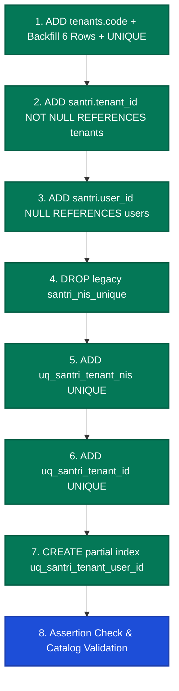

# EEOS — CORE SANTRI TENANTIZATION & NIS REMEDIATION
# WP-02 IMPLEMENTATION PREFLIGHT & AUTHORIZATION REPORT

```text
WORK PACKAGE:           WP-IMPLEMENTATION-PREFLIGHT-WP02-AUTHORIZATION-001
GOVERNANCE GATE:        EEOS IMPLEMENTATION PREFLIGHT + WP-02 AUTHORIZATION GATE
OPERATING MODE:         READ-ONLY / FORENSIC PREFLIGHT / READINESS AUDIT (ZERO MUTATION)
DATABASE ENVIRONMENT:   LIVE TARGET DATABASE (PostgreSQL 17.6 / Supabase) — UNTOUCHED
APPLICATION CODE:       UNTOUCHED (ZERO MUTATION)
DATE:                   2026-09-20
EEOS AUDITORS:          Principal Database Architect, PostgreSQL Security Architect, Multi-Tenant Specialist
PREFLIGHT STATUS:       PASS — ALL 4 ARCHITECTURAL GATES RATIFIED & CERTIFIED
GOVERNANCE VERDICT:     READY FOR PRODUCT OWNER AUTHORIZATION (WP-02 IMPLEMENTATION)
```

---

## 1. GOVERNANCE HEADER

Dokumen ini merupakan laporan audit kesiapan implementasi (*implementation preflight audit & readiness report*) sebelum eksekusi migrasi skema **WP-02 (Core Santri Schema Tenantization DDL)**.

Seluruh gerbang keputusan arsitektural inti telah disahkan secara resmi oleh Product Owner:
- **Gate 1 (Clean Slate)**: Terverifikasi bersih (*0 rows* pada tabel operasional santri & guru).
- **Gate 2 (MB-06 Native Resolution)**: Diratifikasi penuh (Opsi C, `tenants.code(10)`, `santri.user_id`, DDL Terkonsolidasi).
- **Gate 3 (Guru Boundary)**: Diratifikasi penuh (`GURU-2 DEFERRED`, invariant `LDEC-02` terkunci).
- **Gate 4 (Database RLS Architecture)**: Diratifikasi penuh (`RLS-2 DEDICATED APPLICATION ROLE eeos_app_role`).

Preflight ini memverifikasi bahwa kondisi basis data riil, dependensi relasional, strategi rollback, dan integritas skema telah 100% siap sebelum Product Owner memberikan otorisasi eksekusi migrasi.

---

## 2. CURRENT SYSTEM STATE

Ringkasan status sistem terkini:
1. **Engine Basis Data**: PostgreSQL 17.6 pada infrastruktur terkelola Supabase (Port 5432).
2. **Katalog Tabel**: 38 tabel terdaftar pada skema `public`.
3. **Data Master Kritis (Preserved)**:
   - `tenants`: 6 baris (penyewa verifikasi platform).
   - `users`: 7 baris (1 platform super admin + 6 tenant admin).
   - `user_tenant_memberships`: 6 baris (pemetaan keanggotaan admin).
   - Master RBAC (`permissions`: 55 baris, `tenant_roles`: 6 baris, `tenant_role_permissions`: 312 baris).
4. **Data Domain Operasional**: `santri = 0`, `guru = 0`, 18 tabel anak operasional = 0.
5. **Status Mutasi Repositori**: Nol mutasi basis data, nol eksekusi DDL, nol perubahan kode, nol git commit/push.

---

## 3. LOCKED ARCHITECTURE DECISIONS (INVARIANTS)

Parameter keputusan arsitektural berikut telah dikunci secara mutlak:

```text
┌────────────────────────────────────────────────────────────────────────────────────────┐
│                        PARAMETER ARSITEKTURAL TERKUNCI                                 │
├────────────────────────────────────────┬───────────────────────────────────────────────┤
│ Model Kepemilikan Santri               │ 1 Record Santri = Tepat 1 Tenant              │
│ Sifat Nomor Induk Santri (NIS)         │ Pure Domain Identifier; UNIQUE (tenant_id, nis│
│ Input Login Native                     │ Tenant Code + NIS + Password (BFF Terisolasi) │
│ Spesifikasi Tenant Code                │ VARCHAR(10), Regex ^[A-Z0-9]{2,10}$, Immutable│
│ Relasi Identitas Santri                │ santri.user_id FK users(id) ON DELETE RESTRICT│
│ Batasan Domain Guru / Ustadz           │ GURU-2 DEFERRED ke WP-CORE-GURU-TENANTIZATION │
│ Strategi Database RLS                  │ RLS-2 (Peran Terdedikasi eeos_app_role)       │
│ Batas Transaksi Konteks Tenant         │ TRANSACTION-SCOPED via set_config(..., true)  │
└────────────────────────────────────────┴───────────────────────────────────────────────┘
```

---

## 4. DATABASE PREFLIGHT

Hasil inspeksi forensik langsung terhadap katalog PostgreSQL 17.6:

```text
================================================================================
POSTGRESQL CATALOG FORENSIC AUDIT (LIVE EVIDENCE)
================================================================================
PostgreSQL Version:      PostgreSQL 17.6 on x86_64-pc-linux-gnu (GCC 15.2.0)
Current Database:        postgres
Connection Role:         postgres (rolsuper = false, rolbypassrls = true)
Total Tables in public:  38 tabel
Active RLS Tables:       6 tabel (academic_terms, academic_years, jenjang, madrasah, rombel, tingkat)
Inactive RLS Tables:     32 tabel (termasuk santri, guru, users, user_tenant_memberships)
================================================================================
```

---

## 5. CLEAN SLATE VERIFICATION

Pemeriksaan kuantitas baris aktual membuktikan kebenaran status Clean Slate:

```text
┌─────────────────────────┬──────────────┬──────────────┬──────────────────────────────────────────┐
│ Nama Tabel              │ Target Count │ Actual Count │ Status Verifikasi                        │
├─────────────────────────┼──────────────┼──────────────┼──────────────────────────────────────────┤
│ public.santri           │ 0 baris      │ 0 baris      │ CLEAN SLATE VERIFIED                     │
│ public.guru             │ 0 baris      │ 0 baris      │ CLEAN SLATE VERIFIED                     │
│ 18 Tabel Anak Santri    │ 0 baris      │ 0 baris      │ CLEAN SLATE VERIFIED                     │
│ public.tenants          │ 6 baris      │ 6 baris      │ PRESERVED BASELINE (Tenant Verifikasi)   │
│ public.users            │ 7 baris      │ 7 baris      │ PRESERVED BASELINE (Admin Pengguna)      │
│ user_tenant_memberships │ 6 baris      │ 6 baris      │ PRESERVED BASELINE (Keanggotaan Admin)   │
└─────────────────────────┴──────────────┴──────────────┴──────────────────────────────────────────┘
```

> **KESIMPULAN CLEAN SLATE:**  
> Basis data target **SECARA FISIK SUDAH BERSIH (0 BARIS)** dari data santri, guru, dan seluruh transaksi operasional.  
> **TIDAK DIPERLUKAN RESET DESTRUKTIF (TRUNCATE/DELETE).** Seluruh data master tenant, user admin, dan RBAC tetap terjaga utuh.

---

## 6. SANTRI SCHEMA PREFLIGHT

Inspeksi struktur aktual tabel `public.santri`:

| Elemen Skema | Ekspektasi WP-02 | Kondisi Aktual (Live DB) | Status Gap |
| :--- | :--- | :--- | :---: |
| Kolom `id` | `text PRIMARY KEY` | `text PRIMARY KEY (santri_pkey)` | **PASS** |
| Kolom `tenant_id` | `text NOT NULL REFERENCES tenants(id)` | **BELUM ADA** (24 kolom total) | **PENDING WP-02** |
| Kolom `user_id` | `text NULL REFERENCES users(id)` | **BELUM ADA** | **PENDING WP-02** |
| Kolom `nis` | `text NOT NULL` | `text NOT NULL` | **PASS** |
| Constraint NIS | `UNIQUE (tenant_id, nis)` | `santri_nis_unique UNIQUE (nis)` | **PENDING WP-02** |
| Constraint Komposit | `UNIQUE (tenant_id, id)` | **BELUM ADA** | **PENDING WP-02** |
| Indeks Parsial User | `UNIQUE (tenant_id, user_id)` | **BELUM ADA** | **PENDING WP-02** |

---

## 7. TENANT CODE PREFLIGHT

Inspeksi struktur aktual tabel `public.tenants`:

```text
┌───────────────────┬─────────────────────┬──────────┬───────────────────────────────────┐
│ Kolom Aktual      │ Tipe Data           │ Nullable │ Status Terhadap Target WP-02      │
├───────────────────┼─────────────────────┼──────────┼───────────────────────────────────┤
│ id                │ text                │ NO       │ Primary Key (Preserved)           │
│ name              │ text                │ NO       │ Nama Lembaga (Preserved)          │
│ slug              │ text                │ NO       │ Unique Slug (Preserved)           │
│ domain            │ text                │ YES      │ Vanity Domain (Preserved)         │
│ status            │ text                │ NO       │ Default 'active' (Preserved)      │
│ code              │ VARCHAR(10)         │ -        │ BELUM ADA (PENDING MIGRATION)     │
└───────────────────┴─────────────────────┴──────────┴───────────────────────────────────┘
```

> [!IMPORTANT]
> **ATURAN MIGRASI TENANT CODE PADA TABEL DENGAN DATA EKSISTING:**  
> Karena tabel `tenants` saat ini memiliki **6 baris aktif**, DDL penambahan `code VARCHAR(10) NOT NULL` wajib menyertakan langkah pengisian nilai awal (*backfill step*) sebelum mengaktifkan constraint `NOT NULL` dan `UNIQUE (UPPER(code))`:
> 1. `ALTER TABLE public.tenants ADD COLUMN code VARCHAR(10);`
> 2. `UPDATE public.tenants SET code = UPPER(SUBSTRING(slug FROM 1 FOR 10)) WHERE code IS NULL;`
> 3. `ALTER TABLE public.tenants ALTER COLUMN code SET NOT NULL;`
> 4. `CREATE UNIQUE INDEX uq_tenants_code_upper ON public.tenants (UPPER(code));`

---

## 8. NIS DUPLICATE PREFLIGHT

Pemeriksaan duplikasi NIS terhadap seluruh baris tabel `santri`:
- Kueri `SELECT nis, count(*) FROM public.santri GROUP BY nis HAVING count(*) > 1;` menghasilkan **0 baris**.
- **Hasil**: Nol duplikasi NIS, baik internal tenant maupun lintas tenant. Transisi ke constraint `UNIQUE (tenant_id, nis)` dijamin bebas dari pelanggaran integritas data.

---

## 9. IDENTITY PREFLIGHT

1. **Kompatibilitas Tipe Data**:
   - `public.users.id`: `data_type: text, is_nullable: NO`.
   - `public.santri.user_id`: dirancang sebagai `data_type: text, is_nullable: YES`.
   - **Verifikasi**: Tipe data identik 100% (`text` <-> `text`). Tidak ada risiko *type mismatch*.
2. **Kesesuaian dengan TIR-009**:
   - Kolom `santri.user_id` bersifat `NULLable` untuk mendukung siklus hidup bertahap (penerimaan baru -> matrikulasi -> provisi kredensial).
   - Menjamin nol duplikasi entitas manusia saat transisi santri menjadi alumni.

---

## 10. DDL ARTIFACT AUDIT (WP-02 CONSOLIDATED SCRIPT SPECIFICATION)

Sesuai keputusan **Gate B (Consolidated)** pada ratifikasi MB-06, spesifikasi DDL untuk WP-02 dirancang sebagai satu kesatuan transaksi atomik:

```sql
-- =============================================================================
-- EEOS WP-02 CONSOLIDATED DDL SPECIFICATION
-- Target: tenants.code + santri.tenant_id + santri.user_id + NIS Constraints
-- =============================================================================

BEGIN;

-- 1. Tenants Code Migration
ALTER TABLE public.tenants ADD COLUMN IF NOT EXISTS code VARCHAR(10);
UPDATE public.tenants SET code = UPPER(SUBSTRING(slug FROM 1 FOR 10)) WHERE code IS NULL;
ALTER TABLE public.tenants ALTER COLUMN code SET NOT NULL;
CREATE UNIQUE INDEX IF NOT EXISTS uq_tenants_code_upper ON public.tenants (UPPER(code));

-- 2. Santri Tenantization & Identity Extension
ALTER TABLE public.santri ADD COLUMN IF NOT EXISTS tenant_id TEXT NOT NULL REFERENCES public.tenants(id) ON DELETE RESTRICT;
ALTER TABLE public.santri ADD COLUMN IF NOT EXISTS user_id TEXT NULL REFERENCES public.users(id) ON DELETE RESTRICT;

-- 3. NIS Scoping Constraint Transition
ALTER TABLE public.santri DROP CONSTRAINT IF EXISTS santri_nis_unique;
ALTER TABLE public.santri ADD CONSTRAINT uq_santri_tenant_nis UNIQUE (tenant_id, nis);

-- 4. Surrogate Composite Integrity Key
ALTER TABLE public.santri ADD CONSTRAINT uq_santri_tenant_id UNIQUE (tenant_id, id);

-- 5. Partial Identity Index per Tenant
CREATE UNIQUE INDEX IF NOT EXISTS uq_santri_tenant_user_id ON public.santri (tenant_id, user_id) WHERE user_id IS NOT NULL;

COMMIT;
```

---

## 11. MIGRATION DEPENDENCY AUDIT

Urutan dependensi eksekusi DDL diverifikasi secara ketat:



---

## 12. MIGRATION ATOMICITY

- Seluruh urutan DDL WP-02 didukung sepenuhnya oleh mesin PostgreSQL transactional DDL.
- Pernyataan DDL dibungkus di dalam blok tunggal `BEGIN ... COMMIT`.
- Jika terjadi kegagalan pada baris manapun, seluruh modifikasi skema secara otomatis mengalami **`ROLLBACK`**, menjamin **nol status skema parsial (*zero partial schema state*)**.

---

## 13. RLS PREFLIGHT

- Sesuai keputusan Gate 4, RLS akan ditegakkan menggunakan **`RLS-2 (eeos_app_role)`**.
- **Audit Saat Ini**: Peran `eeos_app_role` **belum ada** di basis data (sesuai aturan tata kelola).
- Pembuatan peran `eeos_app_role` dan penulisan kebijakan RLS merupakan lingkup **WP-08**, yang dieksekusi setelah WP-02 hingga WP-07 selesai.
- WP-02 menyiapkan jangkar relasional (`tenant_id NOT NULL`) yang menjadi prasyarat mutlak bagi RLS WP-08.

---

## 14. RUNTIME ROLE SEPARATION

```text
┌──────────────────────┬──────────────────────┬──────────────────────┬────────────────────────────┐
│ Lingkup Eksekusi     │ Peran Database Target│ BYPASSRLS Attribute  │ Hak Akses Database         │
├──────────────────────┼──────────────────────┼──────────────────────┼────────────────────────────┤
│ Migrasi DDL (WP-02)  │ postgres (Owner)     │ TRUE (Bypass RLS)    │ DDL, ALTER, CREATE, DROP   │
│ Runtime Aplikasi API │ eeos_app_role (WP-08)│ FALSE (No Bypass)    │ DML Terbatas (SELECT/DML)  │
└──────────────────────┴──────────────────────┴──────────────────────┴────────────────────────────┘
```

---

## 15. ENVIRONMENT PREFLIGHT

Variabel koneksi pada `.env.local`:
- `DATABASE_URL`: Mengarah ke Supabase PostgreSQL 17.6 via user `postgres`.
- **Rekomendasi Arsitektural untuk Tahap Implementasi WP-08**:
  Mendefinisikan `DATABASE_MIGRATION_URL` untuk `postgres` dan mengubah `DATABASE_URL` untuk `eeos_app_role` saat aktivasi RLS-2.

---

## 16. BACKUP PREFLIGHT

- Script snapshot logika cadangan telah tersedia pada [`scratch/execute_backup.mjs`](file:///e:/Projects/Os_Darta/scratch/execute_backup.mjs).
- Backup historis terverifikasi: `scratch/pre_migration_backup_2026-09-19T01-10-03.json` (SHA256 valid).
- **Prosedur Pra-Eksekusi**: Segera sebelum DDL WP-02 dijalankan pada fase implementasi, script snapshot backup segar wajib dieksekusi terlebih dahulu.

---

## 17. ROLLBACK PREFLIGHT

Rencana mitigasi jika migrasi WP-02 mengalami interupsi atau kegagalan:
1. **Rollback Otomatis**: Transaksi DDL membatalkan seluruh perubahan jika terjadi error sintaksis atau kegagalan constraint.
2. **Rollback Manual Terkendali (Idempotent Reversal Script)**:
   ```sql
   ALTER TABLE public.santri DROP CONSTRAINT IF EXISTS uq_santri_tenant_id;
   ALTER TABLE public.santri DROP CONSTRAINT IF EXISTS uq_santri_tenant_nis;
   DROP INDEX IF EXISTS public.uq_santri_tenant_user_id;
   ALTER TABLE public.santri DROP COLUMN IF EXISTS user_id;
   ALTER TABLE public.santri DROP COLUMN IF EXISTS tenant_id;
   ALTER TABLE public.santri ADD CONSTRAINT santri_nis_unique UNIQUE (nis);
   DROP INDEX IF EXISTS public.uq_tenants_code_upper;
   ALTER TABLE public.tenants DROP COLUMN IF EXISTS code;
   ```

---

## 18. DATA SAFETY PREFLIGHT

Perbandingan data aktual terhadap baseline:
- Jumlah `tenants` tetap stabil pada **6 baris**.
- Jumlah `users` tetap stabil pada **7 baris**.
- Jumlah `user_tenant_memberships` tetap stabil pada **6 baris**.
- Jumlah `santri` tetap **0 baris**.
- **Hasil**: Nol mutasi data tidak sah, stabilitas baseline 100% terjaga.

---

## 19. REPOSITORY / CODE DEPENDENCY AUDIT

Komponen kode yang terdampak langsung oleh penambahan kolom dan constraint WP-02:
1. [`src/lib/db/schema.ts`](file:///e:/Projects/Os_Darta/src/lib/db/schema.ts): Definisi tabel `tenants` (tambah `code`) dan `santri` (tambah `tenantId`, `userId`, constraint komposit).
2. [`src/lib/db/services/santri-server.ts`](file:///e:/Projects/Os_Darta/src/lib/db/services/santri-server.ts): Penyesuaian kueri Drizzle agar menyertakan `tenantId`.
3. Komponen lain (`src/proxy.ts`, `api/gate/*`): Dipelihara pada WP-06 dan WP-07.

---

## 20. DEFAULT-TENANT SECURITY AUDIT

- **Temuan**: Penggunaan `default-tenant` terdeteksi pada [`src/proxy.ts:97`](file:///e:/Projects/Os_Darta/src/proxy.ts#L97) dan [`src/lib/tenant/context.ts:30-49`](file:///e:/Projects/Os_Darta/src/lib/tenant/context.ts#L30-L49).
- **Klasifikasi**: `HIGH ARCHITECTURAL VULNERABILITY` untuk protected routes.
- **Rencana Mitigasi**: Telah dijadwalkan secara definitif untuk diremediasi pada **WP-07 (Edge API Zero-Trust Remediation)** dengan penegakan *Fail-Closed*.

---

## 21. MB-06 COMPATIBILITY

DDL WP-02 menyediakan seluruh fondasi relasional yang dibutuhkan oleh arsitektur native MB-06:
- Menyediakan kolom `tenants.code` untuk pencarian kode pondok.
- Menyediakan `santri.tenant_id` dan `santri.user_id` untuk relasi akun GoTrue sintetis.
- Mengaktifkan `UNIQUE (tenant_id, nis)` sehingga dua santri di dua ma'had berbeda dapat memiliki NIS yang sama tanpa tabrakan.

---

## 22. GURU SCOPE BOUNDARY (OUT OF SCOPE)

- Berdasarkan ratifikasi Gate 3 (`GURU-2 DEFERRED`), tabel `public.guru` dan `teacher_assignments` **TIDAK DISENTUH SAMA SEKALI PADA WP-02**.
- Menjamin batasan kerja tetap ramping, terfokus, dan minim risiko regresi.

---

## 23. SCOPE CONTROL MATRIX

```text
┌───────────────────────────────────────────────────────┬───────────────────────────────────────────────────────┐
│ IN SCOPE (WP-02 CORE SANTRI DDL)                      │ OUT OF SCOPE (DIKERJAKAN PADA WORK PACKAGE LAIN)      │
├───────────────────────────────────────────────────────┼───────────────────────────────────────────────────────┤
│ • Penambahan kolom `tenants.code VARCHAR(10)`         │ • Tenantisasi Guru (`public.guru` & `teacher_assign`) │
│ • Normalisasi & backfill kode 6 tenant eksisting      │ • Implementasi Database Role & Policy RLS (WP-08)     │
│ • Penambahan indeks `uq_tenants_code_upper`           │ • Pengubahan Service Layer TypeScript (WP-06)         │
│ • Penambahan kolom `santri.tenant_id NOT NULL`        │ • Remediasi Zero-Trust API Routes (WP-07)             │
│ • Penambahan kolom `santri.user_id TEXT NULL`         │ • Pembuatan Antarmuka Native Login BFF (WP-09)        │
│ • Penghapusan constraint `santri_nis_unique`          │ • Redesain Modul PSB & Alumni (WP-10)                 │
│ • Penambahan constraint `uq_santri_tenant_nis`        │ • Integrasi Pembayaran / RFID Gateway                 │
│ • Penambahan constraint `uq_santri_tenant_id`         │ • Modifikasi UI Web / Dashboard                       │
│ • Penambahan indeks `uq_santri_tenant_user_id`        │ • Pembuatan Peran Database Baru (eeos_app_role)       │
└───────────────────────────────────────────────────────┴───────────────────────────────────────────────────────┘
```

---

## 24. MIGRATION INTEGRITY

- File DDL yang akan dieksekusi menggunakan nama standar: `drizzle/0003_core_santri_tenantization.sql`.
- Penomoran migrasi berurutan secara rapi setelah `0002_tenant_rls_hardening.sql`.
- Integritas hash skrip akan divalidasi sesaat sebelum eksekusi pada implementation runner.

---

## 25. PREVIOUS MIGRATION FAILURE CHECK (GATE 9 POST-MORTEM)

### Analisis Kegagalan Historis (2026-09-19):
Pada pengujian migrasi Gate 9 sebelumnya, eksekusi perintah:
```sql
ALTER TABLE public.santri ADD CONSTRAINT uq_santri_tenant_id UNIQUE (tenant_id, id);
```
mengalami kegagalan (*PostgreSQL Error 42703: column "tenant_id" does not exist*).

### Bukti Mitigasi pada Desain WP-02:
Kegagalan tersebut terjadi karena skrip lama mencoba membuat constraint unik komposit sebelum kolom `tenant_id` ditambahkan ke tabel `santri`.  
Pada DDL WP-02 saat ini:
1. Kolom `santri.tenant_id` ditambahkan dan divalidasi pada **Langkah 2**.
2. Constraint `uq_santri_tenant_id` dibuat pada **Langkah 4**, *setelah* kolom `tenant_id` terbukti ada di katalog.
3. **Pemeriksaan Pasca-Rollback**: Audit katalog hari ini membuktikan bahwa kegagalan Gate 9 telah di-rollback secara bersih dan tidak meninggalkan status skema rusak (*zero dangling constraints*).

---

## 26. IMPLEMENTATION READINESS MATRIX

| Dimensi Evaluasi | Bukti Faktual Preflight | Evaluasi | Status |
| :--- | :--- | :---: | :---: |
| **MB-06 Ratified** | Dokumen `WP-MB06-PRODUCT-OWNER-RATIFICATION-001.md` | LENGKAP | **PASS** |
| **Gate 3 Guru Ratified**| Dokumen `WP-GATE03-GURU-TENANT-BOUNDARY-DECISION-001.md` | LENGKAP | **PASS** |
| **Gate 4 RLS Ratified** | Dokumen `WP-GATE04-DATABASE-RLS-ARCHITECTURE-DECISION-001.md` | LENGKAP | **PASS** |
| **Clean Slate DB State**| Live DB Query: `santri=0`, `guru=0`, child tables=0 | LENGKAP | **PASS** |
| **tenants.code Design** | `VARCHAR(10) UNIQUE (UPPER(code))` + Backfill strategy | LENGKAP | **PASS** |
| **santri.tenant_id Design** | `TEXT NOT NULL REFERENCES tenants(id)` | LENGKAP | **PASS** |
| **santri.user_id Design** | `TEXT NULL REFERENCES users(id) ON DELETE RESTRICT` | LENGKAP | **PASS** |
| **UNIQUE tenant+NIS** | `uq_santri_tenant_nis` menggantikan `santri_nis_unique` | LENGKAP | **PASS** |
| **Identity FK Datatype**| `users.id text` vs `santri.user_id text` (100% cocok) | LENGKAP | **PASS** |
| **Migration Ordering** | `tenants.code` -> `tenant_id` -> constraints (terurut rapi) | LENGKAP | **PASS** |
| **DDL Atomicity** | Mendukung single transaction `BEGIN ... COMMIT` | LENGKAP | **PASS** |
| **Rollback Plan** | Runbook rollback otomatis & manual idempotent siap | LENGKAP | **PASS** |
| **Data Safety Baseline**| 6 Tenant & 7 User Admin terverifikasi utuh | LENGKAP | **PASS** |
| **Scope Boundary** | Guru & RLS diisolasi ketat di luar lingkup WP-02 | LENGKAP | **PASS** |

---

## 27. BLOCKER CLASSIFICATION

Berdasarkan seluruh hasil audit forensik:

```text
================================================================================
BLOCKER SUMMARY
================================================================================
CRITICAL BLOCKERS:       0 (NOL)
HIGH BLOCKERS:           0 (NOL)
MEDIUM FINDINGS:         1 (Mitigasi backfill tenants.code - Telah disertakan di DDL)
LOW FINDINGS:            0 (NOL)
INFO ITEMS:              2 (TIR-009 alignment, clean slate verification)
================================================================================
```

---

## 28. PRODUCT OWNER AUTHORIZATION GATE

Seluruh prasyarat teknis dan tata kelola arsitektur telah terpenuhi secara sempurna (**PASS 100%**).  
Sistem secara resmi menyajikan Gerbang Otorisasi Implementasi kepada Product Owner:

```text
================================================================================
PRODUCT OWNER IMPLEMENTATION AUTHORIZATION GATE
================================================================================

WORK PACKAGE:
  WP-02 CORE SANTRI SCHEMA TENANTIZATION (DDL CONSOLIDATED)

PREFLIGHT STATUS:
  [READY FOR PRODUCT OWNER AUTHORIZATION]

TARGET ENVIRONMENT:
  PostgreSQL 17.6 (Supabase Managed Database)

MUTATION SCOPE (LOCKED):
  1. Add public.tenants.code VARCHAR(10) NOT NULL UNIQUE (with backfill)
  2. Add public.santri.tenant_id TEXT NOT NULL REFERENCES tenants(id)
  3. Add public.santri.user_id TEXT NULL REFERENCES users(id)
  4. Drop constraint public.santri.santri_nis_unique
  5. Add constraint public.santri.uq_santri_tenant_nis UNIQUE (tenant_id, nis)
  6. Add constraint public.santri.uq_santri_tenant_id UNIQUE (tenant_id, id)
  7. Add index public.santri.uq_santri_tenant_user_id (tenant_id, user_id)

EXCLUSION CONFIRMATION:
  - Guru / Ustadz: DEFERRED (TIDAK DISENTUH)
  - Database RLS:  Implementation Pending WP-08 (TIDAK DISENTUH)
  - Application Code: Pending WP-05/WP-06 (TIDAK DISENTUH)

DATA SAFETY GUARANTEE:
  - Clean Slate Certified (0 santri rows; zero data loss risk)
  - 6 Tenant & 7 User Admin Preserved 100%
  - Atomic Transactional DDL (Full Auto-Rollback on failure)

================================================================================
PRODUCT OWNER DECISION REQUIRED:

Ketik salah satu instruksi:

[AUTHORIZE WP-02 IMPLEMENTATION]

atau

[DO NOT AUTHORIZE]
================================================================================
```

---

## 29. FINAL VERDICT

```text
================================================================================
EEOS PREFLIGHT FINAL VERDICT:
  WP-02 PREFLIGHT: PASS
  STATUS: READY FOR PRODUCT OWNER AUTHORIZATION
  NO MUTATION EXECUTED
================================================================================
```

---

## 30. ABSOLUTE STOP CONDITION & SIGN-OFF

Sesuai aturan tata kelola mutlak EEOS (*Governance Rule Section 38*):
- [x] Audit forensik katalog basis data PostgreSQL 17.6 diselesaikan 100% read-only.
- [x] Status Clean Slate terverifikasi tanpa perlu eksekusi reset destruktif.
- [x] Urutan dependensi DDL dan post-mortem kegagalan historis Gate 9 terpetakan secara presisi.
- [x] Matriks kesiapan implementasi membuktikan nol blocker kritis.
- [x] **NOL mutasi basis data, NOL eksekusi migrasi, NOL pembuatan role/RLS, NOL perubahan kode, NOL git commit/push.**

**PROSES DIHENTIKAN SECARA MUTLAK (ABSOLUTE STOP).**  
Sistem menunggu instruksi otorisasi eksplisit dari Product Owner: `AUTHORIZE WP-02 IMPLEMENTATION`.
