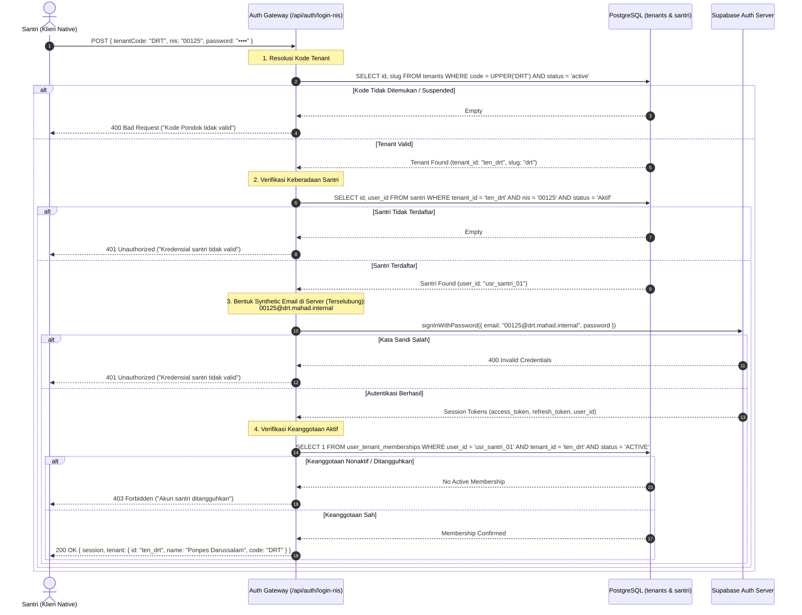
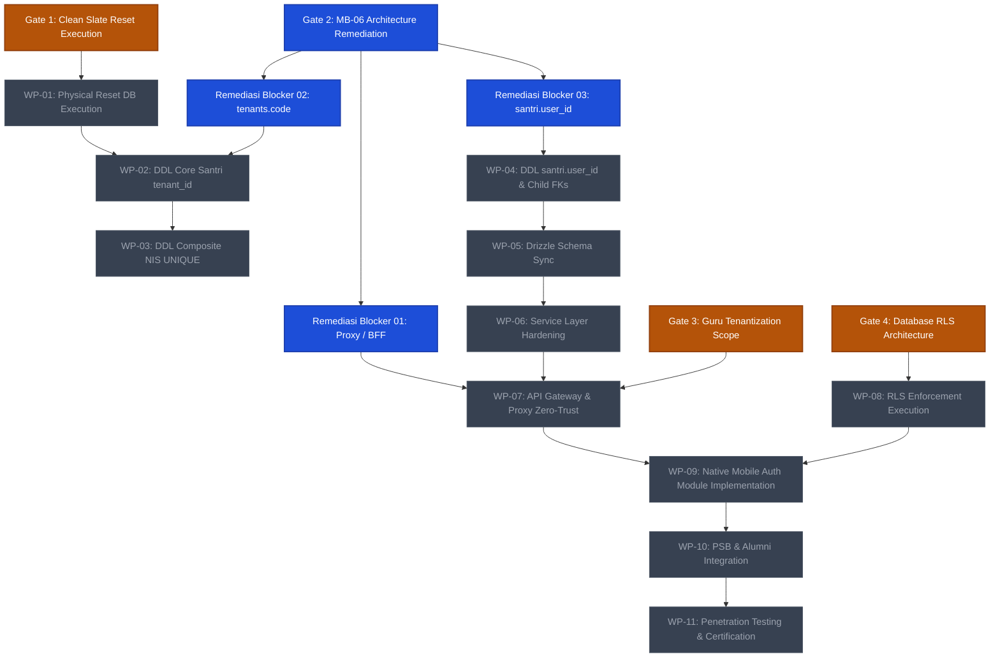

# EEOS — CORE SANTRI TENANTIZATION & NIS REMEDIATION
# ARCHITECTURAL BLOCKER REMEDIATION REPORT

```text
WORK PACKAGE:           WP-MB06-ARCHITECTURAL-BLOCKER-REMEDIATION-001
PRIMARY GATE:           EEOS ARCHITECTURE REMEDIATION GATE (POST-MB-06)
OPERATING MODE:         READ-ONLY / DESIGN & ARCHITECTURE SPECIFICATION ONLY (ZERO MUTATION)
SOURCE ARTIFACT:        docs/architecture/WP-MB06-NATIVE-TENANT-RESOLUTION-DECISION-001.md
DATE:                   2026-09-20
EEOS ARCHITECTS:        Senior Principal Systems Architect, Database Architect, Security Architect
GOVERNANCE VERDICT:     ARCHITECTURALLY READY FOR RATIFICATION & IMPLEMENTATION PLANNING
```

---

## 1. EXECUTIVE SUMMARY

Pada Product Owner Decision Gate #2 ([`WP-MB06-NATIVE-TENANT-RESOLUTION-DECISION-001.md`](file:///e:/Projects/Os_Darta/docs/architecture/WP-MB06-NATIVE-TENANT-RESOLUTION-DECISION-001.md)), model bisnis aplikasi native disahkan secara resmi: **Satu Native App + Satu Login Surface + Tenant Code sebagai konteks login NIS + Resolusi Membership untuk Email + Persistent Authentication Session**.

Namun, audit konsistensi terhadap basis kode dan skema basis data eksisting mengidentifikasi **tiga kontradiksi arsitektural konkret** (*architectural blockers*):
1. **Blocker 01 (Native Tenant Resolution & Proxy Context)**: Middleware [`src/proxy.ts`](file:///e:/Projects/Os_Darta/src/proxy.ts) dan helper [`src/lib/tenant/context.ts`](file:///e:/Projects/Os_Darta/src/lib/tenant/context.ts) saat ini hanya mengenali tenant melalui prefix URL path `/t/:slug` atau subdomain hostname. Request aplikasi native universal menuju endpoint bersama (`api.mahad-app.com`) secara keliru jatuh ke fallback `'default-tenant'` dan mengabaikan JWT Bearer token.
2. **Blocker 02 (Ketiadaan Kolom Tenant Code)**: Skema tabel `tenants` hanya memiliki `id`, `name`, `slug`, `domain`, dan `status`. Tidak ada representasi skema `code` untuk memetakan input pengguna (misal `DRT`) ke tenant yang memiliki slug deskriptif (misal `pesantren-darussalam`).
3. **Blocker 03 (Ketiadaan Relasi Identitas `santri.user_id`)**: Tabel `public.santri` belum memiliki kolom foreign key `user_id` yang menunjuk ke `public.users(id)`. Hal ini memutus mata rantai relasional antara catatan santri dengan identitas autentikasi Supabase Auth (`auth.users`).

Laporan ini menyajikan **desain remediasi arsitektural lengkap dan definitif** untuk menutup ketiga blocker tersebut tanpa melakukan mutasi basis data, migrasi skema, ataupun modifikasi kode (*Zero-Mutation Compliance*).

---

## 2. CURRENT MB-06 DECISION (LOCKED BUSINESS INVARIANTS)

Sesuai otorisasi Product Owner pada Decision Gate #2, parameter bisnis berikut telah dikunci (*immutable*):

```text
┌────────────────────────────────────────────────────────────────────────────────────────┐
│                        LOCKED BUSINESS DECISION (MB-06)                                │
├────────────────────────────────────────┬───────────────────────────────────────────────┤
│ Domain Model                           │ Satu Pesantren/Tenant memiliki Santri & Guru  │
│ Aplikasi Native                        │ Satu aplikasi global di App Store & Play Store│
│ Login Surface                          │ Satu antarmuka terpadu (Tab NIS & Tab Email)  │
│ NIS Karakteristik                      │ Identifier domain murni; TIDAK di-prefix code │
│ Database Constraint Target             │ UNIQUE (tenant_id, nis)                       │
│ Tenant Code                            │ Konteks pencarian awal; BUKAN sumber otorisasi│
│ Email Login                            │ Menggunakan identity-to-membership resolution │
│ Sesi Native                            │ Persisten (SecureStore); App Close != Logout  │
│ Logout Rule                            │ Hanya pada tindakan eksplisit pengguna/revoke │
│ Otoritas Keamanan                      │ JWT + Membership Valid + Server Context + RLS │
│ Status Device Cache                    │ Zero-Trust; Tidak pernah menjadi bukti hak    │
└────────────────────────────────────────┴───────────────────────────────────────────────┘
```

---

## 3. BLOCKER 01 — NATIVE TENANT RESOLUTION & PROXY CONTEXT

### 3.1 Evaluasi Opsi Arsitektur

Untuk menentukan bagaimana request dari aplikasi native menetapkan `tenant_id` yang sah di sisi server tanpa bergantung pada subdomain web, tiga opsi arsitektur dievaluasi secara objektif:

```text
┌─────────────────────────┬────────────────────────────┬────────────────────────────┬────────────────────────────┐
│ Kriteria Evaluasi       │ Opsi A: JWT Claim Minting  │ Opsi B: Client Header Only │ Opsi C: Hybrid Context +   │
│                         │ (Custom Claims Hook)       │ (x-tenant-id dari Klien)   │ Active Membership Cache    │
├─────────────────────────┼────────────────────────────┼────────────────────────────┼────────────────────────────┤
│ Mekanisme               │ Token JWT mencetak         │ Klien mengirim header      │ Klien mengirim Bearer JWT  │
│                         │ `tenant_id` dalam payload  │ `x-tenant-id`; server      │ + target tenant intent;    │
│                         │ saat login.                │ percaya header tersebut.   │ server validasi membership │
│ Isolasi Multi-Tenant    │ Tinggi (terkunci di kripto)│ NOL (Kritis: Rawan IDOR    │ TERTINGGI (Zero-Trust      │
│                         │                            │ dan manipulasi header).    │ validasi di setiap layer). │
│ Fleksibilitas Switch    │ Rendah (Wajib re-mint /    │ Tinggi, namun tidak aman.  │ TINGGI (Switch instan      │
│                         │ refresh token tiap switch) │                            │ tanpa re-mint token JWT).  │
│ Kompatibilitas RLS      │ Sangat Baik                │ Buruk (Header rentan spoof)│ Sangat Baik (Stamping aman)│
│ Kompatibilitas Web      │ Memerlukan sinkronisasi    │ Kompatibel                 │ Unifikasi penuh Web &      │
│                         │ cookie session.            │                            │ Native API.                │
│ Latensi / Overhead      │ Nol query DB per request.  │ Nol query, risiko jebol.   │ Mikro-cache (< 1ms) atau   │
│                         │                            │                            │ query DB terindeks.        │
│ Verdict                 │ TIDAK DIREKOMENDASIKAN     │ DITOLAK MUTLAK             │ DIREKOMENDASIKAN (TERPILIH)│
└─────────────────────────┴────────────────────────────┴────────────────────────────┴────────────────────────────┘
```

### 3.2 Keputusan Arsitektur: Opsi C (Server-Validated Context Architecture)

Kami menetapkan **Opsi C** sebagai arsitektur standar enterprise EEOS:

1. **Prinsip Zero-Trust Client**: Header yang dikirim oleh klien native (misal `X-Tenant-Context: ten_001` atau URL query) dianggap sebagai **pernyataan niat (intent)**, bukan **otoritas otorisasi**.
2. **Server-Side Token Extraction**:
   - Proxy / Gateway mengekstrak `Authorization: Bearer <jwt>`.
   - Mengautentikasi token via Supabase GoTrue -> menghasilkan `auth.uid()`.
3. **Membership Validation & Context Stamping**:
   - Gateway memvalidasi relasi keanggotaan pada tabel `user_tenant_memberships`:
     ```sql
     SELECT tenant_id, primary_role_id, status 
     FROM public.user_tenant_memberships 
     WHERE user_id = :auth_uid 
       AND tenant_id = :requested_tenant_id 
       AND status = 'ACTIVE';
     ```
   - **Jika Valid**: Gateway menimpa (*overwrite*) header request hilir menjadi `x-tenant-id = :verified_tenant_id` dan `x-user-id = :auth_uid`. Menghilangkan celah IDOR.
   - **Jika Tidak Valid / Ditolak / Dihapus**: Gateway langsung memutus request dengan status **HTTP 403 Forbidden** (*Fail Closed*).
   - **Jika Klien Tidak Mengirimkan Target Tenant**:
     - Jika pengguna hanya memiliki **1 keanggotaan aktif**: Server mengotomatisasi konteks ke tenant tunggal tersebut.
     - Jika pengguna memiliki **> 1 keanggotaan aktif**: Server menolak request dengan status **HTTP 400 Bad Request** / **409 Conflict** (`TENANT_CONTEXT_REQUIRED`), mewajibkan aplikasi native menampilkan antarmuka pemilihan tenant.
4. **Pemberantasan Default Fallback**:
   - Menghapus aturan `resolvedTenantId = 'default-tenant'` untuk seluruh rute terproteksi (`/api/*`). Request tanpa identitas dan tanpa konteks yang sah wajib menghasilkan **401 Unauthorized** atau **403 Forbidden**.

### 3.3 Alur Autentikasi NIS Terpadu (BFF Endpoint: `/api/auth/login-nis`)

Klien native tidak berinteraksi langsung dengan GoTrue untuk login NIS, melainkan melalui Backend-For-Frontend (BFF) rute terisolasi:



### 3.4 Alur Pergantian Tenant (Tenant Switching)
Jika seorang Wali Santri memiliki santri di dua pondok (Pondok A dan Pondok B):
1. Pengguna membuka profil dan menekan tombol **"Ganti Lembaga"**.
2. Aplikasi memanggil `GET /api/auth/memberships`. Server memvalidasi Bearer token dan mengembalikan daftar tenant di mana pengguna berstatus `ACTIVE`.
3. Pengguna memilih Pondok B.
4. Aplikasi memperbarui cache lokal `active_tenant_id = ten_b` pada SecureStore.
5. Request API berikutnya menyertakan header `X-Tenant-Context: ten_b`.
6. Gateway server memvalidasi keanggotaan `(user_id, ten_b)`. Karena sah, gateway menstempel `x-tenant-id: ten_b` ke request hilir.
7. **Keamanan**: Jika pengguna mencoba memanipulasi header menjadi `X-Tenant-Context: ten_c` (di mana ia bukan anggota), gateway mendeteksi ketiadaan membership dan mengembalikan **403 Forbidden**.

---

## 4. BLOCKER 02 — TENANT CODE

### 4.1 Perbandingan Mendalam: `tenants.code` vs `tenants.slug`

```text
┌─────────────────────────┬───────────────────────────────────┬───────────────────────────────────┐
│ Dimensi                 │ Opsi 1: Kolom Baru `tenants.code` │ Opsi 2: Menggunakan `tenants.slug`│
├─────────────────────────┼───────────────────────────────────┼───────────────────────────────────┤
│ Format Nilai            │ Ringkas, Alfanumerik Uppercase    │ URL-friendly, Kebab-case Lowercase│
│                         │ (Contoh: `DRT`, `ALF`, `NS01`)    │ (Contoh: `pesantren-darussalam`)  │
│ Kenyamanan Input Klien  │ SANGAT TINGGI (3–6 huruf, mudah   │ RENDAH (Panjang, rawan typo pada  │
│ (UX Mobile)             │ diketik di keyboard ponsel).      │ layar sentuh ponsel).             │
│ Stabilitas Identifier   │ PERMANEN (Dicetak pada kartu ID   │ Rawan berubah jika institusi      │
│                         │ santri, seragam, & tanda terima). │ mengganti URL/branding web.       │
│ Dampak Rebranding Web   │ Nol dampak (Kode fisik tetap).    │ Merusak kartu santri jika slug    │
│                         │                                   │ diubah untuk SEO / vanity domain. │
│ Keunikan Global         │ Unique Constraint Case-Insensitive│ Unique Constraint Lowercase       │
│ Routing Web             │ Tidak terpengaruh                 │ Terikat langsung dengan path web  │
│ Kompatibilitas Legacy   │ Additive (Nol breaking change)    │ Memaksa slug pendek jika ingin    │
│                         │                                   │ mudah diketik santri.             │
│ Verdict                 │ DIREKOMENDASIKAN (TERPILIH)       │ TIDAK DIREKOMENDASIKAN            │
└─────────────────────────┴───────────────────────────────────┴───────────────────────────────────┘
```

### 4.2 Spesifikasi Keputusan Arsitektur: `tenants.code`

Kami menetapkan **Opsi 1 (`tenants.code`)** sebagai keputusan definitif:

```text
================================================================================
SPESIFIKASI KANONIKAL TENANT CODE
================================================================================
Tenant Code Source:      Database Column `public.tenants.code`
Canonical Field:         tenants.code
Data Type:               VARCHAR(10) NOT NULL
Format Rule:             Regex: ^[A-Z0-9]{2,10}$ (Uppercase alfanumerik murni)
Uniqueness:              Globally Unique across platform (uq_tenants_code)
Mutability:              IMMUTABLE (Dilarang diubah setelah ditetapkan)
Normalisasi Input:       Server otomatis mengeksekusi TRIM(UPPER(code))

Digunakan Untuk:
  1. Input kode institusi pada antarmuka login NIS aplikasi native mobile.
  2. Prefix visual penomoran kartu tanda pengenal santri (smartcard RFID).
  3. Identifikasi singkat pada pesan notifikasi WhatsApp/SMS Gateway.
  4. Resolusi cepat pencarian tenant pada rute BFF `/api/auth/login-nis`.

TIDAK Digunakan Untuk:
  1. Primary Key basis data (Primary key tetap `tenants.id`).
  2. Foreign Key relasi tabel (Seluruh child table tetap merujuk ke `tenants.id`).
  3. Routing URL web aplikasi (Web tetap menggunakan `tenants.slug` atau custom domain).
  4. Sumber otorisasi keamanan (Otorisasi tetap berbasis keanggotaan terverifikasi).
================================================================================
```

### 4.3 Aturan Skema & Kendali Integritas Basis Data
1. **Target Constraint**:
   ```sql
   ALTER TABLE public.tenants ADD COLUMN code VARCHAR(10);
   -- Normalisasi & pembersihan dilakukan sebelum unique constraint
   CREATE UNIQUE INDEX uq_tenants_code_upper ON public.tenants (UPPER(code));
   ALTER TABLE public.tenants ALTER COLUMN code SET NOT NULL;
   ```
2. **Penanganan Konflik (Collision Handling)**:
   - Validasi saat pendaftaran tenant baru: Sistem menolak pendaftaran jika `UPPER(code)` telah terdaftar.
   - Pengecekan kata tercemar (*reserved codes*): Kode `APP`, `API`, `ROOT`, `SYS`, `ADMIN`, `DEV`, `SUPER` dilarang digunakan sebagai kode tenant.

---

## 5. BLOCKER 03 — SANTRI USER IDENTITY RELATION

### 5.1 Siklus Hidup Santri & Waktu Wajib Relasi Identitas

Pertanyaan mendasar: *Apakah `santri.user_id` harus `NOT NULL` sejak awal record dibuat?*  
**Jawaban Arsitektural: TIDAK.**

Santri melewati beberapa fase hidup dalam platform:

```text
┌────────────────────────────────────────────────────────────────────────────────────────┐
│                        SIKLUS HIDUP IDENTITAS SANTRI                                   │
├─────────────┬──────────────────────────┬──────────────────────┬────────────────────────┤
│ Tahapan     │ Status Domain            │ `santri.user_id`     │ Rekening Autentikasi   │
├─────────────┼──────────────────────────┼──────────────────────┼────────────────────────┤
│ 1. PSB      │ Calon Santri terdaftar di│ Belum ada record di  │ Wali memiliki akun     │
│             │ `psb_applicants`         │ tabel `santri`       │ `public.users`         │
├─────────────┼──────────────────────────┼──────────────────────┼────────────────────────┤
│ 2. Diterima │ Kelulusan disahkan di    │ Record `santri` baru │ Belum diprovisi        │
│             │ `psb_acceptance_ledgers` │ dibuat (user_id NULL)│                        │
├─────────────┼──────────────────────────┼──────────────────────┼────────────────────────┤
│ 3. Matrikulasi Batch import santri /   │ `NULL` (Pending      │ Kredensial belum       │
│    Awal     │ registrasi massal pondok │ Provisioning)        │ digenerate             │
├─────────────┼──────────────────────────┼──────────────────────┼────────────────────────┤
│ 4. Provisi  │ Administrator menekan    │ POPULATED            │ `auth.users` &         │
│    Kredensial "Generate Akun Santri"   │ (Menunjuk ke UID)    │ `public.users` dibuat  │
├─────────────┼──────────────────────────┼──────────────────────┼────────────────────────┤
│ 5. Aktif    │ Santri aktif belajar &   │ NOT NULL (Mandatori  │ Sesi login native      │
│             │ menggunakan mobile app   │ untuk login native)  │ aktif via NIS          │
├─────────────┼──────────────────────────┼──────────────────────┼────────────────────────┤
│ 6. Alumni   │ Santri lulus; snapshot   │ PRESERVED            │ Ditransisikan via      │
│             │ dibuat di `alumni_*`     │ (Arsip relasional)   │ TIR-009 / Consolidation│
└─────────────┴──────────────────────────┴──────────────────────┴────────────────────────┘
```

### 5.2 Spesifikasi Keputusan Arsitektur: `santri.user_id`

```text
================================================================================
SPESIFIKASI RELASI IDENTITAS SANTRI
================================================================================
Definisi Kolom:          public.santri.user_id text NULL
Relasi Foreign Key:      REFERENCES public.users(id) ON DELETE RESTRICT
Kardinalitas per Tenant: 1 : 1 (Satu user_id hanya dapat memiliki 1 record santri di tenant yang sama)
Constraint Unik:         CREATE UNIQUE INDEX uq_santri_tenant_user_id 
                         ON public.santri (tenant_id, user_id) 
                         WHERE user_id IS NOT NULL;
Waktu Wajib Terisi:      Sebelum santri diizinkan login melalui aplikasi native (Fase 5).
                         Boleh bernilai NULL pada fase registrasi awal/draft (Fase 2 & 3).
================================================================================
```

### 5.3 Kompatibilitas dengan TIR-009 & Identity Consolidation
1. **Preservasi Identitas Kanonikal**:
   - Ketika santri lulus dan bertransisi menjadi alumni, santri mungkin ingin mengklaim akunnya menggunakan email/nomor ponsel pribadi (bukan email sintetis madrasah).
   - Melalui prosedur **TIR-009 (Identity Consolidation)**:
     - Akun personal baru dicatat di `public.users`.
     - Record konsolidasi ditulis ke `identity_consolidation_ledgers` dengan `merged_into_user_id = :canonical_uid`.
     - Record `santri.user_id` diperbarui untuk menunjuk ke `:canonical_uid` (atau dipertahankan dengan rekam jejak konsolidasi ledger).
     - Persona baru ditambahkan pada `user_tenant_personas(tenant_id, user_id, persona_type = 'ALUMNI')`.
2. **Dukungan Dual-Persona (Wali + Alumni)**:
   - Seorang alumni yang di masa depan menjadi wali santri di pondok yang sama memiliki satu rekaman identitas manusia di `public.users`.
   - Di dalam `user_tenant_personas`, ia memiliki dua baris: `persona_type = 'ALUMNI'` dan `persona_type = 'WALI'`.
   - Arsitektur ini mencegah duplikasi record manusia dan sepenuhnya selaras dengan kontrak yang disahkan pada `WP-PSB-ALUMNI-DDL-DESIGN-001`.

### 5.4 Kompatibilitas dengan Tenantization Murni (`UNIQUE (tenant_id, nis)`)
Relasi `santri.user_id` sama sekali tidak melanggar batasan multi-tenant:
- Setiap record `santri` memiliki `tenant_id` eksplisit.
- Jika santri pindah ke pondok lain (Tenant B), di Tenant B akan dibuat record `santri` baru dengan `tenant_id = B` dan `nis = [NIS Tenant B]`.
- Rekening auth sintetis untuk Tenant A (`00125@drt.mahad.internal`) terpisah secara total dari rekening auth sintetis Tenant B (`00999@alfatih.mahad.internal`).

---

## 6. ARCHITECTURE DECISION MATRIX

Matriks rangkuman penutupan celah arsitektural antara kondisi saat ini (*Current State*) dan kondisi target (*Target Architecture*):

| Area Arsitektur | Current State (Audit) | MB-06 Requirement | Architectural Gap | Remediation Architecture |
| :--- | :--- | :--- | :--- | :--- |
| **Native Login Endpoint** | Menggunakan rute web generik yang hanya menerima email/password. | Klien native mengirimkan `Tenant Code + NIS + Password`. | Klien tidak dapat login menggunakan NIS tanpa rute terisolasi. | Penyediaan BFF endpoint `/api/auth/login-nis` yang menyusun email sintetis di sisi server. |
| **Tenant Resolution** | `src/proxy.ts` hanya memeriksa subdomain dan path `/t/:slug`. | Endpoint universal native (`api.mahad-app.com`) dapat menentukan tenant. | Request native jatuh ke fallback `'default-tenant'`. | Gateway memeriksa `X-Tenant-Context` intent + verifikasi keanggotaan aktif server-side via Bearer JWT. |
| **Tenant Code Schema** | Tabel `tenants` hanya memiliki `id`, `name`, `slug`. | Santri menginput kode pendek (misal `DRT`) pada form login. | Tidak ada representasi field `code` di basis data. | Penambahan kolom `tenants.code VARCHAR(10) NOT NULL UNIQUE (UPPER(code))` dengan format alfanumerik. |
| **Santri Identity Link** | Tabel `santri` tidak memiliki relasi ke `public.users`. | Relasi relasional langsung antara record santri dan auth user. | Rekening auth tidak dapat diverifikasi secara relasional ke santri. | Penambahan kolom `santri.user_id text NULL REFERENCES public.users(id)` dengan partial unique index per tenant. |
| **Membership Validation** | Hanya divalidasi pada level aplikasi web tertentu. | Setiap request wajib memvalidasi status keanggotaan aktif. | Potensi eksploitasi jika token sah meminta data tenant lain. | Penegakan fail-closed di gateway: memvalidasi `user_tenant_memberships` pada setiap request API terproteksi. |
| **JWT Authority** | Proxy mengabaikan JWT Bearer dalam penentuan `x-tenant-id`. | JWT menjadi bukti identitas pengguna terautentikasi. | `x-tenant-id` ditentukan terpisah dari identitas JWT. | Unifikasi auth: `x-tenant-id` downstream hanya distempel setelah membership pengguna JWT terbukti aktif di DB. |
| **Tenant Switching** | Belum ada mekanisme switching pada level native mobile. | Pengguna dengan multi-membership dapat beralih antar-lembaga. | Klien terkunci pada satu tenant atau harus logout-login ulang. | Endpoint `/api/auth/memberships` dan header switching `X-Tenant-Context` yang divalidasi server secara dinamis. |
| **RLS Dependency** | RLS belum aktif pada jalur eksekusi aplikasi (`0 policies`). | Isolasi baris basis data ditegakkan di level PostgreSQL engine. | Kueri bergantung sepenuhnya pada integritas klausa `WHERE tenant_id`. | Menyiapkan `app.current_tenant_id` session variable yang distempel gateway untuk konsumsi RLS (Gate RLS terpisah). |

---

## 7. SECURITY THREAT MODEL

Evaluasi ketahanan terhadap 8 skenario serangan spesifik yang diwajibkan:

```text
┌────────────────────────────────────────────────────────────────────────────────────────┐
│                              SECURITY THREAT MATRIX                                    │
├────────┬────────────────────────────────┬────────────────────────────────┬─────────────┤
│ Threat │ Skenario Serangan              │ Mekanisme Pertahanan Server    │ Status      │
├────────┼────────────────────────────────┼────────────────────────────────┼─────────────┤
│ T-01   │ User mencoba mengakses Tenant B│ Gateway memeriksa keanggotaan  │ FAIL CLOSED │
│        │ menggunakan token sesi Tenant A│ JWT pada Tenant B. Jika tidak  │ (HTTP 403)  │
│        │                                │ ada membership -> DITOLAK.     │             │
├────────┼────────────────────────────────┼────────────────────────────────┼─────────────┤
│ T-02   │ User memanipulasi header       │ Gateway MENGABAIKAN dan        │ FAIL CLOSED │
│        │ `x-tenant-id` secara manual    │ MENIMPA header klien dengan    │ (Overwritten│
│        │ pada HTTP request              │ hasil verifikasi server resmi. │ by Server)  │
├────────┼────────────────────────────────┼────────────────────────────────┼─────────────┤
│ T-03   │ User menyisipkan `tenantId`    │ Rute API operasional DILARANG  │ FAIL CLOSED │
│        │ palsu di dalam request body    │ membaca body.tenantId; tenant  │ (Ignored /  │
│        │ JSON (IDOR Payload)            │ diambil dari verified context. │ Forbidden)  │
├────────┼────────────────────────────────┼────────────────────────────────┼─────────────┤
│ T-04   │ User memiliki keanggotaan di   │ Query database dibatasi oleh   │ FAIL CLOSED │
│        │ Tenant A, namun meminta data   │ RLS/Predicate `tenant_id = A`. │ (Empty /    │
│        │ record milik Tenant B          │ Permintaan ke Tenant B ditolak.│ HTTP 403)   │
├────────┼────────────────────────────────┼────────────────────────────────┼─────────────┤
│ T-05   │ Dua tenant memiliki santri     │ Database menegakkan            │ PASS (SAFE) │
│        │ dengan nilai NIS identik       │ UNIQUE (tenant_id, nis).       │ (Isolated   │
│        │ (misal NIS 00125 di A dan B)   │ Rekening auth terpisah slug.   │ Namespaces) │
├────────┼────────────────────────────────┼────────────────────────────────┼─────────────┤
│ T-06   │ Pendaftaran tenant baru        │ Database menegakkan            │ FAIL CLOSED │
│        │ mencoba menggunakan Tenant     │ uq_tenants_code pada level     │ (DB Unique  │
│        │ Code yang telah terpakai       │ UPPER(code) -> Tolak insert.   │ Violation)  │
├────────┼────────────────────────────────┼────────────────────────────────┼─────────────┤
│ T-07   │ Upaya login menggunakan format │ GoTrue menolak password salah. │ FAIL CLOSED │
│        │ email sintetis tenant yang     │ Jika password sama, step check │ (HTTP 401 / │
│        │ salah (Cross-tenant probe)     │ membership menolak akses.      │ HTTP 403)   │
├────────┼────────────────────────────────┼────────────────────────────────┼─────────────┤
│ T-08   │ Manipulasi relasi database di  │ Partial Unique Index melarang  │ FAIL CLOSED │
│        │ mana `santri.user_id` menunjuk │ 1 user_id dikaitkan ke >1      │ (Integrity  │
│        │ ke akun santri orang lain      │ santri di tenant yang sama.    │ Rejection)  │
└────────┴────────────────────────────────┴────────────────────────────────┴─────────────┘
```

---

## 8. DEPENDENCY MAP

Peta ketergantungan antar-gerbang EEOS pasca remediasi MB-06:



---

## 9. IMPLEMENTATION CONTRACTS

Spesifikasi kontrak teknis berikut disiapkan untuk diwariskan kepada *Implementation Agent* setelah otorisasi Product Owner diterbitkan:

### KONTRAK 1: `tenants.code` Schema Migration
* **Tujuan**: Menambahkan kolom kode resmi institusi yang ramah input mobile.
* **Tabel Terdampak**: `public.tenants`
* **File Terdampak**: [`src/lib/db/schema.ts`](file:///e:/Projects/Os_Darta/src/lib/db/schema.ts), migration SQL file baru.
* **Perubahan Skema**:
  ```sql
  ALTER TABLE public.tenants ADD COLUMN code VARCHAR(10);
  CREATE UNIQUE INDEX uq_tenants_code_upper ON public.tenants (UPPER(code));
  ALTER TABLE public.tenants ALTER COLUMN code SET NOT NULL;
  ```
* **Persyaratan Keamanan**: Validasi regex `^[A-Z0-9]{2,10}$` di level Zod Drizzle schema dan DB check constraint.
* **Kompatibilitas Mundur**: Aman sepenuhnya (*additive field*). Tenant eksisting wajib memiliki nilai kode default saat migrasi (misal diturunkan dari slug).

### KONTRAK 2: `santri.user_id` Schema Migration
* **Tujuan**: Menautkan record domain santri ke identitas autentikasi kanonikal.
* **Tabel Terdampak**: `public.santri`
* **File Terdampak**: [`src/lib/db/schema.ts`](file:///e:/Projects/Os_Darta/src/lib/db/schema.ts), migration SQL file baru.
* **Perubahan Skema**:
  ```sql
  ALTER TABLE public.santri ADD COLUMN user_id TEXT NULL;
  ALTER TABLE public.santri ADD CONSTRAINT fk_santri_user FOREIGN KEY (user_id) REFERENCES public.users(id) ON DELETE RESTRICT;
  CREATE UNIQUE INDEX uq_santri_tenant_user_id ON public.santri (tenant_id, user_id) WHERE user_id IS NOT NULL;
  ```
* **Persyaratan Keamanan**: Menolak penghapusan akun `users` jika masih ditunjuk oleh santri aktif (`ON DELETE RESTRICT`).
* **Kompatibilitas Mundur**: Kolom bersifat `NULLable` untuk mendukung proses penerimaan bertahap.

### KONTRAK 3: BFF Auth Route `/api/auth/login-nis`
* **Tujuan**: Menyediakan gateway login khusus santri berbasis Tenant Code + NIS tanpa mengekspos domain sintetis ke publik.
* **File Baru**: `src/app/api/auth/login-nis/route.ts`
* **Payload Request**:
  ```json
  {
    "tenantCode": "DRT",
    "nis": "00125",
    "password": "user_password_string"
  }
  ```
* **Respons Berhasil (200 OK)**:
  ```json
  {
    "success": true,
    "session": { "access_token": "...", "refresh_token": "...", "expires_in": 3600 },
    "tenant": { "id": "ten_001", "name": "Ponpes Darussalam", "code": "DRT", "slug": "darussalam" },
    "santri": { "id": "san_001", "name": "Ahmad Fauzi", "nis": "00125" }
  }
  ```
* **Penanganan Error**: Fail-closed (400 Bad Request jika kode tenant salah; 401 Unauthorized jika NIS/password salah; 403 Forbidden jika keanggotaan ditangguhkan).

### KONTRAK 4: Middleware Zero-Trust Hardening
* **Tujuan**: Memastikan request native ke API universal mendapatkan stamping `x-tenant-id` yang sah via verifikasi membership, serta menghapus celah `default-tenant`.
* **File Terdampak**: [`src/proxy.ts`](file:///e:/Projects/Os_Darta/src/proxy.ts), [`src/lib/tenant/context.ts`](file:///e:/Projects/Os_Darta/src/lib/tenant/context.ts).
* **Perubahan Logika**:
  - Untuk request API ber-Bearer Token: Ekstrak `auth.uid()`, verifikasi keanggotaan aktif terhadap tenant yang diminta (`X-Tenant-Context`), stempel `x-tenant-id` hasil verifikasi server.
  - Hapus fallback `'default-tenant'` untuk rute terproteksi `/api/*`.

---

## 10. ACCEPTANCE CRITERIA

| ID | Kriteria Penerimaan Arsitektur | Status Evaluasi |
| :--- | :--- | :---: |
| **AC-01** | Native login memiliki alur resolusi tenant yang jelas dan terisolasi | **TERPENUHI (BFF `/api/auth/login-nis`)** |
| **AC-02** | Tidak ada lagi fallback `default-tenant` yang dapat menyebabkan salah rute | **TERPENUHI (Fail-Closed 401/403)** |
| **AC-03** | Tenant Code memiliki representasi skema kanonikal (`tenants.code`) | **TERPENUHI (VARCHAR(10) UNIQUE)** |
| **AC-04** | Tenant Code tidak pernah menjadi otoritas otorisasi keamanan | **TERPENUHI (Hanya initial discovery)** |
| **AC-05** | `santri.user_id` memiliki desain relasi identitas yang jelas | **TERPENUHI (FK ON DELETE RESTRICT)** |
| **AC-06** | Desain sepenuhnya kompatibel dengan `UNIQUE (tenant_id, nis)` | **TERPENUHI (Nol konflik lintas tenant)** |
| **AC-07** | Mekanisme perpindahan tenant (*tenant switching*) bersifat fail-closed | **TERPENUHI (Validasi membership per switch)**|
| **AC-08** | Manipulasi manual header `x-tenant-id` oleh klien ditimpa server | **TERPENUHI (Server overwrite stamping)** |
| **AC-09** | Manipulasi manual `body.tenantId` diabaikan oleh rute API | **TERPENUHI (Zero trust body parameter)** |
| **AC-10** | Kredensial sintetis GoTrue tidak menjadi bukti hak otorisasi | **TERPENUHI (Routing handle murni)** |
| **AC-11** | Desain tidak bertentangan dengan TIR-009 & Identity Consolidation | **TERPENUHI (Mendukung dual persona)** |
| **AC-12** | Desain tidak mengambil keputusan prematur untuk arsitektur RLS | **TERPENUHI (RLS tetap di Decision Gate 4)**|
| **AC-13** | Desain tidak mengambil keputusan prematur untuk boundary Guru | **TERPENUHI (Guru tetap di Decision Gate 3)**|
| **AC-14** | Nol mutasi basis data selama work package ini | **TERPENUHI (100% Read-Only)** |
| **AC-15** | Nol mutasi kode sumber aplikasi selama work package ini | **TERPENUHI (100% Read-Only)** |

---

## 11. TEST SCENARIOS (VERIFICATION SUITE)

Skenario pengujian yang wajib lolos saat implementasi dijalankan nantinya:

```text
TC-01: Valid NIS Login
  Precondition: Tenant "DRT" aktif, santri NIS "00125" terdaftar & memiliki user_id aktif.
  Action: POST /api/auth/login-nis { tenantCode: "DRT", nis: "00125", password: "valid" }
  Expected: HTTP 200 OK, sesi autentikasi diterbitkan, tenant context "DRT" dikembalikan.

TC-02: Cross-Tenant NIS Rejection
  Precondition: Santri NIS "00125" terdaftar di Tenant "ALF", bukan Tenant "DRT".
  Action: POST /api/auth/login-nis { tenantCode: "DRT", nis: "00125", password: "valid" }
  Expected: HTTP 401 Unauthorized (Gagal pada langkah pencarian santri di Tenant DRT).

TC-03: Invalid Tenant Code
  Action: POST /api/auth/login-nis { tenantCode: "UNKNOWN", nis: "00125", password: "pass" }
  Expected: HTTP 400 Bad Request ("Kode Pondok tidak valid").

TC-04: Identical NIS in Different Tenants
  Precondition: Santri NIS "00125" ada di Tenant A, dan santri NIS "00125" ada di Tenant B.
  Action: Login ke Tenant A berhasil -> data santri Tenant A. Login ke Tenant B berhasil -> data santri Tenant B.
  Expected: Nol tabrakan data, kedua santri beroperasi terisolasi pada masing-masing pondok.

TC-05: Cross-Tenant Request Rejection
  Precondition: User terautentikasi di Tenant A.
  Action: Mengirim request API dengan header X-Tenant-Context: Tenant_B.
  Expected: HTTP 403 Forbidden (Server menolak karena user tidak memiliki membership di Tenant B).

TC-06: Header Tampering Mitigation
  Action: Klien menyisipkan x-tenant-id: Tenant_B secara manual pada HTTP request.
  Expected: Gateway menimpa header tersebut dengan tenant sah milik pengguna hasil verifikasi token JWT.

TC-07: Body Tampering Mitigation
  Action: Klien mengirimkan payload { "tenantId": "Tenant_B", "santriId": "123" } ke API operasional.
  Expected: Handler mengabaikan body.tenantId dan memproses request berdasarkan server-derived tenantId.

TC-08: Email Login with Multiple Memberships
  Precondition: User memiliki keanggotaan aktif di Tenant A dan Tenant B.
  Action: Login via Email + Password.
  Expected: HTTP 200 OK, daftar tenant dikembalikan, aplikasi menampilkan dialog pemilihan pondok.

TC-09: User with Zero Active Memberships
  Precondition: Akun terdaftar di GoTrue tetapi tidak memiliki baris aktif di user_tenant_memberships.
  Action: Login via Email / NIS.
  Expected: HTTP 403 Forbidden ("Akun tidak memiliki lembaga aktif").

TC-10: Unauthorized Tenant Switching
  Precondition: User aktif di Tenant A, memilih switch ke Tenant C (bukan anggota).
  Action: Klien memanggil request beralih tenant ke Tenant C.
  Expected: HTTP 403 Forbidden.

TC-11: App Close / Restart Session Persistence
  Precondition: Sesi login aktif tersimpan di SecureStore.
  Action: Aplikasi dimatikan total (force close) lalu dibuka kembali.
  Expected: Sesi dipulihkan transparan tanpa meminta password, dashboard langsung terbuka.

TC-12: Explicit Logout Revocation
  Action: Pengguna menekan tombol "Logout".
  Expected: Token di-revoke di GoTrue, SecureStore dibersihkan, app kembali ke form login awal.
```

---

## 12. OPEN QUESTIONS / DECISION POINTS FOR PRODUCT OWNER

Meskipun ketiga blocker telah memiliki desain remediasi arsitektural yang solid, Product Owner diminta meratifikasi dua preferensi implementasi teknis:

1. **Format Penamaan Kode Tenant (`tenants.code`)**:
   - Apakah kode pondok dibatasi maksimal **6 karakter** (misal `DRT`, `ALF`, `PPM01`) atau hingga **10 karakter** untuk menampung singkatan pondok yang lebih panjang? *(Arsitek merekomendasikan: `VARCHAR(10)` alfanumerik).*
2. **Jadwal Eksekusi DDL Penambahan Kolom**:
   - Apakah DDL penambahan `tenants.code` dan `santri.user_id` digabungkan langsung ke dalam work package DDL Core Santri (**WP-02**), atau dijalankan sebagai migrasi persiapan terpisah? *(Arsitek merekomendasikan: Konsolidasikan ke dalam WP-02 agar jumlah migrasi minimal).*

---

## 13. FINAL GATE VERDICT

Berdasarkan analisis arsitektural yang komprehensif, tidak ada lagi kontradiksi teoritis maupun teknis yang menghalangi implementasi keputusan bisnis MB-06. Seluruh kebutuhan native login, pemisahan tenant code, isolasi NIS, dan integritas identitas telah memiliki rancangan teknis yang aman, terisolasi, dan fail-closed.

Status gerbang ditetapkan sebagai:

```text
================================================================================
VERDICT: ARCHITECTURALLY READY FOR RATIFICATION & IMPLEMENTATION PLANNING
================================================================================
Status:               SELURUH 3 BLOCKER MB-06 TELAH TERSELESAIKAN SECARA DESAIN
Tindakan Berikutnya:  1. Product Owner meratifikasi dokumen laporan ini.
                      2. Menjalankan Reset Eksekusi (Gate 1 Runbook).
                      3. Membuka Work Package Implementasi DDL (WP-02 & WP-07).
================================================================================
```

---

## 14. EEOS ABSOLUTE STOP CONDITION & SIGN-OFF

Pekerjaan pada work package remediasi arsitektur ini telah selesai secara penuh:
- [x] Blocker 01 (Native Resolution & Proxy) terselesaikan secara desain (Opsi C).
- [x] Blocker 02 (Tenant Code) terselesaikan secara desain (Opsi 1: `tenants.code`).
- [x] Blocker 03 (`santri.user_id`) terselesaikan secara desain (Lifecycle & Relasi Identitas).
- [x] Threat model, acceptance criteria, implementasi kontrak, dan test scenarios terdokumentasi.
- [x] Nol mutasi basis data, nol eksekusi DDL, nol perubahan kode, nol git commit/push.

**STATUS: STOP. AWAITING PRODUCT OWNER RATIFICATION & DIRECTIVE.**
