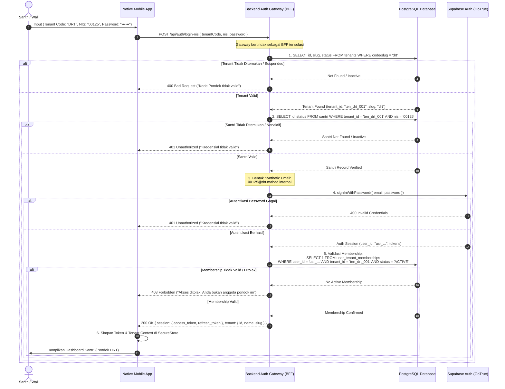
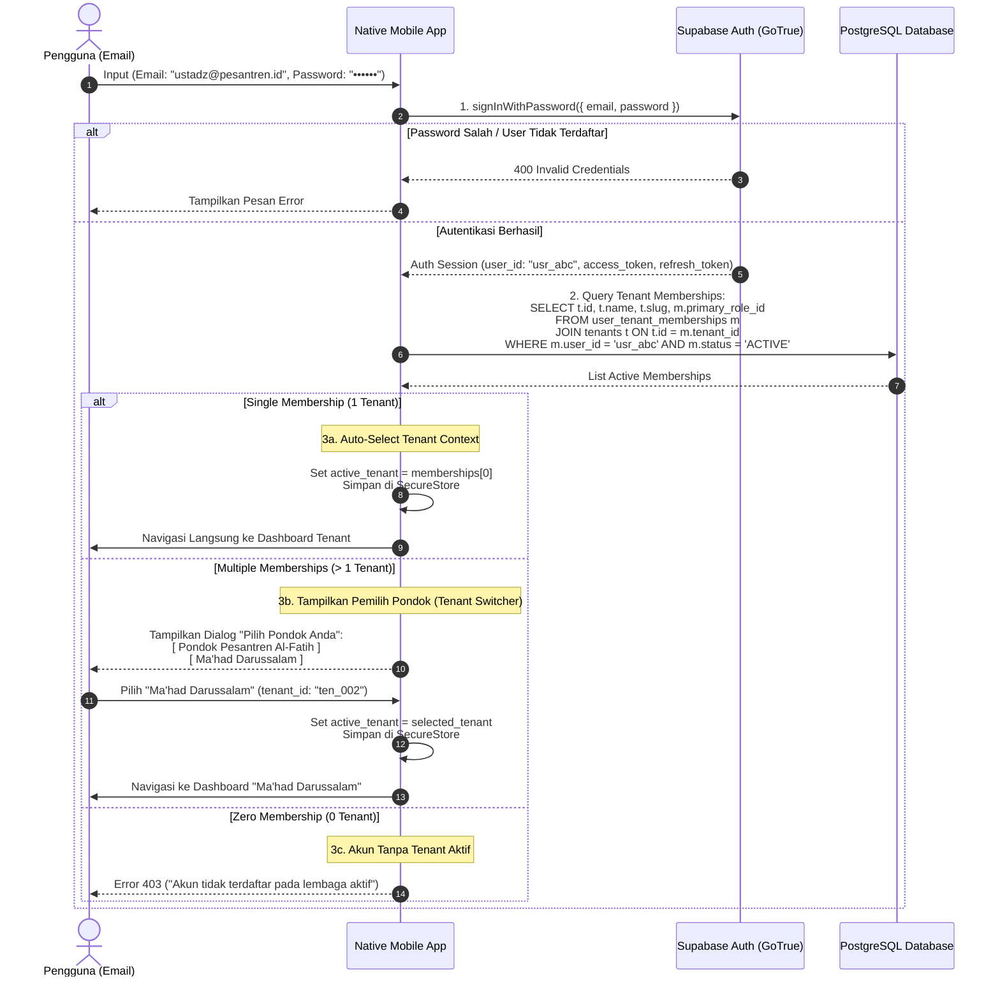
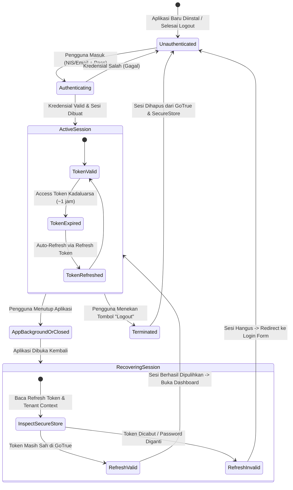

# EEOS — CORE SANTRI TENANTIZATION & NIS REMEDIATION
# ARCHITECTURAL DECISION & CONSISTENCY REPORT

```text
WORK PACKAGE:           WP-MB06-NATIVE-TENANT-RESOLUTION-DECISION-001
PRIMARY GATE:           PRODUCT OWNER DECISION GATE #2 (MB-06)
OPERATING MODE:         DOCUMENTATION & CONSISTENCY VERIFICATION ONLY (ZERO MUTATION)
TARGET ENVIRONMENT:     APP MA'HAD ENTERPRISE ARCHITECTURE & CODEBASE
DATE:                   2026-09-20
EEOS ARCHITECT:         Senior Principal Systems Architect & Multi-Tenant Specialist
GOVERNANCE STATUS:      MB-06 — DECISION RECORDED / IMPLEMENTATION BLOCKED BY ARCHITECTURAL CONTRADICTION
```

---

## 1. PRODUCT OWNER DECISION

Product Owner secara resmi telah menetapkan dan mengesahkan keputusan bisnis final untuk **MB-06 — Native Tenant Resolution UX & Persistent Login**:

> **APP MA'HAD Native menggunakan satu aplikasi dan satu login surface. Login berbasis NIS menggunakan Tenant Code sebagai login context tambahan. Tenant Code bukan bagian dari NIS dan bukan sumber authorization. NIS tetap tenant-scoped dengan target uniqueness `(tenant_id, nis)`. Login berbasis Email memperoleh Tenant Context melalui authenticated identity dan validated tenant membership. Jika identity memiliki satu Tenant membership, Tenant dipilih secara otomatis. Jika memiliki beberapa Tenant membership, user memilih Tenant yang tersedia. Setelah authentication berhasil, persistent session digunakan agar user tetap login ketika aplikasi ditutup dan dibuka kembali. Logout hanya terjadi ketika user melakukan logout atau ketika session secara sah tidak lagi dapat dipulihkan. Tenant Context yang tersimpan pada perangkat hanya digunakan untuk UX dan tidak pernah menjadi sumber otorisasi.**

---

## 2. MB-06 FINAL DECISION

Keputusan bisnis di atas mengunci arsitektur klien native ke dalam model:

```text
┌────────────────────────────────────────────────────────────────────────────────────────┐
│                        MODEL: UNIVERSAL NATIVE APP (MB-06)                             │
├────────────────────────────────────────┬───────────────────────────────────────────────┤
│ Komponen                               │ Spesifikasi Keputusan                         │
├────────────────────────────────────────┼───────────────────────────────────────────────┤
│ Application Distribution               │ One Single Native Application (iOS & Android) │
│ Login Surface                          │ Unified Dual-Mode Surface (NIS Tab / Email Tab│
│ NIS Tenant Resolution                  │ Explicit "Tenant Code" as additional context  │
│ NIS Data Boundary                      │ Pure Domain Identifier; NOT prefixed by code  │
│ Database Constraint                    │ UNIQUE (tenant_id, nis)                       │
│ Email Tenant Resolution                │ Identity-driven via validated memberships     │
│ Multi-Tenant Membership Handling       │ Auto-select (if 1) / Tenant Switcher (if > 1) │
│ Session Persistence                    │ Hardware Secure Storage (SecureStore/Keychain)│
│ Session Lifecycle                      │ OAuth2 Refresh Token rotation; app close !=   │
│                                        │ logout; logout only on explicit user action   │
│ Authorization Source                   │ Server-validated JWT + DB Membership + RLS    │
│ Client Device Storage Role             │ UX cache only; ZERO TRUST authority           │
└────────────────────────────────────────┴───────────────────────────────────────────────┘
```

---

## 3. NIS LOGIN FLOW

Login berbasis NIS dirancang untuk mengakomodasi Nomor Induk Santri yang berulang antar-pesantren tanpa mencemari nilai NIS di database dengan prefix atau slug.

### 3.1 Diagram Alur Eksekusi (NIS)



### 3.2 Karakteristik Kunci Login NIS
1. **Tenant Code Terpisah**: Santri memasukkan kode (misal `DRT`) dan NIS (misal `00125`). Database tetap menyimpan `nis = '00125'`.
2. **Kerahasiaan Synthetic Handle**: Format `{nis}@{tenant_slug}.mahad.internal` dibentuk di sisi server (BFF). Klien native maupun pengguna tidak pernah melihat atau menginput format email internal ini.
3. **Fail-Closed Security Check**: Jika santri terdaftar di Pondok A namun mencoba login menggunakan Tenant Code Pondok B dengan password yang sama, backend menolak akses pada Step 5 (*Membership Validation Check*).

---

## 4. EMAIL LOGIN FLOW

Login berbasis Email digunakan oleh Administrator, Guru/Ustadz, Wali Santri, dan Alumni yang memiliki alamat email nyata.

### 4.1 Diagram Alur Eksekusi (Email)



---

## 5. SYNTHETIC CREDENTIAL FLOW

Synthetic Credential merupakan mekanisme jembatan (*federation shim*) antara sistem identitas domain pesantren (yang berbasis NIS dan belum tentu memiliki email unik dunia nyata) dengan mesin autentikasi Supabase GoTrue (yang mewajibkan email unik secara global).

### 5.1 Spesifikasi Formula

$$\text{Synthetic Email} = \texttt{\{nis\}@\{tenant\_slug\}.mahad.internal}$$

Contoh konkret:

| Tenant | Tenant Code / Slug | NIS Domain | Synthetic GoTrue Identity | Konflik Global di `auth.users`? |
| :--- | :--- | :--- | :--- | :--- |
| Ponpes Darussalam | `drt` | `00125` | `00125@drt.mahad.internal` | **TIDAK** (Namespaced) |
| Ponpes Al-Fatih | `alfatih` | `00125` | `00125@alfatih.mahad.internal` | **TIDAK** (Namespaced) |
| Ponpes Nurul Iman | `nuruliman` | `00125` | `00125@nuruliman.mahad.internal` | **TIDAK** (Namespaced) |

### 5.2 Aturan Keamanan Synthetic Credential
1. **Bukan Bukti Otorisasi**: Keberadaan akun `00125@drt.mahad.internal` di `auth.users` hanya membuktikan kepemilikan kredensial login (*authentication routing handle*), bukan izin akses ke data tenant `drt`.
2. **Validasi Server Wajib**: Server API selalu memverifikasi status keanggotaan santri pada tabel `user_tenant_memberships` dan `public.santri` sebelum memberikan akses data.
3. **Pemisahan Identitas Domain vs Identitas Auth**:
   - `public.santri.nis` = `00125` (bersih, tanpa embel-embel domain).
   - `auth.users.email` = `00125@drt.mahad.internal` (hanya ada di subsystem auth).

---

## 6. PERSISTENT SESSION FLOW

Product Owner menetapkan bahwa penutupan aplikasi (*app close*), peralihan ke latar belakang (*app backgrounding*), maupun *restart* perangkat **bukan merupakan logout**. Sesi pengguna harus dapat dipulihkan secara aman tanpa meminta pengguna memasukkan kata sandi kembali.

### 6.1 Siklus Hidup Sesi Native (Session Lifecycle)



### 6.2 Mekanisme Teknis Penyimpanan Perangkat
- **Secure Hardware Storage**: Pada perangkat native (React Native / Expo), kredensial sesi (`access_token`, `refresh_token`) dan `active_tenant_id` disimpan pada secure storage berbasis perangkat keras:
  - **iOS**: iOS Keychain Services (`kSecAttrAccessibleAfterFirstUnlock`).
  - **Android**: Android Keystore / EncryptedSharedPreferences (AES-256 GCM).
- **Penanganan Expiration**: Access token berumur pendek (misal 3600 detik). Ketika aplikasi dibuka kembali dan access token kadaluarsa, SDK Supabase secara transparan menukar `refresh_token` yang valid dengan `access_token` baru tanpa mengganggu pengguna.

---

## 7. LOGOUT FLOW

Logout adalah tindakan sadar dan eksplisit yang diinisiasi oleh pengguna.

### 7.1 Alur Eksekusi Logout Eksplisit

```text
User menekan tombol "Logout" pada Pengaturan / Profil
                   ↓
1. Panggil `supabase.auth.signOut()`
                   ↓
   - GoTrue mencabut (revoke) refresh token pada tabel `auth.sessions`
   - Token tidak lagi dapat digunakan untuk refresh
                   ↓
2. Bersihkan Secure Device Storage
                   ↓
   - Hapus `access_token`
   - Hapus `refresh_token`
   - Hapus `active_tenant_id`
   - Hapus user profile cache
                   ↓
3. Reset State Aplikasi Klien (Zustand / Redux Auth Store)
                   ↓
4. Navigasi Paksa ke Halaman Login (Initial State)
```

### 7.2 Post-Logout Security State
Setelah logout dieksekusi:
- Aplikasi tidak lagi menyimpan context pondok maupun identitas pengguna.
- Pembukaan aplikasi berikutnya wajib menampilkan form login awal (tanpa *auto-fill* kredensial sensitif).

---

## 8. MULTIPLE TENANT MEMBERSHIP

Satu identitas manusia dapat memiliki relasi dengan lebih dari satu lembaga pendidikan (misalnya: Wali Santri yang memiliki anak di Pondok A dan Pondok B, atau Guru/Konsultan yang mengajar di beberapa Ma'had).

### 8.1 Matriks Resolusi Keanggotaan

| Tipe Login | Jumlah Keanggotaan Aktif | Resolusi Tenant | Interaksi Klien |
| :--- | :---: | :--- | :--- |
| **NIS** | 1 (Santri spesifik) | Ditetapkan via Tenant Code di form login | Langsung ke Dashboard Pondok bersangkutan |
| **Email** | Tepat 1 Lembaga | Terdeteksi otomatis dari `user_tenant_memberships` | Auto-navigasi tanpa dialog pemilih (*Zero friction*) |
| **Email** | $\ge$ 2 Lembaga | Pengguna memilih dari daftar keanggotaan aktif | Dialog modal: "Pilih Pondok" |
| **Email** | 0 Lembaga | Tidak memiliki lembaga aktif | Penolakan akses (Error 403) |

### 8.2 Peralihan Tenant (Tenant Switching)
Jika pengguna dengan multi-keanggotaan ingin berpindah lembaga saat berada di dalam aplikasi:
1. Pengguna memilih menu "Ganti Lembaga / Pondok".
2. Aplikasi meminta konfirmasi konteks baru.
3. Klien memperbarui `active_tenant_id` pada SecureStore.
4. Setiap request API berikutnya menyertakan header/konteks lembaga baru yang divalidasi ulang oleh server secara ketat.

---

## 9. TENANT SECURITY BOUNDARY & ZERO-TRUST

Prinsip keamanan mutlak yang disahkan pada keputusan ini:

> **Device-stored Tenant Context tidak pernah menjadi sumber otorisasi (Zero-Trust Authority).**

### 9.1 Matriks Pertahanan Berlapis (Defense-in-Depth)

```text
┌────────────────────────────────────────────────────────────────────────────────────────┐
│                                DEFENSE-IN-DEPTH LAYERS                                 │
├───────────────────────┬───────────────────────────────────┬────────────────────────────┤
│ Lapisan               │ Sumber Data / Mekanisme           │ Status Kepercayaan Server  │
├───────────────────────┼───────────────────────────────────┼────────────────────────────┤
│ 1. Device Storage     │ SecureStore (Local cache)         │ TIDAK DIPERCAYA (Untrusted)│
│ 2. Network Payload    │ JSON body { tenantId: "..." }     │ DITOLAK SEBAGAI OTORISASI  │
│ 3. Client Headers     │ Request header `x-tenant-id`      │ DITIMPA OLEH GATEWAY       │
│ 4. Authentication     │ Supabase JWT (Bearer Token)       │ TERVERIFIKASI SECARA KRIPTO│
│ 5. Identity Lookup    │ `auth.users.id` -> `public.users` │ TERVERIFIKASI              │
│ 6. Tenant Membership  │ `public.user_tenant_memberships`  │ OTORITAS TUNGGAL SERVER    │
│ 7. DB Row Isolation   │ PostgreSQL RLS / Tenant Predicate │ ISOLASI DATA MUTLAK        │
└───────────────────────┴───────────────────────────────────┴────────────────────────────┘
```

### 9.2 Penegakan Larangan Mutlak
1. **Dilarang Menilai Otorisasi dari Hostname pada Mobile**: Aplikasi mobile menghubungi API gateway bersama (`api.mahad-app.com`). Tidak ada subdomain per-tenant pada lalu lintas aplikasi native.
2. **Dilarang Mempercayai `body.tenantId`**: Endpoint API operasional dilarang mengambil `tenantId` dari payload body JSON yang dikirimkan klien.
3. **Fail-Closed Authorization**: Jika token pengguna sah, namun pengguna meminta data tenant di mana dia tidak terdaftar di `user_tenant_memberships`, request **WAJIB GAGAL** (HTTP 403 Forbidden).

---

## 10. ARCHITECTURE CONSISTENCY AUDIT

Audit read-only dilakukan secara menyeluruh terhadap 12 area arsitektur dalam repositori untuk memverifikasi keselarasan keputusan MB-06 dengan komponen sistem yang ada saat ini:

```text
┌────┬───────────────────────────────────────┬──────────────────────┬────────────────────┐
│ No │ Area Arsitektur                       │ Status Evaluasi      │ Catatan Temuan     │
├────┼───────────────────────────────────────┼──────────────────────┼────────────────────┤
│ 1  │ Synthetic Credential Architecture     │ KONSISTEN            │ Format namespaced  │
│ 2  │ Supabase Auth (GoTrue)                │ KONSISTEN            │ Standar token flow │
│ 3  │ Public Users (`public.users`)         │ KONSISTEN            │ 1:1 Auth mapping   │
│ 4  │ Auth Users (`auth.users`)             │ KONSISTEN            │ Unique email table │
│ 5  │ User Tenant Personas                  │ KONSISTEN DRAFT      │ Model multi-persona│
│ 6  │ Tenant Membership Model               │ KONSISTEN            │ Membership schema  │
│ 7  │ Existing Proxy / Auth Architecture    │ ⚠️ KONTRADIKSI TEKNIS │ Proxy hostname bug │
│ 8  │ Native App Authentication Flow        │ ⚠️ KONTRADIKSI TEKNIS │ Tidak ada BFF NIS  │
│ 9  │ Tenant Isolation Remediation          │ KONSISTEN ATURAN     │ Selaras WP-07      │
│ 10 │ Database RLS Architecture             │ KONSISTEN            │ RLS-1 / RLS-2 ready│
│ 11 │ Session Management                    │ KONSISTEN            │ Standard refresh   │
│ 12 │ Existing Mobile / Native Architecture │ ⚠️ GAP ARSITEKTUR    │ Belum ada kode app │
└────┴───────────────────────────────────────┴──────────────────────┴────────────────────┘
```

---

## 11. CONTRADICTIONS FOUND

Berdasarkan hasil audit konsistensi terhadap kode aktual dan skema database, ditemukan **3 kontradiksi arsitektural konkret** yang menghalangi implementasi langsung (*implementation blocker*):

---

### KONTRADIKSI 1: Proxy Tenant Resolution Mengabaikan Lalu Lintas Aplikasi Native Universal

* **Lokasi**: [`src/proxy.ts:58-98`](file:///e:/Projects/Os_Darta/src/proxy.ts#L58-L98) & [`src/lib/tenant/context.ts:44-59`](file:///e:/Projects/Os_Darta/src/lib/tenant/context.ts#L44-L59)
* **Deskripsi**:
  Fungsi `extractTenantSlug(request)` saat ini **hanya** memeriksa:
  1. Prefix URL path `/t/:slug`
  2. Subdomain hostname (`parts.length > 2`)
  Jika request datang dari aplikasi native mobile yang mengakses universal endpoint (misal `https://api.mahad-app.com/api/...` atau `http://localhost:3000/api/...`), hostname tidak memiliki subdomain pesantren dan path tidak menggunakan prefix `/t/`.
  Akibatnya, fungsi `extractTenantSlug` mengembalikan `'default'`, dan `proxy.ts` menetapkan:
  ```ts
  requestHeaders.set('x-tenant-id', 'default-tenant');
  ```
  `proxy.ts` sama sekali **tidak memeriksa Bearer token JWT**, tidak memeriksa claims, dan tidak memverifikasi keanggotaan pengguna untuk menetapkan `x-tenant-id`.
* **Dampak**:
  Setiap request API dari aplikasi native yang membawa token santri/ustadz sah dari Pondok manapun akan secara keliru dimasukkan ke dalam konteks `'default-tenant'`, menyebabkan kegagalan otorisasi atau kebocoran isolasi multi-tenant.
* **Decision Point / Remediasi yang Diperlukan**:
  Diperlukan pembaruan arsitektur middleware/proxy pada work package API (WP-07) agar proxy mampu menginspeksi token Bearer atau menerima header sesi terverifikasi server untuk menentukan tenant context aplikasi mobile.

---

### KONTRADIKSI 2: Ketiadaan Kolom `code` pada Tabel `public.tenants`

* **Lokasi**: [`src/lib/db/schema.ts:4-12`](file:///e:/Projects/Os_Darta/src/lib/db/schema.ts#L4-L12) & Live PostgreSQL Catalog
* **Deskripsi**:
  Keputusan MB-06 mewajibkan santri menginput **Tenant Code** (misalnya `DRT`). Namun pada definisi tabel `tenants`, hanya terdapat kolom:
  ```ts
  id: text('id').primaryKey(),
  name: text('name').notNull(),
  slug: text('slug').notNull().unique(),
  domain: text('domain'),
  status: text('status').default('active').notNull(),
  ```
  Tidak ada kolom `code text UNIQUE` pada tabel `tenants`.
  Jika sebuah pesantren memiliki `name = "Pondok Pesantren Darussalam"`, `slug = "darussalam"`, dan santri menginput kode `DRT`, sistem tidak memiliki referensi relasional untuk memetakan `DRT -> darussalam` tanpa kolom kode resmi.
* **Dampak**:
  Pencarian *Resolve Tenant* berdasarkan input santri akan gagal kecuali jika:
  a. Kolom `code` ditambahkan ke tabel `tenants`, ATAU
  b. `slug` ditetapkan secara tegas harus sama persis dengan Tenant Code (misal `slug: "drt"`).
* **Decision Point / Remediasi yang Diperlukan**:
  Product Owner dan Database Architect harus menetapkan apakah tabel `tenants` memerlukan kolom baru `code varchar(10) UNIQUE` atau `slug` yang akan difungsikan sebagai Tenant Code resmi.

---

### KONTRADIKSI 3: Ketiadaan Relasi Langsung `santri.user_id` ke `public.users`

* **Lokasi**: [`src/lib/db/schema.ts:52-78`](file:///e:/Projects/Os_Darta/src/lib/db/schema.ts#L52-L78) & Live PostgreSQL Catalog
* **Deskripsi**:
  Alur login NIS pada keputusan PO menyatakan:
  `NIS + Tenant Context -> Find Santri -> Validate Identity / Credential -> Synthetic Credential -> Authentication -> Validate Tenant Membership`.
  Namun pada skema saat ini, tabel `public.santri` **tidak memiliki foreign key `user_id`** yang menunjuk ke `public.users(id)`.
  Tabel `users` hanya memiliki relasi usang yang didepresiasi (`child_santri_id`), sedangkan tabel `santri` berdiri sendiri tanpa tautan ke tabel identitas.
* **Dampak**:
  Setelah santri berhasil login ke GoTrue dan menghasilkan `auth.users.id`, backend tidak dapat melakukan validasi relasional apakah record `santri` yang ditemukan benar-benar berpasangan dengan `auth.users.id` tersebut, kecuali mengandalkan pencocokan string nama pengguna synthetic email secara implisit.
* **Decision Point / Remediasi yang Diperlukan**:
  Kontrak data ini harus ditutup melalui penambahan kolom `user_id text REFERENCES public.users(id)` pada tabel `santri` (sudah tercatat sebagai gap closure CG-001 pada blueprint DDL).

---

## 12. DEPENDENCIES

Pelaksanaan teknis keputusan MB-06 memiliki ketergantungan wajib pada work package lain dalam EEOS:

```text
┌─────────────────────────┬─────────────────────────────────────────────────────────────┐
│ Dependency              │ Keterangan Keterikatan                                      │
├─────────────────────────┼─────────────────────────────────────────────────────────────┤
│ WP-01 (Reset Eksekusi)  │ Basis data harus bersih dari data dummy sebelum skema baru  │
│ WP-02 (DDL Core Santri) │ `public.santri` harus memiliki `tenant_id NOT NULL`         │
│ WP-03 (NIS Constraint)  │ Constraint `UNIQUE (tenant_id, nis)` harus aktif di DB      │
│ WP-04 (Relasi Identitas)│ Kolom `santri.user_id` harus tersedia untuk relasi auth     │
│ WP-07 (API Remediation) │ API Gateway harus memvalidasi JWT Bearer & server membership│
│ WP-08 (Database RLS)    │ Isolasi data level basis data harus aktif                   │
│ WP-09 (Native Module)   │ Implementasi antarmuka klien native (React Native / Expo)   │
└─────────────────────────┴─────────────────────────────────────────────────────────────┘
```

---

## 13. IMPLEMENTATION PRECONDITIONS

Sebelum implementasi kode native atau API login dibuka, prasyarat berikut wajib dipenuhi:

1. **Otorisasi Reset Basis Data (Gate 1)**: Eksekusi runbook pengosongan data dummy (`WP-CLEAN-SLATE-DUMMY-DATA-AUDIT-001.md`) telah diotorisasi dan diselesaikan.
2. **Klarifikasi Skema Tenant Code**: Keputusan apakah menambahkan kolom `tenants.code` atau menggunakan `tenants.slug` sebagai kode pondok.
3. **Penyelarasan Proxy Gateway**: Desain rute BFF `/api/auth/login-nis` dan `/api/auth/memberships` yang dapat melayani klien native tanpa bergantung pada subdomain web.
4. **Zero Mutation Compliance**: Tidak ada migrasi atau modifikasi kode yang dijalankan sebelum seluruh gerbang keputusan selesai.

---

## 14. MB-06 STATUS

Sesuai dengan Status Rule EEOS Governance:
- Keputusan bisnis Product Owner telah didokumentasikan secara lengkap.
- Tiga kontradiksi teknis telah diidentifikasi dan dipetakan.

Status resmi gerbang ini ditetapkan sebagai:

```text
================================================================================
MB-06 — DECISION RECORDED
IMPLEMENTATION BLOCKED BY ARCHITECTURAL CONTRADICTION
================================================================================
```

---

## 15. FINAL DECISION STATEMENT

Dokumentasi keputusan eksplisit Product Owner:

> **APP MA'HAD Native menggunakan satu aplikasi dan satu login surface. Login berbasis NIS menggunakan Tenant Code sebagai login context tambahan. Tenant Code bukan bagian dari NIS dan bukan sumber authorization. NIS tetap tenant-scoped dengan target uniqueness `(tenant_id, nis)`. Login berbasis Email memperoleh Tenant Context melalui authenticated identity dan validated tenant membership. Jika identity memiliki satu Tenant membership, Tenant dipilih secara otomatis. Jika memiliki beberapa Tenant membership, user memilih Tenant yang tersedia. Setelah authentication berhasil, persistent session digunakan agar user tetap login ketika aplikasi ditutup dan dibuka kembali. Logout hanya terjadi ketika user melakukan logout atau ketika session secara sah tidak lagi dapat dipulihkan. Tenant Context yang tersimpan pada perangkat hanya digunakan untuk UX dan tidak pernah menjadi sumber otorisasi.**

---

## 16. ABSOLUTE STOP CONDITION & SIGN-OFF

Pekerjaan pada Decision Gate #2 telah selesai secara penuh:
- [x] Keputusan Product Owner terdokumentasi.
- [x] Audit konsistensi arsitektur selesai dilaksanakan secara read-only.
- [x] Laporan kontradiksi teknis telah disajikan secara transparan dan terperinci.
- [x] Nol mutasi basis data, nol eksekusi DDL, nol pengubahan kode, nol git commit/push.

**STATUS: STOP. AWAITING PRODUCT OWNER DIRECTIVE FOR SUBSEQUENT GATES.**
