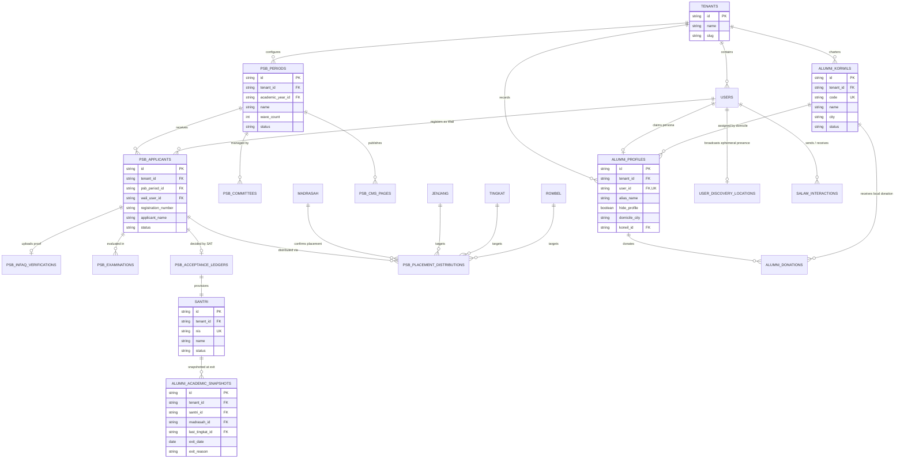

# WP-PSB-ALUMNI-SCHEMA-001-DESIGN

**Work Package ID**: `WP-PSB-ALUMNI-SCHEMA-001`  
**Title**: PSB & Alumni Ecosystem — Technical Schema & API Architecture Design  
**Document Status**: COMPLETED — SUBMITTED FOR PRODUCT OWNER REVIEW & DDL AUTHORIZATION  
**Classification**: TECHNICAL SPECIFICATION & SCHEMA DESIGN ONLY (NO CODE / NO MIGRATION / NO DATABASE WRITE)  
**Authority**: Product Owner Final PRD (`PRD — APP MA'HAD: PSB & Alumni Ecosystem`) & `WP-PSB-ALUMNI-DOMAIN-DISCOVERY-001-REPORT.md`  
**Author**: Senior Principal Systems Architect, Database Architect, Security & RLS Architect  
**Date**: September 2026  

---

## 1. EXECUTIVE SUMMARY

This document establishes the authoritative technical blueprint for the **PSB (Penerimaan Santri Baru)**, **Alumni Organization ("A")**, **Korwil Chapters**, **Privacy-Preserving Social Discovery ("Cari di Sekitar")**, and **Salam Silaturrahmi** ecosystems within APP MA'HAD.

In strict compliance with **PRD Section 73 (Non-Goals)**, **Section 75 (No Premature Database Design)**, and the **Handover Directives**:
1. **Zero Database Modifications**: No DDL was executed, no SQL migration files were applied, and no database tables or columns were created, altered, or dropped.
2. **Zero Code Changes**: No application code, UI components, API route implementations, or repository classes were modified.
3. **Integrate / Extend Existing APP MA'HAD — Not Rewrite**: All proposed schemas build directly on top of the frozen Level-4 Academic Structure (`madrasah`, `jenjang`, `tingkat`, `rombel`), existing tenant boundary isolation (`tenants`, `tenant_settings`), and the central audit ledger (`audit_logs`, `outbox_events`).

The fundamental operational doctrine governing this design is:
$$\mathbf{Satu\ Tenant} = \mathbf{Satu\ Ekosistem\ Pesantren}$$
$$\mathbf{PSB\ \&\ Alumni} \in \mathbf{Tenant\ Level\ (SAT\ Authority)}$$
$$\mathbf{Academic\ Placement\ \&\ Teaching\ (KBM)} \in \mathbf{Madrasah\ Sovereign\ Boundary}$$
$$\mathbf{One\ Person} = \mathbf{One\ Identity\ (Users\ Table\ System-of-Record)}$$
$$\mathbf{Graduate\ (Madrasah-Contextual)} \neq \mathbf{Alumni\ (Tenant-Level)}$$
$$\mathbf{Domisili\ (Membership)} \neq \mathbf{GPS\ (Ephemeral\ Presence)}$$
$$\mathbf{Discovery} \neq \mathbf{Chat} \quad\land\quad \mathbf{Salam\ Silaturrahmi} \neq \mathbf{WhatsApp\ Chat}$$

---

## 2. SCOPE OF TECHNICAL DESIGN

This specification covers the exhaustive design of:
1. **PSB Core Subsystem**: Periods, waves, committees, applicant registry, Infaq Formulir verification, testing/interview scoring, SAT acceptance ledger, automated NIS generation, multi-Madrasah distribution, Madrasah Admin confirmation, and dedicated PSB Public CMS.
2. **Academic Placement & Sovereignty Bridge**: Strict foreign key mapping to the frozen Level-4 structure with Madrasah-sovereign approval boundary.
3. **Identity Federation & Multi-Role Persona**: Resolving the single-role constraint to support multi-context identities (e.g. *Wali + Alumni*) and detailing dual-credential mechanics (active Santri NIS login $\rightarrow$ Alumni Email login).
4. **Alumni Organization ("A") & Korwil Chapters**: Central board (`A Pusat`), regional chapters (`A Korwil Daerah`), domicile-based membership resolution, domicile transfer confirmation toggles, and strictly isolated financial ledgers.
5. **Privacy-Preserving Geolocation Discovery**: Ephemeral, coarse coordinate tracking, Dhoif / Tamu detection, and presentation-safe projection filtering out raw coordinates, numeric distances, WhatsApp numbers, and physical addresses.
6. **Salam Silaturrahmi & Secure WhatsApp Proxy**: Ephemeral interaction ledger with a strict 1-hour pair cooldown, template management, zero persistent chat storage, and server-side WhatsApp deep-link redirection.
7. **Comprehensive Defense-in-Depth Security**: Complete RLS policy matrix, threat models, public registration guardrails, and audit logging.

---

## 3. NON-GOALS & BOUNDARIES

1. **No Migration Execution**: This document does not authorize running `drizzle-kit push`, raw SQL DDL, or database migrations against Supabase or PostgreSQL.
2. **No Alteration of Frozen L4**: Tables `madrasah`, `jenjang`, `tingkat`, and `rombel` remain immutable. No new academic hierarchies or global tingkat columns will be created.
3. **No Automatic Alumni Assignment**: Graduation from a Madrasah never automatically sets Alumni status; authority belongs exclusively to the SAT.
4. **No WhatsApp Auto-Sending**: Personal communication is executed via client deep links (`whatsapp://send`); the system never transmits messages from user personal accounts.
5. **No Persistent Chat Architecture**: Salam Silaturrahmi will not be expanded into a conversation history or messaging system.

---

## 4. EXISTING ARCHITECTURE REUSE MATRIX

To prevent architectural bloat, this design maximizes reuse of existing, battle-tested platform infrastructure:

```
┌──────────────────────────────────────────────────────────────────────────────────┐
│                           EXISTING PLATFORM REUSE MATRIX                         │
├──────────────────────────┬──────────────────────┬────────────────────────────────┤
│ Subsystem / Component    │ Existing Location    │ Reuse Strategy in This Design  │
├──────────────────────────┼──────────────────────┼────────────────────────────────┤
│ Multi-Tenant Isolation   │ tenant-transaction.ts│ Wrap all PSB & Alumni actions  │
│                          │ 0002_tenant_rls.sql  │ in withTenantTransaction local │
│                          │                      │ PostgreSQL session variable.   │
├──────────────────────────┼──────────────────────┼────────────────────────────────┤
│ Central Platform Identity│ users table          │ Retained as single identity    │
│                          │ auth.users (Supabase)│ system of record (One Person = │
│                          │                      │ One Identity).                 │
├──────────────────────────┼──────────────────────┼────────────────────────────────┤
│ Family Relationship      │ wali_santri_         │ Populated automatically upon   │
│                          │ relationships        │ SAT acceptance to link Wali    │
│                          │                      │ account to new Santri record.  │
├──────────────────────────┼──────────────────────┼────────────────────────────────┤
│ Academic Targets         │ academic_structure.ts│ Distribution targets map       │
│                          │ (madrasah, jenjang,  │ directly to frozen L4 tables   │
│                          │ tingkat, rombel)     │ via composite foreign keys.    │
├──────────────────────────┼──────────────────────┼────────────────────────────────┤
│ Editorial CMS Engine     │ WP-ACADEMIC-         │ Reuses rich-text JSONB body,   │
│                          │ COMMUNICATION-001    │ draft/publish states, while    │
│                          │                      │ maintaining isolated tables.   │
├──────────────────────────┼──────────────────────┼────────────────────────────────┤
│ Central Audit Ledger     │ audit_logs table     │ Records all high-authority     │
│                          │ auditLog.ts service  │ decisions (SAT acceptance,     │
│                          │                      │ Alumni designation, Korwil).   │
├──────────────────────────┼──────────────────────┼────────────────────────────────┤
│ Event Outbox             │ outbox_events table  │ Dispatches asynchronous tasks  │
│                          │                      │ (WAHA WhatsApp alerts, email). │
└──────────────────────────┴──────────────────────┴────────────────────────────────┘
```

---

## 5. DOMAIN BOUNDARIES & UBIQUITOUS LANGUAGE

```
┌──────────────────────────────────────────────────────────────────────────────────┐
│                                DOMAIN BOUNDARIES                                 │
├───────────────────────────────┬──────────────────────────────────────────────────┤
│ TENANT ECOSYSTEM              │ Single Pesantren institution boundary. Scopes    │
│                               │ PSB, Santri lifecycle, and Alumni organization.  │
├───────────────────────────────┼──────────────────────────────────────────────────┤
│ PSB (Penerimaan Santri Baru)  │ Tenant-level student intake subsystem. Manages   │
│                               │ applicant pipeline up to SAT acceptance and NIS. │
├───────────────────────────────┼──────────────────────────────────────────────────┤
│ MADRASAH ACADEMIC SOVEREIGNTY │ Educational governance boundary. Sovereign owner │
│                               │ of curriculum, placement approval, and gradebook.│
├───────────────────────────────┼──────────────────────────────────────────────────┤
│ ALUMNI & KORWIL ("A")         │ Tenant-level post-academic organization. Scopes  │
│                               │ central leadership, chapters, and donations.     │
├───────────────────────────────┼──────────────────────────────────────────────────┤
│ SOCIAL DISCOVERY & SALAM      │ Privacy-preserving proximity engine and          │
│                               │ transient social ping system.                    │
└───────────────────────────────┴──────────────────────────────────────────────────┘
```

### Ubiquitous Language Dictionary
- **Applicant (*Pendaftar*)**: Prospective student whose registration has been submitted by Wali.
- **Calon Santri**: Applicant whose Infaq Formulir bank transfer proof has been verified and approved by Panitia. Operates solely under the family portal without independent login credentials.
- **Santri**: Official student admitted by explicit SAT decision ("Lulus / Diterima"), holding a permanent, system-generated NIS.
- **Graduate (*Lulusan Madrasah*)**: Academic milestone representing completion of a level within a specific Madrasah context.
- **Alumni**: Individual who participated in pesantren KBM and is no longer active in KBM across any Madrasah in the Tenant, formally designated by the SAT.
- **A**: Official placeholder designation for the Alumni Organization.
- **A Pusat**: Central governing body of the Alumni Organization, led by the *Ketua Umum Alumni*.
- **A Korwil Daerah**: Regional chapter of the Alumni Organization, formally chartered by the *Administrator Alumni*.
- **Domisili**: Stored residential administrative district (Kabupaten/Kota), which strictly dictates Korwil membership.
- **Dhoif / Tamu**: Contextual, non-permanent state when an Alumnus or active Santri is physically detected in a Korwil region different from their home Korwil.
- **Nama Alias**: Public display moniker chosen by an Alumnus for social discovery.
- **Salam Silaturrahmi**: Formal, lightweight social interaction between active Santri and Alumni with a mandatory 1-hour pair cooldown.

---

## 6. CONCEPTUAL ENTITY-RELATIONSHIP DIAGRAM (MERMAID)



---

## 7. PSB SUBSYSTEM TECHNICAL SCHEMA DESIGN

### 7.1 Entity: `psb_periods` (Tenant Admission Period)
- **Purpose**: Defines an institutional admission period spanning one or two waves.
- **Tenant Scope**: Tenant-wide (`tenant_id`).
- **Schema Specification**:
  ```typescript
  export const psbPeriods = pgTable('psb_periods', {
    id: text('id').primaryKey(),
    tenantId: text('tenant_id').notNull().references(() => tenants.id, { onDelete: 'cascade' }),
    academicYearId: text('academic_year_id').notNull().references(() => academicYears.id, { onDelete: 'restrict' }),
    name: text('name').notNull(), // e.g. "PSB T.A. 2027/2028"
    waveCount: integer('wave_count').default(1).notNull(), // 1 or 2
    status: text('status').default('draft').notNull(), // 'draft' | 'published' | 'open' | 'selection' | 'distribution' | 'closed'
    startDate: date('start_date').notNull(),
    endDate: date('end_date').notNull(),
    infaqFormulirAmount: integer('infaq_formulir_amount').default(0).notNull(),
    paymentBankName: text('payment_bank_name'),
    paymentAccountNumber: text('payment_account_number'),
    paymentAccountHolder: text('payment_account_holder'),
    instructions: text('instructions'),
    createdAt: timestamp('created_at').defaultNow().notNull(),
    updatedAt: timestamp('updated_at').defaultNow().notNull(),
  }, (table) => ({
    tenantStatusIdx: index('idx_psb_periods_tenant_status').on(table.tenantId, table.status),
    waveCountCheck: check('chk_psb_periods_wave_count', sql`wave_count IN (1, 2)`),
    statusCheck: check('chk_psb_periods_status', sql`status IN ('draft', 'published', 'open', 'selection', 'distribution', 'closed')`),
    dateCheck: check('chk_psb_periods_dates', sql`start_date <= end_date`),
  }));
  ```

### 7.2 Entity: `psb_committees` (PSB Panitia Ledger)
- **Purpose**: Assigns teachers to the operational PSB committee per admission period.
- **Tenant Scope**: Tenant-wide (`tenant_id`).
- **Authority**: Ketua Panitia is selected by SAT; members are selected by Ketua Panitia.
- **Schema Specification**:
  ```typescript
  export const psbCommittees = pgTable('psb_committees', {
    id: text('id').primaryKey(),
    tenantId: text('tenant_id').notNull().references(() => tenants.id, { onDelete: 'cascade' }),
    psbPeriodId: text('psb_period_id').notNull().references(() => psbPeriods.id, { onDelete: 'cascade' }),
    userId: text('user_id').notNull().references(() => users.id, { onDelete: 'cascade' }),
    role: text('role').notNull(), // 'KETUA' | 'ANGGOTA' | 'BENDAHARA' | 'TIM_SELEKSI'
    appointedBy: text('appointed_by').notNull().references(() => users.id, { onDelete: 'restrict' }),
    createdAt: timestamp('created_at').defaultNow().notNull(),
  }, (table) => ({
    committeeUnique: unique('uq_psb_committee_period_user').on(table.tenantId, table.psbPeriodId, table.userId),
    singleKetuaUnique: uniqueIndex('uq_psb_committee_single_ketua').on(table.tenantId, table.psbPeriodId).where(sql`role = 'KETUA'`),
    roleCheck: check('chk_psb_committee_role', sql`role IN ('KETUA', 'ANGGOTA', 'BENDAHARA', 'TIM_SELEKSI')`),
  }));
  ```

### 7.3 Entity: `psb_applicants` (Applicant Core Record)
- **Purpose**: System of record for prospective students prior to admission.
- **Tenant Scope**: Tenant-wide (`tenant_id`).
- **Schema Specification**:
  ```typescript
  export const psbApplicants = pgTable('psb_applicants', {
    id: text('id').primaryKey(),
    tenantId: text('tenant_id').notNull().references(() => tenants.id, { onDelete: 'cascade' }),
    psbPeriodId: text('psb_period_id').notNull().references(() => psbPeriods.id, { onDelete: 'restrict' }),
    waveNumber: integer('wave_number').default(1).notNull(), // 1 or 2
    registrationNumber: text('registration_number').notNull(), // Unique public identifier e.g. "PSB-2027-0012"
    waliUserId: text('wali_user_id').notNull().references(() => users.id, { onDelete: 'restrict' }),
    waliRelationship: text('wali_relationship').notNull(), // 'AYAH' | 'IBU' | 'WALI'
    applicantName: text('applicant_name').notNull(),
    applicantGender: text('applicant_gender').notNull(), // 'L' | 'P'
    birthPlace: text('birth_place').notNull(),
    birthDate: date('birth_date').notNull(),
    nik: text('nik'),
    nisn: text('nisn'),
    previousSchoolName: text('previous_school_name').notNull(),
    previousSchoolLevel: text('previous_school_level').notNull(), // 'SD' | 'MI' | 'SMP' | 'MTS' | etc.
    previousSchoolAddress: text('previous_school_address'),
    status: text('status').default('DRAFT').notNull(), // 'DRAFT' | 'SUBMITTED' | 'CALON_SANTRI' | 'SELECTION_PROCESS' | 'LULUS' | 'TIDAK_LULUS' | 'PLACED' | 'CANCELLED'
    createdAt: timestamp('created_at').defaultNow().notNull(),
    updatedAt: timestamp('updated_at').defaultNow().notNull(),
  }, (table) => ({
    tenantRegNoUnique: unique('uq_psb_applicants_reg_no').on(table.tenantId, table.registrationNumber),
    tenantStatusIdx: index('idx_psb_applicants_tenant_status').on(table.tenantId, table.status),
    waliIdx: index('idx_psb_applicants_wali').on(table.tenantId, table.waliUserId),
    genderCheck: check('chk_psb_applicants_gender', sql`applicant_gender IN ('L', 'P')`),
    statusCheck: check('chk_psb_applicants_status', sql`status IN ('DRAFT', 'SUBMITTED', 'CALON_SANTRI', 'SELECTION_PROCESS', 'LULUS', 'TIDAK_LULUS', 'PLACED', 'CANCELLED')`),
  }));
  ```

### 7.4 Entity: `psb_infaq_verifications` (Infaq Formulir Receipt Verification)
- **Purpose**: Manages bank transfer proof and approval workflow promoting Applicant $\rightarrow$ Calon Santri.
- **Schema Specification**:
  ```typescript
  export const psbInfaqVerifications = pgTable('psb_infaq_verifications', {
    id: text('id').primaryKey(),
    tenantId: text('tenant_id').notNull().references(() => tenants.id, { onDelete: 'cascade' }),
    applicantId: text('applicant_id').notNull().references(() => psbApplicants.id, { onDelete: 'cascade' }),
    transferAmount: integer('transfer_amount').notNull(),
    bankOrigin: text('bank_origin').notNull(),
    accountHolderOrigin: text('account_holder_origin').notNull(),
    transferDate: date('transfer_date').notNull(),
    receiptFileUrl: text('receipt_file_url').notNull(),
    status: text('status').default('PENDING').notNull(), // 'PENDING' | 'APPROVED' | 'REJECTED'
    rejectionReason: text('rejection_reason'),
    verifiedBy: text('verified_by').references(() => users.id, { onDelete: 'set null' }),
    verifiedAt: timestamp('verified_at'),
    createdAt: timestamp('created_at').defaultNow().notNull(),
  }, (table) => ({
    applicantUnique: unique('uq_psb_infaq_applicant').on(table.tenantId, table.applicantId),
    statusCheck: check('chk_psb_infaq_status', sql`status IN ('PENDING', 'APPROVED', 'REJECTED')`),
  }));
  ```

### 7.5 Entity: `psb_examinations` & `psb_interviews` (Selection Scoring Ledgers)
- **Purpose**: Records test and interview metrics conducted by Panitia.
- **Schema Specification**:
  ```typescript
  export const psbExaminations = pgTable('psb_examinations', {
    id: text('id').primaryKey(),
    tenantId: text('tenant_id').notNull().references(() => tenants.id, { onDelete: 'cascade' }),
    applicantId: text('applicant_id').notNull().references(() => psbApplicants.id, { onDelete: 'cascade' }),
    examType: text('exam_type').notNull(), // 'BACA_QURAN' | 'TAHFIZH' | 'AKADEMIK' | 'PSIKOTES'
    score: real('score').notNull(),
    notes: text('notes'),
    examinerUserId: text('examiner_user_id').notNull().references(() => users.id, { onDelete: 'restrict' }),
    createdAt: timestamp('created_at').defaultNow().notNull(),
  });

  export const psbInterviews = pgTable('psb_interviews', {
    id: text('id').primaryKey(),
    tenantId: text('tenant_id').notNull().references(() => tenants.id, { onDelete: 'cascade' }),
    applicantId: text('applicant_id').notNull().references(() => psbApplicants.id, { onDelete: 'cascade' }),
    interviewerUserId: text('interviewer_user_id').notNull().references(() => users.id, { onDelete: 'restrict' }),
    interviewNotes: text('interview_notes').notNull(),
    recommendation: text('recommendation').notNull(), // 'RECOMMENDED' | 'CONSIDERED' | 'NOT_RECOMMENDED'
    createdAt: timestamp('created_at').defaultNow().notNull(),
  });
  ```

### 7.6 Entity: `psb_acceptance_ledgers` (SAT Final Acceptance & NIS Provisioning)
- **Purpose**: Immutable ledger recording the SAT's exclusive decision to accept an applicant into Santrihood.
- **Schema Specification**:
  ```typescript
  export const psbAcceptanceLedgers = pgTable('psb_acceptance_ledgers', {
    id: text('id').primaryKey(),
    tenantId: text('tenant_id').notNull().references(() => tenants.id, { onDelete: 'cascade' }),
    applicantId: text('applicant_id').notNull().references(() => psbApplicants.id, { onDelete: 'restrict' }),
    decision: text('decision').notNull(), // 'LULUS' | 'TIDAK_LULUS'
    satUserId: text('sat_user_id').notNull().references(() => users.id, { onDelete: 'restrict' }),
    generatedNis: text('generated_nis'),
    provisionedSantriId: text('provisioned_santri_id').references(() => santri.id, { onDelete: 'restrict' }),
    decisionNotes: text('decision_notes'),
    decidedAt: timestamp('decided_at').defaultNow().notNull(),
  }, (table) => ({
    applicantUnique: unique('uq_psb_acceptance_applicant').on(table.tenantId, table.applicantId),
    decisionCheck: check('chk_psb_acceptance_decision', sql`decision IN ('LULUS', 'TIDAK_LULUS')`),
  }));
  ```

### 7.7 Entity: `tenant_nis_configurations` (Configurable NIS Sequence Generator)
- **Purpose**: Stores the format pattern and sequence counter for automated NIS generation per Tenant.
- **Schema Specification**:
  ```typescript
  export const tenantNisConfigurations = pgTable('tenant_nis_configurations', {
    id: text('id').primaryKey(),
    tenantId: text('tenant_id').notNull().unique().references(() => tenants.id, { onDelete: 'cascade' }),
    prefixPattern: text('prefix_pattern').default('{YEAR}.{SEQUENCE:4}').notNull(), // e.g. "{YEAR}.{SEQUENCE:4}" -> "2027.0001"
    sequencePadding: integer('sequence_padding').default(4).notNull(),
    currentSequence: integer('current_sequence').default(0).notNull(),
    resetYearly: boolean('reset_yearly').default(true).notNull(),
    lastSequenceYear: integer('last_sequence_year').default(2027).notNull(),
    updatedAt: timestamp('updated_at').defaultNow().notNull(),
  });
  ```

### 7.8 Entity: `psb_cms_pages` (Dedicated PSB Public CMS)
- **Purpose**: Stores public-facing admissions portal pages, completely separate from academic announcements.
- **Schema Specification**:
  ```typescript
  export const psbCmsPages = pgTable('psb_cms_pages', {
    id: text('id').primaryKey(),
    tenantId: text('tenant_id').notNull().references(() => tenants.id, { onDelete: 'cascade' }),
    psbPeriodId: text('psb_period_id').notNull().references(() => psbPeriods.id, { onDelete: 'cascade' }),
    slug: text('slug').notNull(), // e.g. "informasi-pendaftaran", "jadwal-tes", "biaya"
    title: text('title').notNull(),
    contentJson: jsonb('content_json').notNull(), // Rich text blocks, schedule tables, FAQs
    isPublished: boolean('is_published').default(false).notNull(),
    publishedAt: timestamp('published_at'),
    createdAt: timestamp('created_at').defaultNow().notNull(),
    updatedAt: timestamp('updated_at').defaultNow().notNull(),
  }, (table) => ({
    tenantPeriodSlugUnique: unique('uq_psb_cms_slug').on(table.tenantId, table.psbPeriodId, table.slug),
  }));
  ```

---

## 8. ACADEMIC PLACEMENT DISTRIBUTION & SOVEREIGNTY BRIDGE

### 8.1 Entity: `psb_placement_distributions`
- **Purpose**: Bridges tenant-wide admissions with sovereign Madrasah classrooms. Panitia proposes; Madrasah Admin confirms.
- **Multi-Madrasah Invariant**: A single accepted Santri may have placement records across multiple Madrasahs simultaneously (e.g. MTs and Tahfizh).
- **Schema Specification**:
  ```typescript
  export const psbPlacementDistributions = pgTable('psb_placement_distributions', {
    id: text('id').primaryKey(),
    tenantId: text('tenant_id').notNull().references(() => tenants.id, { onDelete: 'cascade' }),
    psbPeriodId: text('psb_period_id').notNull().references(() => psbPeriods.id, { onDelete: 'restrict' }),
    applicantId: text('applicant_id').notNull().references(() => psbApplicants.id, { onDelete: 'restrict' }),
    santriId: text('santri_id').notNull().references(() => santri.id, { onDelete: 'restrict' }),
    madrasahId: text('madrasah_id').notNull().references(() => madrasah.id, { onDelete: 'restrict' }),
    jenjangId: text('jenjang_id').notNull().references(() => jenjang.id, { onDelete: 'restrict' }),
    tingkatId: text('tingkat_id').notNull().references(() => tingkat.id, { onDelete: 'restrict' }),
    rombelId: text('rombel_id').notNull().references(() => rombel.id, { onDelete: 'restrict' }),
    status: text('status').default('PROPOSED').notNull(), // 'PROPOSED' | 'CONFIRMED' | 'REJECTED'
    proposedByUserId: text('proposed_by_user_id').notNull().references(() => users.id, { onDelete: 'restrict' }),
    confirmedByUserId: text('confirmed_by_user_id').references(() => users.id, { onDelete: 'restrict' }),
    confirmedAt: timestamp('confirmed_at'),
    rejectionReason: text('rejection_reason'),
    createdAt: timestamp('created_at').defaultNow().notNull(),
    updatedAt: timestamp('updated_at').defaultNow().notNull(),
  }, (table) => ({
    // Student can only be placed once per Madrasah per admission period
    santriMadrasahUnique: unique('uq_psb_dist_santri_madrasah').on(table.tenantId, table.psbPeriodId, table.santriId, table.madrasahId),
    statusCheck: check('chk_psb_dist_status', sql`status IN ('PROPOSED', 'CONFIRMED', 'REJECTED')`),
    // Strict composite FK enforcing that Tingkat and Rombel strictly belong to the specified Madrasah
    madrasahTingkatFk: foreignKey({
      columns: [table.tenantId, table.madrasahId, table.tingkatId],
      foreignColumns: [tingkat.tenantId, tingkat.madrasahId, tingkat.id],
      name: 'fk_psb_dist_madrasah_tingkat',
    }).onDelete('restrict'),
    // High-frequency lookup indexes
    tenantMadrasahIdx: index('idx_psb_dist_madrasah').on(table.tenantId, table.madrasahId, table.status),
    santriIdx: index('idx_psb_dist_santri').on(table.tenantId, table.santriId),
  }));
  ```

---

## 9. IDENTITY SCHEMA EXTENSION (ONE PERSON = ONE IDENTITY)

### 9.1 Resolving the Single-Role Membership Constraint
To reconcile `unique('user_tenant_memberships_user_tenant_idx')` with PRD Section 3.1 (*"Wali + Alumni tetap menggunakan satu akun"*):

We introduce **Persona Context Bindings** and an explicit role junction:
- `user_tenant_memberships` remains as the primary tenant account anchor (retaining 100% backward compatibility with existing platform checks).
- We introduce `user_tenant_roles` to allow assigning multiple authorized personas (`WALI`, `ALUMNI`, `GURU`, `ADMIN`) under a single user account without duplication.

### 9.2 Entity: `user_tenant_roles` (Multi-Context Persona Junction)
```typescript
export const userTenantRoles = pgTable('user_tenant_roles', {
  id: text('id').primaryKey(),
  tenantId: text('tenant_id').notNull().references(() => tenants.id, { onDelete: 'cascade' }),
  userId: text('user_id').notNull().references(() => users.id, { onDelete: 'cascade' }),
  roleCode: text('role_code').notNull(), // 'WALI' | 'ALUMNI' | 'GURU' | 'ADMIN' | 'MUSYRIF'
  isActive: boolean('is_active').default(true).notNull(),
  grantedBy: text('granted_by').references(() => users.id, { onDelete: 'set null' }),
  createdAt: timestamp('created_at').defaultNow().notNull(),
}, (table) => ({
  userTenantRoleUnique: unique('uq_user_tenant_roles').on(table.tenantId, table.userId, table.roleCode),
  tenantUserIdx: index('idx_utr_tenant_user').on(table.tenantId, table.userId),
}));
```

---

## 10. ALUMNI ORGANIZATION ("A") & KORWIL TECHNICAL SCHEMA DESIGN

### 10.1 Entity: `alumni_profiles` (Alumni Social Identity)
- **Purpose**: Holds social discovery settings, alias monikers, and domicile attributes.
- **Schema Specification**:
  ```typescript
  export const alumniProfiles = pgTable('alumni_profiles', {
    id: text('id').primaryKey(),
    tenantId: text('tenant_id').notNull().references(() => tenants.id, { onDelete: 'cascade' }),
    userId: text('user_id').notNull().references(() => users.id, { onDelete: 'cascade' }),
    historicalNis: text('historical_nis').notNull(), // Permanent reference
    aliasName: text('alias_name'), // Nullable; if null, user excluded from discovery
    avatarUrl: text('avatar_url'),
    bio: text('bio'),
    hideProfile: boolean('hide_profile').default(false).notNull(),
    domicileProvince: text('domicile_province').notNull(),
    domicileCity: text('domicile_city').notNull(), // Kabupaten / Kota
    domicileDistrict: text('domicile_district'), // Kecamatan
    domicileAddress: text('domicile_address'), // Internal only! Never exposed in discovery
    korwilId: text('korwil_id'), // Set via domicile resolution
    korwilTransferStatus: text('korwil_transfer_status').default('STABLE').notNull(), // 'STABLE' | 'PENDING_CONFIRMATION'
    pendingKorwilId: text('pending_korwil_id'),
    designatedAlumniAt: timestamp('designated_alumni_at').defaultNow().notNull(),
    createdAt: timestamp('created_at').defaultNow().notNull(),
    updatedAt: timestamp('updated_at').defaultNow().notNull(),
  }, (table) => ({
    userTenantUnique: unique('uq_alumni_profile_user_tenant').on(table.tenantId, table.userId),
    tenantCityIdx: index('idx_alumni_domicile_city').on(table.tenantId, table.domicileCity),
    tenantKorwilIdx: index('idx_alumni_korwil').on(table.tenantId, table.korwilId),
  }));
  ```

### 10.2 Entity: `alumni_academic_snapshots` (Multi-Madrasah Exit Ledger)
- **Purpose**: Immutable educational history recorded when SAT designates a student as Alumni.
- **Schema Specification**:
  ```typescript
  export const alumniAcademicSnapshots = pgTable('alumni_academic_snapshots', {
    id: text('id').primaryKey(),
    tenantId: text('tenant_id').notNull().references(() => tenants.id, { onDelete: 'cascade' }),
    alumniProfileId: text('alumni_profile_id').notNull().references(() => alumniProfiles.id, { onDelete: 'cascade' }),
    santriId: text('santri_id').notNull().references(() => santri.id, { onDelete: 'restrict' }),
    madrasahId: text('madrasah_id').notNull().references(() => madrasah.id, { onDelete: 'restrict' }),
    lastJenjangId: text('last_jenjang_id').notNull().references(() => jenjang.id, { onDelete: 'restrict' }),
    lastTingkatId: text('last_tingkat_id').notNull().references(() => tingkat.id, { onDelete: 'restrict' }),
    exitDate: date('exit_date').notNull(),
    exitReason: text('exit_reason').notNull(), // 'GRADUATED' | 'WITHDRAWN' | 'TRANSFERRED' | 'EXPELLED'
    notes: text('notes'),
    recordedBySatId: text('recorded_by_sat_id').notNull().references(() => users.id, { onDelete: 'restrict' }),
    createdAt: timestamp('created_at').defaultNow().notNull(),
  }, (table) => ({
    alumniMadrasahUnique: unique('uq_alumni_snapshots_madrasah').on(table.tenantId, table.alumniProfileId, table.madrasahId),
    exitReasonCheck: check('chk_alumni_exit_reason', sql`exit_reason IN ('GRADUATED', 'WITHDRAWN', 'TRANSFERRED', 'EXPELLED')`),
  }));
  ```

### 10.3 Entity: `alumni_central_boards` & `alumni_korwils` (A Organization)
- **Schema Specification**:
  ```typescript
  export const alumniCentralBoards = pgTable('alumni_central_boards', {
    id: text('id').primaryKey(),
    tenantId: text('tenant_id').notNull().references(() => tenants.id, { onDelete: 'cascade' }),
    periodName: text('period_name').notNull(), // e.g. "Periode Khidmat 2026-2030"
    ketuaUmumUserId: text('ketua_umum_user_id').notNull().references(() => users.id, { onDelete: 'restrict' }),
    bendaharaUserId: text('bendahara_user_id').notNull().references(() => users.id, { onDelete: 'restrict' }),
    status: text('status').default('ACTIVE').notNull(),
    createdAt: timestamp('created_at').defaultNow().notNull(),
  });

  export const alumniKorwils = pgTable('alumni_korwils', {
    id: text('id').primaryKey(),
    tenantId: text('tenant_id').notNull().references(() => tenants.id, { onDelete: 'cascade' }),
    code: text('code').notNull(), // e.g. "KORWIL-MLG"
    name: text('name').notNull(), // e.g. "A Korwil Malang Raya"
    province: text('province').notNull(),
    city: text('city').notNull(), // Domicile match key (Kabupaten / Kota)
    ketuaKorwilUserId: text('ketua_korwil_user_id').references(() => users.id, { onDelete: 'set null' }),
    bendaharaKorwilUserId: text('bendahara_korwil_user_id').references(() => users.id, { onDelete: 'set null' }),
    status: text('status').default('ACTIVE').notNull(), // 'ACTIVE' | 'INACTIVE'
    establishedBy: text('established_by').notNull().references(() => users.id, { onDelete: 'restrict' }),
    createdAt: timestamp('created_at').defaultNow().notNull(),
  }, (table) => ({
    tenantCodeUnique: unique('uq_alumni_korwil_code').on(table.tenantId, table.code),
    tenantCityIdx: index('idx_alumni_korwil_city').on(table.tenantId, table.city),
  }));

  export const tenantKorwilSettings = pgTable('tenant_korwil_settings', {
    id: text('id').primaryKey(),
    tenantId: text('tenant_id').notNull().unique().references(() => tenants.id, { onDelete: 'cascade' }),
    autoTransferOnDomicileChange: boolean('auto_transfer_on_domicile_change').default(true).notNull(), // Mode OFF=auto, ON=requires confirmation
    updatedAt: timestamp('updated_at').defaultNow().notNull(),
  });
  ```

---

## 11. SOCIAL DISCOVERY, LIKENESS & SALAM SILATURRAHMI SCHEMAS

### 11.1 Entity: `user_discovery_locations` (Ephemeral Location Cache)
- **Architecture**: Separated from core user/profile tables to prevent write contention and WAL bloat.
- **Privacy Protections**:
  - Raw GPS coordinates are snapped to coarse grid cells (coarse jitter $\approx 500\text{m}$).
  - API projections strictly exclude latitude, longitude, and distance values.
  - Entries carry a TTL expiration timestamp (`expires_at`). Stale locations auto-expire.
- **Schema Specification**:
  ```typescript
  export const userDiscoveryLocations = pgTable('user_discovery_locations', {
    id: text('id').primaryKey(),
    tenantId: text('tenant_id').notNull().references(() => tenants.id, { onDelete: 'cascade' }),
    userId: text('user_id').notNull().references(() => users.id, { onDelete: 'cascade' }),
    profileType: text('profile_type').notNull(), // 'ALUMNI' | 'SANTRI'
    latCoarse: real('lat_coarse').notNull(), // Fuzzed latitude
    lngCoarse: real('lng_coarse').notNull(), // Fuzzed longitude
    currentCity: text('current_city').notNull(), // Derived city
    isDhoif: boolean('is_dhoif').default(false).notNull(),
    homeKorwilId: text('home_korwil_id').references(() => alumniKorwils.id, { onDelete: 'set null' }),
    expiresAt: timestamp('expires_at').notNull(), // 6 hours TTL
    updatedAt: timestamp('updated_at').defaultNow().notNull(),
  }, (table) => ({
    userTenantUnique: unique('uq_user_discovery_location').on(table.tenantId, table.userId),
    // Composite index for fast spatial bounding box and tenant-filtered proximity queries
    tenantSpatialIdx: index('idx_udl_tenant_spatial').on(table.tenantId, table.latCoarse, table.lngCoarse),
    expiresIdx: index('idx_udl_expires').on(table.expiresAt),
  }));
  ```

### 11.2 Entity: `salam_interactions` (Ephemeral Social Ping)
- **Domain Law**: **NOT A CHAT SYSTEM**. Stores only transient interaction pings to enforce the **1-hour cooldown per recipient pair** and trigger notifications.
- **Schema Specification**:
  ```typescript
  export const salamInteractions = pgTable('salam_interactions', {
    id: text('id').primaryKey(),
    tenantId: text('tenant_id').notNull().references(() => tenants.id, { onDelete: 'cascade' }),
    senderUserId: text('sender_user_id').notNull().references(() => users.id, { onDelete: 'cascade' }),
    recipientUserId: text('recipient_user_id').notNull().references(() => users.id, { onDelete: 'cascade' }),
    messageType: text('message_type').notNull(), // 'TEMPLATE' | 'CUSTOM'
    templateText: text('template_text').notNull(),
    isReplied: boolean('is_replied').default(false).notNull(),
    repliedViaWa: boolean('replied_via_wa').default(false).notNull(),
    sentAt: timestamp('sent_at').defaultNow().notNull(),
    expiresAt: timestamp('expires_at').notNull(), // Auto-purge after 7 days
  }, (table) => ({
    // High-performance index for the 1-hour cooldown check:
    // SELECT 1 FROM salam_interactions WHERE tenant_id = ? AND sender_user_id = ? AND recipient_user_id = ? AND sent_at > NOW() - INTERVAL '1 HOUR'
    cooldownLookupIdx: index('idx_salam_cooldown').on(table.tenantId, table.senderUserId, table.recipientUserId, table.sentAt),
  }));

  export const salamTemplates = pgTable('salam_templates', {
    id: text('id').primaryKey(),
    tenantId: text('tenant_id').notNull().references(() => tenants.id, { onDelete: 'cascade' }),
    category: text('category').default('SALAM').notNull(), // 'SALAM' | 'WA_REPLY'
    text: text('text').notNull(),
    isActive: boolean('is_active').default(true).notNull(),
    displayOrder: integer('display_order').default(0).notNull(),
    createdAt: timestamp('created_at').defaultNow().notNull(),
  });
  ```

---

## 12. ALUMNI FINANCE & DONATION ISOLATION SCHEMAS

### 12.1 Entity: `alumni_donations`
- **Scope Isolation**: Bendahara Korwil A can only view donations where `destination_scope = 'KORWIL'` and `destination_id = {korwilA_id}`.
- **Anonymous Display Policy**: The system automatically generates a randomized display pseudonym (e.g. *"Hamba Allah #884"*). Raw donor identity is stored internally for audit and verification.
- **Schema Specification**:
  ```typescript
  export const alumniDonations = pgTable('alumni_donations', {
    id: text('id').primaryKey(),
    tenantId: text('tenant_id').notNull().references(() => tenants.id, { onDelete: 'cascade' }),
    destinationScope: text('destination_scope').notNull(), // 'A_PUSAT' | 'KORWIL' | 'PROGRAM' | 'ACTIVITY'
    destinationId: text('destination_id').notNull(), // references central, korwil, or program ID
    donorUserId: text('donor_user_id').references(() => users.id, { onDelete: 'set null' }),
    donorOriginKorwilId: text('donor_origin_korwil_id').references(() => alumniKorwils.id, { onDelete: 'set null' }),
    amount: integer('amount').notNull(),
    isAnonymous: boolean('is_anonymous').default(true).notNull(),
    systemAnonymousName: text('system_anonymous_name').notNull(), // e.g. "Hamba Allah #712"
    paymentProofUrl: text('payment_proof_url'),
    paymentStatus: text('payment_status').default('PENDING').notNull(), // 'PENDING' | 'VERIFIED' | 'REJECTED'
    verifiedByUserId: text('verified_by_user_id').references(() => users.id, { onDelete: 'set null' }),
    verifiedAt: timestamp('verified_at'),
    createdAt: timestamp('created_at').defaultNow().notNull(),
  }, (table) => ({
    scopeCheck: check('chk_alumni_donation_scope', sql`destination_scope IN ('A_PUSAT', 'KORWIL', 'PROGRAM', 'ACTIVITY')`),
    statusCheck: check('chk_alumni_donation_status', sql`payment_status IN ('PENDING', 'VERIFIED', 'REJECTED')`),
    amountCheck: check('chk_alumni_donation_amount', sql`amount > 0`),
    tenantScopeIdx: index('idx_alumni_donation_scope').on(table.tenantId, table.destinationScope, table.destinationId),
  }));
  ```

---

## 13. COMPREHENSIVE RLS SECURITY POLICY MATRIX

Every table strictly enforces `tenant_id` at the database engine level using PostgreSQL Row-Level Security. All policies verify:
$$\mathbf{tenant\_id} = \mathbf{NULLIF(current\_setting('app.current\_tenant\_id',\ true),\ '')}$$

```
┌────────────────────────────────────────────────────────────────────────────────────────────────────────┐
│                                       ROW-LEVEL SECURITY MATRIX                                        │
├────────────────────────────┬──────────────┬──────────────┬──────────────┬──────────────┬───────────────┤
│ Target Table               │ SELECT       │ INSERT       │ UPDATE       │ DELETE       │ RLS Isolation │
├────────────────────────────┼──────────────┼──────────────┼──────────────┼──────────────┼───────────────┤
│ psb_periods                │ Public (if   │ SAT Only     │ SAT Only     │ SAT Only     │ Tenant Match  │
│                            │ published)   │              │              │              │               │
├────────────────────────────┼──────────────┼──────────────┼──────────────┼──────────────┼───────────────┤
│ psb_committees             │ Tenant Staff │ SAT & Ketua  │ SAT & Ketua  │ SAT Only     │ Period + Staff│
├────────────────────────────┼──────────────┼──────────────┼──────────────┼──────────────┼───────────────┤
│ psb_applicants             │ Panitia, SAT,│ Wali Owner   │ Wali (draft),│ SAT Only     │ Owner / Staff │
│                            │ Wali Owner   │              │ Panitia      │              │ Scoped        │
├────────────────────────────┼──────────────┼──────────────┼──────────────┼──────────────┼───────────────┤
│ psb_infaq_verifications    │ Panitia, SAT,│ Wali Owner   │ Panitia / SAT│ None         │ Proof Scoped  │
│                            │ Wali Owner   │              │              │              │               │
├────────────────────────────┼──────────────┼──────────────┼──────────────┼──────────────┼───────────────┤
│ psb_acceptance_ledgers     │ SAT, Panitia │ SAT Exclusiv.│ SAT Exclusiv.│ None         │ SAT Authority │
├────────────────────────────┼──────────────┼──────────────┼──────────────┼──────────────┼───────────────┤
│ psb_placement_             │ Panitia, SAT,│ Panitia      │ Madrasah     │ SAT Only     │ Madrasah      │
│ distributions              │ Madrasah Adm.│              │ Admin (Own)  │              │ Sovereign FK  │
├────────────────────────────┼──────────────┼──────────────┼──────────────┼──────────────┼───────────────┤
│ alumni_profiles            │ Same Tenant  │ SAT / System │ Profile Owner│ None         │ Alias Policy  │
│                            │ (if visible) │              │              │              │ Enforced      │
├────────────────────────────┼──────────────┼──────────────┼──────────────┼──────────────┼───────────────┤
│ alumni_academic_snapshots  │ SAT, Staff,  │ SAT Exclusiv.│ None (Locked)│ None         │ Immutable     │
│                            │ Alumni Owner │              │              │              │ Audit Trail   │
├────────────────────────────┼──────────────┼──────────────┼──────────────┼──────────────┼───────────────┤
│ alumni_korwils             │ Same Tenant  │ Admin Alumni │ Korwil Board │ None         │ Chartered Only│
├────────────────────────────┼──────────────┼──────────────┼──────────────┼──────────────┼───────────────┤
│ alumni_donations           │ Scope Bound: │ Authenticated│ Respective   │ None         │ Destination   │
│                            │ Pusat/Korwil │ Donor        │ Treasurer    │              │ Scope Enforced│
├────────────────────────────┼──────────────┼──────────────┼──────────────┼──────────────┼───────────────┤
│ user_discovery_locations   │ Same Tenant  │ Location     │ Location     │ Location     │ Strict Tenant │
│                            │ (Non-hidden) │ Owner        │ Owner        │ Owner        │ Spatial Filter│
├────────────────────────────┼──────────────┼──────────────┼──────────────┼──────────────┼───────────────┤
│ salam_interactions        │ Sender /     │ Eligible     │ Recipient    │ None         │ 1-Hr Cooldown │
│                            │ Recipient    │ Santri/Alumni│ (Reply flag) │              │ Guarded       │
└────────────────────────────┴──────────────┴──────────────┴──────────────┴──────────────┴───────────────┘
```

---

## 14. CONCEPTUAL API CONTRACT SPECIFICATION

### 14.1 PSB Public & Administrative APIs

#### `POST /api/psb/applications`
- **Actor**: Prospective Parent (Wali).
- **Security**: Rate-limited; verified captcha; creates draft under parent user session.
- **Input Payload**:
  ```json
  {
    "psbPeriodId": "psb_2027_01",
    "applicantName": "Muhammad Al-Ghifari",
    "applicantGender": "L",
    "birthPlace": "Malang",
    "birthDate": "2015-05-12",
    "waliRelationship": "AYAH",
    "previousSchoolName": "SD IT Al-Hikmah",
    "previousSchoolLevel": "SD"
  }
  ```
- **Response**: `201 Created` with `registrationNumber: "PSB-2027-0012"`.

#### `POST /api/psb/applications/{id}/infaq-proof`
- **Actor**: Wali.
- **Action**: Uploads payment receipt; status transitions to `INFAQ_PENDING`.

#### `POST /api/psb/applications/{id}/verify-infaq`
- **Actor**: Panitia / Bendahara PSB.
- **Action**: Approves receipt $\rightarrow$ Status transitions: `Applicant` $\rightarrow$ `CALON_SANTRI`. Pushes event `ApplicantBecameCalonSantri` to `outbox_events` (triggers WAHA notification to Wali).

#### `POST /api/psb/applications/{id}/sat-accept`
- **Actor**: **SAT (Super Admin Tenant) Exclusively**.
- **Action**: Approves applicant $\rightarrow$ Provisions `santri` record, increments `current_sequence`, generates permanent NIS, records immutable entry in `psb_acceptance_ledgers` and `audit_logs`.

#### `POST /api/psb/placements` & `POST /api/psb/placements/{id}/confirm`
- **Actor**: Panitia distributes; **Madrasah Admin confirms**.
- **Authorization**: Backend strictly verifies `caller.madrasah_id == placement.madrasah_id`.

---

### 14.2 Social Discovery & WhatsApp Contact APIs

#### `GET /api/discovery/nearby`
- **Actor**: Active Santri, Alumni.
- **Query Params**: `lat`, `lng`, `radiusKm` (processed exclusively server-side).
- **Presentation-Safe Output (ZERO LEAKAGE GUARANTEE)**:
  ```json
  {
    "success": true,
    "data": [
      {
        "userId": "usr_9921",
        "displayName": "Abu Fulan Al-Malangi",
        "profileType": "ALUMNI",
        "avatarUrl": "https://...",
        "isDhoif": true,
        "korwilAsal": "A Korwil Malang Raya",
        "waContactUrl": "/api/social/wa-proxy/usr_9921"
      },
      {
        "userId": "usr_4412",
        "displayName": "Ahmad Faris",
        "profileType": "SANTRI",
        "avatarUrl": null,
        "isDhoif": false,
        "academicContext": {
          "jenjang": "Wustha",
          "namaTingkat": "Kelas 2"
        },
        "waContactUrl": "/api/social/wa-proxy/usr_4412"
      }
    ]
  }
  ```
  *(Note: Rombel is completely omitted; numeric distances, raw GPS coordinates, phone numbers, and street addresses are 100% excluded).*

#### `GET /api/social/wa-proxy/{recipientUserId}` (Secure Deep-Link Proxy)
- **Actor**: Authenticated User with discovery visibility.
- **Backend Flow**:
  1. Validates caller and recipient share the same `tenant_id`.
  2. Confirms recipient `hide_profile == false`.
  3. Retrieves recipient phone number from database securely.
  4. Formulates `https://wa.me/{phone}?text={encoded_template}`.
  5. Returns HTTP `302 Found` (Redirect) directly to the WhatsApp protocol.
  6. **Zero Phone Number Exposure in Client HTML or JSON payloads.**

---

### 14.3 Salam Silaturrahmi API

#### `POST /api/social/salam`
- **Actor**: Active Santri, Alumni.
- **Input**:
  ```json
  {
    "recipientUserId": "usr_9921",
    "messageType": "TEMPLATE",
    "templateId": "tpl_salam_01"
  }
  ```
- **Validation**:
  1. Enforces caller is Santri or Alumni (rejects Wali-only callers).
  2. Queries `salam_interactions` for `sent_at > NOW() - INTERVAL '1 HOUR'`. If existing, returns `429 Too Many Requests: Cooldown active`.
  3. Inserts record and emits in-app notification event.

---

## 15. IDENTITY FEDERATION ARCHITECTURE: TWO EVALUATION OPTIONS

To satisfy PRD Section 4.2 (*"Santri aktif login menggunakan NIS"*) and Section 28 (*"Ketika menjadi Alumni: NIS login -> Email login"*) without breaking Supabase Auth:

```
┌──────────────────────────────────────────────────────────────────────────────────┐
│                   IDENTITY FEDERATION ARCHITECTURE COMPARISON                    │
├──────────────────────────┬──────────────────────┬────────────────────────────────┤
│ Evaluation Dimension     │ Option A: Synthetic  │ Option B: Next.js Custom Auth  │
│                          │ Internal Credential  │ Bridge / Server Token Proxy    │
├──────────────────────────┼──────────────────────┼────────────────────────────────┤
│ Mechanism                │ Map student NIS to:  │ Dedicated server route         │
│                          │ {nis}@{tenant}.mahad │ verifies NIS + password hash,  │
│                          │ in auth.users.       │ signs custom JWT.              │
├──────────────────────────┼──────────────────────┼────────────────────────────────┤
│ Supabase Auth Native     │ 100% Native Supabase │ Bypasses native Supabase Auth  │
│ Compatibility            │ Auth session token.  │ session management.            │
├──────────────────────────┼──────────────────────┼────────────────────────────────┤
│ Transition to Alumni     │ Supabase Admin API:  │ Direct database update on      │
│ (NIS -> Email)           │ updateUserById()     │ identity record.               │
│                          │ updates email.       │                                │
├──────────────────────────┼──────────────────────┼────────────────────────────────┤
│ Wali + Alumni Multi-Role │ Reuses existing user │ Reuses existing user record    │
│ Compatibility            │ record cleanly.      │ with persona context.          │
├──────────────────────────┼──────────────────────┼────────────────────────────────┤
│ Password Reset / Recovery│ Offline Musyrif PIN  │ In-app reset via admin desk.   │
│                          │ reset for students.  │                                │
├──────────────────────────┼──────────────────────┼────────────────────────────────┤
│ Architectural Complexity │ LOW (Standard SaaS   │ HIGH (Custom token refresh &   │
│                          │ Pattern).            │ security maintenance).         │
├──────────────────────────┼──────────────────────┼────────────────────────────────┤
│ Recommendation Status    │ **RECOMMENDED FOR    │ ALTERNATIVE OPTION             │
│                          │ REVIEW**             │                                │
└──────────────────────────┴──────────────────────┴────────────────────────────────┘
```

### Recommendation for Review: Option A (Synthetic Credential Mapping)
- **Active Santri**: Logs in by typing their NIS (e.g. `2027.0012`) and password. The frontend auth client transparently formats the login identifier as `2027.0012@alfatih.mahad.internal` and calls `supabase.auth.signInWithPassword()`.
- **Alumni Transition**: When SAT designates Alumni, an onboarding workflow prompts for the alumnus's personal email. Once verified, the backend executes `supabase.auth.admin.updateUserById(userId, { email: realEmail })`. Login instantly shifts to email, while `alumni_profiles.historical_nis` preserves the immutable academic record.

---

## 16. OUTBOX DOMAIN EVENTS CATALOG

The following domain events are designed for integration with `outbox_events`:

| Event Name | Producer | Consumer / Payload |
| :--- | :--- | :--- |
| `psb.applicant_registered.v1` | `POST /applications` | Dispatches email verification and SMS acknowledgement. |
| `psb.infaq_proof_submitted.v1` | `POST /infaq-proof` | Alerts Panitia Bendahara of pending bank receipt. |
| `psb.calon_santri_promoted.v1` | `POST /verify-infaq` | **WAHA Service**: Sends WhatsApp congratulation to Wali with app download link. |
| `psb.applicant_accepted.v1` | `POST /sat-accept` | Triggers student creation, NIS assignment, and family relationship linking. |
| `psb.placement_distributed.v1`| `POST /placements` | Queues notification for Madrasah Academic Admin. |
| `psb.placement_confirmed.v1`  | `POST /confirm`    | Finalizes classroom roster. |
| `alumni.santri_designated.v1` | `POST /set-alumni` | Freezes KBM access, generates educational snapshots, triggers email credential setup. |
| `alumni.domicile_changed.v1`  | `PATCH /profile`   | Resolves Korwil membership or queues transfer confirmation. |
| `discovery.dhoif_detected.v1` | Spatial Engine     | Generates generic notification to local members (*"Santri/Alumni di sekitar"*). |
| `social.salam_sent.v1`        | `POST /salam`      | Dispatches in-app notification to recipient. |

---

## 17. LEGACY COMPATIBILITY & COEXISTENCE STRATEGY

1. **Legacy `santri.kelas` Field**:
   - *Status*: Deprecated for academic authority.
   - *Coexistence*: Retained as a read-only projection string for legacy components. Written automatically during placement confirmation by concatenating `tingkat.ui_label + ' - ' + rombel.name`.
2. **Legacy `SantriStateMachine`**:
   - *Status*: The prototype state machine in `src/modules/santri/domain/state-machine.ts` transitions `ACTIVE -> GRADUATED -> ALUMNI`.
   - *Coexistence*: Kept untouched during this design phase. In Phase 3 implementation, the state machine will be refactored to decouple Madrasah Graduation from Tenant Alumni status.
3. **Legacy `users.role` Field**:
   - *Status*: Deprecated single string.
   - *Coexistence*: Defaults to `'wali'` or `'santri'`, while the canonical authority shifts to `user_tenant_roles`.

---

## 18. CONCEPTUAL MIGRATION STRATEGY

```
┌──────────────────────────────────────────────────────────────────────────────────┐
│                      PHASED TECHNICAL MIGRATION ROADMAP                          │
├────────────────────────────────┬─────────────────────────────────────────────────┤
│ Migration Phase 1              │ Identity & Multi-Context Foundation             │
│ (Zero Downtime)                │ • user_tenant_roles table                       │
│                                │ • tenant_nis_configurations table               │
├────────────────────────────────┼─────────────────────────────────────────────────┤
│ Migration Phase 2              │ PSB Intake & Admissions Subsystem               │
│ (Zero Downtime)                │ • psb_periods, psb_committees, psb_applicants   │
│                                │ • psb_infaq_verifications, psb_examinations     │
│                                │ • psb_acceptance_ledgers, psb_cms_pages         │
├────────────────────────────────┼─────────────────────────────────────────────────┤
│ Migration Phase 3              │ Multi-Madrasah Placement Bridge                 │
│ (Requires Frozen L4 Verification)│ • psb_placement_distributions table             │
│                                │ • Madrasah sovereign confirmation RLS policies  │
├────────────────────────────────┼─────────────────────────────────────────────────┤
│ Migration Phase 4              │ Alumni Organization & Snapshots                 │
│ (Non-destructive)              │ • alumni_profiles, alumni_academic_snapshots    │
│                                │ • alumni_central_boards, alumni_korwils         │
│                                │ • alumni_donations & tenant_korwil_settings     │
├────────────────────────────────┼─────────────────────────────────────────────────┤
│ Migration Phase 5              │ Privacy Social Discovery & Salam Silaturrahmi   │
│ (Isolated tables)              │ • user_discovery_locations (ephemeral)          │
│                                │ • salam_interactions, salam_templates          │
└────────────────────────────────┴─────────────────────────────────────────────────┘
```

---

## 19. SECURITY THREAT MODEL & MITIGATION

| Threat Vector | Severity | Architectural Mitigation Strategy |
| :--- | :--- | :--- |
| **Cross-Tenant Discovery Leak** | Critical | Enforce `tenant_id = current_setting('app.current_tenant_id')` on `user_discovery_locations` at the PostgreSQL engine level. |
| **Physical Location Triangulation** | Critical | Database applies coarse spatial jitter (500m); API endpoints strip all coordinates, distances, and addresses. |
| **WhatsApp Scraping via DOM** | High | Buttons route through `/api/social/wa-proxy/{id}`. Phone numbers are never transmitted in JSON or HTML. |
| **Public Applicant Data Scraping** | High | Public registration is write-only for unauthenticated sessions; applicants can only view their own record. |
| **Bypass of "Hide Profile"** | High | All discovery queries and Salam recipient lookups enforce `WHERE hide_profile = false`. |
| **Cross-Madrasah Placement Tampering** | High | Placement confirmation checks Madrasah Admin authority against `psb_placement_distributions.madrasah_id`. |
| **Alumni Real Name Exposure** | Medium | Discovery cards display `alias_name`. If `alias_name IS NULL`, the alumnus is omitted from discovery. |

---

## 20. OPEN DECISIONS FOR PRODUCT OWNER REVIEW

The following four business and architectural decisions require explicit Product Owner locking before DDL generation:

```
┌──────────────────────────────────────────────────────────────────────────────────┐
│                               OPEN DECISIONS MATRIX                              │
├──────────────────────────────────────────────────────────────────────────────────┤
│ DECISION-013: Identity Federation Architecture for NIS Login                     │
│ Question: Should we adopt Option A (Synthetic Email Mapping) or Option B (Custom │
│ Next.js Auth Bridge) for active Santri NIS authentication?                       │
│ Architect Recommendation: Option A (Synthetic Email Mapping)                     │
│ Requires PO Approval: YES                                                        │
├──────────────────────────────────────────────────────────────────────────────────┤
│ DECISION-014: Default Domicile Transfer Mode                                     │
│ Question: Should changing stored domicile auto-transfer Korwil membership        │
│ (Mode OFF) or require manual confirmation by the receiving Korwil (Mode ON)?     │
│ Architect Recommendation: Mode OFF (Auto-Transfer) with optional toggle          │
│ Requires PO Approval: YES                                                        │
├──────────────────────────────────────────────────────────────────────────────────┤
│ DECISION-015: Public Registration Authentication Timing                          │
│ Question: Should prospective parents create an authenticated user account before │
│ filling the PSB form, or fill the form first and receive an account upon submit? │
│ Architect Recommendation: Authenticate first via Magic Link / Phone OTP          │
│ Requires PO Approval: YES                                                        │
├──────────────────────────────────────────────────────────────────────────────────┤
│ DECISION-016: Location Ephemeral Cache TTL                                       │
│ Question: How long should an Alumnus's coarse location persist in "Cari di       │
│ Sekitar" after closing the application before expiring?                          │
│ Architect Recommendation: 6 Hours TTL with automatic cleanup                     │
│ Requires PO Approval: YES                                                        │
└──────────────────────────────────────────────────────────────────────────────────┘
```

---

## 21. ARCHITECTURAL VALIDATION & SIGN-OFF

### Compliance Verification Checklist
- [x] **Integrate / Extend, Not Rewrite**: Built on existing platform architecture.
- [x] **Frozen L4 Preserved**: Zero changes to `madrasah`, `jenjang`, `tingkat`, or `rombel`.
- [x] **Tenant Isolation Preserved**: Strict `tenant_id` and RLS on every proposed entity.
- [x] **One Person = One Identity**: Multi-role persona model cleanly designed.
- [x] **Graduate $\neq$ Alumni**: Madrasah graduation separated from SAT Alumni status.
- [x] **Domisili $\neq$ GPS**: Membership dictated by domicile; GPS used solely for Dhoif.
- [x] **Discovery $\neq$ Chat**: Non-chat ephemeral ping model enforced.
- [x] **Zero Privacy Leaks**: Coordinates, distances, phone numbers, and addresses stripped.
- [x] **Zero Code or DDL Executed**: Design-only work package strictly honored.

---

## 22. HANDOVER TO PRODUCT OWNER

```text
WP ID:
WP-PSB-ALUMNI-SCHEMA-001

STATUS:
DESIGN COMPLETED — AWAITING PRODUCT OWNER REVIEW & DDL AUTHORIZATION

CODE CHANGED:
NO

DATABASE CHANGED:
NO

DDL EXECUTED:
NO

MIGRATION EXECUTED:
NO

FRONTEND CHANGED:
NO

FROZEN ARCHITECTURE MODIFIED:
NO

DOCUMENT CREATED:
docs/architecture/WP-PSB-ALUMNI-SCHEMA-001-DESIGN.md

OPEN DECISIONS:
• DECISION-013: Identity Federation Option (Option A Recommended)
• DECISION-014: Domicile Transfer Mode (Auto-transfer Recommended)
• DECISION-015: Public Registration Authentication Flow (Auth First Recommended)
• DECISION-016: Location Cache TTL (6 Hours Recommended)

NEXT GATE:
PRODUCT OWNER REVIEW & DDL AUTHORIZATION
```

---
*Report certified by: Senior Principal Systems Architect (Antigravity Agent)*  
*Timestamp: September 17, 2026*
