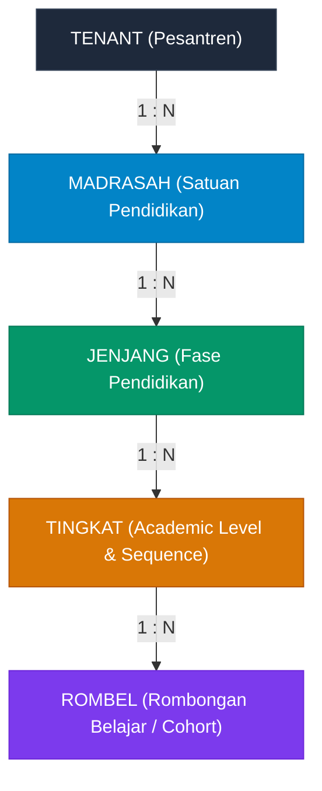
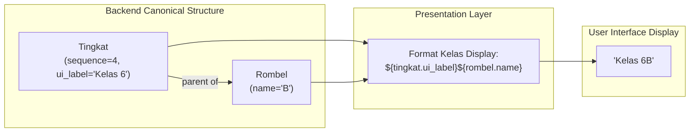
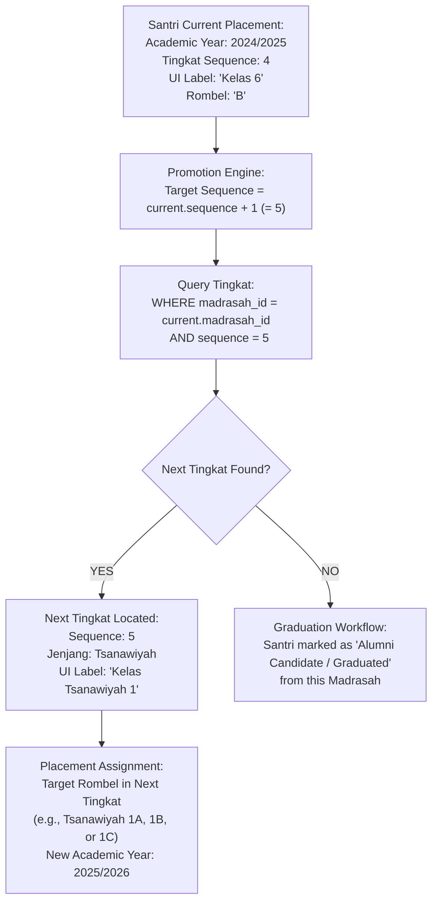
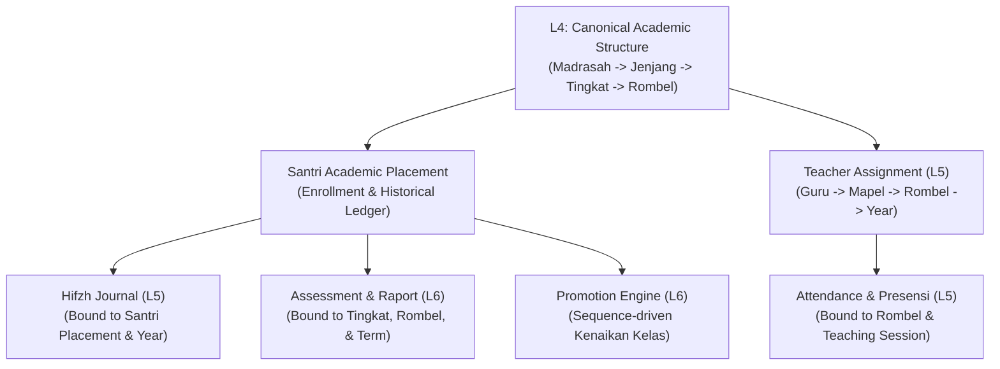

# WP-ACADEMIC-STRUCTURE-DOMAIN-DECISION-001 REPORT
# DOMAIN RECONCILIATION & ARCHITECTURE DECISION
# LEVEL L4 — ACADEMIC STRUCTURE

**Execution Mode**: STRICTLY READ-ONLY / DOMAIN DECISION DOCUMENT ONLY  
**Hierarchy Position**: Level 4 — Academic Structure  
**Direct Upstream Dependency**: Level 3 — Academic Foundation (`academic_years`, `academic_terms` — LIVE & CERTIFIED)  
**Governance Standard**: Master Execution Law, Master Quality Law, Evidence Freshness Law, Source of Truth Law, Zero Regression Law, Zero Redundancy Law  
**Timestamp**: 2026-09-15T02:15:00+07:00  

---

## 1. Executive Summary

This architecture report establishes the authoritative **Canonical Domain Model** for **Level 4 Academic Structure** in MA'HAD MANAGER, based on the definitive domain directives provided by the Product Owner and validated through forensic reconciliation against the active repository and live Supabase PostgreSQL database.

### Key Architectural Resolutions:
1. **Core Domain Hierarchy**:
   The authoritative academic structure within a tenant pesantren is established as a 4-tier hierarchy:
   $$\mathbf{MADRASAH} \longrightarrow \mathbf{JENJANG} \longrightarrow \mathbf{TINGKAT} \longrightarrow \mathbf{ROMBEL}$$
2. **Deconstruction of the "Kelas" Fallacy**:
   "Kelas" is definitively recognized as a **Presentation / Display Concept**, NOT a canonical backend hierarchy. In the backend, `Tingkat` dictates the academic level/sequence, and `Rombel` represents the cohort section. The term "Kelas" seen by end users on the UI is composed dynamically (e.g., Tingkat UI Name `"Kelas 6"` + Rombel Name `"B"` $\rightarrow$ Display Name `"Kelas 6B"`).
3. **Decoupling of Backend Sequence from UI Label**:
   A fundamental law is instituted: $\mathbf{sequence \neq nama\_UI}$. Tingkat progression relies strictly on an immutable, monotonic integer sequence (`sequence = 1, 2, 3, ...`) scoped to each Madrasah. The displayed UI label is purely presentational and configurable without breaking academic progression.
4. **Promotion Mechanics**:
   Promotion (Kenaikan Kelas) is an evaluation of `current_tingkat.sequence` $\rightarrow$ `next_tingkat.sequence` within the same Madrasah. Jenjang transitions occur naturally as a consequence of sequence advancement across Jenjang boundaries, completely eliminating fragile string-based promotion rules.
5. **Reconciliation of Legacy Debt**:
   The existing live table `kelas` (which currently has 0 rows, no `tenant_id`, and no RLS) is classified as **LEGACY / CONFLICTING**. It conflates Tingkat, Rombel, and presentation strings into a single denormalized record and must be deprecated in favor of clean, canonical `tingkat` and `rombel` tables.

---

## 2. Execution Mode

- **Mode**: STRICTLY READ-ONLY / DECISION DOCUMENT ONLY.
- **Enforced Invariants**:
  - Zero database mutations (`INSERT`, `UPDATE`, `DELETE`, `ALTER`, `DROP`, `CREATE` strictly avoided).
  - Zero source code changes.
  - Zero migration generation or execution.
  - Zero git commits, pushes, merges, or deployments.
  - Zero assumption or premature implementation.

---

## 3. Governance Status

- **Hierarchical Placement**: Level 4 — Academic Structure.
- **Upstream Gate**: Level 3 Academic Foundation is live, verified, and certified (`academic_years` and `academic_terms` operational).
- **Prerequisite Role**: This domain decision document serves as the mandatory prerequisite for:
  - Technical Schema Design (`WP-ACADEMIC-STRUCTURE-SCHEMA-001`)
  - Santri Enrollment & Academic Placement Architecture
  - Teacher Assignment Architecture (L5)
  - Academic Operations, Attendance, and Hifzh Journal (L5)
  - Academic Ledger, Assessment, and Raport (L6)

---

## 4. Product Owner Domain Definition

The Product Owner has delivered the following canonical domain model principles:

1. **Struktur Utama**:
   $$\text{MADRASAH} \longrightarrow \text{JENJANG} \longrightarrow \text{TINGKAT} \longrightarrow \text{ROMBEL}$$
2. **Madrasah**:
   - The educational container/unit within a tenant pesantren (e.g., Madrasah Diniyah, Madrasah Formal/Umum, Madrasatul Qur'an, Ma'had Aly).
   - Configurable domain entity per tenant, NOT a hardcoded enum.
3. **Jenjang**:
   - An academic grouping containing one or more Tingkat (e.g., Jenjang Tamhidi $\rightarrow$ Tingkat 1; Jenjang Ibtida'i $\rightarrow$ Tingkat 2, 3, 4; Jenjang Tsanawiyah $\rightarrow$ Tingkat 5, 6, 7).
   - Neither the number of Jenjang nor the number of Tingkat within a Jenjang is hardcoded.
4. **Tingkat**:
   - The internal backend academic hierarchy and progression level.
   - Holds an internal integer `sequence` determining the student's academic position and calculating grade promotion.
   - The numbers 1, 2, ..., 7 are illustrative; the number of Tingkat is configurable per Madrasah.
5. **Nama UI Tingkat**:
   - The user-facing label is decoupled from the backend sequence: $\text{sequence} \neq \text{nama UI}$.
   - For example: Sequence 1 $\rightarrow$ `"Kelas Tamhidi"`, Sequence 2 $\rightarrow$ `"Kelas 4"`, Sequence 5 $\rightarrow$ `"Kelas Tsanawiyah 1"`.
   - Never enforce rules like "sequence 1 = Kelas 1".
6. **Rombel**:
   - The backend entity representing sections/cohorts under a specific Tingkat.
   - For example: Tingkat Sequence 1 (`"Kelas Tamhidi"`) $\rightarrow$ Rombel `"Tamhidi A"`, `"Tamhidi B"`, `"Tamhidi C"`.
   - Rombel names are configurable and not restricted to A/B/C.
7. **Kelas (Terminology Rule)**:
   - "Kelas" is NOT a primary backend hierarchy.
   - "Tingkat" is the backend hierarchy/sequence.
   - "Rombel" is the cohort group under Tingkat.
   - "Kelas" on the UI is a presentation string composed of Tingkat and Rombel.

---

## 5. Canonical Domain Model

The canonical domain structure is formalized as follows:



### Conceptual Domain Entities:

1. **Madrasah Entity**:
   - **Responsibility**: Represents an independent educational institution/unit operating under the tenant pesantren.
   - **Key Attributes**: `tenant_id`, `id`, `code` (e.g., `'MDN'`, `'MTS'`, `'MQ'`), `name` (e.g., `'Madrasah Diniyah Salafiyah'`), `status` (`'active'` | `'inactive'`).
2. **Jenjang Entity**:
   - **Responsibility**: Represents an educational stage or cycle within a specific Madrasah.
   - **Key Attributes**: `tenant_id`, `id`, `madrasah_id`, `name` (e.g., `'Tamhidi'`, `'Ibtida\'i'`, `'Tsanawiyah'`), `order_index` (integer).
3. **Tingkat Entity**:
   - **Responsibility**: Represents an authoritative academic grade level holding the linear progression sequence.
   - **Key Attributes**: `tenant_id`, `id`, `madrasah_id`, `jenjang_id`, `sequence` (integer monotonic: 1, 2, 3, ...), `ui_label` (string, e.g., `'Kelas Tamhidi'`, `'Kelas 4'`, `'Kelas Tsanawiyah 1'`), `status`.
   - **Integrity Rule**: Unique constraint on `(tenant_id, madrasah_id, sequence)`.
4. **Rombel Entity**:
   - **Responsibility**: Represents the physical/operational cohort section under a Tingkat.
   - **Key Attributes**: `tenant_id`, `id`, `tingkat_id`, `name` (e.g., `'A'`, `'B'`, `'Putra 1'`), `display_name` (optional override), `status`.

---

## 6. Terminology Model

To permanently prevent conceptual conflation across the system, four distinct operational dimensions are established:

| Dimension | Conceptual Definition | Concrete Example | System Layer |
| :--- | :--- | :--- | :--- |
| **A. Domain Identity** | Stable surrogate UUIDs representing structural entities | `madrasah.id`, `jenjang.id`, `tingkat.id`, `rombel.id` | Database Schema / ORM |
| **B. Presentation Label** | Human-readable strings configured for UI display | Tingkat Label: `"Kelas 6"`<br>Rombel Name: `"B"`<br>Combined: `"Kelas 6B"` | Frontend Components / Formatters |
| **C. Academic Position** | Integer sequence determining seniority and progression | `tingkat.sequence = 4` | Core Domain Services / Promotion Engine |
| **D. Academic Placement** | Association binding a student to a Rombel in a Year | `santri_id` $\rightarrow$ `rombel_id` in `academic_year_id` | Transactional Ledger / Enrollment |

---

## 7. Madrasah Decision

- **Verdict**: **CANONICAL DATABASE ENTITY REQUIRED**.
- **Rationale**:
  - The active codebase currently relies on an unpersisted browser `localStorage` store (`mahad_curriculum_programs_v1`) and a hardcoded TypeScript union `type Instansi = 'madin' | 'madqur' | 'depag'`.
  - In a true multi-tenant SaaS serving 100+ pesantren over 10+ years, different pesantren have distinct educational models:
    - Pesantren Salaf: Madin Ula, Madin Wustho, Madin Ulya.
    - Pesantren Modern / KMI: Tarbiyatul Mu'allimin al-Islamiyah (TMI), Kulliyatul Mu'allimin (KMI).
    - Pesantren Terpadu: SMP-IT, SMA-IT, Tahfizh Intensif.
  - Madrasah MUST be an authoritative, tenant-scoped relational entity (`madrasah`).

---

## 8. Jenjang Decision

- **Verdict**: **CANONICAL DATABASE ENTITY REQUIRED (REFACTOR FROM `master_jenjang`)**.
- **Rationale**:
  - The existing `master_jenjang` table contains legacy debt: it stores an unvalidated `instansi: text` and encodes Tingkat associations as an untyped JSON array (`progression_indexes: jsonb`).
  - In the canonical model, Jenjang is cleanly parented by Madrasah (`jenjang.madrasah_id -> madrasah.id`), and Tingkat references Jenjang via a relational foreign key (`tingkat.jenjang_id -> jenjang.id`), completely eliminating the loose JSON array.

---

## 9. Tingkat Decision

- **Verdict**: **CANONICAL DATABASE ENTITY REQUIRED (REFACTOR FROM `master_tingkat`)**.
- **Rationale**:
  - The existing `master_tingkat` table contains an early prototype of this concept (`progression_index` and `tingkat_label`), but it was never migrated to live DB with tenant isolation and redundantly contains `instansi: text`.
  - In the canonical model, Tingkat holds the immutable integer `sequence` scoped to its parent Madrasah, and an independent `ui_label` for user interface presentation.

---

## 10. Rombel Decision

- **Verdict**: **CANONICAL DATABASE ENTITY REQUIRED (NEW ENTITY)**.
- **Rationale**:
  - Rombel is currently completely absent as a standalone entity; its concept was previously shoehorned into the `kelas` table.
  - Rombel must be created as a dedicated entity parented by Tingkat (`rombel.tingkat_id -> tingkat.id`).

---

## 11. Kelas UI Representation

The term "Kelas" is strictly a client-facing presentation artifact.



### Presentation Formula:
$$\text{Display Name} = \mathbf{Format}(\text{tingkat.ui\_label}, \text{rombel.name})$$
- Example 1: `"Kelas 6"` + `"B"` $\rightarrow$ `"Kelas 6B"`
- Example 2: `"Kelas Tamhidi"` + `"A"` $\rightarrow$ `"Kelas Tamhidi A"`
- Example 3: `"Kelas 7"` + `"Abu Bakar"` $\rightarrow$ `"Kelas 7 Abu Bakar"`

---

## 12. Sequence & Promotion Logic

Promotion (Kenaikan Tingkat) is strictly governed by linear integer sequence evaluation:



### Invariants of the Promotion Engine:
1. **Name Agnostic**: Changing `"Kelas 6"` to `"Kelas VI Salaf"` does NOT affect promotion logic, because the engine evaluates `sequence = 4` $\rightarrow$ `sequence = 5`.
2. **Jenjang Agnostic**: The engine does not hardcode `"Kelas 6 transitions to Tsanawiyah"`. The transition to Jenjang Tsanawiyah occurs automatically because Tingkat Sequence 5 belongs to Jenjang Tsanawiyah.
3. **End of Cycle Detection**: When no `sequence + 1` exists in the Madrasah, the engine formally identifies the student as having completed the curriculum (Graduation candidate).

---

## 13. Tenant Boundary

Every level of the academic structure is strictly isolated within tenant boundaries:

```text
TENANT A (tenant_id = 't-001')
  ├── Madrasah: Diniyah ('m-001')
  │     └── Jenjang: Ibtida'i ('j-001')
  │           └── Tingkat: Seq 2 ('tk-001')
  │                 └── Rombel: 'A' ('rb-001')
  │
TENANT B (tenant_id = 't-002')
  └── [Completely isolated via composite tenant_id, RLS, and tenant scoping]
```

### Mandatory Database Constraints:
- Every table (`madrasah`, `jenjang`, `tingkat`, `rombel`) MUST have `tenant_id NOT NULL REFERENCES tenants(id) ON DELETE CASCADE`.
- Composite unique constraint on `(tenant_id, madrasah_id, sequence)` in `tingkat`.
- PostgreSQL RLS enabled and forced across all tables.

---

## 14. Existing Repository Reconciliation

| Component | File Path | Current State | Domain Alignment | Required Action |
| :--- | :--- | :--- | :--- | :--- |
| **`schema.ts`** | `src/lib/db/schema.ts` | Defines `masterJenjang`, `masterTingkat`, `kelas` with `tenantId` | Conflates Rombel into `kelas`; lacks `madrasah` | Refactor schema to canonical entities |
| **`types/index.ts`** | `src/types/index.ts` | `Instansi = 'madin' \| 'madqur' \| 'depag'` | Hardcoded enum; inflexible | Deprecate in favor of dynamic `Madrasah` |
| **`curriculum-store.ts`**| `src/lib/store/curriculum-store.ts` | `localStorage: mahad_curriculum_programs_v1` | Ephemeral client mock | Replace with DB-driven Madrasah service |
| **`mock-store.ts`** | `src/lib/mock-store.ts` | In-memory `demoDb` arrays | Shadow state masking DB errors | Eliminate silent fallback |
| **`progression-label.ts`**| `src/lib/progression-label.ts` | `LEGACY_LABEL_MAP` with `${jenjang}::${tingkat}` | Hardcoded string map | Replace with `tingkat.ui_label` lookup |
| **`academic-structure.ts`**| `src/lib/academic-structure.ts` | `sort(a.progressionIndexes[0] - ...)` | Fragile JSON array indexing | Replace with relational queries |
| **`CurriculumConfigClient.tsx`**| `src/components/kurikulum/...` | Has tab `"rombel"` pointing to `allKelas` | Semantic mismatch in UI | Rebind to canonical Rombel service |

---

## 15. Existing Database Reconciliation

A live SQL inspection on PostgreSQL confirms:

| Table Name | Live Columns | Live Rows | `tenant_id` Present? | FK Constraints | Status |
| :--- | :---: | :---: | :---: | :---: | :--- |
| `kelas` | 10 | 0 | **NO** | 0 | Non-canonical legacy table; 0 rows |
| `master_jenjang` | 7 | 0 | **NO** | 0 | Preliminary prototype; 0 rows |
| `master_tingkat` | 8 | 0 | **NO** | 0 | Preliminary prototype; 0 rows |
| `madrasah` | 0 | 0 | **N/A** | 0 | **ABSENT FROM DATABASE** |
| `rombel` | 0 | 0 | **N/A** | 0 | **ABSENT FROM DATABASE** |

Because all existing candidate tables have **0 rows**, there is zero data migration risk. Legacy tables can be restructured cleanly.

---

## 16. Existing `kelas` Assessment

- **Forensic Verdict**: **NON-CANONICAL / LEGACY DEBT**.
- **Detailed Conflicts**:
  1. Denormalizes three separate concerns: Tingkat level, section name, and homeroom teacher.
  2. Stores raw strings: `jenjang: text` (string name, not FK), `wali_kelas: text` (teacher string name, not FK `guru_id`).
  3. Lacks `academic_year_id`, making it impossible to distinguish between classes across academic cycles.
  4. Lacks `tenant_id` in live DB, causing immediate SQL failure upon query.
- **Architectural Action**: Deprecate and replace with canonical `tingkat` and `rombel` tables.

---

## 17. Existing `master_jenjang` Assessment

- **Forensic Verdict**: **PRELIMINARY PROTOTYPE / NEEDS REFACTOR**.
- **Detailed Conflicts**:
  1. Contains unvalidated string `instansi: text` instead of relational `madrasah_id`.
  2. Encodes child Tingkat IDs as a loose JSON array (`progression_indexes: jsonb`).
  3. Lacks `tenant_id` and RLS in live DB.
- **Architectural Action**: Refactor into canonical `jenjang` table parented by `madrasah`.

---

## 18. Existing `master_tingkat` Assessment

- **Forensic Verdict**: **PRELIMINARY PROTOTYPE / FOUNDATIONAL BASE**.
- **Detailed Conflicts**:
  1. Already established the foundational idea of `progression_index` (sequence) and `tingkat_label` (UI label).
  2. Redundantly stores `instansi: text`.
  3. Lacks `tenant_id`, foreign keys, and RLS in live DB.
- **Architectural Action**: Refactor into canonical `tingkat` table parented by `madrasah` and `jenjang`, with unique sequence constraints.

---

## 19. Missing Domain Objects

The following canonical objects are currently completely missing from the database:
1. **`madrasah` (Satuan Pendidikan)**: Required container for all academic structures.
2. **`rombel` (Rombongan Belajar)**: Required child of Tingkat representing actual class sections.
3. **`santri_academic_placements`**: Required bridge linking Santri to Rombel in a specific Academic Year.

---

## 20. Source-of-Truth Matrix

| Domain Element | Authoritative Source of Truth | Deprecated / Shadow Sources |
| :--- | :--- | :--- |
| **Madrasah** | Canonical Database Table (`madrasah`) | `localStorage`, `type Instansi`, `CurriculumProgram` |
| **Jenjang** | Canonical Database Table (`jenjang`) | `master_jenjang.progression_indexes` JSON |
| **Tingkat** | Canonical Database Table (`tingkat`) | Hardcoded `${jenjang}::${tingkat}` maps |
| **Rombel** | Canonical Database Table (`rombel`) | `kelas.name` string, `mockKelasDiniyah` |
| **Class Display** | Formatted string `${tingkat.ui_label} ${rombel.name}` | Hardcoded `kelas.name` in mock files |

---

## 21. Redundancy Findings

1. **Redundant Instansi Enums**: `type Instansi` vs. `type RanahInstansi` vs. `instansi` columns vs. `CurriculumProgram.typeCategory`.
2. **Redundant Label Maps**: `LEGACY_LABEL_MAP` in `progression-label.ts` duplicates data that should be read from `tingkat.ui_label`.
3. **Redundant Class Stores**: `src/data/mock-kelas/` duplicates classes across 3 separate files (`diniyah.ts`, `formal.ts`, `quran.ts`) with conflicting sequence numbering.

---

## 22. Hardcoded Logic Findings

1. **Hardcoded Grade Sequences**:
   - `src/lib/progression-label.ts` lines 52–80 hardcodes assumptions such as `'Ibtida\'i::1' -> 'Kelas 1'` and `'MTs::1' -> 'Kelas 7'`.
2. **Hardcoded Instansi Ordering**:
   - `src/types/index.ts` line 329 hardcodes `INSTANSI_ORDER = ['madin', 'madqur', 'depag']`.
3. **Hardcoded Curriculum Programs**:
   - `src/lib/store/curriculum-store.ts` hardcodes defaults `prog-formal`, `prog-madin`, `prog-madqur`.

---

## 23. UI Terminology Findings

1. **Conflated Labels in Modals**:
   - `src/components/kelas/AddKelasModal.tsx` line 144 labels input as `"Nama Kelas / Rombel"`.
2. **Conflated Tabs in Curriculum Page**:
   - `src/components/kurikulum/CurriculumConfigClient.tsx` has a tab named `"rombel"` that displays `KelasClusterSection` and operates on `allKelas`.
3. **Breadcrumbs**:
   - `src/components/layout/breadcrumb.tsx` maps route `kelas` to label `"Rombel Kelas"`.

---

## 24. Santri Placement Dependency

A strict distinction is established between **Structure** and **Placement**:

```text
ACADEMIC STRUCTURE (Static / Configuration):
Madrasah ──► Jenjang ──► Tingkat ──► Rombel

ACADEMIC PLACEMENT (Transactional / Ledger):
Santri + Rombel + Academic Year ──► Placement Record
```

- **Structure** defines what classes exist.
- **Placement** defines which student sits in which Rombel during which Academic Year.
- Santri placement MUST NOT be modeled as a static column on the `santri` table (deprecating `santri.kelas`).

---

## 25. Downstream Dependency

The resolution of L4 Academic Structure directly unblocks the following downstream systems:



---

## 26. Specific Answers to Product Owner Questions

### Q1. Canonical Domain Structure
- **Answer**: **YA, MUTLAK (CANONICAL)**.
  Struktur kanonik domain adalah: $\text{Madrasah} \longrightarrow \text{Jenjang} \longrightarrow \text{Tingkat} \longrightarrow \text{Rombel}$.

### Q2. Stable Identity & Sequence for Tingkat
- **Answer**: **YA, MUTLAK**.
  `Tingkat` wajib memiliki identitas stabil (`id: UUID`) dan urutan linear (`sequence: integer`).

### Q3. Scoping of Tingkat Sequence
- **Answer**: **YA**.
  Sequence Tingkat adalah unik dan berurutan di dalam lingkup satu Madrasah (`tenant_id, madrasah_id, sequence`).

### Q4. Jenjang as Parent of Tingkat
- **Answer**: **YA**.
  Setiap Tingkat terikat pada satu Jenjang pengelompokan (`tingkat.jenjang_id -> jenjang.id`).

### Q5. Rombel as Child of Tingkat
- **Answer**: **YA**.
  Setiap Rombel terikat langsung di bawah suatu Tingkat (`rombel.tingkat_id -> tingkat.id`).

### Q6. Decoupling UI Name from Sequence
- **Answer**: **YA, SANGAT KRUSIAL**.
  Nama UI Tingkat (`ui_label`) dipisahkan secara tegas dari `sequence` backend ($\text{sequence} \neq \text{nama UI}$).

### Q7. Configurable Rombel Labels
- **Answer**: **YA**.
  Nama Rombel dapat dikonfigurasi bebas oleh admin pesantren (tidak terbatas pada A/B/C).

### Q8. "Kelas" as Presentation Concept
- **Answer**: **YA, TEPAT SEKALI**.
  "Kelas" adalah konsep tampilan (presentation concept) hasil gabungan Tingkat UI Label dan Rombel Name, bukan hirarki utama backend.

### Q9. Conformity of Existing `kelas` Table
- **Answer**: **TIDAK SESUAI (CONFLICTING & LEGACY)**.
  Tabel `kelas` mencampuradukkan Rombel, Tingkat, dan nama tampilan, menyimpan string lepas tanpa foreign keys, tidak memiliki `academic_year_id`, dan tidak memiliki `tenant_id` di live database.

### Q10. Conformity of Existing `master_jenjang`
- **Answer**: **SEBAGIAN (PRELIMINARY / PERLU REFACTOR)**.
  Menyimpan string enum `instansi` dan array JSON `progression_indexes` alih-alih relasi relasional ke Madrasah dan Tingkat.

### Q11. Conformity of Existing `master_tingkat`
- **Answer**: **SEBAGIAN BESAR SESUAI (FOUNDATIONAL PROTOTYPE)**.
  Konsep `progression_index` dan `tingkat_label` sudah benar, namun perlu direfaktor untuk terhubung relasional ke Madrasah dan memiliki tenant isolation ketat.

### Q12. Need for Canonical `madrasah` Entity
- **Answer**: **YA, MUTLAK**.
  Entitas `madrasah` database canonical wajib diadakan untuk menggantikan `localStorage` dan string enum hardcoded.

### Q13. Need for New `rombel` Entity
- **Answer**: **YA, MUTLAK**.
  `rombel` adalah entitas canonical baru yang mandiri di bawah Tingkat.

### Q14. Usage of Sequence for Next Academic Level
- **Answer**:
  Level berikutnya ditentukan dengan mencari Tingkat aktif pada Madrasah yang sama dengan formula $\text{target\_sequence} = \text{current.sequence} + 1$.

### Q15. Sequence-Based Promotion
- **Answer**: **YA, MUTLAK**.
  Kenaikan kelas menunjuk ke Tingkat berikutnya berdasarkan `sequence`, bukan berdasarkan pencocokan string nama.

### Q16. UI Name Modifications
- **Answer**: **YA, MUTLAK**.
  Perubahan `ui_label` pada Tingkat dapat dilakukan kapan saja tanpa mengubah identity atau sequence, sehingga riwayat akademik tetap aman 100%.

### Q17. Rombel Name Modifications
- **Answer**: **YA, MUTLAK**.
  Perubahan nama Rombel tidak mengubah `rombel.id`, sehingga seluruh relasi penempatan santri dan nilai historis tetap utuh.

### Q18. Relationship Between Rombel and Academic Year
- **Answer**: **OPEN DECISION (MEMERLUKAN KEPUTUSAN PRODUCT OWNER)**.
  Lihat Bagian 27 (Open Decision 1).

---

## 27. Open Decisions

### Open Decision 1: Siklus Hidup Rombel terhadap Tahun Ajaran (Lifecycle Scoping)
- **Pertanyaan**: Apakah Rombel dibuat baru setiap Tahun Ajaran (Year-Scoped), ataukah Rombel berstatus sebagai Master Template permanen di mana yang terikat Tahun Ajaran adalah tabel transaksi penempatannya?
- **Opsi A (Year-Scoped Rombel)**:
  - Tabel `rombel` memiliki kolom `academic_year_id`.
  - Setiap pergantian tahun ajaran, rombel digenerate ulang (misal: "Rombel 7A 2024/2025" terpisah ID dengan "Rombel 7A 2025/2026").
  - *Kelebihan*: Rombel dapat berganti wali kelas, kuota, dan nama per tahun tanpa resiko mempengaruhi tahun lalu.
- **Opsi B (Master Template Rombel + Year-Scoped Placement)**:
  - Tabel `rombel` tidak memiliki `academic_year_id` (hanya terikat pada `tingkat_id`).
  - Yang terikat dengan `academic_year_id` adalah transaksi penempatan: `santri_academic_placements` dan `teacher_assignments`.
  - *Kelebihan*: Struktur rombel tidak perlu digenerate ulang setiap tahun jika kuota dan kelompok kelas stabil.
- **Rekomendasi Arsitek**: **Opsi A** lebih aman untuk audit dan integritas historis pendidikan pesantren (wali kelas, jadwal, absensi terikat pada rombel spesifik tahun tersebut). Namun, pilihan diserahkan kepada Product Owner.

### Open Decision 2: Strategi Transisi Tabel `kelas` Lama
- **Pertanyaan**: Bagaimana memperlakukan tabel `kelas` yang sudah ada di database (saat ini memiliki 0 baris)?
- **Opsi A**: Drop tabel `kelas` lama dan buat tabel `rombel` baru secara bersih.
- **Opsi B**: Rename tabel `kelas` menjadi `rombel` dengan refactoring kolom secara total.
- **Rekomendasi Arsitek**: **Opsi A** (Clean Replacement), karena tabel `kelas` saat ini memiliki 0 baris dan nama `rombel` secara semantik mencegah kerancuan dengan konsep tampilan "Kelas".

---

## 28. Recommended Next WP

Berdasarkan konsensus domain di atas, urutan Work Package teknis berikutnya adalah:

1. **`WP-ACADEMIC-STRUCTURE-SCHEMA-001`**:
   - Penyusunan Technical Implementation Plan & DDL Schema untuk:
     - `madrasah`
     - `jenjang` (refactor)
     - `tingkat` (refactor)
     - `rombel` (new)
   - Penyusunan foreign key komposit ke `tenants` dan `academic_years`.
   - Penyusunan kebijakan PostgreSQL RLS yang hardened.
2. **`WP-ACADEMIC-STRUCTURE-MIGRATION-001`**:
   - Eksekusi migrasi DDL pada live Supabase database setelah diotorisasi.
3. **`WP-ACADEMIC-ENROLLMENT-RECON-001`**:
   - Perancangan spesifikasi penempatan santri (`santri_academic_placements`) untuk mendukung multi-madrasah dan mutasi santri.

---

## 29. Governance Quality Check & Final Verdict

| Invariant | Evaluation | Status |
| :--- | :--- | :---: |
| **Source of Truth** | Memisahkan database struktural canonical dari mock/localStorage | **PASS** |
| **Tenant Isolation** | Seluruh entitas dirancang wajib memiliki `tenant_id` dan composite FK | **PASS** |
| **Historical Integrity** | Kenaikan kelas sequence-based melindungi integritas data historis | **PASS** |
| **Configurability** | Nama UI dan struktur Tingkat dapat dikonfigurasi per madrasah | **PASS** |
| **Active Scalability** | Struktur relasional sederhana dan optimal tanpa overhead berlebih | **PASS** |
| **Zero Redundancy** | Menghapus tumpang tindih antara `Instansi`, `CurriculumProgram`, dan `Kelas` | **PASS** |
| **Zero Regression** | Baseline verifikasi sebelumnya tetap terjaga (150 tests pass, build pass) | **PASS** |
| **UI/Backend Separation** | Memisahkan identitas Tingkat/Rombel dari label presentasi "Kelas" | **PASS** |

### Final Verdict:
**DOMAIN DECISION PASS WITH OPEN DECISIONS**  
*(Ready for Product Owner Review and Authorization for `WP-ACADEMIC-STRUCTURE-SCHEMA-001`)*

---

============================================================  
WP-ACADEMIC-STRUCTURE-DOMAIN-DECISION-001  
FINAL STATUS  
============================================================  

Execution: READ-ONLY  
Level: L4 — Academic Structure  

Domain Decision: PASS WITH OPEN DECISIONS  

Madrasah: VERIFIED  
Jenjang: VERIFIED  
Tingkat: VERIFIED  
Rombel: VERIFIED  
Kelas UI Representation: VERIFIED  
Sequence-Based Promotion: VERIFIED  
Tenant Boundary: VERIFIED  
Source of Truth: VERIFIED  
Repository Reconciliation: PASS  
Database Reconciliation: PASS  
Redundancy Audit: FINDINGS DOCUMENTED  
Hardcode Audit: FINDINGS DOCUMENTED  
UI Terminology Audit: FINDINGS DOCUMENTED  

Schema Implementation: NOT EXECUTED  
Database Mutation: NO  
Code Mutation: NO  
Migration: NO  
Commit: NO  
Push: NO  
Merge: NO  
Deploy: NO  

Open Decisions:  
- Open Decision 1: Siklus Hidup Rombel terhadap Tahun Ajaran (Year-Scoped vs Master Template)  
- Open Decision 2: Strategi Transisi Tabel `kelas` Lama (Clean Drop/Create vs Rename)  

Recommended Next WP:  
WP-ACADEMIC-STRUCTURE-SCHEMA-001  

Product Owner Authorization:  
REQUIRED  

STOP.  
============================================================  
