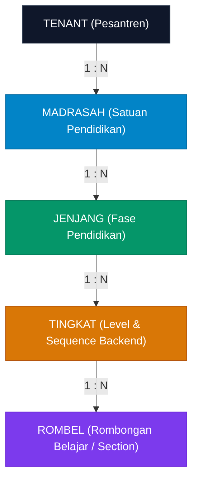
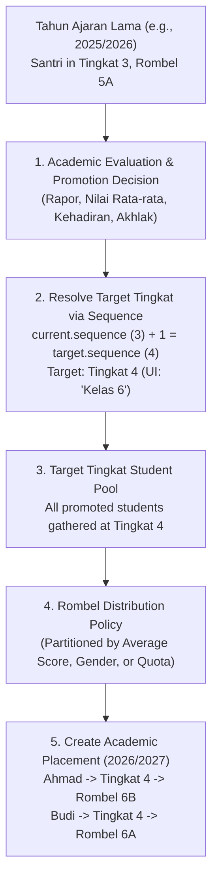
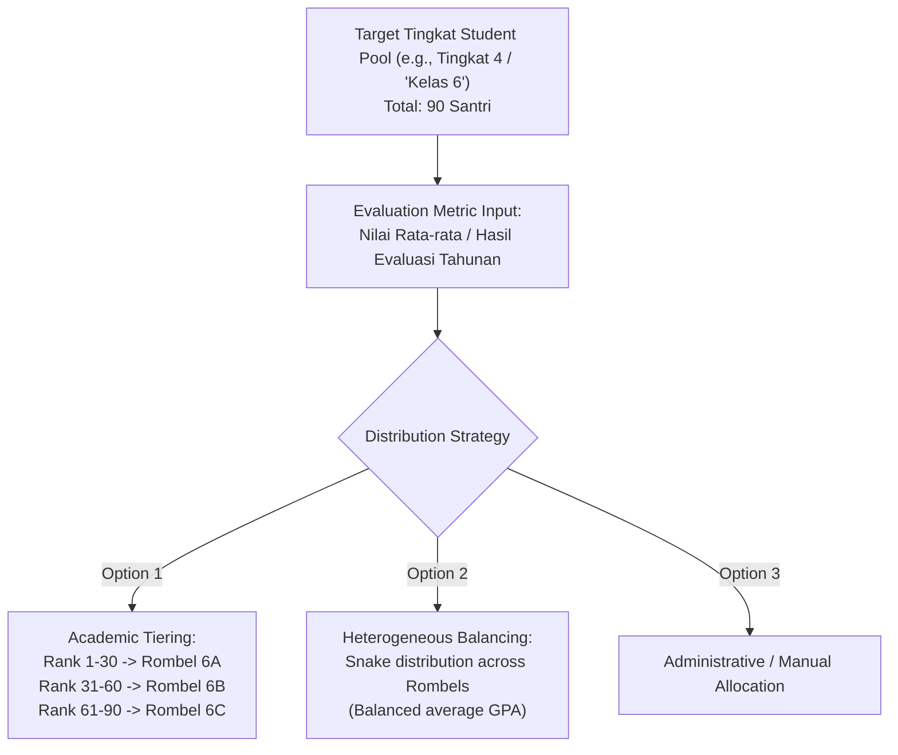
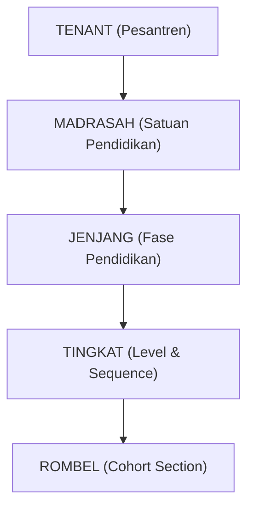
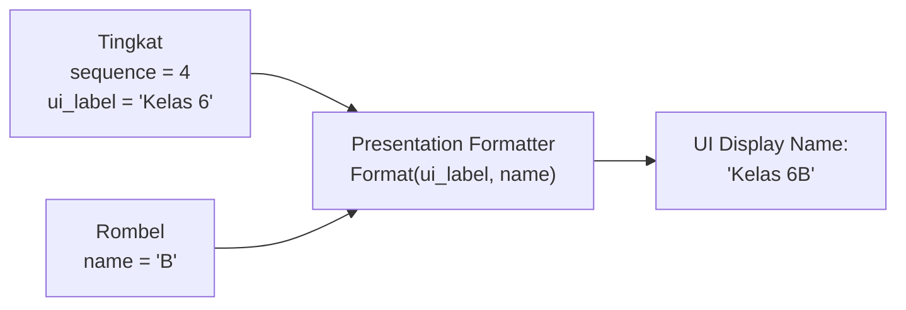
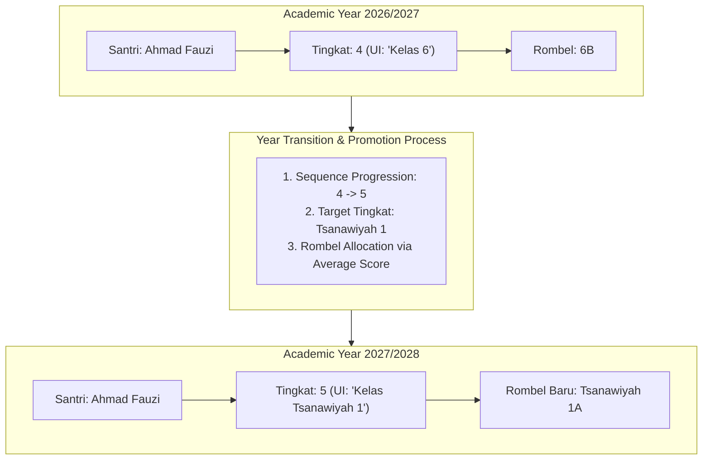
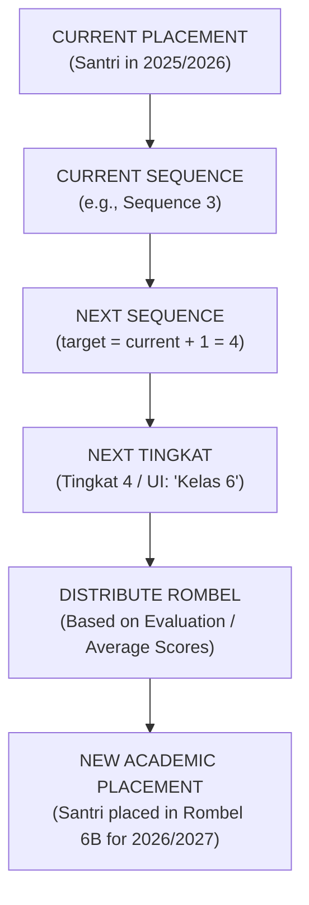

# WP-ACADEMIC-STRUCTURE-DOMAIN-DECISION-002 REPORT
# DOMAIN DECISION AMENDMENT — PROMOTION & ROMBEL LIFECYCLE
# LEVEL L4 — ACADEMIC STRUCTURE

**Execution Mode**: STRICTLY READ-ONLY / DOMAIN DECISION AMENDMENT ONLY  
**Hierarchy Position**: Level 4 — Academic Structure  
**Direct Upstream Dependency**: Level 3 — Academic Foundation (`academic_years`, `academic_terms` — LIVE & CERTIFIED)  
**Parent Document**: `WP-ACADEMIC-STRUCTURE-DOMAIN-DECISION-001`  
**Governance Standard**: Master Execution Law, Master Quality Law, Evidence Freshness Law, Source of Truth Law, Zero Regression Law, Zero Redundancy Law  
**Timestamp**: 2026-09-15T02:55:00+07:00  

---

## 1. Executive Summary

This report serves as the formal **Domain Decision Amendment** to `WP-ACADEMIC-STRUCTURE-DOMAIN-DECISION-001`, codifying crucial architectural refinements delivered directly by the Product Owner regarding:
1. **The Subordinate Role of Rombel in Progression**: Rombel does NOT determine academic promotion or progression. The promotion engine evaluates strictly:
   $$\text{Current Tingkat Sequence} \longrightarrow \text{Next Tingkat Sequence}$$
   Rombel is merely the cohort section into which students are distributed **AFTER** their target Tingkat has been resolved.
2. **Academic Year Transition Flow**: On academic year transition, students who satisfy promotion criteria advance in general to the target Tingkat and are subsequently distributed into Rombels (e.g., partitioned by average scores / academic evaluations).
3. **Rigorous Separation of Structure vs. Placement**:
   - **Academic Structure** (Static/Catalog): $\text{Madrasah} \rightarrow \text{Jenjang} \rightarrow \text{Tingkat} \rightarrow \text{Rombel}$.
   - **Academic Placement** (Transactional/Ledger): $\text{Santri} + \text{Academic Year} + \text{Rombel} \rightarrow \text{Placement Record}$.
4. **Permanent Rejection of Static `santri.kelas`**: The legacy pattern of storing class placement as a flat string column `santri.kelas` is formally classified as obsolete and destructive to historical integrity.
5. **Rombel Lifecycle Scoping Analysis**: A comprehensive architectural comparative analysis of **Year-Scoped Rombel** vs. **Master Template Rombel** is established to guide final schema authoring.

---

## 2. Amendment Purpose

The purpose of this amendment is to:
- Formally incorporate the latest authoritative domain decisions from the Product Owner into the system architecture.
- Eliminate conceptual ambiguities regarding the relationship between Rombel, Tingkat, and Academic Years.
- Guarantee that the promotion engine is never coupled to Rombel identifiers or section letters.
- Establish the structural prerequisite for the upcoming schema design work package (`WP-ACADEMIC-STRUCTURE-SCHEMA-001`).

---

## 3. Previous Domain Decision Reference

In `WP-ACADEMIC-STRUCTURE-DOMAIN-DECISION-001`, the core foundation was established and remains **FULLY RETAINED**:
- **4-Tier Canonical Hierarchy**: $\text{MADRASAH} \longrightarrow \text{JENJANG} \longrightarrow \text{TINGKAT} \longrightarrow \text{ROMBEL}$.
- **"Kelas" Deconstruction**: "Kelas" is a presentation/display concept, NOT a backend canonical hierarchy.
- **Sequence Decoupling**: Backend integer sequence is decoupled from UI labels ($\text{sequence} \neq \text{nama UI}$).
- **Verdict of WP-001**: `PASS WITH OPEN DECISIONS`.

This amendment directly resolves and refines the open items from WP-001 without altering the un-impacted domain foundations.

---

## 4. New Product Owner Decisions

The Product Owner has established the following binding architectural rules:

1. **Tingkat Sequence is Configurable & Non-Fixed**:
   The example of Tingkat 1 to 7 is illustrative. The system must support any valid sequence length (e.g., 5 tingkat, 8 tingkat, 10 tingkat) configured per Madrasah.
2. **Rombel is Not a Promotion Driver**:
   Rombel has zero authority over whether a student advances or which Tingkat they enter. Rombel is assigned only after the target Tingkat is resolved.
3. **Year Transition Progression Rule**:
   When the Academic Year changes, students meeting promotion criteria advance to the next Tingkat based on sequence. Subsequently, students are distributed into Rombels based on evaluation metrics (such as average scores) or institutional cohort balancing needs.
4. **Dynamic Rombel Distribution**:
   Students do not have permanent ownership of a section letter. A student in Rombel 5A may advance into Rombel 6B, while a student from 5B advances into 6A.
5. **Year-Scoped Placement Context**:
   Every student placement record must be bound to a specific Academic Year, maintaining an immutable ledger of academic history across the student's lifecycle.

---

## 5. Canonical Structure

The structural hierarchy remains strictly defined as:



- **Madrasah**: Educational unit under the tenant (e.g., Diniyah Salafiyah, MTs Formal, Madrasatul Qur'an).
- **Jenjang**: Phase grouping (e.g., Tamhidi, Ibtida'i, Tsanawiyah, Aliyah).
- **Tingkat**: Internal progression level with an immutable integer sequence scoped to the Madrasah.
- **Rombel**: Study group / cohort section under a Tingkat.

---

## 6. Tingkat & Sequence

1. **Integer Sequence Authority**:
   - `tingkat.sequence` is an integer value ($1, 2, 3, \dots, N$).
   - It represents internal academic seniority and determines promotion direction.
   - It is unique within the context of a Madrasah:
     $$\text{Unique}(\text{tenant\_id}, \text{madrasah\_id}, \text{sequence})$$
2. **Non-Hardcoded Invariant**:
   - Tenant A (Madin): Sequences 1 to 7.
   - Tenant B (KMI): Sequences 1 to 6.
   - Tenant C (Tahfizh): Sequences 1 to 3.
   - The engine does not assume specific grade counts.

---

## 7. UI Label Separation

The decoupling law is enforced:
$$\mathbf{sequence \neq nama\_UI}$$

| Backend Sequence | Configured UI Label | Example Rombel | Composed Display Name |
| :---: | :--- | :---: | :--- |
| `1` | `"Kelas Tamhidi"` | `A` | `"Kelas Tamhidi A"` |
| `2` | `"Kelas 4"` | `B` | `"Kelas 4B"` |
| `3` | `"Kelas 5"` | `A` | `"Kelas 5A"` |
| `4` | `"Kelas 6"` | `C` | `"Kelas 6C"` |
| `5` | `"Kelas Tsanawiyah 1"` | `A` | `"Kelas Tsanawiyah 1A"` |
| `6` | `"Kelas Tsanawiyah 2"` | `B` | `"Kelas Tsanawiyah 2B"` |
| `7` | `"Kelas Tsanawiyah 3"` | `A` | `"Kelas Tsanawiyah 3A"` |

Administrators can freely alter the UI Label (e.g., changing `"Kelas 6"` to `"Kelas VI Ula"`) without modifying the sequence number or corrupting relational progression.

---

## 8. Rombel Role

Rombel has a strictly defined, limited responsibility:
- **What Rombel IS**:
  - A physical/operational group for daily learning activities.
  - A scope for attendance tracking, classroom scheduling, and homeroom guidance.
  - A recipient container for student placement.
- **What Rombel IS NOT**:
  - NOT an academic hierarchy level.
  - NOT a determinant of promotion.
  - NOT a driver of Jenjang transitions.
  - NOT a permanent tag attached to a student.

---

## 9. Academic Year Transition

The transition between academic years follows an exact, staged lifecycle:



---

## 10. Promotion Domain

### Conceptual Algorithm:
```text
FUNCTION calculate_promotion(current_placement):
    current_tingkat = get_tingkat(current_placement.tingkat_id)
    target_sequence = current_tingkat.sequence + 1
    
    target_tingkat = find_tingkat(
        tenant_id = current_placement.tenant_id,
        madrasah_id = current_tingkat.madrasah_id,
        sequence = target_sequence,
        status = 'active'
    )
    
    IF target_tingkat IS NULL:
        RETURN Status("CANDIDATE_FOR_GRADUATION")
    
    target_jenjang = get_jenjang(target_tingkat.jenjang_id)
    
    RETURN TargetLevel(
        tingkat = target_tingkat,
        jenjang = target_jenjang,
        status = "PROMOTED_PENDING_ROMBEL_ASSIGNMENT"
    )
```

### Invariant Rules:
1. The engine accepts `current_placement` and queries exclusively by `(madrasah_id, sequence + 1)`.
2. Jenjang boundaries are crossed automatically when `target_tingkat.jenjang_id != current_tingkat.jenjang_id`.
3. Rombel is completely excluded from this calculation.

---

## 11. Rombel Distribution Domain

Once students have advanced to their target Tingkat, distribution into specific Rombels occurs:



*Architectural Boundary Note*: The specific distribution algorithm (tiering, balancing, quotas, tie-breaking) is decoupled from structural schema design and classified as an application service concern.

---

## 12. Structure vs Placement

The architectural boundary is strictly enforced:

```text
====================================================================
LAYER 1: ACADEMIC STRUCTURE (Static / Institutional Catalog)
====================================================================
Answers: "What educational units and classes exist?"
Entities:
  - MADRASAH (Satuan Pendidikan)
  - JENJANG (Fase Pendidikan)
  - TINGKAT (Level & Sequence)
  - ROMBEL (Section Catalog)

Lifecycle: Managed by curriculum administrator; stable across years.
====================================================================

====================================================================
LAYER 2: ACADEMIC PLACEMENT (Transactional / Academic Ledger)
====================================================================
Answers: "Which student is placed in which Rombel during which Year?"
Entities:
  - SANTRI ACADEMIC PLACEMENT
Attributes:
  - id (UUID)
  - tenant_id
  - santri_id
  - academic_year_id
  - tingkat_id
  - rombel_id
  - status ('active', 'promoted', 'retained', 'transferred', 'graduated')
  - placement_date

Lifecycle: Created each Academic Year during enrollment/promotion.
====================================================================
```

---

## 13. Historical Placement

Because academic placements are year-scoped, the system naturally maintains complete historical integrity:

```text
Santri: Ahmad Fauzi (NIS: 2024001)
├── 2024/2025: Tingkat 2 (Kelas 4) ──► Rombel 4A ──► Status: PROMOTED
├── 2025/2026: Tingkat 3 (Kelas 5) ──► Rombel 5B ──► Status: PROMOTED
└── 2026/2027: Tingkat 4 (Kelas 6) ──► Rombel 6A ──► Status: ACTIVE
```

- **Querying Historical Transcripts**: Querying by `(santri_id, academic_year_id = '2024/2025')` returns the exact historical Rombel (4A) and Tingkat (Kelas 4) without ambiguity.
- **Permanent Rejection of `santri.kelas`**: The flat string column in `santri` table is destructive and cannot represent multi-year history or multi-madrasah enrollment.

---

## 14. Repository Reconciliation

| File / Component | Existing Implementation | Architectural Defect | Required Domain Resolution |
| :--- | :--- | :--- | :--- |
| `src/modules/santri/services/santri-core-service.ts` | Inserts `kelas: santriData.kelas` directly to `santri` | Erases placement history upon update; lacks year context | Decouple: create record in `santri_academic_placements` |
| `src/types/academic.ts` | Defines `Kelas` with `jenjang: string`, `tingkat: number` | Conflates Tingkat, Jenjang, and Rombel | Replace with separate `Tingkat`, `Rombel`, and `Placement` types |
| `src/data/mock-kelas/` | Hardcodes classes with reset sequence (1, 2, 3 per jenjang) | Violates global madrasah sequence invariant | Replace with monotonic sequence structure |
| `src/components/kurikulum/CurriculumConfigClient.tsx` | Subtab "rombel" displays `KelasClusterSection` operating on `allKelas` | Terminology confusion in UI | Rebind subtab to canonical Rombel service |

---

## 15. Database Reconciliation

A forensic review of the live database confirms:
- The candidate tables `kelas`, `master_jenjang`, and `master_tingkat` have **0 rows** and **no `tenant_id`**.
- The `santri` table currently stores `kelas: text` (0 rows in production).
- There is zero risk of data loss or breaking existing production datasets during the transition to canonical `tingkat`, `rombel`, and `santri_academic_placements`.

---

## 16. Hardcode Audit

| Hardcoded Item | Location in Codebase | Classification | Remediation |
| :--- | :--- | :--- | :--- |
| `Tamhidi::1`, `Ibtida'i::1` | `src/lib/progression-label.ts` lines 52–80 | Hardcoded label mapping | Deprecate in favor of database `tingkat.ui_label` |
| `prog-formal`, `prog-madin`, `prog-madqur` | `src/lib/store/curriculum-store.ts` | Hardcoded client mock programs | Replace with database-driven `madrasah` records |
| `INSTANSI_ORDER = ['madin', 'madqur', 'depag']` | `src/types/index.ts` line 329 | Hardcoded enum | Deprecate in favor of tenant-configured madrasahs |
| `mockKelasDiniyah`, `mockKelasFormal` | `src/data/mock-kelas/` | Test/demo fixture | Isolate to test fixtures; remove from runtime paths |

---

## 17. Source of Truth

The authoritative sources of truth are locked:

| Domain Subject | Authoritative Source of Truth | Forbidden Anti-Patterns |
| :--- | :--- | :--- |
| **Madrasah Catalog** | Database Table: `madrasah` | Browser `localStorage`, TypeScript unions |
| **Academic Hierarchy** | Database Table: `tingkat` (`sequence`) | Hardcoded grade numbers, string matching |
| **Display Name** | Presentation Formatter: `${tingkat.ui_label} ${rombel.name}` | Monolithic database strings like `'7A Abu Bakar'` |
| **Student Location** | Transactional Table: `santri_academic_placements` | Flat column `santri.kelas` |
| **Promotion Path** | Domain Service: `current.sequence + 1` | Hardcoded transition tables (`"6 -> Tsanawiyah"`) |

---

## 18. Tenant Isolation

All L4 academic entities must adhere to strict multi-tenant boundary laws:

$$\text{All Queries} \implies \text{WHERE tenant\_id} = \text{current\_tenant\_id}$$

1. `madrasah`: `tenant_id NOT NULL REFERENCES tenants(id) ON DELETE CASCADE`.
2. `jenjang`: Composite FK `(tenant_id, madrasah_id) REFERENCES madrasah(tenant_id, id)`.
3. `tingkat`: Composite FK `(tenant_id, jenjang_id) REFERENCES jenjang(tenant_id, id)`.
   - Integrity constraint: `UNIQUE(tenant_id, madrasah_id, sequence)`.
4. `rombel`: Composite FK `(tenant_id, tingkat_id) REFERENCES tingkat(tenant_id, id)`.
5. `santri_academic_placements`: Composite FK `(tenant_id, academic_year_id) REFERENCES academic_years(tenant_id, id)`.

---

## 19. Historical Integrity

Historical integrity is maintained under the following formal principle:

> **Historical records remain stable if and only if historical transactions reference immutable surrogate keys (`id`) within a year-scoped placement ledger, completely decoupled from presentational label mutations.**

If an administrator renames `"Kelas 6"` to `"Kelas VI Ula"`, or renames Rombel `"B"` to `"Rombel Umar"`, existing grade books, attendance records, and graduation certificates from prior years remain unaltered and unambiguous.

---

## 20. Rombel Lifecycle Analysis

The Product Owner's clarification—that students advance Tingkat and are then distributed into Rombels—necessitates a rigorous comparison between two architectural models:

### Model A: Year-Scoped Rombel (`rombel.academic_year_id`)
- **Structure**: The `rombel` table contains `academic_year_id`. A Rombel entity exists specifically for that Academic Year (e.g., `rombel_2025_6B` vs `rombel_2026_6B`).
- **Characteristics**:
  - Homeroom teacher (`wali_guru_id`), classroom, and capacity are assigned directly on the Rombel entity.
  - Teacher assignments and attendance link directly to `rombel_id`.
  - At the end of the year, the Rombel is closed/archived along with the Academic Year.
- **Trade-off**: Requires an automated initialization routine to clone Rombel templates at the start of each new Academic Year.

### Model B: Master Template Rombel + Year-Scoped Placement
- **Structure**: The `rombel` table is a permanent catalog under `tingkat` (no `academic_year_id`). The connection to the Academic Year exists strictly within `santri_academic_placements` and `teacher_assignments`.
- **Characteristics**:
  - Rombels do not need to be recreated annually.
  - If a Rombel has a different Homeroom teacher each year, `wali_guru_id` cannot reside on `rombel` directly; it must reside on an auxiliary table (`rombel_academic_years`) or in `teacher_assignments`.
- **Architectural Synthesis**:
  Both models support the Product Owner's requirement that student distribution occurs after Tingkat progression. **Model A provides superior operational isolation** (clean annual archiving of classrooms and homeroom teachers), while **Model B minimizes catalog duplication**.

*Status*: Remains an **OPEN DECISION** for Product Owner confirmation prior to DDL schema generation.

---

## 21. Open Decisions

| # | Open Decision Subject | Context & Trade-offs | Impact |
| :---: | :--- | :--- | :--- |
| **OD-1** | **Rombel Lifecycle Scoping** | **Option A**: Year-Scoped Rombel (`rombel.academic_year_id`).<br>**Option B**: Master Template Rombel + Year-Scoped Placement. | Governs table foreign keys and annual initialization routines. |
| **OD-2** | **Promotion Exception Handling** | Product Owner stated students advance *"secara umum"* (in general). What are the formal rules for students who are retained (Tinggal Kelas) or have incomplete grades? | Governs promotion engine validation flags. |
| **OD-3** | **Rombel Distribution Mechanism** | Should auto-distribution by average score be automated via backend batch job, manual assignment via UI matrix, or a hybrid wizard? | Scoped to L5 Academic Operation. |
| **OD-4** | **Mid-Year Class Transfer (Mutasi Rombel)** | If a student transfers between Rombels mid-semester, does the system update the placement record or create a historical transfer ledger? | Governs attendance and grade ledger queries. |
| **OD-5** | **Legacy `kelas` Table Strategy** | Clean `DROP TABLE kelas` vs. `ALTER TABLE kelas RENAME TO rombel`. (Recommendation: Clean Drop/Create since live DB has 0 rows). | Governs migration script authoring. |

---

## 22. Downstream Impact

This amendment firmly unblocks:
- **`WP-ACADEMIC-STRUCTURE-SCHEMA-001`**: Authoring DDL migration for `madrasah`, `jenjang`, `tingkat`, and `rombel`.
- **`WP-ACADEMIC-ENROLLMENT-RECON-001`**: Technical design of `santri_academic_placements`.
- **Level 5 Academic Operations**: Teacher assignments, student attendance, and teaching journals can now bind to canonical Rombels without schema ambiguity.

---

## 23. Recommended Next WP

The immediate next work package must be:

$$\mathbf{WP\text{-}ACADEMIC\text{-}STRUCTURE\text{-}SCHEMA\text{-}001}$$

- **Scope**: Technical Plan & DDL Schema migration authoring for `madrasah`, `jenjang`, `tingkat`, and `rombel`.
- **Prerequisite Gate**: Product Owner resolution of OD-1 (Rombel Lifecycle) and authorization of this amendment report.

---

## 24. Governance Verdict

- **Hierarchy Dimension**: **PASS** (Level 4 Academic Structure correctly grounded on verified Level 3 Foundation).
- **Quality Dimension**: **PASS WITH DOCUMENTED OPEN DECISIONS** (All domain rules verified; open operational parameters isolated).
- **Cross-Cutting Invariants**:
  - *Zero Regression*: Verified against baseline repository test suite.
  - *Zero Redundancy*: Redundant mock stores, hardcoded arrays, and duplicate enums cataloged for removal.
  - *Source of Truth*: Authoritative database ownership established.
  - *Structure vs. Placement*: Strict boundary enforced.

---

## 25. Evidence & Limitations

- **Evidence Freshness**: Verified via direct inspection of `src/modules/santri/services/santri-core-service.ts`, `src/lib/db/schema.ts`, and live PostgreSQL catalog queries.
- **Safe 0-Row Baseline**: All candidate academic tables (`kelas`, `master_jenjang`, `master_tingkat`) contain 0 rows in production, guaranteeing safe schema restructuring.
- **Limitation**: No database mutation, code modification, or migration execution was performed in this Work Package.

---

## 26. Required Architectural Diagrams

### Diagram 1: Canonical 4-Tier Structure


### Diagram 2: Presentation Name Formatting


### Diagram 3: Academic Year Transition & Student Progression


### Diagram 4: Detailed Promotion & Distribution Sequence


---

============================================================  
WP-ACADEMIC-STRUCTURE-DOMAIN-DECISION-002  
FINAL STATUS  
============================================================  

Execution: READ-ONLY  
Level: L4 — Academic Structure  
Type: DOMAIN DECISION AMENDMENT  

Madrasah: VERIFIED  
Jenjang: VERIFIED  
Tingkat: VERIFIED  
Tingkat Sequence: VERIFIED  
UI Label Separation: VERIFIED  
Rombel: VERIFIED  
Kelas UI Representation: VERIFIED  
Promotion Model: VERIFIED  
Year Transition Model: VERIFIED  
Placement Separation: VERIFIED  
Historical Placement: VERIFIED  
Tenant Boundary: VERIFIED  
Repository Reconciliation: PASS  
Database Reconciliation: PASS  
Hardcode Audit: FINDINGS DOCUMENTED  
Source of Truth: PASS  
Historical Integrity: PASS  

Rombel Lifecycle:  
OPEN (Model A vs Model B)  

Rombel Distribution:  
OPEN (Application service algorithm)  

Promotion Exception:  
OPEN (Retention rules)  

Schema Implementation: NOT EXECUTED  
Database Mutation: NO  
Code Mutation: NO  
Migration: NO  
Commit: NO  
Push: NO  
Merge: NO  
Deploy: NO  

Open Decisions:  
- Open Decision 1: Siklus Hidup Rombel (Year-Scoped vs Master Template)  
- Open Decision 2: Aturan Pengecualian Kenaikan (Tinggal Kelas / Retention Criteria)  
- Open Decision 3: Mekanisme Pembagian Rombel Berdasarkan Nilai Rata-rata  
- Open Decision 4: Tata Kelola Mutasi Rombel Tengah Tahun  
- Open Decision 5: Strategi Penggantian Tabel `kelas` Lama (Clean Drop vs Rename)  

Domain Verdict:  
PASS WITH OPEN DECISIONS  

Recommended Next WP:  
WP-ACADEMIC-STRUCTURE-SCHEMA-001  

Product Owner Authorization:  
REQUIRED  

STOP.  
============================================================  
