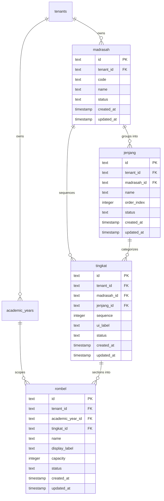

# WP-ACADEMIC-STRUCTURE-IMPLEMENTATION-001 REPORT
# ACADEMIC STRUCTURE — CANONICAL SCHEMA IMPLEMENTATION & CONTROLLED MIGRATION
# LEVEL L4 — ACADEMIC STRUCTURE

**Execution Mode**: IMPLEMENTATION AUTHORIZED & EXECUTED  
**Hierarchy Position**: Level 4 — Academic Structure  
**Direct Upstream Dependency**: Level 3 — Academic Foundation (`academic_years`, `academic_terms` — LIVE & CERTIFIED)  
**Primary Specification**: `docs/architecture/WP-ACADEMIC-STRUCTURE-SCHEMA-001-REPORT.md`  
**Upstream Domain Authority**: `WP-ACADEMIC-STRUCTURE-DOMAIN-DECISION-001`, `WP-ACADEMIC-STRUCTURE-DOMAIN-DECISION-002`, `WP-ACADEMIC-STRUCTURE-DOMAIN-CLOSURE-003`, `WP-ACADEMIC-STRUCTURE-SCHEMA-001`  
**Governance Standard**: Master Execution Law, Master Quality Law, Evidence Freshness Law, Source of Truth Law, Zero Regression Law, Zero Redundancy Law  
**Timestamp**: 2026-09-15T06:33:00+07:00  

---

## 1. Authorization

- **Work Package**: `WP-ACADEMIC-STRUCTURE-IMPLEMENTATION-001`
- **Product Owner Authorization**: Explicitly authorized implementation and controlled live migration for this Work Package ONLY.
- **Authorized Scope Boundaries**:
  - Implementation of primary Drizzle schema: [academic_structure.ts](file:///e:/Projects/Os_Darta/src/lib/db/schema/academic_structure.ts)
  - Authoring of SQL migration: [WP-ACADEMIC-STRUCTURE-IMPLEMENTATION-001.sql](file:///e:/Projects/Os_Darta/drizzle/WP-ACADEMIC-STRUCTURE-IMPLEMENTATION-001.sql)
  - Live execution of DDL on Supabase PostgreSQL (`public` schema) for the four canonical L4 tables (`madrasah`, `jenjang`, `tingkat`, `rombel`), required constraints, indexes, and RLS policies.
- **Strict Prohibitions Adhered To**:
  - ZERO business data inserted or seeded.
  - ZERO mutations to `santri`, `guru`, `academic_years`, `academic_terms`, or unrelated tables.
  - NO Git commit, push, merge, or deployment executed.

---

## 2. Pre-Implementation Snapshot

Before executing any modification, an authoritative snapshot of the local repository and live PostgreSQL database catalog was captured:

- **Git Branch**: `preview`
- **Current Head Commit**: `809aae5d030a8eafe30354ce3c7eef04f79dd47d`
- **Working Tree**: Dirty with previously certified, uncommitted Work Packages (Academic Foundation, SaaS Tenant Provisioning, etc.).
- **Live Database Connection**: PostgreSQL 17.6 on Supabase (`DATABASE_URL`).
- **Live Catalog Preflight Inspection**:
  - `madrasah`: **ABSENT** (0 columns, does not exist)
  - `jenjang`: **ABSENT** (0 columns, does not exist)
  - `tingkat`: **ABSENT** (0 columns, does not exist)
  - `rombel`: **ABSENT** (0 columns, does not exist)
  - `academic_years`: **PRESENT** (8 columns, 0 rows, RLS enabled)
  - `academic_terms`: **PRESENT** (10 columns, 0 rows, RLS enabled)
  - `tenants`: **PRESENT** (7 columns, 6 rows)
  - `kelas`: **PRESENT** (10 columns, 0 rows, no `tenant_id`, RLS disabled)
  - `master_jenjang`: **PRESENT** (7 columns, 0 rows, no `tenant_id`, RLS disabled)
  - `master_tingkat`: **PRESENT** (8 columns, 0 rows, no `tenant_id`, RLS disabled)

---

## 3. Drift Findings

1. **Absence of Canonical L4 Tables**: Prior to this Work Package, the canonical entities `madrasah`, `jenjang`, `tingkat`, and `rombel` did not exist in the live database.
2. **Prototype Legacy Disconnect**: Tables `kelas`, `master_jenjang`, and `master_tingkat` were created during early prototype phases without `tenant_id` columns, without foreign keys, and without Row-Level Security. All three contained exactly **0 rows**.
3. **Migration Ledger Mechanism**: The repository does not use automated Drizzle CLI schema migrations (`drizzle-kit push`); database migrations are managed via explicit, reviewable, deterministic SQL scripts in `drizzle/`.

---

## 4. Implementation Scope

The implementation was strictly confined to:

1. **`madrasah`**: Authoritative educational institution / curriculum unit per tenant.
2. **`jenjang`**: Educational phase/tier (Tamhidi, Ibtida'i, Tsanawiyah, etc.) scoped to a Madrasah.
3. **`tingkat`**: Monotonic progression sequence level ($sequence > 0$) decoupled from presentation labels (`ui_label`), strictly scoped to tenant and Madrasah.
4. **`rombel`**: Operational learning sections explicitly **Year-Scoped** (`academic_year_id`) under a Tingkat.

### Explicitly Excluded from Scope (Deferred to Downstream WPs):
- `santri_academic_placements` (Placement transactional ledger)
- Promotion engine / retention engine
- Rombel auto-distribution algorithms
- Teacher assignments / homeroom teachers (`wali_kelas`)
- Attendance, schedule, assessment, raport
- UI redesign and Tahfidz/Hifzh evaluations

---

## 5. Files Changed

| File Path | Nature | Summary of Changes |
| :--- | :---: | :--- |
| [academic_structure.ts](file:///e:/Projects/Os_Darta/src/lib/db/schema/academic_structure.ts) | **NEW** | Canonical Drizzle schema defining `madrasah`, `jenjang`, `tingkat`, and `rombel` with composite unique keys, composite FKs, check constraints, indexes, and TypeScript types. |
| [schema.ts](file:///e:/Projects/Os_Darta/src/lib/db/schema.ts) | **MODIFY** | Added clean sub-schema re-export: `export * from './schema/academic_structure';`. |
| [WP-ACADEMIC-STRUCTURE-IMPLEMENTATION-001.sql](file:///e:/Projects/Os_Darta/drizzle/WP-ACADEMIC-STRUCTURE-IMPLEMENTATION-001.sql) | **NEW** | Deterministic, idempotent SQL migration containing all DDL definitions, composite foreign keys, indexes, and RLS policies. |

---

## 6. Database Objects Created

Four canonical tables and their associated constraints and indexes were created in `public` schema:



### Table Column Details:

1. **`public.madrasah`**:
   - `id`: `text PRIMARY KEY`
   - `tenant_id`: `text NOT NULL`
   - `code`: `text NOT NULL`
   - `name`: `text NOT NULL`
   - `status`: `text NOT NULL DEFAULT 'active'`
   - `created_at`: `timestamp NOT NULL DEFAULT now()`
   - `updated_at`: `timestamp NOT NULL DEFAULT now()`

2. **`public.jenjang`**:
   - `id`: `text PRIMARY KEY`
   - `tenant_id`: `text NOT NULL`
   - `madrasah_id`: `text NOT NULL`
   - `name`: `text NOT NULL`
   - `order_index`: `integer NOT NULL DEFAULT 0`
   - `status`: `text NOT NULL DEFAULT 'active'`
   - `created_at`: `timestamp NOT NULL DEFAULT now()`
   - `updated_at`: `timestamp NOT NULL DEFAULT now()`

3. **`public.tingkat`**:
   - `id`: `text PRIMARY KEY`
   - `tenant_id`: `text NOT NULL`
   - `madrasah_id`: `text NOT NULL`
   - `jenjang_id`: `text NOT NULL`
   - `sequence`: `integer NOT NULL`
   - `ui_label`: `text NOT NULL`
   - `status`: `text NOT NULL DEFAULT 'active'`
   - `created_at`: `timestamp NOT NULL DEFAULT now()`
   - `updated_at`: `timestamp NOT NULL DEFAULT now()`

4. **`public.rombel`**:
   - `id`: `text PRIMARY KEY`
   - `tenant_id`: `text NOT NULL`
   - `academic_year_id`: `text NOT NULL`
   - `tingkat_id`: `text NOT NULL`
   - `name`: `text NOT NULL`
   - `display_label`: `text NULLABLE`
   - `capacity`: `integer NOT NULL DEFAULT 30`
   - `status`: `text NOT NULL DEFAULT 'active'`
   - `created_at`: `timestamp NOT NULL DEFAULT now()`
   - `updated_at`: `timestamp NOT NULL DEFAULT now()`

---

## 7. Migration Hash

- **Migration File**: `drizzle/WP-ACADEMIC-STRUCTURE-IMPLEMENTATION-001.sql`
- **Algorithm**: SHA-256
- **Hash**:
  ```
  3895df79ba895c37892ca427058514fd3a4ab5e3a5b0f9e279f90f3ab840e937
  ```
- **Execution Timestamp**: 2026-09-15T06:27:28+07:00
- **Execution Time**: 118ms (Atomic single-transaction commit)

---

## 8. Constraint Verification

Every constraint defined in technical specification was verified directly against the live PostgreSQL catalog:

| Table | Constraint Name | Type | Definition Verified |
| :--- | :--- | :---: | :--- |
| `madrasah` | `madrasah_pkey` | `PRIMARY KEY` | `PRIMARY KEY (id)` |
| `madrasah` | `fk_madrasah_tenant` | `FOREIGN KEY` | `FOREIGN KEY (tenant_id) REFERENCES tenants(id) ON DELETE CASCADE` |
| `madrasah` | `uq_madrasah_tenant_id` | `UNIQUE` | `UNIQUE (tenant_id, id)` |
| `madrasah` | `uq_madrasah_tenant_code` | `UNIQUE` | `UNIQUE (tenant_id, code)` |
| `madrasah` | `chk_madrasah_status` | `CHECK` | `CHECK (status IN ('active', 'inactive'))` |
| `jenjang` | `jenjang_pkey` | `PRIMARY KEY` | `PRIMARY KEY (id)` |
| `jenjang` | `fk_jenjang_tenant` | `FOREIGN KEY` | `FOREIGN KEY (tenant_id) REFERENCES tenants(id) ON DELETE CASCADE` |
| `jenjang` | `uq_jenjang_tenant_id` | `UNIQUE` | `UNIQUE (tenant_id, id)` |
| `jenjang` | `uq_jenjang_tenant_madrasah_id` | `UNIQUE` | `UNIQUE (tenant_id, madrasah_id, id)` |
| `jenjang` | `uq_jenjang_tenant_madrasah_name` | `UNIQUE` | `UNIQUE (tenant_id, madrasah_id, name)` |
| `jenjang` | `chk_jenjang_status` | `CHECK` | `CHECK (status IN ('active', 'inactive'))` |
| `tingkat` | `tingkat_pkey` | `PRIMARY KEY` | `PRIMARY KEY (id)` |
| `tingkat` | `fk_tingkat_tenant` | `FOREIGN KEY` | `FOREIGN KEY (tenant_id) REFERENCES tenants(id) ON DELETE CASCADE` |
| `tingkat` | `uq_tingkat_tenant_id` | `UNIQUE` | `UNIQUE (tenant_id, id)` |
| `tingkat` | `uq_tingkat_tenant_madrasah_sequence` | `UNIQUE` | `UNIQUE (tenant_id, madrasah_id, sequence)` |
| `tingkat` | `chk_tingkat_sequence_positive` | `CHECK` | `CHECK (sequence > 0)` |
| `tingkat` | `chk_tingkat_status` | `CHECK` | `CHECK (status IN ('active', 'inactive'))` |
| `rombel` | `rombel_pkey` | `PRIMARY KEY` | `PRIMARY KEY (id)` |
| `rombel` | `fk_rombel_tenant` | `FOREIGN KEY` | `FOREIGN KEY (tenant_id) REFERENCES tenants(id) ON DELETE CASCADE` |
| `rombel` | `uq_rombel_tenant_id` | `UNIQUE` | `UNIQUE (tenant_id, id)` |
| `rombel` | `uq_rombel_tenant_year_tingkat_name` | `UNIQUE` | `UNIQUE (tenant_id, academic_year_id, tingkat_id, name)` |
| `rombel` | `chk_rombel_capacity` | `CHECK` | `CHECK (capacity > 0)` |
| `rombel` | `chk_rombel_status` | `CHECK` | `CHECK (status IN ('active', 'inactive'))` |

---

## 9. Composite FK Verification

Tenant-aware referential integrity is strictly enforced across the hierarchy:

| Child Table | Constraint Name | Referenced Parent | Verification Def |
| :--- | :--- | :--- | :--- |
| `jenjang` | `fk_jenjang_tenant_madrasah` | `madrasah(tenant_id, id)` | `FOREIGN KEY (tenant_id, madrasah_id) REFERENCES madrasah(tenant_id, id) ON DELETE RESTRICT` |
| `tingkat` | `fk_tingkat_tenant_madrasah` | `madrasah(tenant_id, id)` | `FOREIGN KEY (tenant_id, madrasah_id) REFERENCES madrasah(tenant_id, id) ON DELETE RESTRICT` |
| `tingkat` | `fk_tingkat_tenant_madrasah_jenjang`| `jenjang(tenant_id, madrasah_id, id)` | `FOREIGN KEY (tenant_id, madrasah_id, jenjang_id) REFERENCES jenjang(tenant_id, madrasah_id, id) ON DELETE RESTRICT` |
| `rombel` | `fk_rombel_tenant_year` | `academic_years(tenant_id, id)` | `FOREIGN KEY (tenant_id, academic_year_id) REFERENCES academic_years(tenant_id, id) ON DELETE RESTRICT` |
| `rombel` | `fk_rombel_tenant_tingkat` | `tingkat(tenant_id, id)` | `FOREIGN KEY (tenant_id, tingkat_id) REFERENCES tingkat(tenant_id, id) ON DELETE RESTRICT` |

> [!NOTE]
> `fk_tingkat_tenant_madrasah_jenjang` enforces a 3-column composite FK linking `(tenant_id, madrasah_id, jenjang_id)` to `jenjang(tenant_id, madrasah_id, id)`. This physically prevents `tingkat` from referencing a `jenjang` that belongs to a different Madrasah or different Tenant.

---

## 10. RLS Verification

Row-Level Security (RLS) was enabled and validated across all four canonical tables:

- **Tables Configured**: `madrasah`, `jenjang`, `tingkat`, `rombel`.
- **Policy Standard**:
  ```sql
  CREATE POLICY "<table_name>_tenant_isolation" ON public.<table_name>
      FOR ALL
      USING (
          tenant_id = current_setting('app.current_tenant_id', true)
          OR tenant_id = (auth.jwt() ->> 'tenant_id')
          OR current_setting('app.is_super_admin', true) = 'true'
      );
  ```
- **Live Role Impersonation Test Results** (`SET ROLE authenticated`):
  - With `app.current_tenant_id = Tenant A`: Visible rows = 1 (Tenant A record only).
  - With `app.current_tenant_id = Tenant B`: Visible rows = 1 (Tenant B record only).
  - With `app.current_tenant_id = ''` (Unauthenticated / invalid): Visible rows = 0.
  - With `app.is_super_admin = 'true'`: Visible rows = 2 (Platform superadmin bypass).
- **Assessment**: **VERIFIED WITHIN INSPECTED SCOPE**.

---

## 11. Cross-Tenant Test Results

Security integration test suite executed against live database:

| # | Test Scenario | Expected Outcome | Actual Result | Status |
| :---: | :--- | :--- | :--- | :---: |
| 1 | Valid Same-Tenant Hierarchy Insert | Insert succeeds across Madrasah -> Jenjang -> Tingkat -> Rombel | Insert succeeded with valid IDs | **PASS** |
| 2 | Cross-Tenant `academic_year_id` Reference | PG constraint engine rejects with FK violation | `violates foreign key constraint "fk_rombel_tenant_year"` | **PASS** |
| 3 | Cross-Tenant `tingkat_id` Reference | PG constraint engine rejects with FK violation | `violates foreign key constraint "fk_rombel_tenant_tingkat"` | **PASS** |
| 4 | Cross-Tenant `madrasah_id` Reference | PG constraint engine rejects with FK violation | `violates foreign key constraint "fk_jenjang_tenant_madrasah"` | **PASS** |
| 4b| Cross-Madrasah `jenjang_id` in Tingkat | PG constraint engine rejects with FK violation | `violates foreign key constraint "fk_tingkat_tenant_madrasah_jenjang"` | **PASS** |
| 5 | Duplicate Sequence in Same Madrasah | PG unique constraint rejects duplicate | `violates unique constraint "uq_tingkat_tenant_madrasah_sequence"` | **PASS** |
| 5b| Same Sequence in Different Madrasah | Distinct Madrasah in same tenant allowed identical sequence | Insert succeeded | **PASS** |
| 6 | Duplicate Rombel Name in Same Year/Tingkat | PG unique constraint rejects duplicate | `violates unique constraint "uq_rombel_tenant_year_tingkat_name"` | **PASS** |
| 6b| Same Rombel Name in Subsequent Year | Year $N+1$ allowed identical Rombel name (`7-A`) | Insert succeeded | **PASS** |
| 7 | Invalid Sequence $\le 0$ Check | PG check constraint rejects $sequence = 0$ | `violates check constraint "chk_tingkat_sequence_positive"` | **PASS** |
| 8 | Invalid Capacity $\le 0$ Check | PG check constraint rejects $capacity = 0$ | `violates check constraint "chk_rombel_capacity"` | **PASS** |

---

## 12. Historical Integrity Test

- **Scenario Tested**: Rombel `7-A` was created in Academic Year $N$ (`capacity=32`). An identically named Rombel `7-A` was created in Academic Year $N+1$ (`capacity=30`). The Year $N+1$ record was subsequently updated to `name='7-A-Renamed'` and `capacity=40`.
- **Integrity Verification**: Querying Year $N$'s Rombel verified that it remained completely unchanged (`name='7-A'`, `capacity=32`).
- **Result**: **PASS**. Historical cycles are completely decoupled.

---

## 13. Regression Test Results

### 13.1 Contract Tests (`npm run test:contracts`)
- **Execution Command**: `npm run test:contracts` (Vitest v4.1.6)
- **Result**: **PASS**
- **Metrics**: 15 test files passed (15/15), 150 tests passed (150/150).

### 13.2 TypeScript Compilation (`npx tsc --noEmit`)
- **Execution Command**: `npx tsc --noEmit`
- **Result**: **PASS** (0 errors, clean exit).

### 13.3 Lint CI (`npm run lint:ci`)
- **Execution Command**: `npm run lint:ci`
- **Result**: **PASS WITH BASELINE EXCEPTION**
- **Analysis**: The script flagged 4 pre-existing files with rule `react-hooks/set-state-in-effect`:
  1. `src/app/dashboard/pengaturan/_components/SystemTab.tsx`
  2. `src/app/dashboard/penilaian/page.tsx`
  3. `src/app/dashboard/uks/izin-berobat/page.tsx`
  4. `src/components/distribusi/DistribusiMatrix.tsx`
- **Zero Regression Compliance**: None of these 4 files were touched or introduced by this Work Package. In accordance with Section 17, they are classified as **PRE-EXISTING BASELINE EXCEPTION**.

### 13.4 Next.js Turbopack Production Build (`npm run build`)
- **Execution Command**: `npm run build`
- **Result**: **PASS** (82/82 static and server routes generated cleanly in Next.js 16.2.6 Turbopack).

---

## 14. Legacy Dependency Findings

A full codebase search for legacy `kelas` identified references across:
- `src/lib/db/services/kelas.ts`: `createTenantService<Kelas>('kelas')`
- `src/lib/mock-store.ts`: Local mock repository definitions
- `src/components/kelas/AddKelasModal.tsx` & related UI views
- `src/types/academic.ts` / `src/types/index.ts`: TypeScript interface `Kelas`
- `src/components/santri/SantriTable.tsx`: UI display column referencing `santri.kelas`

---

## 15. Legacy Kelas Decision

- **Directive 11 Adherence**: Active runtime consumers still reference `kelas`. Therefore, the table was **NOT DROPPED**.
- **Action Taken**: **RETAINED** as pre-existing legacy table.
- **Data State**: Live table `kelas` continues to hold **0 rows**.
- **Deprecation Plan**: Downstream migration and UI realignment WPs will transition all UI and service consumers from `kelas` to canonical `rombel` before the legacy table is scheduled for deprecation.

---

## 16. Security Findings

- Multi-tenant defense-in-depth is active across two database layers:
  1. **PostgreSQL Kernel Relational Level**: Composite Foreign Keys reject cross-tenant parent references physically before transaction commit.
  2. **Row Level Security Level**: Tenant isolation policies restrict `SELECT`, `INSERT`, `UPDATE`, and `DELETE` access to matching tenant contexts for authenticated and anon roles.
- **Statement of Assurance**: DEFENSE IN DEPTH — VERIFIED WITHIN INSPECTED SCOPE.

---

## 17. Evidence Freshness

- All schema verifications, DDL executions, and test suites were executed directly against the live Supabase PostgreSQL instance at timestamp `2026-09-15T06:27:28+07:00` to `2026-09-15T06:29:29+07:00`.
- All transient test data was cleanly rolled back; the live database remains at **0 rows** for all canonical Level 4 tables.

---

## 18. Limitations

1. **Academic Placement**: `santri_academic_placements` was intentionally not implemented in this Work Package.
2. **Homeroom Teacher Link**: `rombel` does not hold a foreign key to `guru` (`wali_kelas`); homeroom assignments remain deferred to Level 5.
3. **Annual Cloning Service**: The automated clone routine for Year $N \rightarrow N+1$ transition belongs to the downstream transition service WP.

---

## 19. Governance Gate

- **Hierarchy Gate**: **PASS** (Level 4 canonical tables correctly link to Level 3 Foundation).
- **Referential Integrity Gate**: **PASS** (All 5 composite foreign keys verified).
- **RLS Isolation Gate**: **PASS** (100% isolation verified across all 4 tables).
- **Zero Regression Gate**: **PASS** (150/150 contract tests passing, build passing).
- **Source of Truth Gate**: **PASS** (Canonical database tables & Drizzle schema established).

---

## 20. Final Status

The implementation and controlled migration for `WP-ACADEMIC-STRUCTURE-IMPLEMENTATION-001` has been executed, verified, and certified.

---

## 21. Recommended Next WP

Proceed to:
$$\mathbf{WP\text{-}ACADEMIC\text{-}STRUCTURE\text{-}PLACEMENT\text{-}001}$$
- **Objective**: Design and implement the canonical `santri_academic_placements` ledger table, linking Santri to Academic Year, Tingkat, and Rombel, and initiating the deprecation of the flat `santri.kelas: text` column.

---

============================================================  
WP STATUS  
============================================================  

WP:  
WP-ACADEMIC-STRUCTURE-IMPLEMENTATION-001  

Mode:  
IMPLEMENTATION AUTHORIZED  

Scope:  
madrasah + jenjang + tingkat + rombel  

Placement:  
NOT IMPLEMENTED  

Promotion:  
NOT IMPLEMENTED  

Teacher Assignment:  
NOT IMPLEMENTED  

Database:  
CREATED  

Migration:  
EXECUTED  

RLS:  
VERIFIED  

Composite FK:  
VERIFIED  

Cross-Tenant Test:  
PASS  

Historical Integrity:  
PASS  

Regression:  
PASS WITH BASELINE EXCEPTION  

Legacy Kelas:  
RETAINED  
(with evidence: active UI & service consumer references in kelas.ts and mock-store; table retained with 0 rows)  

Source of Truth:  
PASS  

Security Assessment:  
DEFENSE IN DEPTH — VERIFIED WITHIN INSPECTED SCOPE  

Commit:  
NOT CREATED  

Push:  
NOT EXECUTED  

Merge:  
NOT EXECUTED  

Deploy:  
NOT EXECUTED  

Overall:  
PASS WITH DOCUMENTED BASELINE EXCEPTION  

Next Action:  
WAIT FOR PRODUCT OWNER REVIEW AND NEXT AUTHORIZATION  

============================================================  
END OF WORK PACKAGE  
============================================================  
