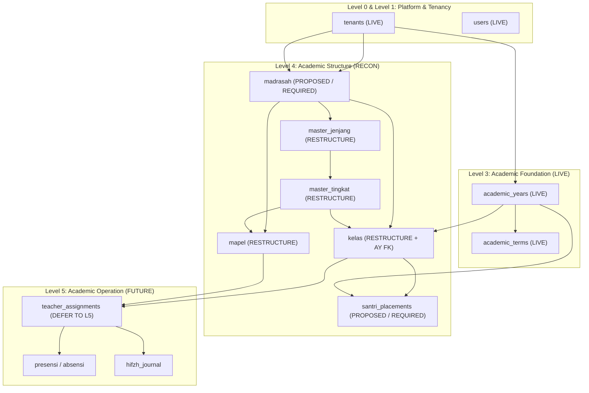

# WP-ACADEMIC-STRUCTURE-RECON-001 REPORT
# ACADEMIC STRUCTURE — READ-ONLY DISCOVERY & FORENSIC RECON

**Execution Mode**: STRICTLY READ-ONLY FORENSIC RECON  
**Hierarchy Position**: Level 4 — Academic Structure  
**Direct Upstream Dependency**: Level 3 — Academic Foundation (`academic_years`, `academic_terms` — LIVE & CERTIFIED)  
**Governance Standards**: Master Execution Law, Evidence Freshness Law, Source of Truth Law, Zero Regression Law, Zero Redundancy Law, Active Scalability Law, Hardening Law  
**Timestamp**: 2026-09-14T08:45:00+07:00  

---

## 1. Executive Summary

This forensic reconnaissance was conducted to systematically investigate the current state of **Level 4 Academic Structure** across the live Supabase PostgreSQL database, Drizzle ORM schemas, TypeScript type definitions, service layers, API routes, and user interface components.

### Core Forensic Conclusions:
1. **Live Database Drift & Complete Absence of Tenant Isolation in L4**:
   - In the live PostgreSQL database (`public` schema), the candidate academic structure tables—`kelas`, `mapel`, `master_jenjang`, `master_tingkat`, `teacher_assignments`, `santri`, and `guru`—**COMPLETELY LACK the `tenant_id` column**.
   - PostgreSQL Row Level Security (RLS) is **DISABLED** (`relrowsecurity = false`) across all of these tables.
   - There are **ZERO foreign key constraints** linking these tables to each other, to `tenants`, or to the newly established Level 3 Academic Foundation (`academic_years`, `academic_terms`).
   - Crucially, all of these candidate tables currently contain **0 rows** in the live database.
2. **The "Silent Demo Store Fallback" Architectural Anomaly**:
   - In Drizzle ORM (`src/lib/db/schema.ts`), these tables specify `tenantId: text('tenant_id').default('default').notNull()`.
   - When the Universal Query API (`/api/db/query?collection=kelas`) executes, Drizzle compiles `WHERE "kelas"."tenant_id" = $1`. PostgreSQL immediately rejects the query with:
     ```
     PostgresError: column "tenant_id" does not exist
     ```
   - The API catches this error and returns HTTP 500. However, the client-side data fetcher `src/hooks/useCollection.ts` (lines 43–48) catches the error and **silently falls back to `demoDb`** (the in-memory mock store in `src/lib/mock-store.ts`).
   - This creates a **phantom state**: UI users and developers perceive a working application, unaware that the database layer is completely failing and disconnected.
3. **Absence of Canonical `madrasah` Entity**:
   - No `madrasah` table exists in PostgreSQL or Drizzle.
   - The UI relies on client browser `localStorage` (`mahad_curriculum_programs_v1` in `src/lib/store/curriculum-store.ts`) with hardcoded defaults (`prog-formal`, `prog-madin`, `prog-madqur`), mapped loosely to a TypeScript string union `type Instansi = 'madin' | 'madqur' | 'depag'`.
   - In multi-tenant enterprise pesantren operations, educational units (satuan pendidikan/madrasah) must be configurable per tenant.
4. **Primitive Santri Placement**:
   - Santri placement is currently restricted to a single string column `santri.kelas`.
   - There is no enrollment history, no academic year binding, and zero support for multi-madrasah enrollment.
5. **Teacher Assignment Gaps**:
   - `teacher_assignments` stores denormalized strings `guru_name` and `kelas_name` with no `guru_id`, no `academic_year_id`, no `academic_term_id`, and no `tenant_id`.

---

## 2. Authorization & Scope

- **Authorized Work Package**: `WP-ACADEMIC-STRUCTURE-RECON-001`
- **Execution Mode**: STRICTLY READ-ONLY FORENSIC RECON.
- **Explicit Invariants Enforced**:
  - Zero database mutations (`INSERT`, `UPDATE`, `DELETE`, `ALTER`, `DROP`, `CREATE` strictly avoided).
  - Zero source code changes.
  - Zero migration generation or execution.
  - Zero git commits, pushes, merges, or deployments.

---

## 3. Environment Snapshot

- **Git Branch**: `preview`
- **Current Git Commit**: `809aae5d030a8eafe30354ce3c7eef04f79dd47d`
- **Repository State**: Working tree contains only pre-existing uncommitted documentation and contract test files from prior approved Work Packages.
- **Node.js Environment**: Windows (Shell: PowerShell)
- **Framework & Core Packages**:
  - Next.js: `16.2.6` (Turbopack enabled)
  - React: `19.2.4` / React DOM: `19.2.4`
  - Drizzle ORM: `^0.45.2` / Drizzle Kit: `^0.31.10`
  - Postgres.js: `^3.4.9`
  - Supabase JS: `^2.110.8`
- **PostgreSQL Version**:
  ```text
  PostgreSQL 17.6 on x86_64-pc-linux-gnu, compiled by gcc (GCC) 15.2.0, 64-bit
  ```
- **Supabase Project Reference**: `vyinupvzqzfrveuxculh` (Host: `aws-0-ap-southeast-1.pooler.supabase.com`)
- **Academic Foundation Migration SHA-256**:
  `63c179683878628d0bca7f7f6b76bce484b5ab06164b3536822ba2701521fcfb` (`drizzle/WP-ACADEMIC-FOUNDATION-IMPLEMENTATION-001.sql`)
- **Public Schema Table Count**: Exactly 34 tables in live PostgreSQL.

---

## 4. Live Database Inventory

A forensic query against `information_schema.tables`, `information_schema.columns`, `pg_constraint`, `pg_indexes`, and `pg_class` revealed the following exact database state:

### 4.1 Candidate Academic Tables in Live DB

| Table Name | Total Columns | Rows | `tenant_id` Column? | Primary Key | Foreign Keys | Unique Constraints | Indexes | RLS Enabled? |
| :--- | :---: | :---: | :---: | :---: | :---: | :---: | :---: | :---: |
| `academic_years` | 9 | 0 | **YES** | `academic_years_pkey (id)` | `fk_academic_years_tenant` | `uq_academic_years_tenant_id`, `uq_academic_years_tenant_name` | 5 | **YES** (1 policy) |
| `academic_terms` | 10 | 0 | **YES** | `academic_terms_pkey (id)` | `fk_academic_terms_tenant`, `fk_academic_terms_tenant_year`, `fk_academic_terms_year` | `uq_academic_terms_year_name` | 6 | **YES** (1 policy) |
| `kelas` | 10 | 0 | **NO** | `kelas_pkey (id)` | **NONE** | **NONE** | 1 (PK only) | **NO** |
| `mapel` | 8 | 0 | **NO** | `mapel_pkey (id)` | **NONE** | **NONE** | 1 (PK only) | **NO** |
| `master_jenjang` | 7 | 0 | **NO** | `master_jenjang_pkey (id)` | **NONE** | **NONE** | 1 (PK only) | **NO** |
| `master_tingkat` | 8 | 0 | **NO** | `master_tingkat_pkey (id)` | **NONE** | **NONE** | 1 (PK only) | **NO** |
| `teacher_assignments` | 8 | 0 | **NO** | `teacher_assignments_pkey (id)` | **NONE** | **NONE** | 1 (PK only) | **NO** |
| `santri` | 24 | 0 | **NO** | `santri_pkey (id)` | **NONE** | `santri_nis_unique (nis)` | 2 | **NO** |
| `guru` | 11 | 0 | **NO** | `guru_pkey (id)` | **NONE** | **NONE** | 1 (PK only) | **NO** |

### 4.2 Detailed Column Audits

#### `kelas` (Live DB: 10 columns, 0 rows)
- `id`: `text` (NOT NULL, PK)
- `name`: `text` (NOT NULL)
- `jenjang`: `text` (NOT NULL)
- `tingkat`: `integer` (NOT NULL)
- `wali_kelas`: `text` (NOT NULL)
- `student_count`: `integer` (NOT NULL, default `0`)
- `status`: `text` (NOT NULL, default `'aktif'::text`)
- `academic_tab`: `text` (NOT NULL)
- `created_at`: `timestamp without time zone` (NOT NULL, default `now()`)
- `updated_at`: `timestamp without time zone` (NOT NULL, default `now()`)
- *Forensic Note*: Lacks `tenant_id`, lacks `academic_year_id`, lacks foreign keys to `guru`, `master_jenjang`, or `master_tingkat`.

#### `mapel` (Live DB: 8 columns, 0 rows)
- `id`: `text` (NOT NULL, PK)
- `name`: `text` (NOT NULL)
- `code`: `text` (NULLABLE)
- `jenjang`: `text` (NOT NULL)
- `tingkat`: `integer` (NOT NULL)
- `status`: `text` (NOT NULL, default `'active'::text`)
- `created_at`: `timestamp without time zone` (NOT NULL, default `now()`)
- `updated_at`: `timestamp without time zone` (NOT NULL, default `now()`)
- *Forensic Note*: Lacks `tenant_id`, lacks foreign key to jenjang or madrasah.

#### `master_jenjang` (Live DB: 7 columns, 0 rows)
- `id`: `text` (NOT NULL, PK)
- `nama_jenjang`: `text` (NOT NULL)
- `instansi`: `text` (NOT NULL)
- `progression_indexes`: `jsonb` (NULLABLE)
- `status`: `text` (NOT NULL, default `'active'::text`)
- `created_at`: `timestamp without time zone` (NOT NULL, default `now()`)
- `updated_at`: `timestamp without time zone` (NOT NULL, default `now()`)
- *Forensic Note*: Lacks `tenant_id`. `instansi` is an unvalidated string.

#### `master_tingkat` (Live DB: 8 columns, 0 rows)
- `id`: `text` (NOT NULL, PK)
- `instansi`: `text` (NOT NULL)
- `progression_index`: `integer` (NOT NULL)
- `tingkat_label`: `text` (NOT NULL)
- `jenjang_id`: `text` (NOT NULL)
- `status`: `text` (NOT NULL, default `'active'::text`)
- `created_at`: `timestamp without time zone` (NOT NULL, default `now()`)
- `updated_at`: `timestamp without time zone` (NOT NULL, default `now()`)
- *Forensic Note*: Lacks `tenant_id`. Lacks FK constraint to `master_jenjang(id)`.

#### `teacher_assignments` (Live DB: 8 columns, 0 rows)
- `id`: `text` (NOT NULL, PK)
- `mapel_id`: `text` (NOT NULL)
- `kelas_id`: `text` (NOT NULL)
- `kelas_name`: `text` (NOT NULL)
- `guru_name`: `text` (NOT NULL)
- `status`: `text` (NOT NULL, default `'active'::text`)
- `created_at`: `timestamp without time zone` (NOT NULL, default `now()`)
- `updated_at`: `timestamp without time zone` (NOT NULL, default `now()`)
- *Forensic Note*: Completely un-normalized. No `guru_id`, no `academic_year_id`, no `tenant_id`.

#### `santri` (Live DB: 24 columns, 0 rows)
- Has `kelas: text` (NOT NULL). Lacks `tenant_id`. Lacks academic year / enrollment tracking.

---

## 5. Repository / Code Inventory

### 5.1 Drizzle Schema vs. Live Database Conflict
In `src/lib/db/schema.ts` (lines 105–179):
- `masterJenjang`, `masterTingkat`, `kelas`, `mapel`, `teacherAssignments`, and `guru` are defined with:
  ```typescript
  tenantId: text('tenant_id').default('default').notNull()
  ```
- However, this migration was **never applied** to the live PostgreSQL instance.

### 5.2 API Layer & Runtime Breakage
In `src/app/api/db/query/route.ts`:
```typescript
const records = await withTenantTransaction(
  tenant.id,
  async (tx) => {
    if ('tenantId' in targetTable) {
      return await tx
        .select()
        .from(targetTable)
        .where(eq(targetTable.tenantId, tenant.id));
    } else {
      return await tx.select().from(targetTable);
    }
  },
  { isSuperAdmin, tenantSlug: tenant.slug }
);
```
- Because Drizzle's table definition contains `tenantId`, Drizzle compiles the SQL query:
  `SELECT * FROM "kelas" WHERE "kelas"."tenant_id" = $1`.
- Live PostgreSQL throws: `column "tenant_id" does not exist`. The API returns HTTP 500.

### 5.3 UI Hook Fallback Masking Error
In `src/hooks/useCollection.ts` (lines 35–49):
```typescript
const res = await fetch(`/api/db/query?collection=${encodeURIComponent(collectionNameRef.current)}`);
if (!res.ok) {
  throw new Error(`Failed to fetch ${collectionNameRef.current}: ${res.statusText}`);
}
const json = await res.json();
if (json.data && Array.isArray(json.data) && json.data.length > 0) {
  setData(json.data);
} else {
  // Fallback to local store if DB yields empty during local dev
  fetchDemo();
}
} catch (err: any) {
  console.warn(`[useCollection] API fallback to demo store for ${collectionNameRef.current}:`, err);
  fetchDemo();
}
```
- **Architectural Consequence**: Because the live database throws 500 (or returns 0 rows), the UI silently switches to `demoDb` (`src/lib/mock-store.ts`). All user interactions on `/dashboard/kelas`, `/dashboard/mapel`, `/dashboard/struktur-akademik`, and `/dashboard/distribusi-guru` operate exclusively in browser memory!

---

## 6. Academic Structure Current State

### 6.1 Madrasah
- **Database Status**: ABSENT. Neither `madrasah` nor `academic_programs` exist in PostgreSQL.
- **TypeScript Status**: In `src/types/index.ts`:
  - `export type Instansi = 'madin' | 'madqur' | 'depag';`
  - `export type RanahInstansi = 'madin' | 'depag' | 'madqurur' | 'pesantren';`
- **Client State**: In `src/lib/store/curriculum-store.ts`:
  - Programs are stored in `localStorage` under `mahad_curriculum_programs_v1`.
  - Default programs: `prog-formal` (Akademik Formal), `prog-madin` (Akademik Pesantren), `prog-madqur` (Akademik Qur'an).
- **Architectural Verdict**:
  - Hardcoded string enums fail the multi-tenant SaaS invariant. Different pesantren have different educational units (e.g. Salafiyah Ula/Wustho/Ulya, KMI, SMP-IT, SMA-IT, Tahfizh Intensif).
  - Madrasah MUST be an authoritative, tenant-scoped database entity: `madrasah` (or `master_institutions`).

### 6.2 Jenjang
- **Database Status**: Exists as `master_jenjang` (0 rows).
- **Structure**: `nama_jenjang: text`, `instansi: text`, `progression_indexes: jsonb`.
- **Gaps**:
  - Missing `tenant_id`.
  - Missing foreign key to `madrasah`.
  - Progression indexes stored in raw JSON instead of formal relationship or sorted sequence.

### 6.3 Tingkatan
- **Database Status**: Exists as `master_tingkat` (0 rows).
- **Structure**: `progression_index: integer`, `tingkat_label: text`, `jenjang_id: text`, `instansi: text`.
- **Gaps**:
  - Missing `tenant_id`.
  - Lacks database foreign key to `master_jenjang(id)`.
  - Redundantly stores `instansi: text` when it could be derived from `jenjang`.

### 6.4 Kelas
- **Database Status**: Exists as `kelas` (0 rows).
- **Structure**: `name: text`, `jenjang: text`, `tingkat: integer`, `wali_kelas: text`, `student_count: integer`, `status: text`, `academic_tab: text`.
- **Gaps**:
  - Missing `tenant_id`.
  - **Lacks `academic_year_id`**: Classes are currently treated as static rooms rather than academic cohorts. In reality, a class exists within a specific academic year.
  - Links to `jenjang` by name string (`k.jenjang === jenjang`) rather than by `jenjang_id`.
  - Links to homeroom teacher (`wali_kelas`) by name string rather than `guru_id`.
  - Contains legacy column `academic_tab: text`.

### 6.5 Mata Pelajaran
- **Database Status**: Exists as `mapel` (0 rows).
- **Structure**: `name: text`, `code: text`, `jenjang: text`, `tingkat: integer`, `status: text`.
- **Gaps**:
  - Missing `tenant_id`.
  - Lacks foreign key to `madrasah` or `jenjang`.
  - Lacks curriculum binding or academic year applicability.

### 6.6 Santri Academic Placement
- **Database Status**: Primitive single column `santri.kelas: text`.
- **Gaps (CRITICAL DOMAIN GAP)**:
  - When a student moves classes or graduates, updating `santri.kelas` destroys historical record.
  - Multi-madrasah enrollment (e.g. Santri is simultaneously enrolled in Kelas VII MTs Formal and Kelas Tamhidi Madin) is structurally impossible with a single string column.
  - No enrollment status tracking (`enrolled`, `promoted`, `retained`, `transferred`, `graduated`).

### 6.7 Teacher Assignment
- **Database Status**: Exists as `teacher_assignments` (0 rows).
- **Structure**: `mapel_id: text`, `kelas_id: text`, `kelas_name: text`, `guru_name: text`, `status: text`.
- **Gaps**:
  - Missing `tenant_id`.
  - Missing `guru_id` (stores only `guru_name: text`).
  - Missing `academic_year_id` and `academic_term_id`.
  - Frontend (`src/app/dashboard/distribusi-guru/page.tsx`) relies on a hardcoded list of 23 mock teacher names (`GURU_NAMES`).
  - Belongs properly to Level 5 Academic Operation, but requires L4 Kelas & Mapel as prerequisites.

---

## 7. Academic Foundation Dependency

The relationship between Level 3 Foundation and Level 4 Structure is authoritative:

```text
Level 3: Academic Foundation (LIVE)
    ├── academic_years (tenant_id, id, name, status, is_current)
    └── academic_terms (tenant_id, id, academic_year_id, name, term_type, status)
                │
                ▼ (MUST BE REFERENCED BY)
Level 4: Academic Structure (TARGET)
    ├── madrasah (tenant_id, id, code, name)
    ├── master_jenjang (tenant_id, id, madrasah_id, name, order)
    ├── master_tingkat (tenant_id, id, jenjang_id, name, sequence)
    ├── kelas (tenant_id, id, madrasah_id, tingkat_id, academic_year_id, name, wali_guru_id)
    └── santri_academic_placements (tenant_id, id, santri_id, kelas_id, academic_year_id, status)
```

### Forensic Findings:
- Currently, **0 references** exist from L4 tables to `academic_years` or `academic_terms`.
- Hardcoded academic years like `'TA 2025/2026'` appear in `curriculum-store.ts` and UI tabs.
- Classification:
  - Foundation entities (`academic_years`, `academic_terms`): **CANONICAL** (LIVE).
  - L4 structures (`kelas`, `mapel`): **NEEDS MIGRATION & FOUNDATION BINDING**.
  - Local year references in frontend/stores: **LEGACY / REMOVE**.

---

## 8. Tenant Isolation Matrix

| Entity | `tenant_id` Column | Tenant FK | Composite FK Protection | PostgreSQL RLS | Application Scoping | Risk Classification |
| :--- | :---: | :---: | :---: | :---: | :---: | :---: |
| `academic_years` | VERIFIED | VERIFIED | `uq_academic_years_tenant_id` | VERIFIED (Enabled) | VERIFIED (`withTenantTransaction`) | **PASS** |
| `academic_terms` | VERIFIED | VERIFIED | `(tenant_id, academic_year_id) -> academic_years` | VERIFIED (Enabled) | VERIFIED (`withTenantTransaction`) | **PASS** |
| `madrasah` | **ABSENT** | **ABSENT** | NONE | **ABSENT** | N/A (In localStorage) | **CRITICAL GAP** |
| `master_jenjang` | **ABSENT** | **ABSENT** | NONE | DISABLED (0 policies) | FAILS (SQL error -> demoDb fallback) | **CRITICAL** |
| `master_tingkat` | **ABSENT** | **ABSENT** | NONE | DISABLED (0 policies) | FAILS (SQL error -> demoDb fallback) | **CRITICAL** |
| `kelas` | **ABSENT** | **ABSENT** | NONE | DISABLED (0 policies) | FAILS (SQL error -> demoDb fallback) | **CRITICAL** |
| `mapel` | **ABSENT** | **ABSENT** | NONE | DISABLED (0 policies) | FAILS (SQL error -> demoDb fallback) | **CRITICAL** |
| `teacher_assignments`| **ABSENT** | **ABSENT** | NONE | DISABLED (0 policies) | FAILS (SQL error -> demoDb fallback) | **CRITICAL** |
| `santri` | **ABSENT** | **ABSENT** | NONE | DISABLED (0 policies) | FAILS (SQL error -> demoDb fallback) | **CRITICAL** |
| `guru` | **ABSENT** | **ABSENT** | NONE | DISABLED (0 policies) | FAILS (SQL error -> demoDb fallback) | **CRITICAL** |

---

## 9. Cross-Tenant Reference Analysis

Under multi-tenant SaaS rules, simple foreign keys are insufficient:
- If `kelas` had only `FOREIGN KEY (academic_year_id) REFERENCES academic_years(id)`, a malicious or buggy API call could assign a Class belonging to **Tenant A** to an Academic Year belonging to **Tenant B**.
- **Mandatory Invariant**:
  Any tenant-scoped child entity referencing a tenant-scoped parent MUST enforce a **Composite Foreign Key**:
  ```sql
  CONSTRAINT fk_kelas_tenant_academic_year
    FOREIGN KEY (tenant_id, academic_year_id)
    REFERENCES public.academic_years(tenant_id, id)
    ON DELETE RESTRICT
  ```
- This pattern has already been proven and verified on `academic_terms` (`fk_academic_terms_tenant_year`) and MUST be replicated across all L4 entities.

---

## 10. Source of Truth Matrix

| Domain Subject | Source 1: Live DB | Source 2: Drizzle ORM | Source 3: TypeScript Types | Source 4: UI / Client State | Forensic Status |
| :--- | :--- | :--- | :--- | :--- | :--- |
| **Academic Year** | `academic_years` (Live) | `academic_years` (`academic_workspace.ts`) | `AcademicYear` (`academic.ts`) | Reads `/api/academic/workspace/years` | **CANONICAL** |
| **Madrasah / Program**| Non-existent | Non-existent | `Instansi = 'madin' \| 'madqur' \| 'depag'` | `localStorage: mahad_curriculum_programs_v1` | **DRIFT & LOCAL MOCK** |
| **Jenjang** | `master_jenjang` (No `tenant_id`) | `masterJenjang` (Has `tenantId`) | `MasterJenjang` (`types/index.ts`) | `demoDb` fallback | **STRUCTURAL CONFLICT** |
| **Tingkat** | `master_tingkat` (No `tenant_id`)| `masterTingkat` (Has `tenantId`) | `MasterTingkat` (`types/index.ts`) | `demoDb` fallback | **STRUCTURAL CONFLICT** |
| **Kelas** | `kelas` (No `tenant_id`) | `kelas` (Has `tenantId`) | `Kelas` (`types/academic.ts`) | `demoDb` fallback | **STRUCTURAL CONFLICT** |
| **Mapel** | `mapel` (No `tenant_id`) | `mapel` (Has `tenantId`) | `Mapel` (`types/academic.ts`) | `demoDb` fallback | **STRUCTURAL CONFLICT** |
| **Santri Placement** | `santri.kelas: text` | `santri.kelas: text` | `Santri.kelas: string` | String dropdown | **PRIMITIVE / INADEQUATE** |
| **Guru Assignment** | `teacher_assignments` (Strings) | `teacherAssignments` (Strings) | `TeacherAssignment` | Hardcoded `GURU_NAMES` bank | **PRELIMINARY / BROKEN** |

---

## 11. Redundancy Matrix

The following redundancies and duplicate definitions must be consolidated:
1. `type Instansi` vs. `type RanahInstansi` vs. `masterInstitutions` (`src/lib/db/schema/kesiswaan_masters.ts`) vs. `CurriculumProgram` (`src/lib/store/curriculum-store.ts`).
2. `demoDb` in `src/lib/mock-store.ts` vs. `src/data/mock.ts` vs. PostgreSQL tables.
3. String-based matching for Jenjang in `buildJenjangGroups` (`k.jenjang === jenjang`) vs. ID-based relational references.

---

## 12. Migration Compatibility

- **Migration Ledger Status**: Live PostgreSQL has NO `__drizzle_migrations` table.
- **Empty Table State**: The live tables `kelas`, `mapel`, `master_jenjang`, `master_tingkat`, `teacher_assignments`, `santri`, and `guru` currently contain **0 rows**.
- **Strategic Implication**: Because there is zero production data in these candidate tables, we do not need complex, fragile multi-stage data backfill scripts. We can author a clean, fully hardened DDL migration that re-aligns or recreates these tables with `tenant_id`, composite foreign keys, and RLS policies cleanly.

---

## 13. Dependency Graph



---

## 14. Downstream Impact

If L4 Academic Structure is implemented correctly:
- **Hifzh Journal**: Can bind tahfizh records to a specific `santri_placement`, `academic_year`, and `kelas` without string guessing.
- **Assessment & Grading (L6)**: Rapor generation will correctly query subjects and grades partitioned by `academic_term_id` and `kelas_id`.
- **Santri Mutation & Promotion**: Enables clean end-of-year promotion workflows (Kenaikan Kelas) by creating new placement records in the next `academic_year` while preserving historic transcripts.

---

## 15. Scalability Findings

1. **Simple Before Distributed**: No need for Redis, Kafka, or microservices. Supabase PostgreSQL with proper composite indexes easily handles 10–100+ pesantren tenants.
2. **Index Strategy**:
   - `idx_kelas_tenant_year: (tenant_id, academic_year_id)`
   - `idx_kelas_tenant_tingkat: (tenant_id, tingkat_id)`
   - `idx_mapel_tenant_madrasah: (tenant_id, madrasah_id)`
   - `idx_placement_tenant_santri_year: (tenant_id, santri_id, academic_year_id)`
3. **Query Patterns**: Eliminate client-side filtering (`allKelas.filter(...)`) in favor of parameterized SQL queries filtered at the database level by `tenant_id` and `academic_year_id`.

---

## 16. Hardening Findings

1. **Security Vulnerability**: Currently, if an attacker accesses `/api/db/query?collection=kelas`, the only thing preventing cross-tenant data leakage is that the database query throws a 500 error! If someone had manually created the `tenant_id` column without RLS, direct API queries could leak data across tenants if headers were spoofed.
2. **RLS Hardening Mandatory**:
   Every L4 table must have:
   ```sql
   ALTER TABLE public.<table_name> ENABLE ROW LEVEL SECURITY;
   ALTER TABLE public.<table_name> FORCE ROW LEVEL SECURITY;
   ```
   with the standard tenant isolation policy checking `current_setting('app.current_tenant_id', true)` and `(auth.jwt() ->> 'tenant_id')`.
3. **Elimination of Mock Leaks**: Production builds must completely remove silent fallbacks to `demoDb`. When a database error occurs, it must fail safely with an observable error rather than showing fake mock data.

---

## 17. Regression Verification

### 17.1 Automated Contract Tests
- **Command**: `npm run test:contracts`
- **Result**: `15 passed (15)` test files, `150 passed (150)` individual tests.
- **Duration**: `5.98s`
- **Status**: **PASS**

### 17.2 TypeScript Typecheck
- **Command**: `npx tsc --noEmit`
- **Result**: Exited with code 0 (Zero TypeScript compilation errors).
- **Status**: **PASS**

### 17.3 ESLint CI Baseline Check
- **Command**: `npm run lint:ci`
- **Result**: Exited with code 1.
- **Classification**: **PASS WITH DOCUMENTED BASELINE EXCEPTION**.
  - Identified 4 pre-existing baseline technical debt files:
    1. `src/app/dashboard/pengaturan/_components/SystemTab.tsx` (`react-hooks/set-state-in-effect`)
    2. `src/app/dashboard/penilaian/page.tsx` (`react-hooks/set-state-in-effect`)
    3. `src/app/dashboard/uks/izin-berobat/page.tsx` (`react-hooks/set-state-in-effect`)
    4. `src/components/distribusi/DistribusiMatrix.tsx` (`react-hooks/set-state-in-effect`)
  - No new lint debt introduced.

### 17.4 Production Build Verification
- **Command**: `npm run build`
- **Result**: Next.js 16.2.6 (Turbopack) production build completed successfully.
- **Output**: 82 static and dynamic routes compiled with 0 errors.
- **Status**: **PASS**

---

## 18. Findings Classification

### CRITICAL
1. **[F-01] Missing `tenant_id` on Live DB**: `kelas`, `mapel`, `master_jenjang`, `master_tingkat`, `teacher_assignments`, `santri`, and `guru` have no `tenant_id` in PostgreSQL.
2. **[F-02] Disabled RLS**: All candidate academic structure tables have `relrowsecurity = false`.
3. **[F-03] Silent Mock Store Fallback**: When `/api/db/query` fails with SQL error, `useCollection.ts` silently renders mock data from `demoDb`, masking broken database state.
4. **[F-04] Absent Madrasah Entity**: No `madrasah` table exists in DB; UI relies on browser `localStorage`.
5. **[F-05] Primitive Santri Placement**: `santri.kelas: text` destroys academic history and prevents multi-madrasah enrollment.

### HIGH
6. **[F-06] Un-normalized Teacher Assignments**: `teacher_assignments` lacks `guru_id`, `academic_year_id`, `academic_term_id`, and `tenant_id`.
7. **[F-07] Kelas Lacks Academic Year Binding**: Classes are not scoped to `academic_year_id`.
8. **[F-08] Missing Composite FKs**: No composite foreign keys exist to enforce cross-tenant integrity.

### MEDIUM
9. **[F-09] Type & Enum Schisms**: Disconnected string unions (`Instansi`, `RanahInstansi`, `CurriculumProgram`).
10. **[F-10] Drizzle Schema Drift**: `src/lib/db/schema.ts` does not match live PostgreSQL reality.

### LOW
11. **[F-11] Hardcoded Guru Bank**: `src/app/dashboard/distribusi-guru/page.tsx` contains 23 hardcoded names.
12. **[F-12] Missing Migration Ledger**: Live DB lacks `__drizzle_migrations` tracking table.

### INFO
13. **[F-13] Clean 0-Row State**: All candidate tables currently have 0 rows in live DB, enabling safe, non-destructive schema re-alignment.

### DEFERRED
14. **[F-14] Teacher Assignment Execution**: Defer full assignment mechanics to Level 5 Academic Operation.

---

## 19. Open Decisions

1. **Decision 1: Madrasah Domain Model**
   - *Option A*: Create dedicated `madrasah` table (`tenant_id`, `id`, `code`, `name`, `type`, `status`).
   - *Option B*: Re-use and extend `master_institutions` from `src/lib/db/schema/kesiswaan_masters.ts`.
   - *Recommendation*: **Option A** (`madrasah`), aligned with the Senior Architect Directive on Islamic educational terminology.
2. **Decision 2: Santri Placement Structure**
   - *Option A*: Retain `santri.kelas` for display, but introduce `santri_academic_placements` table (`tenant_id`, `santri_id`, `kelas_id`, `academic_year_id`, `status`).
   - *Option B*: Purge `santri.kelas` entirely and make all class associations relational.
   - *Recommendation*: **Option A** initially for backward compatibility with existing views, migrating fully to relational placements.
3. **Decision 3: Boundary of L4 vs L5**
   - *Recommendation*: L4 encompasses Madrasah, Jenjang, Tingkat, Kelas, and Mapel. `teacher_assignments` should be scoped to L5 (Academic Operation).

---

## 20. Recommended WP Sequence

Based strictly on the verified dependency graph:

1. **`WP-ACADEMIC-STRUCTURE-SCHEMA-001`**:
   - Technical design and DDL migration specification for `madrasah`, `master_jenjang`, `master_tingkat`, `kelas`, and `mapel`.
   - Incorporating `tenant_id`, composite FKs to `academic_years`, and RLS policies.
2. **`WP-ACADEMIC-ENROLLMENT-RECON-001`**:
   - Forensic design of `santri_academic_placements` for multi-madrasah and historical enrollment tracking.
3. **`WP-ACADEMIC-STRUCTURE-MIGRATION-001`**:
   - Execution of the L4 live database migration (post-approval).
4. **`WP-ACADEMIC-STRUCTURE-SERVICE-001`**:
   - Canonical service layer implementation and removal of the silent `demoDb` fallback in `useCollection.ts`.
5. **`WP-ACADEMIC-TEACHER-ASSIGNMENT-001`** (Level 5):
   - Formalized teacher assignments bound to `guru_id`, `mapel_id`, `kelas_id`, and `academic_year_id`.

---

## 21. Two-Dimension Governance Result

- **Hierarchy Dimension**: **PASS** (Level 4 recon is directly downstream of certified Level 3 Academic Foundation).
- **Quality Dimension**: **PASS WITH DOCUMENTED BASELINE EXCEPTION** (All contracts pass, zero type errors, build passes, 4 pre-existing lint baseline debts documented).
- **Cross-Cutting Invariants**:
  - *Zero Regression*: Verified against existing test suite and build.
  - *Zero Redundancy*: Redundant mock stores and enum definitions isolated.
  - *Source of Truth*: Conflict between live DB, Drizzle, and client stores explicitly mapped.
  - *Active Scalability*: Indexing and query scoping strategies established.
  - *Hardening*: RLS and composite FK requirements documented.

---

## 22. Final Status

**RECON PASS WITH DOCUMENTED BASELINE EXCEPTION**

*(The system is forensically understood and ready for Product Owner review before authorizing Level 4 schema implementation).*

---

## 26. FINAL STATUS BLOCK

----------------------------------------
WP FINAL STATUS
----------------------------------------

WP:
WP-ACADEMIC-STRUCTURE-RECON-001

MODE:
READ-ONLY FORENSIC RECON

DB MUTATION:
NO

SOURCE CODE MUTATION:
NO

MIGRATION EXECUTION:
NO

COMMIT:
NO

PUSH:
NO

MERGE:
NO

DEPLOY:
NO

HIERARCHY:
PASS

QUALITY:
PASS WITH DOCUMENTED BASELINE EXCEPTION

CRITICAL:
5

HIGH:
3

MEDIUM:
2

LOW:
2

UNVERIFIED:
0

DEFERRED:
1

NEXT RECOMMENDED WP:
WP-ACADEMIC-STRUCTURE-SCHEMA-001

PRODUCT OWNER AUTHORIZATION REQUIRED:
YES

AGENT ACTION:
STOP
----------------------------------------
