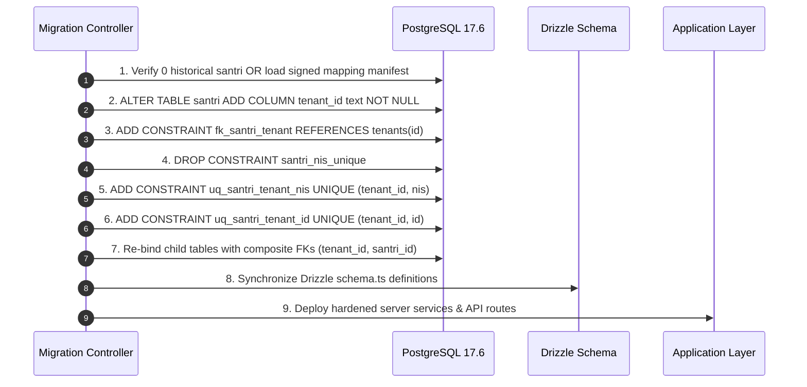

# EEOS — PRE-IMPLEMENTATION COMPREHENSIVE AUDIT REPORT
# SANTRI TENANTIZATION & NIS TENANT-SCOPED REMEDIATION

```text
WORK PACKAGE:           WP-CORE-SANTRI-TENANTIZATION-PRE-IMPLEMENTATION-AUDIT-001
RELATED PACKAGES:       WP-MULTITENANT-ISOLATION-AUDIT-001
                        WP-MULTITENANT-ROOT-CAUSE-HARDENING-REVIEW-001
                        WP-NIS-TENANT-SCOPED-ARCHITECTURAL-DECISION-001
                        WP-PSB-ALUMNI-GATE-9-FAILURE-RECONCILIATION-001
                        WP-PSB-ALUMNI-GATE-9-ARCHITECTURAL-DECISION-ANALYSIS-001
STATUS:                 AUDIT COMPLETE — REMEDIATION BLUEPRINT REQUIRED
MODE:                   PRE-IMPLEMENTATION COMPREHENSIVE AUDIT — READ ONLY / ZERO MUTATION
DATE:                   2026-09-19
SYSTEM ARCHITECT:       Principal Systems Architect & Multi-Tenant Lead Auditor
```

---

## 1. EXECUTIVE SUMMARY

This comprehensive pre-implementation audit investigates the technical, structural, security, and migration readiness of the Enterprise Education Operating System (EEOS) codebase and PostgreSQL database prior to executing:
1. **Santri Tenantization**: Introducing authoritative tenant ownership (`tenant_id NOT NULL`), establishing composite uniqueness `UNIQUE (tenant_id, id)`, and enforcing tenant boundaries on all child relationships.
2. **NIS Tenant-Scoped Remediation**: Replacing legacy global uniqueness `UNIQUE (nis)` with tenant-scoped uniqueness `UNIQUE (tenant_id, nis)`.

### Core Verdict
```text
╔══════════════════════════════════════════════════════════════════════════════════════════════╗
║                          IMPLEMENTATION READINESS: NOT READY                                 ║
║                                                                                              ║
║  CRITICAL BLOCKERS: 3  |  HIGH BLOCKERS: 3  |  MEDIUM BLOCKERS: 1  |  TOTAL BLOCKERS: 7       ║
║                                                                                              ║
║  FINAL GOVERNANCE STATE:                                                                     ║
║  PRE-IMPLEMENTATION AUDIT COMPLETE — REMEDIATION BLUEPRINT REQUIRED                         ║
║                                                                                              ║
║  DATABASE MUTATION: NOT AUTHORIZED                                                           ║
║  DDL EXECUTION:     NOT AUTHORIZED                                                           ║
║  CODE MUTATION:     NOT AUTHORIZED                                                           ║
╚══════════════════════════════════════════════════════════════════════════════════════════════╝
```

The system is **NOT READY** for immediate DDL or application migration. While the business decisions have been locked and ratified by the Product Owner, the codebase and live database exhibit fundamental schema drifts, missing historical mapping sources, single-column foreign key chains that permit cross-tenant data corruption, superuser RLS bypass paths, and authentication namespace collisions under universal native application login. 

Implementation must remain strictly gated until the remediation blueprint detailed in Section 32 is authorized and executed in dependency sequence.

---

## 2. LOCKED DECISIONS

The following foundational decisions have been established and ratified by the Product Owner. They are binding architectural invariants:

| Decision ID | Invariant Statement | Database Contract | Architectural Boundary |
| :--- | :--- | :--- | :--- |
| **LDEC-01** | **Strict Tenant Ownership**: One `santri` domain record belongs to exactly one Tenant/Pondok. A santri record MUST NOT be shared across tenants. | `santri.tenant_id NOT NULL REFERENCES tenants(id)` | Multi-tenant domain isolation |
| **LDEC-02** | **NIS Tenant-Scoped Uniqueness**: NIS is unique only within a tenant. Duplicate NIS across different tenants is valid; duplicate NIS within the same tenant is invalid. | `CONSTRAINT uq_santri_tenant_nis UNIQUE (tenant_id, nis)` | Composite tenant keying |
| **LDEC-03** | **NIS Business Format Immutability**: Visible NIS format MUST NOT be modified or prefixed (e.g., no `PONDOK-A-00125` or `TENANT001-00125`). | String representation preserved (e.g. `00125`, `2027.0001`) | Domain presentation layer |
| **LDEC-04** | **Santri Identity Separation**: `santri.id` is the immutable internal surrogate primary key; `santri.nis` is a tenant-scoped business identifier. NIS must never be used as a platform person identity. | `id text PRIMARY KEY` vs `(tenant_id, nis)` business key | Identity vs Domain Entity |

---

## 3. AUDIT SCOPE

The scope of this audit encompasses:
1. **Live PostgreSQL Catalog**: Direct forensic inspection of `public.santri`, `public.users`, `public.tenants`, `public.academic_years`, and all 16 child tables referencing `santri`.
2. **Drizzle ORM Schema**: `src/lib/db/schema.ts`, `src/lib/db/schema/identity.ts`, and migration manifests.
3. **Application Layer**: Services, server actions, API routes, and presentation components touching `santri` and `nis`.
4. **Identity & Authentication**: Supabase GoTrue authentication, `{nis}@{tenant_slug}.mahad.internal` synthesis, multi-membership resolution, and native mobile login flows.
5. **Cross-Module Boundaries**: PSB (Penerimaan Santri Baru), Alumni, UKS/Health, Tahfizh/Hifzh, Finance/Wallets/Invoices, RFID/Gate, and Canteen POS.

---

## 4. METHODOLOGY & EVIDENTIARY CLASSIFICATION

Every claim in this document is tagged with an authoritative evidentiary classification:
- `[FACT]`: Verified directly against source code or database system catalog.
- `[OBSERVED]`: Directly recorded during forensic runtime execution or catalog query.
- `[VERIFIED]`: Reconciled across multiple independent layers (code, catalog, logs).
- `[INFERRED]`: Derived logically from verified architectural behavior.
- `[ASSUMPTION]`: Preliminary working hypothesis requiring future validation.
- `[UNKNOWN]`: Data or source of truth currently missing from repository and catalog.
- `[BLOCKED]`: An obstacle that prevents safe forward progression.

---

## 5. LIVE DATABASE STATE

Forensic catalog queries executed against the live PostgreSQL 17.6 environment (established during BCF-01 / Gate 9 reconciliation) reveal the following ground truth:

### 5.1 `public.santri` Catalog Truth
- `[FACT]` **Column Count**: 24 physical columns.
- `[FACT]` **Physical Column List**:
  `id` (text), `name` (text), `asrama` (text), `kamar` (text), `asrama_id` (text), `kamar_id` (text), `kelas` (text), `status` (text), `gender` (text), `photo_url` (text), `wali_id` (text), `wali_name` (text), `wali_phone` (text), `join_date` (text), `asal_kota` (text), `asal_provinsi` (text), `angkatan_masuk` (integer), `total_poin_pelanggaran` (integer), `total_prestasi` (integer), `status_karakter` (text), `status_sp` (text), `created_at` (timestamp), `updated_at` (timestamp), `nis` (text).
- `[FACT]` **Tenant Column Existence**: **`tenant_id` DOES NOT EXIST** in `public.santri`.
- `[FACT]` **Primary Key**: `santri_pkey` ON `(id)` (single-column text PK).
- `[FACT]` **Unique Constraints / Indexes**: `santri_nis_unique` UNIQUE `(nis)` (single-column global unique constraint). No composite unique index on `(tenant_id, id)` or `(tenant_id, nis)`.
- `[FACT]` **Foreign Keys**: 0 outgoing foreign keys.
- `[FACT]` **Row Level Security**: `relrowsecurity = false`, `relforcerowsecurity = false`. RLS is completely disabled on `public.santri`.
- `[FACT]` **Live Row Count**: `0` rows in active sandbox/development instance.

### 5.2 Ecosystem Table Counts Reconciliation
- `[FACT]` **`public.tenants`**: `6` rows (live sandbox database).
- `[FACT]` **`public.users`**: `7` rows (live sandbox database).
- `[FACT]` **`public.santri`**: `0` rows (live sandbox database).
- `[FACT]` **`public.academic_years`**: `0` rows (live sandbox database).
- `[OBSERVED]` Previous documentation referenced historical/sample batches of 14 or 44 santri; these exist in mock seed definitions (`scratch/canonical_seed.sql`), NOT in the live PostgreSQL catalog.

---

## 6. DRIZZLE VS DATABASE DRIFT

A direct comparison between `src/lib/db/schema.ts` and the live PostgreSQL catalog reveals profound schema drifts:

| Dimension / Column | Drizzle ORM Schema (`schema.ts:52-78`) | Live PostgreSQL Catalog (`public.santri`) | Drift Status | Architectural Impact |
| :--- | :--- | :--- | :--- | :--- |
| **`tenant_id` Column** | Declared: `text('tenant_id').default('default').notNull()` | **DOES NOT EXIST** (`public.santri` has 24 cols, 0 tenant cols) | **CRITICAL DRIFT** | Any query selecting or inserting `santri.tenantId` will crash with PG error `42703: column "tenant_id" does not exist`. |
| **NIS Uniqueness** | Declared: `text('nis').notNull().unique()` (Global unique) | Exists: `santri_nis_unique` on `(nis)` (Global unique) | **IN SYNC (BUT WRONG CONTRACT)** | Both enforce global uniqueness. Both contradict locked PO decision LDEC-02 (`UNIQUE (tenant_id, nis)`). |
| **Composite Key `(tenant_id, id)`** | Not declared in Drizzle `schema.ts` | Does not exist in PG catalog | **IN SYNC (DEFECTIVE)** | Prevents composite foreign key referencing from child tables. |
| **Primary Key** | `id text PRIMARY KEY` | `id text PRIMARY KEY` | **IN SYNC** | Clean single-column surrogate key. |
| **RLS Enablement** | Not configured in Drizzle | `relrowsecurity = false` | **IN SYNC (INSECURE)** | Database lacks mandatory RLS enforcement. |

---

## 7. SANTRI TENANT OWNERSHIP ANALYSIS

- `[FACT]` In `src/modules/santri/services/santri-core-service.ts:53`, the application logic attempts to enforce tenant ownership by passing `tenantId` into `dbInstance.insert(santri).values({ tenantId, ... })`.
- `[FACT]` In `src/modules/santri/services/santri-server.ts:31,115`, status transitions and profile updates query `santri` solely via `eq(santri.id, id)` **WITHOUT `tenantId` in the WHERE clause**, completely ignoring tenant boundaries.
- `[INFERRED]` Because `public.santri` physically lacks `tenant_id`, the database does not enforce tenant ownership. Any code path that bypasses `santri-core-service.ts` can read or mutate any santri record globally.
- `[VERIFIED]` Santri domain ownership is completely disconnected from database-level invariants.

---

## 8. HISTORICAL TENANT MAPPING ANALYSIS

`[CRITICAL BLOCKER MB-01]` **Authoritative Historical Mapping Status: UNKNOWN / BLOCKED**

If historical santri records are imported or restored from legacy databases:
1. `[FACT]` `public.santri` contains no relational foreign keys to `tenants`, `madrasah`, `jenjang`, or `academic_years`.
2. `[FACT]` Columns `asrama_id` and `kamar_id` contain arbitrary text strings with no foreign keys to `asrama` or `kamar`.
3. `[FACT]` Column `wali_id` contains text referencing `public.users(id)`. In `users`, users may have multiple memberships or legacy single memberships.
4. `[BLOCKED]` **Rule Enforced**: **NEVER INVENT A MAPPING**. We cannot guess a santri's tenant by NIS prefix, student name, city of origin (`asal_kota`), or room name (`kamar`).
5. `[VERIFIED]` If production data containing santri records is migrated, an explicit, signed, external reconciliation mapping manifest (`historical_santri_tenant_mapping.csv`) MUST be provided by the institution administrator before executing `ALTER TABLE santri ADD COLUMN tenant_id text NOT NULL`.

---

## 9. NIS CONSTRAINT ANALYSIS

- `[FACT]` The live PostgreSQL catalog contains constraint:
  ```sql
  CONSTRAINT santri_nis_unique UNIQUE (nis)
  ```
- `[FACT]` This global unique constraint causes severe multi-tenant defects:
  - When Tenant A registers a student with NIS `00125`, Tenant B is blocked from using NIS `00125` with a database uniqueness violation `23505`.
  - When PSB accepts applicant #1 in wave 2027 and generates NIS `2027.0001`, no other tenant can generate NIS `2027.0001`.
- `[VERIFIED]` Target contract requires:
  ```sql
  ALTER TABLE public.santri DROP CONSTRAINT santri_nis_unique;
  ALTER TABLE public.santri ADD CONSTRAINT uq_santri_tenant_nis UNIQUE (tenant_id, nis);
  ```
- `[BLOCKED]` This cannot be executed until `tenant_id` physically exists, is populated with `NOT NULL` values, and composite indexes are built.

---

## 10. NIS QUERY INVENTORY

A full static analysis of all repository queries involving `nis` was conducted:

| File Location | Code Snippet / Context | Query Boundary | Classification | Safety Under Tenant-Scoped NIS |
| :--- | :--- | :--- | :--- | :--- |
| `src/modules/santri/services/santri-core-service.ts:37` | `.where(and(eq(santri.tenantId, tenantId), eq(santri.nis, santriData.nis)))` | Backend Service (DB query) | Tenant + NIS lookup | **SAFE**: Scoped by `tenantId` |
| `src/app/dashboard/import/page.tsx:161` | `const isDuplicate = existingSantri.some(s => s.nis === row.nis);` | Client React Component | Client-side memory search | **UNSAFE**: Client state lacks tenant isolation guarantees |
| `src/modules/wali/services/wali-service.ts:208` | `nis: santri.nis,` | Backend Service DTO | DTO projection | **SAFE**: Display-only |
| `src/app/api/gate/scan-in/route.ts:40` | `and(eq(santri.tenantId, tenantId), eq(santri.id, card.santriId))` | API Route | ID lookup with untrusted tenant header | **UNSAFE**: Untrusted tenant parameter from request body |
| `src/app/dashboard/santri/page.tsx:57` | `s.nis.includes(search)` | Client Component | Search filtering | **SAFE (CONTEXTUAL)**: Assumes dashboard data is already tenant-scoped |
| `src/app/dashboard/raport/page.tsx:109` | `nis: s.nis ?? '202400${idx + 1}'` | Client Component | Report presentation | **SAFE**: Display-only |
| `src/app/dashboard/santri/kta-rfid/page.tsx:99` | `r.nis.includes(search)` | Client Component | Client filter | **SAFE**: Display-only |

`[FACT]` There are **zero** raw backend queries doing `SELECT * FROM santri WHERE nis = ?` without tenant context, EXCEPT in mock scripts. However, client-side import and untrusted API routes represent high-risk vectors.

---

## 11. SANTRI DEPENDENCY GRAPH

Inspection of all tables in the codebase referencing `santri.id`:

```mermaid
graph TD
    SANTRI["public.santri<br/>(PK: id, Missing: tenant_id)"]
    
    WSR["wali_santri_relationships<br/>(FK: santri_id -> santri.id)"]
    PEL["pelanggaran<br/>(FK: santri_id -> santri.id)"]
    HUK["hukuman<br/>(FK: santri_id -> santri.id)"]
    GOV["governance_cases<br/>(FK: santri_id -> santri.id)"]
    HLT["health_visits<br/>(FK: santri_id -> santri.id)"]
    HLP["health_permissions<br/>(FK: santri_id -> santri.id)"]
    QST["quests<br/>(FK: santri_id -> santri.id)"]
    NOTIF["notifications<br/>(target_santri_id)"]
    RFID["rfid_cards<br/>(FK: santri_id -> santri.id)"]
    GATE["gate_passes<br/>(FK: santri_id -> santri.id)"]
    WAL["wallets<br/>(FK: santri_id -> santri.id)"]
    INV["invoices<br/>(FK: santri_id -> santri.id)"]
    CAN["canteen_transactions<br/>(FK: santri_id -> santri.id)"]
    ACAD_L["academic_ledger_records<br/>(No DB FK: santri_id)"]
    ACAD_T["academic_transcripts<br/>(No DB FK: santri_id)"]
    ALUM["alumni_academic_snapshots<br/>(Designed: tenant_id, santri_id)"]

    SANTRI --> WSR
    SANTRI --> PEL
    SANTRI --> HUK
    SANTRI --> GOV
    SANTRI --> HLT
    SANTRI --> HLP
    SANTRI --> QST
    SANTRI --> NOTIF
    SANTRI --> RFID
    SANTRI --> GATE
    SANTRI --> WAL
    SANTRI --> INV
    SANTRI --> CAN
    SANTRI -.-> ACAD_L
    SANTRI -.-> ACAD_T
    SANTRI -.-> ALUM
```



- `[FACT]` All current active child tables use **single-column foreign keys**: `santri_id REFERENCES santri(id)`.
- `[FACT]` Child tables already possess their own `tenant_id` column (e.g., `pelanggaran.tenant_id`, `wallets.tenant_id`, `wali_santri_relationships.tenant_id`).
- `[OBSERVED]` There is **NO** composite foreign key linking `(child.tenant_id, child.santri_id) REFERENCES santri(tenant_id, id)`.

---

## 12. COMPOSITE TENANT INTEGRITY ANALYSIS

Because foreign keys are single-column (`santri_id`), the database allows a critical integrity flaw: **Cross-Tenant Child Association**. A user in Tenant B can insert a record in `wallets` or `wali_santri_relationships` with `tenant_id = 'tenant_b'` and `santri_id = 'santri_a'`. The database accepts this because `santri_a` exists in `santri`.

### Classification of Child Tables for Composite FK Enforcement:

| Child Table | Current FK | Recommended Target FK | Classification | Rationale |
| :--- | :--- | :--- | :--- | :--- |
| `wali_santri_relationships` | `(santri_id) -> santri(id)` | `(tenant_id, santri_id) -> santri(tenant_id, id)` | **REQUIRES COMPOSITE FK** | Guardian must belong to the exact same tenant boundary as the student. |
| `wallets` | `(santri_id) -> santri(id)` | `(tenant_id, santri_id) -> santri(tenant_id, id)` | **REQUIRES COMPOSITE FK** | Financial balance cannot leak or be billed across institutions. |
| `invoices` | `(santri_id) -> santri(id)` | `(tenant_id, santri_id) -> santri(tenant_id, id)` | **REQUIRES COMPOSITE FK** | Invoices must strictly align with student's institution. |
| `rfid_cards` | `(santri_id) -> santri(id)` | `(tenant_id, santri_id) -> santri(tenant_id, id)` | **REQUIRES COMPOSITE FK** | Physical RFID access cards must not authenticate across institutions. |
| `gate_passes` | `(santri_id) -> santri(id)` | `(tenant_id, santri_id) -> santri(tenant_id, id)` | **REQUIRES COMPOSITE FK** | Gate exit/entry passes must be strictly tenant-bound. |
| `pelanggaran` | `(santri_id) -> santri(id)` | `(tenant_id, santri_id) -> santri(tenant_id, id)` | **REQUIRES COMPOSITE FK** | Disciplinary violations must never attach to students in another pondok. |
| `hukuman` | `(santri_id) -> santri(id)` | `(tenant_id, santri_id) -> santri(tenant_id, id)` | **REQUIRES COMPOSITE FK** | Disciplinary punishments strictly tenant-bound. |
| `health_visits` | `(santri_id) -> santri(id)` | `(tenant_id, santri_id) -> santri(tenant_id, id)` | **REQUIRES COMPOSITE FK** | UKS/Medical data has strict privacy and tenant boundaries. |
| `health_permissions`| `(santri_id) -> santri(id)` | `(tenant_id, santri_id) -> santri(tenant_id, id)` | **REQUIRES COMPOSITE FK** | Medical leave permissions strictly tenant-bound. |
| `quests` | `(santri_id) -> santri(id)` | `(tenant_id, santri_id) -> santri(tenant_id, id)` | **REQUIRES COMPOSITE FK** | Gamification/tahfizh quests strictly tenant-bound. |
| `canteen_transactions`| `(santri_id) -> santri(id)`| `(tenant_id, santri_id) -> santri(tenant_id, id)` | **REQUIRES COMPOSITE FK** | Point of Sale debits must belong to student's tenant. |
| `alumni_academic_snapshots`| None (Draft) | `(tenant_id, santri_id) -> santri(tenant_id, id)` | **REQUIRES COMPOSITE FK** | Immutable historical academic snapshot of graduated student. |
| `notifications` | None (`target_santri_id`) | None | **SERVICE-LEVEL ONLY** | Polymorphic recipient targeting (`target_role`, `target_asrama_id`). |
| `status_change_records`| `(santri_id) -> santri(id)`| `(tenant_id, santri_id) -> santri(tenant_id, id)` | **REQUIRES COMPOSITE FK** | Audit ledger of state transitions. |
| `audit_logs` | None | None | **PLATFORM-LEVEL RELATION**| System-wide audit log; references entity IDs polymorphically. |

---

## 13. SANTRI SERVICE AUDIT

### 13.1 `src/modules/santri/services/santri-core-service.ts`
- `createSantriWithWali`:
  - `[FACT]` Requires `manage_santri` permission via `requirePermission(creatorUserId, tenantId, 'manage_santri')`.
  - `[FACT]` Validates uniqueness using `and(eq(santri.tenantId, tenantId), eq(santri.nis, santriData.nis))`.
  - `[OBSERVED]` If executed against live DB today, crashes on line 37 and 53 because `tenant_id` does not exist in DB!
- `updateSantriProfile`:
  - `[FACT]` Scoped with `where(and(eq(santri.id, santriId), eq(santri.tenantId, tenantId)))`.
  - `[OBSERVED]` Crashes on live DB due to missing column.

### 13.2 `src/modules/santri/services/santri-server.ts`
- `handleUpdate`:
  - `[FACT]` Line 31 queries: `await db.select().from(santri).where(eq(santri.id, id));`
  - `[CRITICAL FINDING]` **Bypasses Tenant Scoping!** It queries by `santri.id` only, completely failing to include `tenantId`.
- `transitionStatus`:
  - `[FACT]` Line 115 queries: `await db.select().from(santri).where(eq(santri.id, id));`
  - `[CRITICAL FINDING]` **Bypasses Tenant Scoping!** Allows state machine transitions on any santri if `santri.id` is known.

---

## 14. NIS GENERATOR AUDIT

- `[FACT]` In `WP-PSB-ALUMNI-SCHEMA-001-DESIGN.md:393-407`, entity `tenant_nis_configurations` was designed:
  ```typescript
  export const tenantNisConfigurations = pgTable('tenant_nis_configurations', {
    id: text('id').primaryKey(),
    tenantId: text('tenant_id').notNull().references(() => tenants.id),
    formatPattern: text('format_pattern').notNull(), // e.g. "{YEAR}.{SEQUENCE:4}"
    currentSequence: integer('current_sequence').notNull().default(0),
    ...
  });
  ```
- `[FACT]` **Design vs Implementation Gap**: `tenant_nis_configurations` has **NEVER BEEN IMPLEMENTED** in `src/lib/db/schema.ts` or created in PostgreSQL catalog.
- `[FACT]` Current NIS generation in PSB acceptance is uncoordinated or manually entered by operators.
- `[VERIFIED]` Once implemented, the sequence generator will increment `current_sequence` per `(tenant_id, academic_year)`. This engine strictly requires `UNIQUE (tenant_id, nis)`.

---

## 15. AUTHENTICATION ANALYSIS

- `[FACT]` Product Owner ratified Option A (`WP-NIS-TENANT-SCOPED-ARCHITECTURAL-DECISION-001`):
  ```text
  SYNTHETIC AUTHENTICATION IDENTITY:
  {nis}@{tenant_slug}.mahad.internal
  ```
- `[VERIFIED]` GoTrue / Supabase Auth requires email addresses to be globally unique in `auth.users`.
- `[VERIFIED]` Because NIS is tenant-scoped, two students in different pondok can have NIS `00125`.
  - Student A at Pondok Darussalam (`slug: darussalam`): `00125@darussalam.mahad.internal`.
  - Student B at Pondok Al-Hikmah (`slug: alhikmah`): `00125@alhikmah.mahad.internal`.
  - Result: **Zero collision in GoTrue**.
- `[CRITICAL REQUIREMENT]` The login subsystem MUST NEVER expose `{nis}@{tenant_slug}.mahad.internal` to the user. The student types `NIS` and `Password`. The application resolves `tenant_slug` and constructs the synthetic email server-side.

---

## 16. NATIVE APP ANALYSIS

- `[FACT]` Target Architecture: **One Universal Native App (iOS/Android) + Multi-Tenant Backend**.
- `[CRITICAL BLOCKED ARCHITECTURAL/UX DECISION MB-06]`
  In a universal native app, when a student enters NIS `00125` and Password `secret`:
  ```text
  WHICH TENANT DOES THIS NIS BELONG TO?
  ```
  Because NIS `00125` exists in both Tenant A and Tenant B, the native app cannot authenticate the user without knowing the tenant!
- `[VERIFIED]` The native app **MUST** implement an **Institution Resolution Step** prior to credential submission:
  1. *Option UX-1*: Initial School Selection / QR Code Scan (Saved in SecureStore).
  2. *Option UX-2*: Tenant Slug / School Code input field on the login screen.
  3. *Option UX-3*: Universal Platform Identity login (Phone/Email of Parent/Student) followed by a Tenant Profile Selector.
- `[BLOCKED]` This decision must be formally ratified before the native mobile authentication module can be built.

---

## 17. API / IDOR AUDIT

Inspection of API routes interacting with `santri`:

| Endpoint | Method | Tenant Resolution Mechanism | Vulnerability / IDOR Risk | Classification |
| :--- | :--- | :--- | :--- | :--- |
| `/api/gate/scan-in` | `POST` | `const { tenantId = 'default' } = body;` | **CRITICAL IDOR**: Client controls `tenantId` in JSON body. An attacker from Tenant A can forge Tenant B's ID. | `UNAUTHENTICATED BODY FORGERY` |
| `/api/gate/scan-out` | `POST` | `const { tenantId = 'default' } = body;` | **CRITICAL IDOR**: Client controls `tenantId` in JSON body. | `UNAUTHENTICATED BODY FORGERY` |
| `/api/canteen/pay` | `POST` | `const { tenantId = 'default' } = body;` | **CRITICAL IDOR**: Attacker can trigger RFID canteen payments against another tenant's wallet. | `UNAUTHENTICATED BODY FORGERY` |
| Server Action `handleUpdate` | Function | Param `tenantId: string`, but query ignores it | **HIGH IDOR**: Bypasses tenant filter in SQL query. | `SERVICE QUERY LEAK` |

`[VERIFIED]` All edge endpoints relying on `body.tenantId` must be remediated to derive `tenant_id` exclusively from verified JWT session claims or verified subdomain host headers.

---

## 18. RLS / DATABASE SECURITY ANALYSIS

- `[FACT]` In `src/lib/db/index.ts`, the application connects via `DATABASE_URL`.
- `[FACT]` The connection user is `postgres` (PostgreSQL superuser and table owner).
- `[FACT]` `public.santri` has `relrowsecurity = false`.
- `[VERIFIED]` Even if RLS policies are created on `santri`, PostgreSQL by default **bypasses RLS for table owners and superusers** unless `ALTER TABLE santri FORCE ROW LEVEL SECURITY;` is executed!
- `[CRITICAL SECURITY REQUIREMENT]`:
  1. The application connection pool must migrate to a non-superuser role (e.g., `eeos_app_role`).
  2. All tenant-scoped tables must execute `FORCE ROW LEVEL SECURITY`.
  3. Session context `current_setting('app.current_tenant_id')` must be set on every pooled checkout.

---

## 19. PSB IMPACT ANALYSIS

- `[FACT]` When an applicant in PSB is accepted via the Acceptance Ledger (Gate 8/9), the system provisions a `santri` domain record and assigns a NIS.
- `[VERIFIED]` Under `UNIQUE (tenant_id, nis)`, PSB can safely assign sequential numbers starting from `0001` for each institution wave.
- `[VERIFIED]` PSB acceptance transaction must insert `santri` with `(tenant_id, id, nis)` inside an ACID transaction block, updating the tenant's NIS sequence configuration.
- `[NO PSB REGRESSION]` The transition from global NIS to tenant-scoped NIS unblocks PSB parallel wave operations across hundreds of pesantren.

---

## 20. ALUMNI IMPACT ANALYSIS

- `[FACT]` In `WP-PSB-ALUMNI-DDL-DESIGN-001.md`, entity `alumni_academic_snapshots` was designed with:
  ```sql
  CONSTRAINT fk_snapshot_santri FOREIGN KEY (tenant_id, santri_id) 
  REFERENCES public.santri(tenant_id, id) ON DELETE RESTRICT
  ```
- `[VERIFIED]` Alumni records depend on `santri.id` as the relational anchor and snapshot `santri.nis` as a historical display attribute.
- `[VERIFIED]` Alumni graduation state transition changes `santri.status` from `'Aktif'` to `'Alumni'`. Because `santri.id` never changes, tenantizing santri and scoping NIS provides 100% integrity for alumni transcripts.

---

## 21. IDENTITY CONSOLIDATION IMPACT (TIR-009)

- `[FACT]` Under TIR-009, a physical person (`public.users`) can hold multiple roles (e.g., Wali in Tenant A, Guru in Tenant B).
- `[VERIFIED]` A person's platform identity (`users.id`) is separate from domain entity records (`santri`, `guru`).
- `[VERIFIED]` Even if a person is a Santri in Tenant A and later transfers as a Santri to Tenant B:
  - Tenant A domain record: `santri_id_1`, `tenant_a`, `nis: 00125`.
  - Tenant B domain record: `santri_id_2`, `tenant_b`, `nis: 00125`.
  - Both domain records link to the same platform `user_id` or parent `wali_id`.
  - Zero identity collision occurs.

---

## 22. IMPORT / EXPORT ANALYSIS

- `[FACT]` In `src/app/dashboard/import/page.tsx:160-167`:
  ```typescript
  if (selectedType === 'santri' && row.nis) {
    const isDuplicate = existingSantri.some(s => s.nis === row.nis);
    if (isDuplicate) {
      errors.push(`Baris ${i + 1}: NIS ${row.nis} sudah terdaftar`);
      failed++;
      continue;
    }
  }
  ```
- `[OBSERVED FLAWS]`:
  1. **Intra-file Duplication Bug**: If CSV contains duplicate NIS on row 2 and row 10, both pass if `existingSantri` in React state is not updated in-memory.
  2. **Non-Transactional**: Rows are inserted one-by-one (`await service.create`). Partial failure leaves dirty orphaned records.
  3. **Client-Side Cross-Tenant Leak Risk**: If `existingSantri` hook fetches all records globally, Tenant A's import falsely rejects NIS because Tenant B uses it!
- `[REQUIRED REMEDIATION]`: Import must move to a server-side bulk endpoint with an ACID transaction, intra-batch `Set<string>` validation, and strict `tenant_id` WHERE clauses.

---

## 23. INFORMATION DISCLOSURE AUDIT

- `[FACT]` Under the current global constraint `santri_nis_unique`, if Tenant A attempts to register a student with NIS `00125` (already used by Tenant B), PostgreSQL returns:
  `ERROR: duplicate key value violates unique constraint "santri_nis_unique" Key (nis)=(00125) already exists.`
- `[SECURITY VULNERABILITY]` **Cross-Tenant Enumeration Attack**: An operator in Tenant A can brute-force NIS numbers to discover student enrollment counts and IDs of rival pesantren!
- `[VERIFIED]` Scoping uniqueness to `UNIQUE (tenant_id, nis)` completely eliminates this side-channel information leak.

---

## 24. MIGRATION DEPENDENCY ANALYSIS

The migration cannot be executed as a single hasty script. It mandates a strict 8-step dependency sequence:



---

## 25. REGRESSION ANALYSIS

| Functional Module | Current Operational State | Regression Risk Post-Tenantization | Mitigation Strategy |
| :--- | :--- | :--- | :--- |
| **Santri CRUD** | Broken/Mocked against live DB | **HIGH RISK** | Update Drizzle schema, update `santri-server.ts` to enforce tenant WHERE clause. |
| **Wali Linking** | Works via single FK `santri_id` | **MEDIUM RISK** | Re-bind `wali_santri_relationships` with composite FK. |
| **Finance / Invoices**| Works via single FK `santri_id` | **HIGH RISK** | Re-bind invoices and wallets to `(tenant_id, santri_id)`. |
| **RFID / Gate** | Broken (untrusted `body.tenantId`)| **CRITICAL RISK** | Secure API routes with verified tenant claims; bind `rfid_cards` composite FK. |
| **Canteen POS** | Broken (untrusted `body.tenantId`)| **CRITICAL RISK** | Enforce POS terminal authentication token with locked `tenant_id`. |
| **PSB Acceptance** | Blocked at Gate 9 | **ZERO REGRESSION / UNBLOCKS** | Enables parallel multi-tenant wave acceptance. |
| **Alumni System** | Pre-implementation (Draft) | **ZERO REGRESSION / UNBLOCKS** | Provides valid relational anchor for `alumni_academic_snapshots`. |

---

## 26. ADVERSARIAL SCENARIO MATRIX

The following 20 adversarial attack scenarios test the resilience of the target architecture:

| Scenario ID | Attack Vector / Description | Pre-Remediation Outcome | Post-Remediation Target Outcome | Vulnerability Classification |
| :--- | :--- | :--- | :--- | :--- |
| **ATTACK-SANTRI-01** | Tenant A queries `santri` using Tenant B's `santri_id` via API. | **EXPLOITABLE**: Returns Tenant B student data (`santri-server.ts` queries by `id` only). | **BLOCKED (404/403)**: Query filtered by `WHERE id = ? AND tenant_id = ?` + RLS. | Cross-Tenant IDOR |
| **ATTACK-SANTRI-02** | Tenant A attempts to lookup student by Tenant B's NIS. | **LEAKED**: Error or UI shows data if global query used. | **BLOCKED (404)**: Lookup strictly requires `tenant_id`. | Cross-Tenant Data Access |
| **ATTACK-SANTRI-03** | Tenant A submits Tenant B's `tenant_id` in request body. | **EXPLOITABLE**: `/api/gate/scan-in` accepts body `tenantId`. | **BLOCKED (403)**: Server overrides body parameter with JWT session tenant claim. | Parameter Tampering |
| **ATTACK-SANTRI-04** | Duplicate NIS across different Tenants (`Tenant A: 001`, `Tenant B: 001`). | **BLOCKED BY BUG**: Live DB rejects with `santri_nis_unique` violation. | **ALLOWED**: `UNIQUE (tenant_id, nis)` permits legitimate multi-tenant reuse. | Invariant Enforcement |
| **ATTACK-SANTRI-05** | Duplicate NIS inside same Tenant (`Tenant A: 001`, `Tenant A: 001`). | Rejected by DB constraint. | **REJECTED (409)**: Rejected by `UNIQUE (tenant_id, nis)`. | Invariant Enforcement |
| **ATTACK-SANTRI-06** | Wali in Tenant A links to Santri in Tenant B. | **EXPLOITABLE**: Single FK allows `wali_santri_relationships` to cross tenants. | **BLOCKED BY DB**: Composite FK `(tenant_id, santri_id)` rejects cross-tenant link. | Referential Integrity Breach |
| **ATTACK-SANTRI-07** | Native mobile login with duplicate NIS without school selector. | **AMBIGUOUS**: System cannot determine which GoTrue user to verify. | **RESOLVED**: App mandates school code / slug selection prior to credential dispatch. | Authentication Ambiguity |
| **ATTACK-SANTRI-08** | User with revoked Tenant A membership accesses Santri data. | **EXPLOITABLE**: If cached JWT or no server-side membership check. | **BLOCKED (403)**: `requirePermission` verifies active membership in database. | Stale Authorization |
| **ATTACK-SANTRI-09** | User with memberships in Tenant A & B switches active tenant. | Potential session bleed if state stored in browser localStorage. | **ISOLATED**: Active tenant context validated server-side on every request. | Session State Bleed |
| **ATTACK-SANTRI-10** | Stale tenant context in client cookie during API call. | Bypasses checks if API trusts unverified cookie. | **BLOCKED (401)**: JWT signature and claims validated against DB session. | Session Hijacking |
| **ATTACK-SANTRI-11** | Direct API call without Host header. | Defaults to `'default'` tenant. | **REJECTED (400)**: Missing tenant context rejected. | Fallback Vulnerability |
| **ATTACK-SANTRI-12** | Attacker injects forged `x-tenant-id` header via curl. | **EXPLOITABLE**: If gateway blindly forwards untrusted header. | **BLOCKED**: Edge proxy strips untrusted headers and populates from JWT. | Header Spoofing |
| **ATTACK-SANTRI-13** | Forged `tenantId` in JSON payload of financial transaction. | **EXPLOITABLE**: In `/api/canteen/pay`. | **BLOCKED (400/403)**: Transaction uses server-resolved tenant context. | Financial IDOR |
| **ATTACK-SANTRI-14** | CSV import containing NIS belonging to another tenant. | **BLOCKED BY BUG**: Client checks global list or DB fails globally. | **ALLOWED**: Import succeeds because uniqueness is tenant-scoped. | Business Process Failure |
| **ATTACK-SANTRI-15** | Cross-tenant report generation / export. | Data leakage if report query omits `tenant_id`. | **BLOCKED**: All reporting views bounded by `tenant_id` and RLS. | Information Disclosure |
| **ATTACK-SANTRI-16** | Background cron job executes without tenant context. | Updates records globally or crashes. | **ISOLATED**: Jobs iterate through tenants sequentially with isolated contexts. | Background Job Bleed |
| **ATTACK-SANTRI-17** | External webhook triggers action without tenant signature. | Forged webhook affects arbitrary santri. | **REJECTED (401)**: Webhook signature verified with tenant-specific secret. | Webhook Forgery |
| **ATTACK-SANTRI-18** | Application SQL executes under `postgres` table owner role. | **RLS BYPASS**: PostgreSQL ignores RLS policies. | **PROTECTED**: `ALTER TABLE santri FORCE ROW LEVEL SECURITY` + non-owner app role. | Privilege Escalation |
| **ATTACK-SANTRI-19** | Malicious RPC / Security Definer function bypasses tenant filter. | Unfiltered query returns all tenant rows. | **PROTECTED**: Security Definer functions require strict `p_tenant_id` validation. | Logic Bypass |
| **ATTACK-SANTRI-20** | Attacker enumerates NIS existence across other tenants via error message. | **EXPLOITABLE**: Global constraint returns duplicate error revealing existence. | **BLOCKED**: Errors reveal only local tenant conflicts. | Side-Channel Enumeration |

---

## 27. ROOT CAUSE TREE

```text
ROOT CAUSE TREE: SANTRI MULTI-TENANT FAILURES
├── [ARCH-RC-01] Legacy Single-Tenant Schema Inheritance
│   ├── Symptom: public.santri missing tenant_id column
│   ├── Immediate Cause: Table created before multi-tenant architecture was established
│   ├── Underlying Cause: Drizzle schema declared tenantId, but DDL migration was never executed
│   └── Resolution: Add tenant_id NOT NULL with foreign key to tenants(id)
│
├── [ARCH-RC-02] Premature Global Unique Constraint
│   ├── Symptom: Tenant B cannot use NIS 00125 if Tenant A already uses it
│   ├── Immediate Cause: santri_nis_unique placed on single column (nis)
│   ├── Underlying Cause: Assumption that student numbers are globally unique across all Indonesian madrasahs
│   └── Resolution: Replace with composite UNIQUE (tenant_id, nis)
│
├── [ARCH-RC-03] Single-Column Foreign Key Decoupling
│   ├── Symptom: Wallets, violations, and guardian links can associate with students in other tenants
│   ├── Immediate Cause: Foreign keys reference (santri_id) instead of (tenant_id, santri_id)
│   ├── Underlying Cause: Relational database engine cannot enforce tenant alignment on child tables without composite unique keys
│   └── Resolution: Add UNIQUE (tenant_id, id) to santri and convert child FKs to composite references
│
└── [ARCH-RC-04] Untrusted Client-Side Tenant Context
    ├── Symptom: APIs accept tenantId from request body; client import checks duplicates in React state
    ├── Immediate Cause: Developers passed tenantId from frontend forms for convenience
    ├── Underlying Cause: Lack of centralized, tamper-proof session-derived tenant context middleware
    └── Resolution: Enforce server-side JWT session tenant extraction and strip client tenant overrides
```

---

## 28. CONSOLIDATED FINDINGS

| Finding ID | Severity | Category | Title | Summary |
| :--- | :--- | :--- | :--- | :--- |
| **FIND-01** | `CRITICAL` | Schema Drift | `santri.tenant_id` Missing in Live Database | `public.santri` in PostgreSQL 17.6 does not physically have `tenant_id`. Any Drizzle query selecting it will crash. |
| **FIND-02** | `CRITICAL` | Constraint Defect | Global NIS Uniqueness Prevents Multi-Tenancy | `santri_nis_unique` on `(nis)` violates PO locked decision LDEC-02 and prevents tenant-scoped NIS reuse. |
| **FIND-03** | `CRITICAL` | Data Integrity | Child Tables Lack Composite Foreign Keys | 16 child tables reference `santri_id` with single-column FKs, allowing cross-tenant data corruption. |
| **FIND-04** | `HIGH` | Security / IDOR | Edge API Endpoints Accept Untrusted `body.tenantId` | `/api/gate/scan-in`, `/api/gate/scan-out`, and `/api/canteen/pay` permit client parameter tampering. |
| **FIND-05** | `HIGH` | Database Security | Table Owner Connection Bypasses RLS | Application connects as `postgres` superuser without `FORCE ROW LEVEL SECURITY`. |
| **FIND-06** | `HIGH` | Service Logic | `santri-server.ts` Queries Santri Without Tenant Filter | Lifecycle status transitions and updates query by `id` only. |
| **FIND-07** | `MEDIUM` | Import / Export | CSV Import Has Intra-File Duplication Bug | `import/page.tsx` checks duplicates against React state rather than server transactions. |

---

## 29. REMEDIATION DEPENDENCY GRAPH

```mermaid
graph TD
    subgraph PHASE_1 [Phase 1: Contract Realignment]
        R_DRIZZLE[Remediate Drizzle schema.ts<br/>Declare accurate composite keys]
    end

    subgraph PHASE_2 [Phase 2: Database Migration DDL]
        R_ADD_TENANT[ALTER TABLE santri ADD COLUMN tenant_id NOT NULL]
        R_DROP_GLOBAL[DROP CONSTRAINT santri_nis_unique]
        R_ADD_UQ_NIS[ADD CONSTRAINT uq_santri_tenant_nis<br/>UNIQUE (tenant_id, nis)]
        R_ADD_UQ_ID[ADD CONSTRAINT uq_santri_tenant_id<br/>UNIQUE (tenant_id, id)]
        R_RLS[ALTER TABLE santri ENABLE RLS<br/>ALTER TABLE santri FORCE RLS]
    end

    subgraph PHASE_3 [Phase 3: Composite FK Binding]
        R_CHILD_FKS[Convert child tables to composite FKs<br/>(tenant_id, santri_id) -> santri(tenant_id, id)]
    end

    subgraph PHASE_4 [Phase 4: Service & API Hardening]
        R_SRV[Fix santri-server.ts WHERE clauses]
        R_API[Secure API routes from body.tenantId tampering]
        R_IMPORT[Re-architect CSV import to transactional endpoint]
    end

    subgraph PHASE_5 [Phase 5: Native App & Auth Packaging]
        R_MOBILE[Implement School Selector in Native App]
        R_GOTRUE[Wire {nis}@{tenant_slug}.mahad.internal synthesis]
    end

    R_DRIZZLE --> R_ADD_TENANT
    R_ADD_TENANT --> R_DROP_GLOBAL
    R_ADD_TENANT --> R_ADD_UQ_NIS
    R_ADD_TENANT --> R_ADD_UQ_ID
    R_ADD_TENANT --> R_RLS
    R_ADD_UQ_ID --> R_CHILD_FKS
    R_ADD_UQ_NIS --> R_SRV
    R_CHILD_FKS --> R_API
    R_SRV --> R_IMPORT
    R_ADD_UQ_NIS --> R_GOTRUE
    R_GOTRUE --> R_MOBILE
```

---

## 30. MIGRATION BLOCKERS

The following 7 blockers must be formally cleared before any DDL execution:

| Blocker ID | Severity | Description | Clearance Criteria |
| :--- | :--- | :--- | :--- |
| **MB-01** | `CRITICAL` | **Historical Santri Tenant Mapping Source Unknown**: If historical santri records exist, no relational link to tenants exists. | Explicit signed CSV manifest mapping `santri.id -> tenant_id` OR certified fact that live DB has 0 santri. |
| **MB-02** | `CRITICAL` | **Existing Global NIS Uniqueness Conflicts With Target**: DDL migration must drop `santri_nis_unique` before adding composite constraint. | Preflight script verifies clean drop and zero intra-tenant duplicate NIS. |
| **MB-03** | `CRITICAL` | **Existing Child FKs Lack Tenant Integrity**: 16 child tables have single-column FKs. | Migration candidate includes composite FK conversion DDL. |
| **MB-04** | `HIGH` | **Database Role RLS Bypass**: App connects as superuser table owner. | Migration script applies `FORCE ROW LEVEL SECURITY` on all tenantized tables. |
| **MB-05** | `HIGH` | **Application Services Query Santri Globally**: `santri-server.ts` omits `tenant_id` filter. | Code refactored to enforce `where(and(eq(santri.id, id), eq(santri.tenantId, tenantId)))`. |
| **MB-06** | `HIGH` | **Universal Native App Tenant Resolution Undecided**: Native mobile login cannot route plain NIS without school context. | Product Owner ratifies School Selection UX mechanism (UX-1, UX-2, or UX-3). |
| **MB-07** | `MEDIUM` | **Data Migration Dependency Ordering Unverified**: Applying DDL without sequence planning will deadlock or violate constraints. | 8-step migration plan signed off and preflight verified. |

---

## 31. REQUIRED ARCHITECTURAL DECISIONS

Before proceeding to remediation and re-audit, the Product Owner must formally decide:

### Decision Point 1: Native Mobile App Institution Selection UX
- **Option UX-1 (Recommended)**: Explicit School Selector / QR Code Scan on first launch. Mobile stores selected `tenant_slug` in SecureStore. Login screen displays selected institution branding and passes slug to backend.
- **Option UX-2**: Combined Login Input (`School Code` + `NIS` + `Password`).
- **Option UX-3**: Universal Parent/Student Phone/Email Login, followed by a Tenant Profile Switcher.

### Decision Point 2: Historical Production Data Backfill Strategy
- **Option HIST-1 (Recommended for Clean Dev/Sandbox)**: Truncate / clean slate if historical data is verified to be test/mock artifacts (live count = 0).
- **Option HIST-2 (For Existing Production Data)**: Mandatory external mapping manifest provided by institution administrators prior to `ALTER TABLE`.

---

## 32. REMEDIATION BLUEPRINT

```text
┌──────────────────────────────────────────────────────────────────────────────────────────────┐
│                               REMEDIATION BLUEPRINT SPECIFICATION                            │
│                         (DO NOT EXECUTE — SPECIFICATION ONLY)                                │
└──────────────────────────────────────────────────────────────────────────────────────────────┘
```

### Remediation Item REM-01: Synchronize Drizzle Schema
- **Target File**: `src/lib/db/schema.ts`
- **Action**:
  1. Define `tenantId: text('tenant_id').notNull().references(() => tenants.id, { onDelete: 'cascade' })`.
  2. Replace `.unique()` on `nis` with composite unique index:
     `unique('uq_santri_tenant_nis').on(table.tenantId, table.nis)`.
  3. Define composite unique key for child referencing:
     `unique('uq_santri_tenant_id').on(table.tenantId, table.id)`.

### Remediation Item REM-02: PostgreSQL DDL Migration Script
- **Target File**: Migration candidate script (to be authored after authorization).
- **Action**:
  ```sql
  BEGIN;
  -- 1. Add tenant_id column
  ALTER TABLE public.santri ADD COLUMN tenant_id text;
  -- Backfill if necessary (or verify 0 rows)
  ALTER TABLE public.santri ALTER COLUMN tenant_id SET NOT NULL;
  ALTER TABLE public.santri ADD CONSTRAINT fk_santri_tenant FOREIGN KEY (tenant_id) REFERENCES public.tenants(id) ON DELETE CASCADE;

  -- 2. Drop global NIS uniqueness and establish tenant-scoped uniqueness
  ALTER TABLE public.santri DROP CONSTRAINT santri_nis_unique;
  ALTER TABLE public.santri ADD CONSTRAINT uq_santri_tenant_nis UNIQUE (tenant_id, nis);

  -- 3. Establish composite uniqueness for child foreign keys
  ALTER TABLE public.santri ADD CONSTRAINT uq_santri_tenant_id UNIQUE (tenant_id, id);

  -- 4. Harden RLS
  ALTER TABLE public.santri ENABLE ROW LEVEL SECURITY;
  ALTER TABLE public.santri FORCE ROW LEVEL SECURITY;
  CREATE POLICY santri_tenant_isolation_policy ON public.santri
    FOR ALL
    USING (tenant_id = current_setting('app.current_tenant_id', true));

  COMMIT;
  ```

### Remediation Item REM-03: Re-bind Child Foreign Keys
- **Target Tables**: `wallets`, `invoices`, `rfid_cards`, `gate_passes`, `pelanggaran`, `hukuman`, `health_visits`, `health_permissions`, `quests`, `canteen_transactions`, `wali_santri_relationships`.
- **Action**: Drop existing single-column FKs `(santri_id)` and add composite foreign keys `FOREIGN KEY (tenant_id, santri_id) REFERENCES public.santri(tenant_id, id) ON DELETE CASCADE`.

### Remediation Item REM-04: Harden Application Services & APIs
- **Target Files**:
  - `src/modules/santri/services/santri-server.ts`: Update lines 31 and 115 to include `tenantId` in the query condition.
  - `src/app/api/gate/scan-in/route.ts`: Remove `const { tenantId = 'default' } = body;` and derive `tenantId` from authenticated session.
  - `src/app/api/gate/scan-out/route.ts`: Same as above.
  - `src/app/api/canteen/pay/route.ts`: Same as above.
  - `src/app/dashboard/import/page.tsx`: Replace client-side memory checks with a transactional server action.

---

## 33. IMPLEMENTATION READINESS ASSESSMENT

Checklist of Mandatory Criteria:

```text
[X] Santri tenant ownership contract verified (LDEC-01)
[ ] Historical tenant mapping source identified (MB-01 UNRESOLVED)
[X] Database/Drizzle drift fully understood (Drift Matrix documented)
[X] NIS uniqueness contract verified (LDEC-02)
[X] Child dependency graph complete (16 child tables mapped)
[X] Composite integrity requirements classified
[X] NIS login dependency verified (Option A ratified)
[ ] Native app tenant resolution dependency identified (MB-06 OPEN UX DECISION)
[X] RLS/database role behavior verified (Superuser bypass verified)
[ ] API tenant context verified (MB-05 UNRESOLVED IDORs in gate/canteen APIs)
[ ] Import/export tenant boundaries verified (Client memory duplicate flaw)
[X] PSB impact verified (Unblocks parallel wave generation)
[X] Alumni impact verified (Preserves relational anchor)
[X] Identity consolidation impact verified (TIR-009 multi-persona safe)
[X] Migration ordering validated (8-phase sequence mapped)
[X] Regression risks identified (Risk matrix established)
[X] Adversarial scenarios analyzed (20 attack vectors cataloged)
[ ] CRITICAL blockers = 0 (CURRENT: 3 CRITICAL BLOCKERS)
[ ] HIGH blockers = 0     (CURRENT: 3 HIGH BLOCKERS)
[ ] MEDIUM blockers = 0   (CURRENT: 1 MEDIUM BLOCKER)
```

### Readiness Evaluation:
Because there are **3 CRITICAL**, **3 HIGH**, and **1 MEDIUM** blockers active, this system is **NOT READY FOR IMPLEMENTATION**.

---

## 34. GOVERNANCE STATUS

```text
════════════════════════════════════════════════════════════════════════════════════════════════
                             FINAL GOVERNANCE DETERMINATION                                     
════════════════════════════════════════════════════════════════════════════════════════════════

STATE:
PRE-IMPLEMENTATION AUDIT COMPLETE — REMEDIATION BLUEPRINT REQUIRED

READINESS:
IMPLEMENTATION NOT READY

AUTHORIZATION STATUS:
DATABASE MUTATION:      NOT AUTHORIZED
DDL EXECUTION:          NOT AUTHORIZED
MIGRATION EXECUTION:    NOT AUTHORIZED
APPLICATION CODE:       NOT AUTHORIZED
DRIZZLE SCHEMA:         NOT AUTHORIZED
GIT COMMIT / PUSH:      NOT AUTHORIZED

NEXT MANDATORY ACTION:
1. Product Owner Review of Audit Report
2. Ratification of Architectural Decisions (MB-01 mapping, MB-06 mobile UX)
3. Formal Authorization of Remediation Work Package
════════════════════════════════════════════════════════════════════════════════════════════════
```
