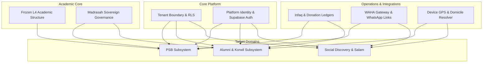

# WP-PSB-ALUMNI-DOMAIN-DISCOVERY-001-REPORT

**Work Package ID**: `WP-PSB-ALUMNI-DOMAIN-DISCOVERY-001`  
**Title**: PSB & Alumni Ecosystem — Architectural Forensic Audit & Domain Trace  
**Document Status**: COMPLETED — SUBMITTED FOR ARCHITECTURAL & PRODUCT OWNER REVIEW  
**Classification**: ARCHITECTURAL AUDIT & DOMAIN TRACE (NO CODE / NO MIGRATION / NO SCHEMA DDL)  
**Authority**: Product Owner Final PRD (`PRD — APP MA'HAD: PSB & Alumni Ecosystem`)  
**Author**: Senior Principal Systems Architect (Antigravity Agent)  
**Date**: September 2026  

---

## 1. EXECUTIVE SUMMARY & PURPOSE

The Product Owner delivered the finalized, approved business specification: **`PRD — APP MA'HAD: PSB & Alumni Ecosystem`** (`Document Status: FINAL — BUSINESS DOMAIN APPROVED`, `Implementation Status: NOT YET AUTHORIZED`).

The foundational operational law governing the entire platform is:
$$\mathbf{Satu\ Tenant} = \mathbf{Satu\ Ekosistem\ Pesantren}$$

Under this doctrine:
1. **PSB (Penerimaan Santri Baru)** and **Alumni** operate at the **Tenant Level**.
2. **Academic Governance & Teaching (KBM)** operate strictly within the **Madrasah Sovereign Boundary**.
3. **One Person = One Identity**: Multiple roles (e.g. Wali + Alumni) belong to a single account without duplicate user records.
4. **Credential Lifecycle**: Wali log in via **Email**, active Santri log in via **NIS**, and transitioning to Alumni switches login from **NIS $\rightarrow$ Email** while permanently retaining the historical NIS.
5. **Graduate $\neq$ Alumni**: Graduating a Madrasah educational level is Madrasah-contextual; becoming an Alumni is a Tenant-level status determined exclusively by the **Super Admin Tenant (SAT)**.
6. **Social Discovery & Privacy**: Location proximity searches ("Cari di Sekitar") display unified Alumni, Santri, and Dhoif/Tamu sorted by proximity, but **never display raw coordinates, numeric distances, WhatsApp numbers, or full physical addresses**.
7. **Salam Silaturrahmi $\neq$ Chat**: Lightweight ping with a 1-hour cooldown per recipient pair; zero chat history is stored; WhatsApp contact is executed via external deep links without automatic sending.

In accordance with **PRD Section 73 (Non-Goals)**, **Section 74 (Implementation Governance)**, and **Section 88 (Handover Instruction to Antigravity)**, this work package executes the mandatory **AUDIT + DOMAIN TRACE** phase. It delivers a forensic audit of the existing codebase, traces cross-domain boundaries, and rigorously answers all **10 Foundational Architectural Questions** before any schema DDL, database migration, or frontend modification is permitted.

---

## 2. THE 10 FOUNDATIONAL HANDOVER QUESTIONS (PRD SECTION 88)

```
┌──────────────────────────────────────────────────────────────────────────────────┐
│                   PRD SECTION 88 ARCHITECTURAL INVENTORY MATRIX                  │
├────────────────────────────────┬─────────────────────────────────────────────────┤
│ 1. Apa yang sudah ada?         │ Multi-tenant RLS, Users/Roles, Frozen L4        │
│                                │ Academic, Santri profile, Status ledgers.       │
├────────────────────────────────┼─────────────────────────────────────────────────┤
│ 2. Apa yang bisa direuse?      │ withTenantTransaction, Audit logs, Outbox,      │
│                                │ L4 Madrasah targets, Editorial CMS engine.      │
├────────────────────────────────┼─────────────────────────────────────────────────┤
│ 3. Apa yang belum ada?         │ PSB core & CMS, Infaq verification, NIS engine, │
│                                │ A Pusat, Korwil, Domicile resolver, Discovery,  │
│                                │ Dhoif evaluator, Salam 1-hr cooldown engine.    │
├────────────────────────────────┼─────────────────────────────────────────────────┤
│ 4. Apa yang konflik?           │ Single-role constraint on membership, global    │
│                                │ kelas on santri, Graduate=Alumni prototype sm,  │
│                                │ Email-only Supabase login vs NIS credential.   │
├────────────────────────────────┼─────────────────────────────────────────────────┤
│ 5. Apa dependency-nya?         │ Tenant isolation, Supabase Auth, Frozen L4,     │
│                                │ Finance ledgers, WAHA/Email, Geolocation API.   │
├────────────────────────────────┼─────────────────────────────────────────────────┤
│ 6. Apa risiko migration?       │ Breaking legacy santri queries, unit test drift │
│                                │ in state machine, high-frequency geo write load.│
├────────────────────────────────┼─────────────────────────────────────────────────┤
│ 7. Apa risiko RLS?             │ Cross-tenant discovery leaks (catastrophic),    │
│                                │ public PSB access leaks, Korwil finance leaks.  │
├────────────────────────────────┼─────────────────────────────────────────────────┤
│ 8. Apa risiko identity?        │ Email collision on NIS->Email transition,       │
│                                │ duplicate accounts for Wali+Alumni, premature   │
│                                │ credential issuance to Calon Santri.            │
├────────────────────────────────┼─────────────────────────────────────────────────┤
│ 9. Apa risiko location/privacy?│ Triangulation via raw coords/distances, bypass  │
│                                │ of Hide Profile, phone number DOM exposure.     │
├────────────────────────────────┼─────────────────────────────────────────────────┤
│ 10. Technical Architecture?    │ Modular 4-layer: Domain modules, DB/RLS layer,  │
│                                │ Integration adapters (WAHA/Proxy), Governance.  │
└────────────────────────────────┴─────────────────────────────────────────────────┘
```

---

### QUESTION 1: APA YANG SUDAH ADA? (WHAT EXISTS ALREADY?)

A forensic inspection of the codebase confirms that APP MA'HAD already possesses solid enterprise foundations:

1. **Multi-Tenant Foundation & Schema Isolation**:
   - `tenants` table (`id`, `name`, `slug`, `domain`, `status`).
   - `tenant_settings` table (`customLogoUrl`, `customBgUrl`, `primaryColor`, `tagline`, `loginTitle`, `loginSubtitle`, `loginDescription`, `waGatewayApiKey`, `flipSecretKey`, `gdriveServiceAccountJson`).
   - `withTenantTransaction(tenantId, callback, options)` utility enforcing PostgreSQL `SET LOCAL app.current_tenant_id` and `SET LOCAL app.is_super_admin` per connection check.
   - Comprehensive PostgreSQL RLS enforcement across all core tables (`drizzle/0002_tenant_rls_hardening.sql`).
2. **Platform Identity & RBAC Core**:
   - `users` table: Central identity system-of-record mapped 1:1 to Supabase Auth (`auth.users.id`), with `email` (unique), `phone` (unique), `status`, `name`, `avatar`. Legacy fields `tenant_id`, `role`, `child_santri_id` exist.
   - `platform_roles` (`SUPER_ADMIN`, `DEVELOPER`) and `user_platform_roles`.
   - `tenant_roles` (`ADMIN`, `GURU`, `MUSYRIF`, `BENDAHARA`, `STAFF`, `WALI`) and `user_tenant_memberships` table.
   - `permissions`, `tenant_role_permissions`, `user_additional_permissions` canonical catalog (`src/lib/authz/canonical-permissions.ts`).
   - `wali_santri_relationships` table linking `(tenant_id, wali_user_id, santri_id, relationship_type, is_primary, status)`.
3. **Canonical Level-4 Academic Structure (Closed & Frozen)**:
   - Formally closed and verified under `WP-ACADEMIC-STRUCTURE-CLOSURE-001-REPORT.md`:
     - `madrasah`: Tenant-scoped, unique code (`uq_madrasah_tenant_code`).
     - `jenjang`: Madrasah-scoped, ordered by `order_index`.
     - `tingkat`: Jenjang/Madrasah-scoped, monotonic `sequence`, unique progression, `ui_label`.
     - `rombel`: Tingkat/Academic Year-scoped, capacity checked.
     - `academic_years`: Start/end dates, planned/active/archived lifecycle, max 1 active per tenant.
     - `academic_terms`: Semester ganjil/genap, current/active check.
4. **Student Master Record & Prototype State Machine**:
   - `santri` table: Core student biodata (`nis`, `name`, `asrama`, `kamar`, `kelas`, `status`, `gender`, `wali_name`, `wali_phone`, `join_date`, `asal_kota`, `asal_provinsi`, `angkatan_masuk`).
   - Status & history ledgers: `status_ledgers`, `status_change_records`, `history_ledgers`, `field_change_records`.
   - Prototype state machine (`src/modules/santri/domain/state-machine.ts`) with legal transitions across `DRAFT`, `REGISTERED`, `VERIFIED`, `ACTIVE`, `SUSPENDED`, `TRANSFERRED`, `GRADUATED`, `ALUMNI`, `ARCHIVED`.
   - Client mock-store / service: `alumniService = createTenantService<Alumni>('alumni')` and TypeScript `Alumni` interface in `src/types/index.ts`.
5. **Decoupled Editorial CMS Architecture**:
   - Formally locked under `WP-ACADEMIC-COMMUNICATION-DECISION-CLOSURE-001-REPORT.md`: Madrasah Announcement CMS is sovereign to each Madrasah and decoupled from calendar events.
6. **Audit & Event Infrastructure**:
   - `audit_logs` table and repository (`src/lib/db/services/auditLog.ts`).
   - `outbox_events` table for reliable asynchronous event delivery.

---

### QUESTION 2: APA YANG BISA DIREUSE? (WHAT CAN BE REUSED?)

The new PSB & Alumni domains do not need to build everything from scratch; several battle-tested platform systems can be directly leveraged:

1. **`withTenantTransaction` Defense-in-Depth RLS**:
   - All PSB applicant submissions, payment verifications, student creations, and Alumni discovery queries can execute inside `withTenantTransaction(tenantId, ...)` to guarantee zero cross-tenant leakage.
2. **Audit Logging Ledger (`audit_logs`)**:
   - The PRD Section 72 explicitly outlines high-authority decisions (SAT accepting applicants, SAT designating Alumni, Panitia appointment, Madrasah placement confirmation). All can directly record immutable entries to `audit_logs` using existing audit schemas.
3. **Outbox Pattern (`outbox_events`)**:
   - High-throughput asynchronous workflows—such as notifying parents via WhatsApp (WAHA) when an applicant becomes a Calon Santri, broadcasting Dhoif alerts, or syncing email invites—can push domain events to `outbox_events` for reliable background processing.
4. **Frozen Level-4 Academic Entities as Distribution Targets**:
   - The PSB distribution workflow requires assigning accepted students to Madrasah, Jenjang, Tingkat, and Rombel. We can directly reference the existing, frozen `madrasah`, `jenjang`, `tingkat`, and `rombel` tables via foreign keys without redefining academic hierarchies.
5. **Editorial CMS Engine & Publishing Lifecycle**:
   - The publishing state machine (`DRAFT`, `PUBLISHED`, `ARCHIVED`), rich text body structures, and multi-channel targeting patterns established in `WP-ACADEMIC-COMMUNICATION-ANNOUNCEMENT-001` can be reused as the technical foundation for the **PSB Public CMS** and **Alumni Announcements**, while remaining in distinct domain tables.
6. **Existing Family Relationship Infrastructure**:
   - `wali_santri_relationships` can be directly populated when SAT marks an applicant as "Lulus/Diterima" and creates the Santri identity, linking the registered parent's `users.id` to the new `santri.id`.
7. **Integration Credential Storage**:
   - `tenant_settings` already stores integration credentials (like `waGatewayApiKey`); it can be cleanly extended to hold tenant-specific WAHA endpoints and Play Store download links.

---

### QUESTION 3: APA YANG BELUM ADA? (WHAT DOES NOT EXIST YET?)

The following components are completely missing from the existing codebase and represent the primary functional scope of this domain:

1. **PSB Configuration & Lifecycle Subsystem**:
   - No `psb_periods` table or wave configuration (1 or 2 waves, submission windows, quotas, admission rules).
   - No `psb_committees` entity allowing SAT to assign a teacher as Ketua Panitia, and allowing Ketua Panitia to recruit members per PSB period.
   - No `psb_applicants` entity to store prospective student data, previous education history, parent biodata, and submission status.
   - No `psb_payment_verifications` workflow to handle Infaq Formulir bank transfer receipts and admin verification.
   - No `psb_examinations` or `psb_interviews` scoring and qualification records.
   - No `psb_placement_distributions` table tracking student assignments to Madrasah/Rombel and recording explicit Madrasah Admin confirmation.
   - No dedicated `psb_cms_pages` or public CMS publication system for prospective parents.
2. **Automated NIS Generation Engine**:
   - No configurable NIS pattern/sequence generator per tenant (e.g., Year + Sequence prefix). Currently, NIS is entered manually or mocked.
3. **Alumni Organization ("A") Subsystem**:
   - No `A Pusat` structure or leadership assignment (`alumni_central_boards`, Ketua Umum, Administrator Alumni, Bendahara).
   - No `A Korwil Daerah` entity (`alumni_korwils`) created formally by Administrator Alumni.
   - No Domicile-to-Korwil automatic membership resolver.
   - No Domicile change tracker with a tenant-level `Konfirmasi Perpindahan Korwil` configuration toggle (`OFF = auto-transfer`, `ON = requires confirmation`).
   - No Alumni Programs, Activities, or Financial Donation ledgers (`alumni_donations` with an anonymous display name generator).
4. **Multi-Madrasah Educational Snapshot Ledger**:
   - No `alumni_academic_snapshots` table capturing per-Madrasah educational history upon becoming Alumni (Madrasah, last Jenjang, last Nama Tingkat, exit date, exit reason).
5. **Geolocation & Social Discovery ("Cari di Sekitar")**:
   - No user coordinates storage (`user_discovery_locations`) or spatial indexing.
   - No `Hide Profile` privacy toggle.
   - No `Nama Alias` attribute on Alumni profiles.
   - No Dhoif/Tamu evaluation logic detecting when a user is physically outside their home Korwil.
   - No proximity query projection that ranks users by distance without exposing numeric meters/km, telephone numbers, or physical street addresses.
6. **Salam Silaturrahmi Subsystem**:
   - No `salam_interactions` ledger enforcing the strict **1-hour cooldown per recipient pair**.
   - No `salam_templates` configuration table managed by Alumni administration.
   - No server-side WhatsApp reply deep-link generator with pre-filled message templates.
7. **Dual-Credential Switching & Portal Access Engine**:
   - No system allowing active Santri to log in via NIS, while Wali and Alumni log in via Email.
   - No transition workflow that flips authentication credentials from NIS to Email when SAT marks a student as Alumni.
8. **WAHA Integration Service**:
   - No WAHA HTTP client adapter, dispatch queue, or template rendering service.

---

### QUESTION 4: APA YANG KONFLIK? (WHAT CONFLICTS EXIST?)

A rigorous audit identified four critical architectural and structural conflicts between the legacy/prototype code and the new PRD:

#### Conflict 1: `user_tenant_memberships` Unique Constraint vs. Multi-Role Identity
- **Existing Code**: In `src/lib/db/schema/identity.ts` (lines 60–74), `user_tenant_memberships` has:
  ```typescript
  unique('user_tenant_memberships_user_tenant_idx').on(table.userId, table.tenantId)
  ```
  with comment: `Single Active Primary Role per Tenant`.
- **PRD Law (Sections 3.1 & 62)**:
  > "Satu orang hanya mempunyai satu Identity/Account. Satu Identity dapat mempunyai beberapa role/context. Contoh: Wali + Alumni tetap menggunakan satu akun. Dalam konteks Alumni: dapat ditemukan, menggunakan Alias, kirim Salam. Dalam konteks Wali: tetap memiliki hak Portal Wali. Tidak dibuat akun kedua."
- **Conflict Resolution**: The platform must not force a user to choose between being a Wali or an Alumni, nor create duplicate users. We must either:
  1. Decouple role assignments into a `user_tenant_roles` junction table, or
  2. Maintain `user_tenant_memberships` as the base membership and introduce secondary persona context bindings (`alumni_profiles`, `wali_profiles`).

#### Conflict 2: Flat `kelas` Column on `santri` vs. Multi-Madrasah Sovereignty
- **Existing Code**: The `santri` table (in `src/lib/db/schema.ts` line 61) has a flat `kelas: text('kelas')`. The legacy `Alumni` interface in `src/types/index.ts` has `kelasTerakhir: string`.
- **PRD Law (Sections 23 & 27)**:
  > "Satu Santri dapat mempunyai beberapa academic placement dalam satu Academic Year (Madrasah A, Madrasah B, Madrasah C). Tidak boleh membuat Tingkat global pada Santri. Tingkat/Nama Tingkat selalu berada dalam konteks akademik."
  > "Ketika SAT menetapkan Alumni, sistem segera membuat snapshot pendidikan. Untuk setiap Madrasah yang pernah diikuti, snapshot menyimpan minimal: Madrasah, last Jenjang, last Nama Tingkat, tanggal, exit reason."
- **Conflict Resolution**: The flat `kelas` column must be treated as deprecated legacy display only. All true academic placements must reference Madrasah-specific L4 structures, and Alumni snapshots must record multi-Madrasah educational history in `alumni_academic_snapshots`.

#### Conflict 3: Prototype State Machine vs. Graduate vs. Alumni Distinction
- **Existing Code**: In `src/modules/santri/domain/state-machine.ts`, the transition flow is hardcoded as `ACTIVE -> GRADUATED -> ALUMNI`. Graduation is modeled as a global student state that automatically transitions to Alumni once invoices are settled.
- **PRD Law (Sections 24, 25, 26)**:
  > "Graduate bersifat: Madrasah-contextual. Alumni bersifat: Tenant-level. Graduate tidak otomatis berarti Alumni. Jika masih aktif di Madrasah lain -> tetap Santri. SAT adalah authority final untuk perubahan Santri -> Alumni."
- **Conflict Resolution**: Graduation must be decoupled from the student aggregate. Graduation is an academic outcome recorded within a specific Madrasah context. The student remains `ACTIVE` as long as any Madrasah placement is active. Only an explicit decision by the **SAT** can transition a student's tenant-level status to `ALUMNI`.

#### Conflict 4: Email-Only Supabase Auth vs. NIS Login for Santri
- **Existing Code**: `src/store/auth-store.ts` and `src/app/client-page.tsx` pass `email` and `password` directly to Supabase Auth (`supabase.auth.signInWithPassword({ email, password })`).
- **PRD Law (Sections 4.1, 4.2, 28)**:
  > "Wali menggunakan Email sebagai credential login. Santri aktif menggunakan NIS sebagai credential login. Ketika menjadi Alumni: NIS login -> Email login."
- **Conflict Resolution**: Supabase Auth natively requires an email or phone as the username. Active Santri do not possess an external email. We must adopt an **Identity Federation Adapter** (e.g. mapping NIS to a synthetic internal credential `nis@{tenant_slug}.internal` or a custom auth bridge) so students authenticate using NIS, while Wali and Alumni authenticate using their real Email address—without creating disconnected identities.

#### Conflict 5: Salam Silaturrahmi vs. Traditional Chat System
- **Existing Code**: Standard messaging patterns often attempt to build persistent conversation threads (`conversations`, `messages`, chat history).
- **PRD Law (Sections 51, 56, 73, 84)**:
  > "Salam Silaturrahmi BUKAN fitur chat. Riwayat Salam Silaturrahmi tidak perlu ditampilkan/disediakan sebagai history. Interaksi bersifat sesaat. Tidak ada conversation history. Dilarang menjadikan Salam Silaturrahmi sebagai chat system."
- **Conflict Resolution**: The database must **never** store a persistent chat ledger. A transient interaction ledger (`salam_interactions`) is used solely to enforce the 1-hour cooldown and trigger notifications, after which records expire or are purged.

---

### QUESTION 5: APA DEPENDENCY-NYA? (WHAT ARE THE DEPENDENCIES?)

The PSB & Alumni domains rely on six cross-domain architectural pillars:



1. **Multi-Tenant & RLS Subsystem**: All tables must strictly carry `tenant_id` and execute under `withTenantTransaction`.
2. **Platform Identity & Auth**: `users` table as the person system-of-record; `wali_santri_relationships` for family ties; authentication provider for credential handling.
3. **Academic Structure (Frozen L4)**: `madrasah`, `jenjang`, `tingkat`, `rombel`, and `academic_years` provide the valid targets for PSB student distribution.
4. **Academic Context & Governance**: Madrasah Admin confirmation workflow preserves the academic sovereignty locked in `WP-ACADEMIC-CONTEXT-BOUNDARY-001`.
5. **Financial Subsystem**: Infaq Formulir verification during PSB; donation distribution (A Pusat vs Korwil) during Alumni operations.
6. **External Integration Gateways**: WAHA HTTP API for programmatic WhatsApp dispatches; native device GPS / browser Geolocation API for proximity; deep-linking engine for direct WhatsApp communication.

---

### QUESTION 6: APA RISIKO MIGRATION? (WHAT ARE THE MIGRATION RISKS?)

1. **Legacy Santri Table Disruption**:
   - The existing `santri` table contains legacy text fields (`kelas`, `asrama`, `kamar`). Introducing strict foreign keys or modifying columns directly risks breaking existing pages (e.g. UKS, Pelanggaran, Dompet).
   - *Mitigation*: Keep legacy columns intact during transition; introduce new relational placement tables and snapshots without dropping legacy columns.
2. **State Machine Test Regression**:
   - `src/modules/santri/domain/__tests__/state-machine.test.ts` contains 17 unit tests verifying the old `ACTIVE -> GRADUATED -> ALUMNI` transition.
   - *Mitigation*: Update the domain state machine and test suite in a controlled, isolated work package specifically authorized for lifecycle refactoring.
3. **Database Write Pressure from Location Tracking**:
   - High-frequency GPS updates for "Cari di Sekitar" written directly to a core table (`users` or `santri`) would create severe row lock contention, WAL bloat, and cache thrashing.
   - *Mitigation*: Isolate geolocation into an unlogged or lean ephemeral table (`user_discovery_locations`) with a short time-to-live (TTL) and minimal indexing.
4. **Retroactive Membership Migration**:
   - Existing users with single-role memberships must not lose their role assignments when multi-role context support is deployed.
   - *Mitigation*: Ensure schema modifications maintain 100% backward compatibility with existing `user_tenant_memberships` records.

---

### QUESTION 7: APA RISIKO RLS? (WHAT ARE THE RLS RISKS?)

1. **Cross-Tenant Discovery Data Leakage (CATASTROPHIC RISK)**:
   - "Cari di Sekitar" calculates geographical proximity using device GPS coordinates.
   - **Severe Threat**: If a geospatial query (`ST_DWithin` or bounding box) is executed across all rows without enforcing `tenant_id = app.current_tenant_id()`, students from Pesantren A physically near Pesantren B (e.g. in the same district) would be visible to each other!
   - *Mitigation*: RLS policy on `user_discovery_locations` must enforce `tenant_id = NULLIF(current_setting('app.current_tenant_id', true), '')` at the PostgreSQL engine level, and all query builders must include an explicit `tenant_id` predicate.
2. **Public PSB Applicant Access Leakage**:
   - Prospective parents registering via the public PSB portal are not yet authenticated tenant users.
   - **Threat**: Allowing unauthenticated inserts could open the `psb_applicants` table to scraping or unauthorized reads of other applicants' sensitive family data.
   - *Mitigation*: Public inserts to `psb_applicants` must be write-only for unauthenticated sessions, or prospective parents must undergo instant lightweight authentication (magic link or OTP) so RLS restricts each parent to their own application draft.
3. **Alumni Financial Data Scope Leakage**:
   - PRD Section 67 & 68 mandates that Bendahara Korwil must **never** see donation details belonging to A Pusat or other Korwils.
   - *Mitigation*: RLS policies on `alumni_donations` must inspect the destination scope (`A_PUSAT` vs `KORWIL`) and the actor's assigned chapter role.
4. **Madrasah Placement Confirmation Bypass**:
   - An administrator of Madrasah MTs must not be allowed to approve student placements for Madrasah MA.
   - *Mitigation*: Enforce Madrasah-level authorization on placement confirmation actions (`psb_placement_distributions`).

---

### QUESTION 8: APA RISIKO IDENTITY / ACCOUNT? (WHAT ARE THE IDENTITY / ACCOUNT RISKS?)

1. **Email Collision on NIS $\rightarrow$ Email Transition**:
   - While a Santri is active, they log in via NIS. They may not possess a personal email in the system.
   - When transitioning to Alumni, PRD Section 28 requires: "NIS login -> Email login."
   - **Threat**: If the newly designated Alumni enters an email already used by their parent (Wali) or another user, a database unique constraint collision will occur.
   - *Mitigation*: The transition to Alumni must feature an explicit email onboarding / invitation step where the Alumni provides and verifies their own email address before the login method is transitioned.
2. **Dual-Role Collision (Wali + Alumni)**:
   - An alumnus of the pesantren whose child is now a student is both a **Wali** and an **Alumni**.
   - **Threat**: In typical systems, administrators accidentally register a second user account for the parent.
   - *Mitigation*: Strict enforcement of "One Person = One Identity". The user logs in once with their email and accesses a unified portal with context switching between Wali features (student grades, invoices) and Alumni features (Korwil, Discovery, Salam).
3. **Premature Calon Santri Credential Issuance**:
   - PRD Section 11 explicitly states: "Calon Santri belum menjadi Santri aktif. Calon Santri menggunakan akses wali/family portal. Calon Santri TIDAK memiliki credential sendiri pada tahap ini."
   - **Threat**: Over-eager onboarding flows issuing student credentials upon initial registration.
   - *Mitigation*: Calon Santri records must remain strictly under the guardian's profile. Zero user login accounts or NIS numbers are generated until the SAT explicitly triggers "Lulus / Diterima".

---

### QUESTION 9: APA RISIKO LOCATION / PRIVACY? (WHAT ARE THE LOCATION / PRIVACY RISKS?)

1. **Triangulation via Raw Coordinates or Distance Numbers**:
   - PRD Section 42: "Angka jarak TIDAK ditampilkan."
   - PRD Section 44: "Tidak menampilkan alamat lengkap, nomor WhatsApp, informasi sensitif yang tidak diperlukan."
   - **Severe Threat**: If the API response includes raw `latitude`, `longitude`, or calculated distance in meters, a tech-savvy user can inspect browser DevTools or mobile network traffic, query from three locations, and mathematically triangulate the exact bedroom or home address of minor students!
   - *Mitigation*:
     - Coordinates and calculated distances must remain strictly within the backend database query.
     - The API endpoint must return an ordered list of profile cards with **zero coordinates and zero distance numbers**.
     - Location coordinates must be fuzzed or snapped to coarse grid centroids (e.g. 500m jitter).
2. **Bypass of "Hide Profile" via Salam Silaturrahmi or Dhoif Alerts**:
   - PRD Section 43 & 54: "Hide Profile tidak boleh dibypass oleh fitur Salam Silaturrahmi."
   - PRD Section 57: "Notifikasi Dhoif tidak langsung menampilkan identitas Dhoif. Action: Cari di Sekitar."
   - **Threat**: If an invisible user can be searched in a dropdown to send a Salam, their privacy setting is effectively nullified.
   - *Mitigation*: Any query for Discovery, Dhoif candidate matching, or Salam recipient selection must include `WHERE hide_profile = false`. If a user is hidden, they are completely invisible across all social features.
3. **Alumni Real Name Exposure vs. Alias Policy**:
   - PRD Section 30 & 31: "Nama Alumni pada social discovery menggunakan Nama Alias. Jika belum memiliki Alias: identitas asli TIDAK digunakan sebagai pengganti Alias."
   - **Threat**: Displaying real full names for Alumni who haven't set an alias leaks personal identity.
   - *Mitigation*: Alumni who have not configured a `Nama Alias` are excluded from social discovery card generation until an alias is created.
4. **WhatsApp Phone Number Harvesting from DOM / Network**:
   - PRD Section 46 & 81: "Nomor WhatsApp TIDAK ditampilkan. Button label: Hubungi via WhatsApp. Membuka WhatsApp melalui hyperlink/deep link."
   - **Threat**: If the frontend renders `<a href="https://wa.me/628123456789">`, any user can inspect the HTML and scrape phone numbers.
   - *Mitigation*: The frontend renders a button linking to an internal proxy route: `/api/social/wa-contact/{recipientId}`. The backend validates authorization, fetches the phone number securely from the database, and issues an HTTP 302 Redirect directly to WhatsApp without ever exposing the phone number in client-side HTML or JSON payloads.

---

### QUESTION 10: APA TECHNICAL ARCHITECTURE YANG DIPERLUKAN? (WHAT TECHNICAL ARCHITECTURE IS REQUIRED?)

To satisfy the 10-year multi-tenant enterprise vision and adhere strictly to the PRD without introducing technical debt, the platform requires a modular 4-layer architecture:

```
┌──────────────────────────────────────────────────────────────────────────────────┐
│                   TARGET 4-LAYER TECHNICAL ARCHITECTURE                         │
├──────────────────────────────────────────────────────────────────────────────────┤
│ LAYER 1: PRESENTATION & PORTALS                                                  │
│ • Public PSB Portal & CMS Landing Page                                           │
│ • Wali / Family Portal (Application tracking, Multi-child grades, Payments)     │
│ • Panitia PSB Dashboard (Verification, Examination, Distribution)               │
│ • Super Admin Tenant (SAT) Cockpit (Acceptance authority, Alumni designation)   │
│ • Madrasah Academic Cockpit (Placement confirmation per sovereign boundary)      │
│ • Alumni Portal (A Pusat, Korwil, Discovery "Cari di Sekitar", Salam)            │
├──────────────────────────────────────────────────────────────────────────────────┤
│ LAYER 2: APPLICATION & DOMAIN SERVICES                                           │
│ • PSB Domain Service (Wave engine, Infaq verifier, Distribution ledger)          │
│ • NIS Sequence Engine (Tenant-configurable pattern generator)                   │
│ • Placement Sovereignty Bridge (Madrasah confirmation workflow)                  │
│ • Lifecycle & Transition Manager (Decoupled Graduation vs SAT Alumni designation)│
│ • Alumni & Korwil Engine (Domicile resolver, Transfer toggle, Finance scopes)    │
│ • Proximity & Dhoif Evaluator (Coarse geo ranking, Zero-coordinate responses)    │
│ • Salam Silaturrahmi Service (1-hr cooldown enforcer, Ephemeral transient model) │
│ • Secure WhatsApp Contact Proxy (Zero-exposure deep-link generator)              │
├──────────────────────────────────────────────────────────────────────────────────┤
│ LAYER 3: INFRASTRUCTURE & INTEGRATION ADAPTERS                                   │
│ • WAHA HTTP Client (Queued background notification dispatcher via Outbox)        │
│ • Identity Federation Adapter (NIS-based auth bridge for active Santri)          │
│ • Geolocation & Spatial Resolver (Haversine / PostGIS bounded queries)          │
│ • Multi-Tenant Transaction Session Context (withTenantTransaction SET LOCAL)     │
├──────────────────────────────────────────────────────────────────────────────────┤
│ LAYER 4: PERSISTENCE & DATA ISOLATION (POSTGRESQL + RLS)                         │
│ • Core Tenant Tables (tenants, tenant_settings)                                  │
│ • Identity Tables (users, user_tenant_roles, wali_santri_relationships)          │
│ • PSB Tables (psb_periods, psb_applicants, psb_distributions, psb_cms)           │
│ • Academic Structure Tables (Frozen L4: madrasah, jenjang, tingkat, rombel)      │
│ • Alumni Tables (alumni_profiles, alumni_snapshots, alumni_korwils, donations)  │
│ • Social & Location Tables (user_discovery_locations, salam_interactions)        │
│ • Audit & Outbox Tables (audit_logs, outbox_events)                              │
└──────────────────────────────────────────────────────────────────────────────────┘
```

---

## 3. DOMAIN-BY-DOMAIN FORENSIC TRACE & COMPLIANCE

### 3.1 Domain 1: PSB (Penerimaan Santri Baru) Lifecycle

```
[ SAT Creates PSB Period & Waves ]
               │
               ▼
[ SAT Appoints Teacher as Ketua Panitia ] ──► [ Ketua Panitia Recruits Members ]
               │
               ▼
[ Panitia Publishes PSB Public CMS ]
               │
               ▼
[ Wali Submits Application & Infaq Formulir Receipt ]
               │
               ▼
[ Panitia Verifies Infaq Receipt ] ──► [ Status Becomes: CALON SANTRI ]
               │                          │
               │                          └──► WAHA Notifies Wali + App Download Link
               ▼
[ Testing & Interview Process ]
               │
               ▼
[ SAT Final Decision: LULUS / DITERIMA ] (EXCLUSIVE SAT AUTHORITY)
               │
               ├─────────────────────────────────────────────┐
               ▼                                             ▼
[ Santri Identity Created ]                     [ Configurable NIS Generated ]
               │
               ▼
[ Panitia Creates Distribution to Madrasahs / Tingkat / Rombel ]
               │
               ▼
[ Admin Madrasah A Confirms ]       [ Admin Madrasah B Confirms ]
               │                                   │
               └─────────────────┬─────────────────┘
                                 │
                                 ▼
                     [ All Placements Confirmed ]
                                 │
                                 ▼
                     [ PSB Formally Closed ]
                                 │
                                 ▼
                     [ Immutable Historical Ledger Preserved ]
```

- **Tenant Ownership**: PSB is 100% Tenant-wide. Prospective parents do **not** choose a Madrasah upon application.
- **Infaq Formulir & Calon Santri**: Proof of transfer verification promotes `Applicant` $\rightarrow$ `Calon Santri`. Calon Santri operate under the family portal and have **no credentials of their own**.
- **SAT Final Authority**: The decision "Lulus / Diterima" is the sole prerogative of the SAT. Clicking "Lulus" immediately establishes the student as a `Santri` and triggers automated NIS generation—**no redundant re-registration step**.
- **Madrasah Sovereignty in Distribution**: While Panitia prepares student distribution, each Madrasah Admin retains absolute sovereignty to approve/confirm the placement within their Madrasah context.
- **Formal Closure**: PSB closes only when all relevant Madrasahs have confirmed placements.

---

### 3.2 Domain 2: Graduate vs. Alumni Separation

The PRD permanently settles the relationship between educational completion and alumni status:

| Dimension | Graduate (Lulus Madrasah) | Alumni (Alumni Pesantren) |
| :--- | :--- | :--- |
| **Governance Boundary** | **Madrasah Contextual** | **Tenant Level** |
| **Definition** | Santri completed a level within a specific Madrasah. | Individual who was engaged in KBM and is no longer active across the pesantren. |
| **Multi-Madrasah Effect** | Graduating MTs while still active in Tahfizh $\rightarrow$ **Remains Active Santri**. | No active KBM relations remain across any Madrasah $\rightarrow$ Eligible for Alumni status. |
| **Authority** | Madrasah Academic Board | **SAT (Super Admin Tenant) Exclusively** |
| **Operational Impact** | Gradebook closed for that Madrasah. | All KBM relations stopped; attendance stopped; academic operations terminated. |
| **Educational Snapshot** | N/A | **Mandatory Snapshot**: Per-Madrasah record (Madrasah, last Jenjang, last Nama Tingkat, exit date, exit reason). |
| **Credential** | NIS Login preserved. | NIS login transitions to **Email Login**; historical NIS preserved as reference. |

---

### 3.3 Domain 3: Alumni Organization ("A"), Korwil & Domicile

1. **Organizational Hierarchy**:
   - `A Pusat`: Led by *Ketua Umum Alumni*, appointing *Administrator Alumni* and *Bendahara*.
   - `A Korwil Daerah`: Regional chapters created officially by Administrator Alumni. If a region has no official Korwil established, alumni in that area have no Korwil membership.
2. **The Fundamental Law of Membership: Domicile vs. GPS**:
   $$\mathbf{Domisili\ Tersimpan} \implies \mathbf{Menentukan\ Membership\ Korwil}$$
   $$\mathbf{GPS\ Aktual} \implies \mathbf{Menentukan\ Keberadaan\ Saat\ Ini\ (Dhoif)}$$
   - **GPS never changes Korwil membership.**
3. **Domicile Transfer Configuration**:
   - When an Alumnus updates their stored domicile, Korwil reassignment follows the tenant setting:
     - `OFF`: Auto-transfer to the new region's Korwil.
     - `ON`: Transfer queued, requiring administrative confirmation.
4. **Financial Isolation**:
   - Bendahara A Pusat manages central funds; Bendahara Korwil manages regional funds.
   - Visibility is strictly compartmentalized by destination. A Korwil treasurer cannot inspect donations directed to A Pusat or other Korwils.
   - Public donation displays show amounts transparently, but donor identity defaults to **Anonymous** with system-generated pseudonyms.

---

### 3.4 Domain 4: Dhoif / Tamu & Social Discovery ("Cari di Sekitar")

1. **Definition of Dhoif**:
   - A contextual, ephemeral state occurring when an Alumnus or active Santri is physically located in a Korwil region different from their home Korwil.
   - Home Korwil remains unchanged (e.g. Alumnus from Korwil Malang physically in Surabaya is `Alumni + Dhoif`, Home Korwil: Malang).
2. **Unified Discovery Screen**:
   - Single unified list displaying **Alumni, Active Santri, and Dhoif/Tamu** together, sorted strictly by proximity (nearest to farthest).
   - Global coverage: Administrative boundaries (Kabupaten/Kota) within Indonesia; geographic proximity internationally.
3. **Strict Privacy Standards**:
   - **Distance numbers are NEVER displayed** (e.g., no "1.2 km away").
   - **Full street addresses and raw coordinates are NEVER displayed**.
   - **WhatsApp phone numbers are NEVER displayed**.
   - **Hide Profile**: When enabled, the user is completely excluded from discovery results and cannot be detected as Dhoif.
4. **Card Display Rules**:
   - **Alumni**: Photo/avatar, **Nama Alias**, primary status (`Alumni`), `[Hubungi via WhatsApp]` (proxy link). If Dhoif: `Dhoif` badge + `Korwil Asal`. If no alias is configured, profile is hidden from discovery.
   - **Active Santri**: Photo/avatar, real Name, primary status (`Santri Aktif`), Madrasah context selector, Jenjang, **Nama Tingkat** (Rombel is strictly hidden!), `[Hubungi via WhatsApp]` (proxy link). If Dhoif: `Dhoif` badge + `Korwil Asal`.
5. **Dhoif Notification Flow**:
   - When a Dhoif enters a Korwil area, the system dispatches a generic notification to local members: *"Ada Alumni/Santri dari luar wilayah sedang berada di sekitar Anda."*
   - The notification **never reveals the person's identity**. Tapping the notification simply opens "Cari di Sekitar", where the user appears normally if their profile is visible.

---

### 3.5 Domain 5: Salam Silaturrahmi & WhatsApp Integration

1. **Salam Silaturrahmi Rules**:
   - Formal UI title: **Salam Silaturrahmi** (the informal term "Colek" is strictly deprecated).
   - Eligible actors: **Active Santri** and **Alumni** (including Wali who are also Alumni). Wali-only users are excluded.
   - **Strict Cooldown: 1 hour per recipient pair**. (User A can send to User B at 10:00; blocked until 11:00. User A can still send to User C).
   - Message options: Pre-configured templates (managed by Alumni administration) or custom free-form text.
   - **Non-Chat Principle**: No conversation history is maintained. It is an ephemeral social ping.
   - Privacy guarantee: Salam can never bypass `Hide Profile`.
2. **WhatsApp Deep-Link Integration**:
   - "Hubungi via WhatsApp" and "Balas melalui WhatsApp" generate external deep links (`whatsapp://send?text=...`).
   - The system pre-fills the message text based on configurable templates, allowing the user to review and edit before sending.
   - **Zero Automatic Sending**: The system never triggers automated WhatsApp messages on behalf of a user's personal account.
   - **Zero Number Exposure**: Contact buttons route through a secure server proxy redirect to protect telephone privacy.

---

## 4. MULTI-TENANT RLS & SECURITY MATRIX

To guarantee full compliance with Section 71 (Security & Privacy Principles), all target tables will enforce the following security matrix:

| Table Category | Proposed Table Name | Multi-Tenant Key | RLS Policy Model | Security Invariant |
| :--- | :--- | :--- | :--- | :--- |
| **PSB Configuration** | `psb_periods` | `tenant_id` | Read: Public (if published); Write: SAT only | Wave count constrained to 1 or 2. |
| **PSB Committee** | `psb_committees` | `tenant_id` | Read: Tenant staff; Write: SAT & Ketua Panitia | Panitia assignments scoped to specific PSB period. |
| **PSB Applicants** | `psb_applicants` | `tenant_id` | Read: Panitia & Wali owner; Write: Wali owner | Prospective parent cannot see other applicants. |
| **PSB Payment** | `psb_payment_verifications` | `tenant_id` | Read: Panitia & Wali owner; Write: Panitia verify | Verification required for Calon Santri status. |
| **PSB Distribution** | `psb_placement_distributions`| `tenant_id` | Read: Panitia & Madrasah Admin; Write: Panitia/Madrasah | Madrasah Admin can only confirm their own `madrasah_id`. |
| **PSB CMS** | `psb_cms_pages` | `tenant_id` | Read: Public; Write: Panitia & SAT | Distinct from Academic & Alumni announcements. |
| **Alumni Organization**| `alumni_central_boards` | `tenant_id` | Read: Tenant authenticated; Write: SAT / Ketua Umum | Single central board per tenant. |
| **Alumni Chapters** | `alumni_korwils` | `tenant_id` | Read: Tenant authenticated; Write: Administrator Alumni | Must be formally chartered to exist. |
| **Alumni Snapshots** | `alumni_academic_snapshots` | `tenant_id` | Read: Tenant staff & Alumni owner; Write: SAT only | Immutable multi-Madrasah educational history. |
| **Alumni Donations** | `alumni_donations` | `tenant_id` | Read: Scope-isolated (A Pusat vs Korwil); Write: Donor | Anonymous name generation; Korwil scope strictly isolated. |
| **Social Locations** | `user_discovery_locations` | `tenant_id` | Read: Same-tenant only; Write: Location owner | **STRICT TENANT ISOLATION**: Zero cross-tenant visibility. |
| **Salam Silaturrahmi**| `salam_interactions` | `tenant_id` | Read: Sender/Recipient; Write: Sender (1-hr cooldown) | Ephemeral interaction record; zero persistent chat log. |

---

## 5. RECONCILIATION WITH PREVIOUS WORK PACKAGES

This audit establishes flawless continuity with prior architectural milestones:

1. **Level-4 Academic Structure (`WP-ACADEMIC-STRUCTURE-CLOSURE-001`)**:
   - The frozen hierarchy `Madrasah -> Jenjang -> Tingkat -> Rombel` is completely respected. PSB distribution acts as an intake feeder into this frozen structure without altering its tables or constraints.
2. **Academic Context Boundary (`WP-ACADEMIC-CONTEXT-BOUNDARY-001`)**:
   - The principle that **Madrasah is the Academic Governance Boundary** is honored. Panitia prepares distribution, but the Madrasah Admin possesses sovereign confirmation authority.
3. **Communication & Announcement CMS (`WP-ACADEMIC-COMMUNICATION-DECISION-CLOSURE-001`)**:
   - Decoupled domain ownership is preserved: **Madrasah Announcement CMS**, **PSB Public CMS**, and **Alumni Announcement CMS** remain separate domain entities, sharing only underlying rich-text rendering components.
4. **Multi-Tenant Foundation (`WP-SAAS-SEC-001/002/003`)**:
   - Every target entity is bound to `tenant_id` with fail-closed PostgreSQL RLS and transaction context enforcement via `withTenantTransaction`.

---

## 6. ROADMAP & GATED NEXT STEPS

In strict compliance with PRD Section 74, 75, and 88, no implementation or migration has been performed in this work package. The exact sequence of subsequent gates is structured as follows:

```
[ THIS WORK PACKAGE: AUDIT + DOMAIN TRACE ] (WP-PSB-ALUMNI-DOMAIN-DISCOVERY-001)
                    │
                    ▼
[ GATE 1: Product Owner Review & Architectural Authorization ]
                    │
                    ▼
[ TECHNICAL PROPOSAL: SCHEMA DESIGN & API CONTRACT ] (WP-PSB-ALUMNI-SCHEMA-001)
  • Explicit table definitions, column types, foreign keys, and indexes
  • Drizzle ORM schema specifications
  • RLS policy definitions
  • API route contracts and Identity Federation design
                    │
                    ▼
[ GATE 2: Product Owner Review & DDL Execution Authorization ]
                    │
                    ▼
[ EXECUTION & MIGRATION ] (Phase-by-phase implementation)
  • Phase 1: PSB Configuration, Applicants & Infaq Verification
  • Phase 2: SAT Acceptance, NIS Generation & Madrasah Distribution Bridge
  • Phase 3: Graduate vs Alumni Separation & Educational Snapshots
  • Phase 4: A Pusat, Korwil, Domicile Resolver & Donation Engine
  • Phase 5: Privacy-Preserving Geolocation Discovery & Salam Silaturrahmi
  • Phase 6: WAHA Notifications & Secure WhatsApp Proxy
```

---

## 7. CONCLUSION & SIGN-OFF

The architectural audit and domain trace for the **PSB & Alumni Ecosystem** is complete. All 10 questions mandated by PRD Section 88 have been thoroughly investigated, answered, and cross-referenced against the current codebase.

Key findings confirm that APP MA'HAD has strong multi-tenant, identity, and academic structural foundations, but requires clean domain separation for PSB, Alumni, Korwil, and Social Discovery. The critical architectural conflicts (such as multi-role membership, global kelas deprecation, and decoupling Madrasah Graduation from Tenant Alumni status) have been pinpointed with clear, robust resolution paths.

**No code, database migration, or schema DDL was altered during this discovery phase.**

This report is formally submitted to the **Product Owner** for review and authorization to proceed to **Phase 2: Technical Schema & Architecture Proposal (`WP-PSB-ALUMNI-SCHEMA-001`)**.

---
*Report certified by: Senior Principal Systems Architect (Antigravity Agent)*  
*Timestamp: September 17, 2026*
