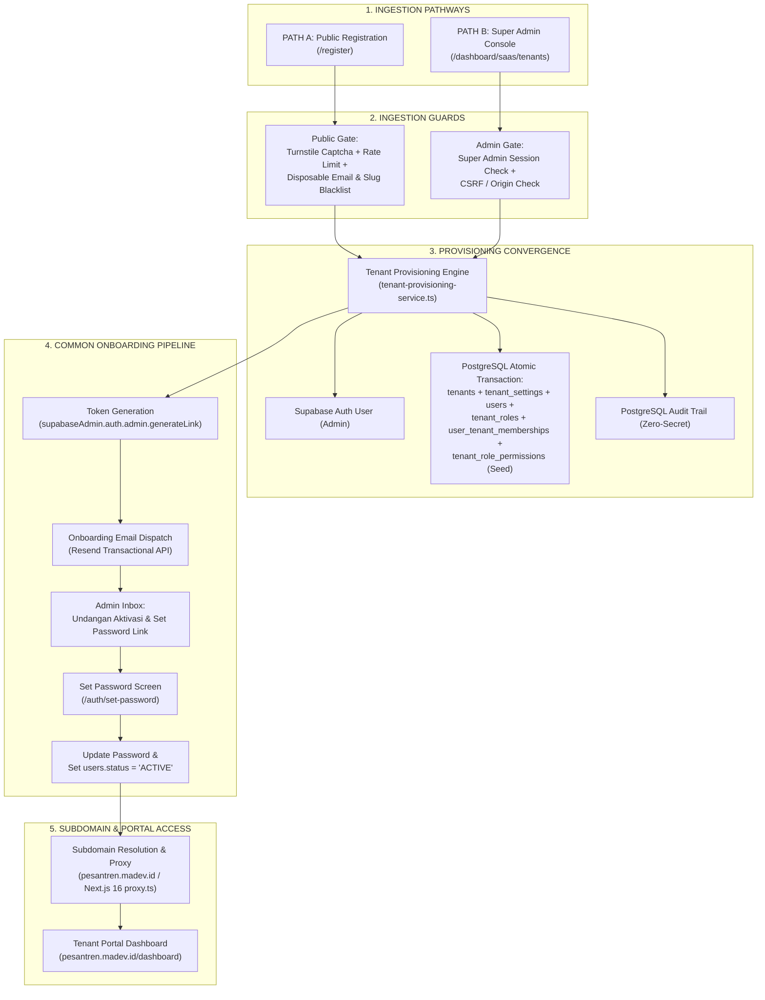

# WP-SAAS-REGISTRATION-DISCOVERY-001 REPORT

**WORK PACKAGE**: `WP-SAAS-REGISTRATION-DISCOVERY-001`  
**TITLE**: Public Registration + Super Admin Tenant Creation + Common Tenant Onboarding Architecture Discovery  
**ROLE**: Architecture Discovery Engineer / Senior Principal Systems Architect  
**PHASE**: READ-ONLY ARCHITECTURE DISCOVERY  
**STATUS**: `PASS` (Architecture Discovery & Flow Mapping Completed)  

---

## 1. Executive Summary & Mission Statement

Laporan ini merupakan hasil penyelidikan arsitektur mendalam (*read-only architecture discovery*) terhadap alur pembuatan tenant (*tenant creation*) dan orientasi tenant baru (*tenant onboarding*) pada platform multi-tenant SaaS **MA'HAD MANAGER**.

Sesuai arahan arsitektur, platform dirancang untuk mendukung **dua jalur pembuatan tenant (Two Ingestion Paths)** yang saling melengkapi, yang kemudian wajib bermuara pada satu pipa pemrosesan bersama (**Common Tenant Onboarding Flow**):

1. **PATH A: Public Self Registration (`/register`)**  
   Pendaftaran mandiri oleh perwakilan instansi pesantren publik secara online, dilengkapi proteksi anti-spam/abuse, verifikasi identitas, dan aktivasi otomatis.
2. **PATH B: Super Admin Tenant Creation (`/dashboard/saas/tenants` via `POST /api/saas/tenants`)**  
   Pembuatan tenant secara administratif oleh Super Admin / Tim Operasional SaaS untuk kebutuhan kemitraan institusi, onboarding khusus, atau migrasi data pesantren binaan.

Kedua jalur ini **berkonvergensi** pada engine provisi terpusat (**Tenant Provisioning Engine**) dan dilanjutkan dengan alur orientasi seragam (**Common Onboarding Pipeline**): pengiriman email undangan/aktivasi, penetapan kata sandi (*set password*), penerbitan sesi terotentikasi, resolusi subdomain, dan pengarahan ke portal tenant.



---

## 2. Current State Forensic Audit

Pemeriksaan read-only dilakukan secara menyeluruh terhadap seluruh komponen relevan di codebase:

| Komponen | Lokasi File | Status Aktual | Analisis Arsitektur |
| :--- | :--- | :--- | :--- |
| **Public Register UI** | `src/app/register/page.tsx` | Presentational Shell | Dibuat pada `WP-SAAS-REGISTRATION-ENTRY-001` sebagai kartu informasi statis ("Portal Registrasi Mandiri Sedang Disiapkan"). Belum memiliki form interaktif dan handler API. |
| **Next.js 16 Proxy** | `src/proxy.ts` | Active (Hotfix-001) | Berisi logika fail-closed authentication. **TEMUAN KRITIS**: Path `/register` belum terdaftar pada `PUBLIC_PATHS`, sehingga visitor anonim langsung dialihkan ke `/login?redirect=/register`. |
| **Super Admin UI** | `src/app/dashboard/saas/tenants/page.tsx` | Functional UI Modal | Memiliki modal "Tambah Lembaga Baru" dan tab "Pengajuan Trial" (state in-memory). Menampilkan modal handoff kredensial sementara (`temporaryPassword`). |
| **Super Admin API** | `src/app/api/saas/tenants/route.ts` | Functional Route Handler | Menangani `GET` (list) dan `POST` (provision). Memeriksa header `x-is-super-admin: true`, origin CSRF, dan validasi schema. |
| **Provisioning Engine** | `src/modules/saas/services/tenant-provisioning-service.ts` | Production-Grade Two-Phase Engine | Memprovisi Supabase Auth User + PostgreSQL entities (`tenants`, `tenant_settings`, `users`, `tenant_roles`, `user_tenant_memberships`) dengan rollback kompensasi otomatis. |
| **Audit Persistence** | `src/lib/db/repositories/audit-repository.ts` | Persistent (PostgreSQL) | Diremediasi pada `WP-AUDIT-PERSISTENCE-REMEDIATION-001`. Menyimpan log provisioning ke `public.audit_logs` dengan kebijakan *zero secret leakage*. |
| **Tenant Context** | `src/lib/tenant/context.ts` | Functional Resolver | Membaca header `x-tenant-slug` yang diinjeksi Proxy untuk memuat identitas branding instansi dari database. |
| **Email Infrastructure** | `.env.local` / `package.json` | API Key Ready, Package Missing | Kredensial `RESEND_API_KEY` tersedia di `.env.local`, namun library `resend` belum diinstal di `package.json` dan belum ada modul dispatcher email. |
| **Auth Callback & Set Password** | `src/app/auth/` | **ABSENT** | Tidak ada direktori `src/app/auth/callback` maupun `src/app/auth/set-password`. Alur konfirmasi token dan pembuatan password belum tersedia. |

---

## 3. Critical Discovery Gaps & Blockers

Dari audit mendalam, ditemukan 6 (enam) kesenjangan arsitektural (*gaps*) yang perlu diselesaikan sebelum implementasi:

### GAP 1: Proxy Authentication Blocker pada `/register`
- **Lokasi**: `src/proxy.ts` (baris 13-18 dan 120-133)
- **Kondisi**:
  ```ts
  const PUBLIC_PATHS = [
    '/login',
    '/maintenance',
    '/auth',
    '/api/webhooks',
  ];
  ```
- **Dampak**: Halaman `/register` tidak terdaftar sebagai public path. Akibatnya, setiap pengguna publik yang mengklik tombol "Daftar Instansi" pada landing page akan dicegat oleh Proxy dan dipaksa redirect ke `/login?redirect=/register`.
- **Solusi**: Tambahkan `/register` dan rute pendaftaran publik terkait (misal `/api/saas/register`) ke dalam daftar `PUBLIC_PATHS`.

### GAP 2: Credential Delivery Mismatch (Manual Handoff vs Automated Email)
- **Lokasi**: `tenant-provisioning-service.ts` & `src/app/api/saas/tenants/route.ts`
- **Kondisi**:
  Engine saat ini mengembalikan `temporaryPassword` dalam payload respons JSON untuk disalin secara manual oleh Super Admin (`createdCredential` modal).
- **Dampak**: Pada pendaftaran publik mandiri (PATH A), tidak ada Super Admin yang menyalin password. Mengembalikan password sementara langsung ke response browser publik merupakan kerentanan keamanan tinggi (risiko pendaftaran palsu atau pengambilalihan akun).
- **Solusi**: Pisahkan strategi pengiriman kredensial:
  - PATH A (Publik): Wajib memicu pembuatan token undangan (*invite/recovery token link*) dan mengirimkan **Onboarding Email** secara otomatis ke alamat email pendaftar.
  - PATH B (Super Admin): Menyediakan opsi fleksibel: manual handoff (kredensial di layar) ATAU langsung memicu pengiriman email undangan resmi.

### GAP 3: Role Permissions Seeding Gap pada Provisioning Engine
- **Lokasi**: `tenant-provisioning-service.ts` (baris 309-331)
- **Kondisi**:
  Engine membuat role `ADMIN` pada tabel `tenant_roles`, namun **tidak mengisi baris relasi permission** pada tabel `tenant_role_permissions`.
- **Dampak**: Ketika admin pesantren yang baru dibuat berhasil login dan mengakses API terproteksi (misalnya `/api/tenant/branding`), `requirePermission(userId, tenantId, 'view_pengaturan')` akan menolak dengan error `DENIED_PERMISSION_MISSING: User missing required permission`.
- **Solusi**: Saat transaksi pembuatan tenant di `withTenantTransaction`, engine wajib menyemai (*seed*) seluruh canonical permissions yang relevan untuk role `ADMIN` ke tabel `tenant_role_permissions`.

### GAP 4: Ketiadaan Rute `/auth/callback` dan `/auth/set-password`
- **Lokasi**: `src/app/`
- **Kondisi**:
  Status pengguna baru diset sebagai `MUST_CHANGE_PASSWORD` pada `public.users.status`. Namun aplikasi tidak memiliki antarmuka maupun rute API untuk memvalidasi token dari email dan memperbarui password pengguna.
- **Solusi**: Buat rute:
  1. `src/app/auth/callback/route.ts`: Menukar `token_hash` / code dari email invite menjadi active Supabase session.
  2. `src/app/auth/set-password/page.tsx`: Halaman pembuatan password baru dengan validasi kompleksitas.
  3. `src/app/api/auth/complete-onboarding/route.ts`: Endpoint yang mengubah status user dari `MUST_CHANGE_PASSWORD` menjadi `ACTIVE`.

### GAP 5: Infrastruktur Pengiriman Email Belum Terinstal
- **Lokasi**: `package.json`
- **Kondisi**: Kunci `RESEND_API_KEY` tersedia, namun library `resend` belum diinstal dan belum ada template email transaksi multi-tenant berbahasa Indonesia.
- **Solusi**: Instal `resend` dan buat service terdedikasi `src/lib/email/onboarding-email-service.ts` beserta template HTML responsif dengan branding islami elegan.

### GAP 6: Resolusi Subdomain Lokal & Slug Mismatch pada Proxy
- **Lokasi**: `src/proxy.ts` (baris 71-84 & 94-97)
- **Kondisi**:
  1. `!hostname.includes('localhost')` menyebabkan hostname lokal `pesantren.localhost:3000` ditolak dan jatuh ke `'default'`.
  2. `requestHeaders.set('x-tenant-id', resolvedTenantId)` menyetel header dengan nilai **slug** (misal `'al-hikmah'`), bukan **UUID id** tenant (misal `'t_1789...'`). Ini memicu kegagalan otorisasi downstream yang memeriksa `tenants.id`.
- **Solusi**:
  1. Sempurnakan logika ekstraksi hostname agar mendukung pengujian lokal (misal `*.localhost` atau base dev domain).
  2. Pastikan layer otorisasi atau resolver memetakan slug menjadi ID tenant kanonikal dengan benar.

---

## 4. Detailed Pathway Analysis: PATH A vs PATH B

### 4.1 Ingestion Comparison Matrix

| Dimensi Arsitektural | PATH A: Public Self Registration | PATH B: Super Admin Tenant Creation |
| :--- | :--- | :--- |
| **Entry Point URL** | `/register` (Halaman Publik) | `/dashboard/saas/tenants` (Internal Console) |
| **API Route Target** | `POST /api/saas/register` (Public) | `POST /api/saas/tenants` (Privileged) |
| **Authentication Requirement** | Anonymous / Guest (Unauthenticated) | Authenticated Super Admin (`x-is-super-admin: true`) |
| **Anti-Abuse Protections** | Cloudflare Turnstile, IP Rate Limiter, Disposable Email Filter, Slug Blacklist | CSRF Origin Validation, Super Admin Session Check |
| **Initial Tenant Status** | `status: 'trial'` (atau `pending_verification`) | `status: 'active'` (atau pilihan Super Admin) |
| **Initial User Status** | `MUST_CHANGE_PASSWORD` | `MUST_CHANGE_PASSWORD` |
| **Default Subscription Tier** | Tier Standar / Trial 14 Hari (Max 50 Santri) | Ditetapkan bebas oleh Super Admin (Pro / Enterprise) |
| **Credential Generation** | Cryptographic random password di background | Cryptographic random password (`generateSecureTemporaryPassword`) |
| **Credential Delivery** | **Otomatis melalui Email Undangan (Resend)** | **Manual Handoff Modal** ATAU **Kirim Email Undangan** |
| **Activation Step** | Pengguna klik link email → buat kata sandi | Pengguna menerima link/kredensial dari Super Admin |

---

## 5. The Common Tenant Onboarding Flow (End-to-End Deep Dive)

Berikut adalah pemetaan terperinci dari 7 tahap alur onboarding bersama:

```
[1. ENGINE PROVISIONING]
  │  • Supabase Auth user dibuat (email_confirm: true, status: temporary)
  │  • PostgreSQL transaction: tenants, tenant_settings, users, tenant_roles, memberships, role_permissions
  │  • Audit trail dicatat ke public.audit_logs
  ▼
[2. TOKEN GENERATION]
  │  • supabaseAdmin.auth.admin.generateLink({ type: 'invite', email, redirectTo: 'https://[subdomain].madev.id/auth/callback' })
  │  • Menghasilkan token_hash dan action_link yang aman secara kriptografis
  ▼
[3. ONBOARDING EMAIL DISPATCH]
  │  • Resend API mengirim email transaksional bertema resmi MA'HAD MANAGER
  │  • Menyertakan nama pesantren, subdomain resmi, dan tombol "Aktivasi Akun & Buat Kata Sandi"
  ▼
[4. TOKEN VERIFICATION & AUTH CALLBACK]
  │  • User mengklik link email menuju https://[subdomain].madev.id/auth/callback?token_hash=...
  │  • Route handler memvalidasi token via supabase.auth.verifyOtp()
  │  • Sesi autentikasi aman diterbitkan di browser (cookie scoped ke subdomain)
  ▼
[5. SET PASSWORD INTERFACE]
  │  • User diarahkan ke https://[subdomain].madev.id/auth/set-password
  │  • Form penetapan kata sandi baru (minimal 8 karakter, huruf besar, kecil, angka, simbol)
  │  • Client mengeksekusi supabase.auth.updateUser({ password: newPassword })
  ▼
[6. STATUS TRANSITION & AUDIT]
  │  • POST /api/auth/complete-onboarding memperbarui public.users.status: 'MUST_CHANGE_PASSWORD' -> 'ACTIVE'
  │  • Audit event 'complete_onboarding' dicatat ke PostgreSQL
  ▼
[7. REDIRECTION TO TENANT PORTAL]
  │  • User langsung diarahkan ke https://[subdomain].madev.id/dashboard
  │  • Dashboard menyambut Admin Pesantren dengan data awal lembaga yang siap dikonfigurasi
```

---

## 6. Security, Governance, & Abuse Prevention Architecture

### 6.1 Proteksi Berlapis untuk Pendaftaran Publik (PATH A)

Pendaftaran mandiri publik membuka permukaan serangan (*attack surface*) terhadap bot spam, pendaftaran domain palsu (*slug squatting*), dan penipuan identitas. Arsitektur pencegahan yang dirancang:

1. **Cloudflare Turnstile Captcha**:
   - Widget Turnstile dipasang pada form `/register`.
   - Backend `POST /api/saas/register` memvalidasi secret token Turnstile ke API Cloudflare sebelum menyentuh database atau Supabase Auth.
2. **IP-Based Sliding-Window Rate Limiting**:
   - Maksimal 3 pendaftaran per IP address per jam.
   - Maksimal 5 percobaan cek ketersediaan subdomain per IP per menit.
3. **Disposable / Temporary Email Blacklist**:
   - Memeriksa domain email terhadap daftar provider email sekali pakai (seperti `mailinator.com`, `guerrillamail.com`, `10minutemail.com`, `tempmail.com`).
   - Mencegah spam pembuatan tenant fiktif.
4. **Reserved Subdomain & Slug Blacklist**:
   - Menggabungkan daftar `RESERVED_HOSTNAMES` (`admin`, `api`, `dashboard`, `mail`, dll.) dengan nama-nama institusi sensitif dan lembaga keagamaan resmi (`kemenag`, `daruttauhid`, `gontor`, `nu`, `muhammadiyah`, `pesantren`, `root`, `system`).
5. **Tenant Lifecycle Isolation**:
   - Tenant yang didaftarkan melalui pendaftaran publik dapat memiliki status awal `'trial'` dengan masa aktif 14 hari dan pembatasan kapasitas santri (maksimal 50 santri) hingga diverifikasi oleh admin platform atau melakukan pembayaran langganan.

### 6.2 Zero-Trust Security Policies
- **Zero Plaintext Password Exposure**: Kata sandi pengguna tidak pernah dikirim dalam log audit, tidak disimpan dalam plaintext di PostgreSQL, dan tidak di-expose di API response publik.
- **Signed Onboarding Links**: Link aktivasi email menggunakan token kriptografis berbatas waktu (kedaluwarsa dalam 24 jam) yang diverifikasi langsung oleh infrastruktur Supabase Auth.
- **Tenant Context Boundary**: Sesi yang dihasilkan pada subdomain instansi `pesantren-a.madev.id` terisolasi dan tidak dapat digunakan untuk mengekstrak data dari `pesantren-b.madev.id`.

---

## 7. Canonical Data Contracts & Interfaces

### 7.1 Input Contracts

```ts
// Contract: Public Self Registration Input
export interface PublicRegisterInput {
  name: string;           // Nama Lembaga / Pesantren (min. 3 karakter)
  slug: string;           // Subdomain / Slug unik (3-50 char, regex: ^[a-z0-9-]+$)
  location: string;       // Kota / Kabupaten pesantren
  ownerName: string;      // Nama lengkap administrator / pendaftar
  ownerEmail: string;     // Email resmi administrator (unik di platform)
  ownerPhone: string;     // Nomor WhatsApp aktif untuk konfirmasi
  plan?: string;          // Default: 'Trial' / 'Pro SaaS'
  captchaToken: string;   // Cloudflare Turnstile token untuk verifikasi anti-bot
}

// Contract: Super Admin Provision Input (Existing Contract Enhanced)
export interface SuperAdminCreateTenantInput {
  name: string;
  slug: string;
  location?: string;
  plan?: string;
  ownerName: string;
  ownerEmail: string;
  ownerPhone?: string;
  initialPassword?: string;
  sendInviteEmail?: boolean; // Toggle pengiriman email onboarding langsung
  modules?: TenantModulesConfig;
}

// Contract: Onboarding Email Payload
export interface OnboardingEmailPayload {
  recipientEmail: string;
  recipientName: string;
  tenantName: string;
  tenantSlug: string;
  subdomainUrl: string;
  activationUrl: string;
  expiresInHours: number;
}
```

---

## 8. Implementation Roadmap (Phased Work Packages)

Untuk memastikan implementasi berjalan aman, modular, teruji, dan sesuai tata kelola enterprise, pekerjaan dibagi menjadi rangkaian Work Package berurutan:

```
WP-SAAS-REGISTRATION-DISCOVERY-001 (SELESAI - Discovery & Blueprint)
    │
    ▼
WP-SAAS-EMAIL-INFRA-001
(Instalasi Resend + Template Email Onboarding Resmi + Dispatcher Service)
    │
    ▼
WP-TENANT-PROVISION-SEED-PERMISSIONS-001
(Penyempurnaan Engine: Seeding Role Permissions 'ADMIN' saat Provisioning)
    │
    ▼
WP-AUTH-SET-PASSWORD-001
(Rute /auth/callback + Halaman /auth/set-password + API Complete Onboarding)
    │
    ▼
WP-SAAS-REGISTRATION-PUBLIC-001
(Backend API POST /api/saas/register + Rate Limiting + Captcha + Proxy Whitelist)
    │
    ▼
WP-SAAS-REGISTRATION-UI-001
(Frontend Form Interaktif /register + Live Subdomain Availability Checker)
    │
    ▼
WP-SAAS-ONBOARDING-E2E-VERIFY-001
(Verifikasi Runtime End-to-End untuk PATH A dan PATH B hingga Tenant Portal)
```

---

## 9. Specific Forensic Answers

### A. How do PATH A and PATH B differ prior to reaching the engine?
PATH A (Publik) berasal dari pengguna anonim yang belum terotentikasi, sehingga memerlukan proteksi ketat (Captcha Turnstile, Rate Limiting, filter disposable email, reservasi slug, dan status default `'trial'`).  
PATH B (Super Admin) berasal dari sesi terotentikasi dengan hak istimewa platform (`x-is-super-admin: true`), melewati validasi Captcha, dan dapat mengonfigurasi status maupun modul secara kustom.

### B. Where is the exact point of convergence?
Titik konvergensi berada tepat pada pemanggilan fungsi:  
`tenantProvisioningService.provisionTenant(input, actor, dbInstance)` pada `src/modules/saas/services/tenant-provisioning-service.ts`.  
Kedua jalur menghasilkan entitas database yang identik: `tenants`, `tenant_settings`, `users`, `tenant_roles`, dan `user_tenant_memberships`.

### C. How should the onboarding email be sent?
Menggunakan **pendekatan hibrida optimal**:
1. Token aktivasi dihasilkan oleh Supabase Auth Admin API (`supabaseAdmin.auth.admin.generateLink({ type: 'invite', ... })`) untuk menjamin keamanan kriptografis dan kompatibilitas sesi.
2. Pengiriman email dieksekusi oleh **Resend API** menggunakan kredensial `RESEND_API_KEY`, memastikan template email responsif, profesional, berbahasa Indonesia, dan bebas dari limit SMTP Supabase.

### D. Why does `/register` currently fail for anonymous users?
Karena pada `src/proxy.ts` (Next.js 16 Proxy), array `PUBLIC_PATHS` belum menyertakan `/register`. Logika *fail-closed* secara otomatis mengarahkan visitor anonim ke rute `/login?redirect=/register`.

### E. What happens when the user sets their password?
User yang mengakses link aktivasi akan melewati `/auth/callback` yang memverifikasi token dan menerbitkan sesi login. Di halaman `/auth/set-password`, user menetapkan kata sandi baru. Setelah kata sandi tersimpan, status `users.status` diubah dari `'MUST_CHANGE_PASSWORD'` menjadi `'ACTIVE'`, dan pengguna langsung diarahkan ke portal subdomain instansinya (`https://[slug].madev.id/dashboard`).

---

## 10. Conclusion & Final Verdict

Penyelidikan arsitektur membuktikan bahwa fondasi multi-tenant MA'HAD MANAGER **sangat siap dan kokoh** untuk mendukung pendaftaran mandiri publik maupun pembuatan oleh Super Admin. Engine provisi dua tahap (*two-phase engine*) yang sudah ada memiliki keandalan atomisitas yang tinggi. 

Dengan mengintegrasikan Resend untuk pengiriman email onboarding, melengkapi rute verifikasi token dan penetapan kata sandi, serta membuka jalur pendaftaran di Next.js Proxy dengan pengamanan anti-abuse yang memadai, sistem siap bertransisi menuju fase implementasi modular.
