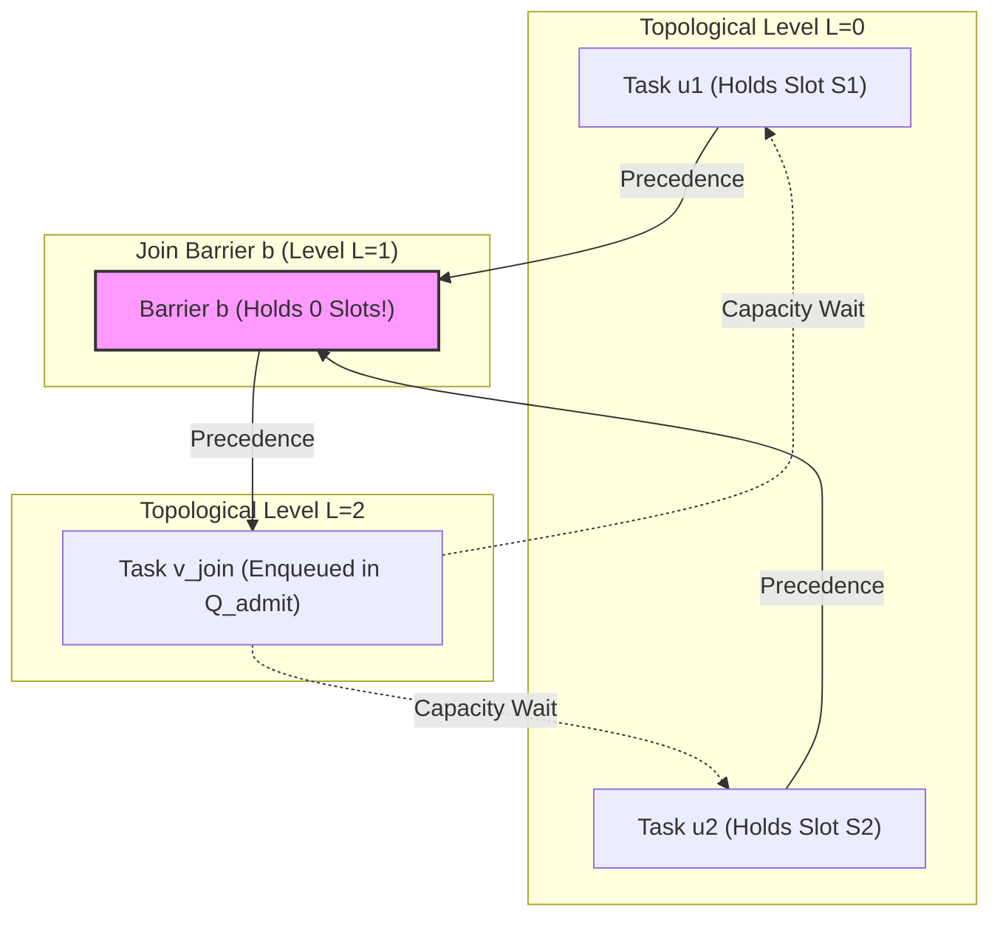

# EEOS-O ARCHITECTURAL SPECIFICATION: WP-P14-02-05

# FAILURE PROPAGATION, BLOCKING & DEADLOCK PREVENTION ARCHITECTURE

**Specification Identifier**: `SPEC-P14-02-05`  
**Governing Sub-Work Package**: `WP-P14-02-05 — Failure Propagation, Blocking & Deadlock Prevention Architecture`  
**Parent Work Package**: `MWP-EEOS-O-WP-P14-02 — Macro-Orchestrator Fork-Join & Concurrency Engine`  
**Governing Directive**: `EXEC-DIR-EEOS-O-WP-P14-02-05-001` (Version 1.0.0)  
**Dual-Sovereign Execution Authorization**: `EEOS-O-GOV-EXEC-AUTH-P14-02-05-001`  
**Document Version**: `1.0.0-DRAFT`  
**Lifecycle Status**: `DRAFT — AWAITING INDEPENDENT ARCHITECTURAL SPECIFICATION AUDIT`  
**Implementation Budget**: `STRICTLY 0 BYTES`  
**Author**: `EEOS-O Senior Architectural Specification Author`  
**Security / Tenant Classification**: `ENTERPRISE MULTI-TENANT ISOLATED (RLS + TENANT_ID BOUNDED)`

---

## 1. DOCUMENT IDENTITY & GOVERNANCE STATUS

### 1.1 Formal Identity & Canonical Mapping
This document serves as the authoritative, mathematical, and formal architectural specification for Sub-Work Package **WP-P14-02-05** within Phase 1.4 of the EEOS-O Macro-Orchestrator architecture.

```text
Specification ID:         SPEC-P14-02-05
Canonical Path:           docs/eeos-o/specs/phase-1.4/WP-P14-02-05-FAULT-DEADLOCK-GOVERNANCE.md
Governing WP:             WP-P14-02-05
Parent Master WP:         MWP-EEOS-O-WP-P14-02
Governing Directive:      EXEC-DIR-EEOS-O-WP-P14-02-05-001 (Version 1.0.0)
Consolidation Record:     EEOS-O-GOV-EXEC-AUTH-P14-02-05-001
Preceding Independent:    REPORT-EEOS-O-WP-P14-02-05-EXECUTION-DIRECTIVE-INDEPENDENT-AUDIT-001 (PASS)
PO Sovereign Decision:    SOV-DEC-PO-P14-02-05-AUTH-001 (AUTHORIZE)
Mandor Sovereign Decision:SOV-DEC-MANDOR-P14-02-05-AUTH-001 (AUTHORIZE)
Version:                  1.0.0-DRAFT
Lifecycle Status:         DRAFT — AWAITING INDEPENDENT ARCHITECTURAL SPECIFICATION AUDIT
Implementation Status:    0 BYTES (PHYSICAL IMPLEMENTATION STRICTLY LOCKED)
```

### 1.2 Dual-Sovereign Authorization Basis
This specification is produced under explicit dual-sovereign authorization established in `EEOS-O-GOV-EXEC-AUTH-P14-02-05-001`. The authorization binds the authoring agent strictly to architectural modeling, formal state mapping, deadlock proof derivation, and declarative boundary definition, prohibiting any physical code, SQL, runtime workers, or self-clearance.

### 1.3 Governance Authority Boundaries
The author is designated as the `EEOS-O Senior Architectural Specification Author`. Under ZenOrion Tier 3 Governance Architecture:
* The author possesses **no authority** to clear, audit, or ratify this specification.
* The author possesses **no authority** to resolve or modify any quarantined Open Architectural Question (`OAQ-SYNC-01`, `OAQ-SYNC-02`, `OAQ-SYNC-03`).
* The author possesses **no authority** to mutate upstream ratified specifications (`WP-P14-01`, `WP-P14-02-01`, `WP-P14-02-02`, `WP-P14-02-03`, `WP-P14-02-04`, `WP-P14-02-06`, `Phase 1.2`, `Phase 1.3`).
* The lifecycle state of this document is immutable `1.0.0-DRAFT` until reviewed by an independent auditor and cleared by dual-sovereign authorities.

---

## 2. SCOPE & BOUNDARIES

### 2.1 Owned Architectural Scope (WP-P14-02-05)
WP-P14-02-05 formally governs:
1. **Branch Outcome Domain & Failure Classification**: Mathematical definitions of single-branch failures, partial branch collapses, and total branch collapses.
2. **Failure Propagation Semantics**: Formal derivation of deterministic failure propagation and strict containment boundaries (`INV-FAULT-01`).
3. **Join Fault Aggregation**: Complete, deterministic truth tables mapping multi-branch completion, rejection, and failure combinations to the canonical 8-state barrier FSM of `WP-P14-02-04`.
4. **Declarative Barrier Blocking**: Precise semantic definition of `BLOCKED` as an orchestrator ledger state with zero OS thread, mutex, or semaphore blocking (`INV-FAULT-02`).
5. **Backpressure Escalation & Quota Recovery**: Formal boundary interactions with the Concurrency Limiter (`WP-P14-02-03`) ensuring instantaneous quota forfeiture and zero quota leakage upon barrier stall or failure.
6. **Structural Deadlock Prevention**: Rigorous mathematical proof establishing global deadlock freedom across both direct topological edges and indirect capacity/limiter wait states (`INV-FAULT-03`).
7. **Anti-Starvation Guarantees**: Formal topological and lexicographical progress guarantees ensuring finite wait times under bounded DAG execution without runtime scheduling heuristics (`INV-FAULT-04`).
8. **Declarative Timeout Boundaries**: Definition of static SLA contract thresholds ($\tau_{\text{barrier\_timeout}}$, $\tau_{\text{stall\_threshold}}$) and external macro-trigger integration without local timer daemons (`INV-FAULT-05`).
9. **Container Cancellation Boundaries**: Declarative cancellation intent definitions ($\mathbf{e}_{\text{cancel\_intent}}$) honoring Phase 1.3 container lifecycle sovereignty without destructive OS signals (`INV-FAULT-06`).
10. **State Space Orthogonality**: Rigorous proofs maintaining strict segregation between the 8-state Barrier FSM and the 15-state Task FSM.

### 2.2 Explicit Exclusions & Upstream/Downstream Boundaries
The following concerns are strictly partitioned outside WP-P14-02-05:
* **Dynamic Ripple Invalidation**: Cascading downstream topological cache invalidation belongs strictly to `WP-P14-03`.
* **Structural Merge Gating**: Join merge strategies, artifact synthesis, and structural schema gating belong strictly to `WP-P14-04`.
* **Dynamic Workflow Modification**: Dynamic runtime DAG mutability is strictly quarantined under `OAQ-SYNC-01`.
* **Dynamic Branch Cardinality**: Dynamic fork/join branch expansion is strictly quarantined under `OAQ-SYNC-02`.
* **Task Retries & Compensation Logic**: Retry loops, retry quotas, and compensating tasks are strictly quarantined under `OAQ-SYNC-03`.
* **Physical Implementation**: All runtime code, database tables, background workers, event loops, and unit tests are strictly locked at **0 BYTES**.

---

## 3. IMMUTABLE UPSTREAM BASELINES & ARCHITECTURAL CONTRACTS

This specification strictly conforms to the following ratified upstream contracts:
1. **Phase 1.1 (`DO_WP`)**: Governance work package protocol and invariant enforcement.
2. **Phase 1.2 (Task Contract Architecture)**: The canonical 15-state Task FSM and formal Task Rejection semantics (`TASK_REJECTED`).
3. **Phase 1.3 (Agent Contract Architecture)**: Agent container lifecycle, slot capacity allocations, and `maxParallelAgents` constraints.
4. **WP-P14-01 (DAG Data Structure Specification)**: Topological sort invariance, immutable directed acyclic graph $G = (V, E)$, Kahn level assignments $\mathcal{L}(v)$, and Invariants `I-01` through `I-08`.
5. **WP-P14-02-01 (Fork Barrier Architecture)**: Deterministic branch dispatch, fork barrier invariants, and branch metadata.
6. **WP-P14-02-02 (Join Barrier Architecture)**: Join barrier cardinality $C_{\text{expected}}$, predicate evaluation, and barrier satisfaction conditions.
7. **WP-P14-02-03 (Concurrency Limiter Architecture)**: Tenant-bounded slot capacity $C_{\text{tenant}}$, reservation ledger, deterministic admission ordering $\mathcal{O}_{\text{admission}}$, and slot release contracts.
8. **WP-P14-02-04 (Barrier State Machine & Lifecycle)**: The exact 8-state barrier FSM ($\mathcal{S}_{\text{barrier}}$), transitions $T_{01}$–$T_{19}$, rejection rules $R_1$–$R_{10}$, and Invariants `INV-STATE-01` through `INV-STATE-06`.
9. **WP-P14-02-06 (DAG Topology Interface Boundary)**: Read-only topological query interface ($\Delta(G_{\text{P14-01}}) \equiv \emptyset$).

---

## 4. FORMAL MODEL & MATHEMATICAL DEFINITIONS

### 4.1 Topology and Barrier Context
Let an immutable macro-orchestration workflow DAG be defined as:
$$G = (V, E)$$
where:
* $V$ is the finite set of task nodes ($|V| < \infty$).
* $E \subset V \times V$ is the set of directed precedence edges, satisfying strict acyclicity ($\text{Cycles}(G) = \emptyset$).
* For any node $v \in V$, its Kahn topological level is $\mathcal{L}(v) \in \mathbb{N}_0$, where:
  $$\forall (u, v) \in E \implies \mathcal{L}(u) < \mathcal{L}(v)$$

Let $b \in \mathcal{B}$ be a canonical join barrier instance defined in `WP-P14-02-02` and `WP-P14-02-04`, associated with target node $v_{\text{join}} \in V$.
* $C_{\text{expected}}(b) = |\text{Pred}(v_{\text{join}})| = |\{ u \in V \mid (u, v_{\text{join}}) \in E \}| \ge 1$.
* $\mathcal{B}_{\text{branches}}(b) = \{ u_1, u_2, \dots, u_m \}$ represents the exact set of inbound precursor branches where $m = C_{\text{expected}}(b)$.

### 4.2 Branch Outcome Domain
Each precursor branch $u \in \mathcal{B}_{\text{branches}}(b)$ executes within the Phase 1.2 Task FSM and reaches a terminal state. The outcome domain of an inbound branch as observed by the join barrier is formally defined as:
$$\mathcal{O}_{\text{branch}} = \{ \text{COMPLETED}, \text{REJECTED}, \text{FAILED} \}$$

Let $\omega: \mathcal{B}_{\text{branches}}(b) \to \mathcal{O}_{\text{branch}} \cup \{ \text{PENDING} \}$ denote the current observation state function of branch $u$.
At any point in workflow execution, the barrier maintains the discrete partition of inbound branch counts:
* $N_{\text{total}}(b) = C_{\text{expected}}(b)$
* $N_{\text{completed}}(b) = |\{ u \in \mathcal{B}_{\text{branches}}(b) \mid \omega(u) = \text{COMPLETED} \}|$
* $N_{\text{rejected}}(b) = |\{ u \in \mathcal{B}_{\text{branches}}(b) \mid \omega(u) = \text{REJECTED} \}|$
* $N_{\text{failed}}(b) = |\{ u \in \mathcal{B}_{\text{branches}}(b) \mid \omega(u) = \text{FAILED} \}|$
* $N_{\text{pending}}(b) = |\{ u \in \mathcal{B}_{\text{branches}}(b) \mid \omega(u) = \text{PENDING} \}|$

The conservation invariant holds at all times:
$$N_{\text{total}}(b) = N_{\text{completed}}(b) + N_{\text{rejected}}(b) + N_{\text{failed}}(b) + N_{\text{pending}}(b)$$

---

## 5. Q1 — DETERMINISTIC FAILURE PROPAGATION SEMANTICS

### 5.1 Failure Classifications
A fault occurring within a branch $u \in \mathcal{B}_{\text{branches}}(b)$ is classified into one of three structural categories:

1. **Single-Branch Isolated Failure**:
   $$\text{FaultCategory}(b) = \text{SINGLE\_FAULT} \iff N_{\text{failed}}(b) + N_{\text{rejected}}(b) = 1 \land N_{\text{total}}(b) > 1$$
   *Semantics*: A single branch failed or was rejected. Sibling branches $u' \neq u$ remain running or pending.

2. **Partial Multi-Branch Failure**:
   $$\text{FaultCategory}(b) = \text{PARTIAL\_FAULT} \iff 1 < N_{\text{failed}}(b) + N_{\text{rejected}}(b) < N_{\text{total}}(b)$$
   *Semantics*: Multiple branches failed, but at least one branch has completed or remains pending.

3. **Total Branch Collapse**:
   $$\text{FaultCategory}(b) = \text{TOTAL\_COLLAPSE} \iff N_{\text{failed}}(b) + N_{\text{rejected}}(b) = N_{\text{total}}(b)$$
   *Semantics*: Every inbound precursor branch to barrier $b$ has experienced terminal failure or rejection.

### 5.2 Propagation vs. Containment Boundaries
To prevent unbounded cascading failures and preserve the deterministic containment required by `INV-STATE-06` (WP-P14-02-04), this specification establishes three distinct architectural layers:

```
┌───────────────────────────────────────────────────────────────┐
│ Layer 1: Local Fault                                          │
│ Branch Task u enters FAILED or REJECTED (Phase 1.2 FSM)       │
└───────────────────────────────┬───────────────────────────────┘
                                │ Emits discrete branch event
                                ▼
┌───────────────────────────────────────────────────────────────┐
│ Layer 2: Join-Level Outcome                                   │
│ Barrier b evaluates aggregation predicate (WP-P14-02-05 / 04)  │
│ Barrier transitions to PARTIALLY_SATISFIED, BLOCKED, or FAILED│
└───────────────────────────────┬───────────────────────────────┘
                                │ Evaluates downstream propagation
                                ▼
┌───────────────────────────────────────────────────────────────┐
│ Layer 3: Downstream Propagation                               │
│ IF Barrier b == FAILED: Downstream node v_join cannot execute.│
│ Sibling subgraphs NOT topologically reachable from v_join     │
│ are STRICTLY CONTAINED and proceed normally.                  │
└───────────────────────────────────────────────────────────────┘
```

### 5.3 Formal Propagation and Containment Invariant
```text
INVARIANT: INV-FAULT-01 (Deterministic Failure Containment)
Let G = (V, E) be the workflow DAG. Let u in V fail such that u in Pred(v_join).
1. Propagation Condition:
   The failure of u propagates to barrier b = Barrier(v_join) if and only if
   the Join Failure Aggregation Predicate evaluates to TRUE:
   EvalJoinFault(b) == TRUE ==> BarrierState(b) in { BLOCKED, FAILED }
2. Containment Condition:
   For any task node w in V such that w is NOT in Reachable(v_join, G),
   TaskState(w) and BarrierState(Barrier(w)) are strictly independent of the
   failure of u:
   w notin Reachable(v_join, G) ==> Delta(Execution(w)) == EMPTY
```

*Proof of INV-FAULT-01*:
By `WP-P14-01` (Invariant `I-04`), the DAG is topologically ordered. By definition of causal dependency in macro-orchestration, a node $w$ is causally dependent on $u$ if and only if there exists a directed path from $u$ to $w$ in $G$. Sibling nodes $s \in V$ such that $(u, s) \notin E^*$ share no causal precedence edges. The state evaluation of `Barrier(w)` depends strictly on $Pred(w)$. Since $u \notin Pred(w)$ and $v_{\text{join}} \notin Pred(w)$, branch observation function $\omega_w(k)$ is invariant under $\omega_b(u)$. Hence, failure propagation is strictly bounded to the topological transitive closure $\text{Reachable}(v_{\text{join}}, G)$. $\blacksquare$

---

## 6. Q2 — JOIN FAULT AGGREGATION & TRUTH TABLE

### 6.1 Canonical Join Predicates
In accordance with `WP-P14-02-02` (Join Barrier Architecture) and `WP-P14-02-04` (Barrier State Machine), a join barrier evaluates branch outcomes against its declarative cardinality and join policy:
* **All-Succeed Join (AND-Barrier)**: Requires $N_{\text{completed}}(b) = N_{\text{total}}(b)$ to release. Any $N_{\text{failed}}(b) > 0$ or $N_{\text{rejected}}(b) > 0$ breaches the satisfaction condition.
* **Tolerant/Quorum Join ($K$-of-$N$)**: Requires $N_{\text{completed}}(b) \ge K$ where $1 \le K \le N_{\text{total}}(b)$. The barrier can tolerate up to $(N_{\text{total}}(b) - K)$ failures before becoming unfulfillable.

Let $K(b)$ be the required completion quorum ($K(b) = N_{\text{total}}(b)$ for strict AND-barriers).
We define the deterministic boolean state predicates:
* $\text{CanSatisfy}(b) \iff N_{\text{completed}}(b) + N_{\text{pending}}(b) \ge K(b)$
* $\text{IsSatisfied}(b) \iff N_{\text{completed}}(b) \ge K(b)$
* $\text{IsUnsatisfiable}(b) \iff N_{\text{completed}}(b) + N_{\text{pending}}(b) < K(b)$

### 6.2 Deterministic Join Fault Aggregation Truth Table
The following truth table formally maps all aggregate branch conditions to the canonical 8-state barrier FSM of `WP-P14-02-04`. It uses strictly the canonical states: `WAITING`, `PARTIALLY_SATISFIED`, `SATISFIED`, `BLOCKED`, `FAILED`, `RELEASED`, `INVALIDATED`.

| Row | $N_{\text{completed}}$ | $N_{\text{rejected}}$ | $N_{\text{failed}}$ | $N_{\text{pending}}$ | $\text{CanSatisfy}$ | Prior State | Trigger Event | Resulting Canonical State | WP-P14-02-04 Transition | Semantic Architectural Meaning |
|:---:|:---:|:---:|:---:|:---:|:---:|:---:|:---:|:---:|:---:|:---|
| **R01** | $0$ | $0$ | $0$ | $= N$ | $\text{TRUE}$ | `PENDING` | $\mathbf{e}_{\text{arrive}}$ | `WAITING` | $T_{01}$ | Initial barrier activation; awaiting branch execution. |
| **R02** | $> 0$ | $0$ | $0$ | $> 0$ | $\text{TRUE}$ | `WAITING` | $\mathbf{e}_{\text{branch\_done}}(\text{COMPL})$ | `PARTIALLY_SATISFIED` | $T_{02}$ | Normal progress: subset of branches completed successfully. |
| **R03** | $> 0$ | $0$ | $0$ | $> 0$ | $\text{TRUE}$ | `PARTIALLY_SATISFIED` | $\mathbf{e}_{\text{branch\_done}}(\text{COMPL})$ | `PARTIALLY_SATISFIED` | $T_{03}$ | Continued progress: additional branch completed, quorum not yet reached. |
| **R04** | $\ge K$ | $\ge 0$ | $\ge 0$ | $\ge 0$ | $\text{TRUE}$ | `PARTIALLY_SATISFIED` | $\mathbf{e}_{\text{branch\_done}}(\text{COMPL})$ | `SATISFIED` | $T_{04}$ | Quorum achieved: barrier satisfaction condition fully met. |
| **R05** | $\ge K$ | $0$ | $0$ | $0$ | $\text{TRUE}$ | `WAITING` | $\mathbf{e}_{\text{branch\_done}}(\text{COMPL})$ | `SATISFIED` | $T_{05}$ | Single-branch join ($N=K=1$) immediately satisfies barrier. |
| **R06** | $< K$ | $> 0$ | $\ge 0$ | $> 0$ | $\text{TRUE}$ | `PARTIALLY_SATISFIED` | $\mathbf{e}_{\text{branch\_done}}(\text{REJ/FAIL})$ | `PARTIALLY_SATISFIED` | $T_{03}$ | Tolerant join: branch failed but quorum is still mathematically achievable. |
| **R07** | $< K$ | $\ge 0$ | $\ge 0$ | $> 0$ | $\text{FALSE}$ | `PARTIALLY_SATISFIED` | $\mathbf{e}_{\text{branch\_done}}(\text{REJ/FAIL})$ | `BLOCKED` | $T_{06}$ | Quorum impossible to reach while branches remain active; execution stalled. |
| **R08** | $< K$ | $\ge 0$ | $\ge 0$ | $> 0$ | $\text{FALSE}$ | `WAITING` | $\mathbf{e}_{\text{branch\_done}}(\text{REJ/FAIL})$ | `BLOCKED` | $T_{07}$ | Strict AND-join: first branch fails, stalling the barrier awaiting resolution. |
| **R09** | $< K$ | $\ge 0$ | $\ge 0$ | $0$ | $\text{FALSE}$ | `PARTIALLY_SATISFIED` | $\mathbf{e}_{\text{branch\_done}}(\text{REJ/FAIL})$ | `FAILED` | $T_{08}$ | Terminal collapse: all branches ended, quorum unfulfilled. |
| **R10** | $< K$ | $\ge 0$ | $\ge 0$ | $0$ | $\text{FALSE}$ | `WAITING` | $\mathbf{e}_{\text{branch\_done}}(\text{REJ/FAIL})$ | `FAILED` | $T_{09}$ | Total immediate failure on single-branch or all-failed evaluation. |
| **R11** | $< K$ | $\ge 0$ | $\ge 0$ | $\ge 0$ | $\text{FALSE}$ | `BLOCKED` | $\mathbf{e}_{\text{timeout\_escalated}}$ | `FAILED` | $T_{18}$ | Declarative timeout expires on stalled barrier, converting block to terminal fail. |
| **R12** | $\ge K$ | $\ge 0$ | $\ge 0$ | $\ge 0$ | $\text{TRUE}$ | `SATISFIED` | $\mathbf{e}_{\text{release\_eval}}$ | `RELEASED` | $T_{10}$ | Downstream dispatch unlocked; barrier permanently released. |

### 6.3 Mapping Verification against WP-P14-02-04
Every transition in the truth table maps 1-to-1 to canonical transitions $T_{01}$–$T_{19}$ defined in `WP-P14-02-04`. No new barrier states are introduced. All rejection rules $R_1$–$R_{10}$ (WP-P14-02-04 Section 8) are strictly honored:
* When $\text{IsUnsatisfiable}(b) \land N_{\text{pending}}(b) > 0$, the barrier moves to `BLOCKED` ($T_{06}, T_{07}$). It CANNOT transition directly to `RELEASED` (prohibited by Rule $R_3$).
* When $\text{IsUnsatisfiable}(b) \land N_{\text{pending}}(b) = 0$, the barrier moves directly to `FAILED` ($T_{08}, T_{09}$).
* When `BLOCKED` receives $\mathbf{e}_{\text{timeout\_escalated}}$, it moves to `FAILED` ($T_{18}$).
* Terminal states `RELEASED` and `FAILED` accept no further mutations (prohibited by Rules $R_1, R_2$).

---

## 7. Q3 — DECLARATIVE NON-BLOCKING BARRIER BLOCKING SEMANTICS

### 7.1 Formal Ledger Semantics of `BLOCKED`
In the EEOS-O macro-orchestration architecture, `BLOCKED` is an **architectural ledger state** within the immutable event log and barrier state register. It possesses **zero physical blocking characteristics**.

```text
INVARIANT: INV-FAULT-02 (Non-Blocking Barrier Invariant)
The barrier state BLOCKED:
1. Denotes exclusively an architectural ledger record indicating that join satisfaction
   is currently stalled due to unrecoverable branch deficits or resource backpressure.
2. Shall NEVER cause an operating system thread to sleep, park, block, or wait.
3. Shall NEVER acquire or hold an OS mutex, futex, semaphore, or condition variable.
4. Shall NEVER execute busy-wait loops, polling spins, or timer sleeps.
5. Signals declarative non-readiness to downstream scheduling evaluators,
   allowing the macro-orchestrator runtime to remain 100% reactive and asynchronous.
```

### 7.2 Root Causes of `BLOCKED`
A join barrier enters `BLOCKED` exclusively through:
1. **Quorum Deficit Stall** ($T_{06}, T_{07}$): A precursor branch has failed or rejected such that $\text{CanSatisfy}(b) = \text{FALSE}$, but sibling precursor branches $u' \in \mathcal{B}_{\text{branches}}(b)$ remain active ($N_{\text{pending}}(b) > 0$).
2. **Quota Starvation Stall** (via Concurrency Limiter boundary `WP-P14-02-03`): Downstream admission cannot proceed due to tenant slot saturation, recording a temporary barrier block.

### 7.3 Recovery and Terminal Transition Semantics
A barrier in `BLOCKED` can transition out of `BLOCKED` **only** via:
1. **Terminal Failure Escalation** ($T_{18}$): Arrival of $\mathbf{e}_{\text{timeout\_escalated}}$ (declarative SLA threshold exceeded). The barrier transitions `BLOCKED` $\to$ `FAILED`.
2. **All-Branches Terminated Evaluation** ($T_{08}$): When all remaining pending branches complete their turns, the barrier transitions `BLOCKED` $\to$ `FAILED`.
3. **External Dynamic Reconfiguration** ($T_{19}$): When an upstream workflow compensation or governance cancellation invalidates the barrier, transitioning `BLOCKED` $\to$ `INVALIDATED`.

---

## 8. Q4 — BACKPRESSURE ESCALATION, SLOT FORFEITURE & QUOTA RECOVERY

### 8.1 Integration with Concurrency Limiter (`WP-P14-02-03`)
Under `WP-P14-02-03`, execution capacity is bounded by the tenant concurrency quota $C_{\text{tenant}}$. Let:
* $S_{\text{committed}}(t) \in \mathbb{N}_0$ be the count of active agent container slots allocated to executing branches of barrier $b$ at logical time $t$.
* $S_{\text{reserved}}(t) \in \mathbb{N}_0$ be slots reserved in the admission queue $\mathcal{Q}_{\text{admit}}$ for downstream dispatch.

### 8.2 Backpressure Escalation Protocol
When a join barrier enters `BLOCKED` or `FAILED`, it exerts upstream backpressure and initiates immediate quota recovery:

```
┌────────────────────────────────────────────────────────┐
│ Join Barrier b enters BLOCKED or FAILED                │
└───────────────────────────┬────────────────────────────┘
                            │ Declarative notification
                            ▼
┌────────────────────────────────────────────────────────┐
│ Concurrency Limiter (WP-P14-02-03 Boundary)            │
│ 1. Forfeits all downstream reserved slots S_reserved   │
│ 2. Prohibits new branch dispatches under barrier b     │
│ 3. Records ForfeitedCapacity in Tenant Ledger          │
└───────────────────────────┬────────────────────────────┘
                            │ As active branches drain
                            ▼
┌────────────────────────────────────────────────────────┐
│ Active Slot Deallocation                               │
│ For each terminating branch u:                         │
│ S_committed = S_committed - 1                          │
│ Limit: S_committed -> 0                                │
│ Released slots immediately available to Q_admit       │
└────────────────────────────────────────────────────────┘
```

### 8.3 Proof of Zero Quota Leakage
```text
THEOREM: Zero Quota Leakage under Barrier Failure
Let C_tenant be the tenant slot quota. Let b be a join barrier with allocated slots
S_committed(b) > 0. If b transitions to BLOCKED or FAILED, then:
  lim_{t -> t_drain} S_committed(b, t) = 0
and no slots remain permanently blocked or orphaned.
```

*Proof*:
1. By `WP-P14-02-03` Section 6, slot commitment is strictly associated with an active Task Container lease.
2. When barrier $b$ enters `BLOCKED` or `FAILED`, no additional slots can be requested from $\mathcal{Q}_{\text{admit}}$ (Admission Predicate $\text{CanAdmit}(b) \equiv \text{FALSE}$).
3. Any downstream reserved slots $S_{\text{reserved}}(b)$ are immediately revoked via the Limiter Forfeiture Transition:
   $$S_{\text{reserved}}(b) \gets 0, \quad C_{\text{available}} \gets C_{\text{available}} + S_{\text{reserved}}(b)$$
4. For all running precursor branches $u$ with committed slots $S_{\text{committed}}(u) = 1$:
   - Either $u$ completes normally and exits via Phase 1.2 `TASK_COMPLETED`.
   - Or $u$ receives declarative cancellation intent $\mathbf{e}_{\text{cancel\_intent}}$ (Section 12) and terminates via Phase 1.3 `CONTAINER_TERMINATED`.
5. Upon task termination, Phase 1.3 container deallocation triggers Limiter Release:
   $$S_{\text{committed}}(u) \gets 0, \quad C_{\text{available}} \gets C_{\text{available}} + 1$$
6. Since all branch tasks have finite execution bounds (enforced by Phase 1.3 container timeouts), all running branches reach a terminal state at $t_{\text{drain}} < \infty$.
7. Therefore, $S_{\text{committed}}(b, t_{\text{drain}}) = 0$. Quota capacity is conserved with zero leakage:
   $$\sum_{b' \in \mathcal{B}} S_{\text{committed}}(b') + C_{\text{available}} = C_{\text{tenant}} \quad \forall t$$
   $\blacksquare$

---

## 9. Q5 — STRUCTURAL DEADLOCK PREVENTION & FORMAL PROOF (OBS-01 COMPLIANCE)

### 9.1 Deconstruction of the Simplistic DAG Fallacy
> **Critical Architectural Directive (OBS-01)**: The simplistic assertion that *"The DAG is acyclic, therefore all synchronization waits are acyclic"* is mathematically flawed in multi-resource macro-orchestration. 

While the DAG topology $G = (V, E)$ is strictly acyclic, synchronization deadlocks can emerge if **indirect capacity waits** (concurrency limiter queues, resource locks, or cross-barrier slot reservations) induce wait-for cycles.

### 9.2 Unified Macro-Orchestrator Wait Relation
To rigorously prevent deadlocks, we define the **Composite Wait Graph** $\mathcal{W} = (\mathcal{V}_{\text{wait}}, \mathcal{E}_{\text{wait}})$ over all executing entities:
* $\mathcal{V}_{\text{wait}} = V \cup \mathcal{B} \cup \mathcal{Q}_{\text{slots}}$
  where $V$ is task nodes, $\mathcal{B}$ is join barriers, and $\mathcal{Q}_{\text{slots}}$ is tenant concurrency capacity pools.

$\mathcal{E}_{\text{wait}}$ is the union of two distinct classes of edges:
1. **Direct Topological Precedence Edges ($\mathcal{E}_{\text{topo}}$)**:
   $$(u, b) \in \mathcal{E}_{\text{topo}} \iff u \in \mathcal{B}_{\text{branches}}(b)$$
   $$(b, v_{\text{join}}) \in \mathcal{E}_{\text{topo}} \iff b = \text{Barrier}(v_{\text{join}})$$
2. **Indirect Capacity Wait Edges ($\mathcal{E}_{\text{capacity}}$)**:
   $$(v, \mathcal{Q}_{\text{slots}}) \in \mathcal{E}_{\text{capacity}} \iff v \text{ is enqueued in } \mathcal{Q}_{\text{admit}} \text{ awaiting slot allocation}$$
   $$(\mathcal{Q}_{\text{slots}}, u) \in \mathcal{E}_{\text{capacity}} \iff u \text{ currently holds a committed slot } S_{\text{committed}}(u) > 0$$

A deadlock exists if and only if $\mathcal{W}$ contains a directed cycle:
$$\text{Deadlock} \iff \exists \text{ cycle } C \subset \mathcal{E}_{\text{topo}} \cup \mathcal{E}_{\text{capacity}}$$

### 9.3 Deadlock Invariant and Structural Prevention Theorem
```text
INVARIANT: INV-FAULT-03 (Structural Deadlock Prevention / INV-DEADLOCK-01)
Under all possible macro-orchestration execution states:
1. No cyclic wait dependencies can exist in the Composite Wait Graph W:
   Cycles(W) = EMPTY
2. Join barriers shall NEVER hold concurrency slots while waiting for precursor branches.
3. Concurrency slots are allocated EXCLUSIVELY to leaf tasks actively executing turns.
4. Admission queue ordering in WP-P14-02-03 is strictly monotonic with respect to
   topological Kahn level L(v):
   L(u) < L(v) ==> Priority(u) > Priority(v) in Q_admit
```



### 9.4 Mathematical Proof of Structural Deadlock Freedom
```text
THEOREM: Global Deadlock Impossibility in Composite Wait Graph W
Given:
1. Direct precedence edges E_topo adhere to Kahn levels:
   (x, y) in E_topo ==> L(x) < L(y)
2. Capacity allocation rule: Join barriers hold 0 slots:
   forall b in B: S_committed(b) == 0
3. Admission priority monotonicity:
   L(x) < L(y) ==> Rank(x) < Rank(y) (x is served before y)
Then:
Composite Wait Graph W contains no directed cycles: Cycles(W) = EMPTY.
```

*Proof by Contradiction*:
1. Suppose a directed cycle exists in $\mathcal{W}$:
   $$\mathcal{C} = (x_0, x_1, x_2, \dots, x_k, x_0)$$
2. Direct edges $(x_i, x_{i+1}) \in \mathcal{E}_{\text{topo}}$ strictly increase the topological level: $\mathcal{L}(x_i) < \mathcal{L}(x_{i+1})$. Because $\mathbb{N}_0$ is strictly ordered, a cycle composed exclusively of $\mathcal{E}_{\text{topo}}$ cannot exist (conforming to `WP-P14-01`).
3. Therefore, $\mathcal{C}$ must contain at least one capacity wait path $(x_i \to \mathcal{Q}_{\text{slots}} \to x_j)$ where $x_i$ waits for a slot held by $x_j$.
4. For $x_i$ to wait for $x_j$ via $\mathcal{Q}_{\text{slots}}$, $x_j$ must currently hold a slot ($S_{\text{committed}}(x_j) > 0$), and $x_i$ must be blocked in $\mathcal{Q}_{\text{admit}}$.
5. By Rule 2, join barriers hold 0 slots. Therefore, $x_j$ cannot be a barrier; $x_j$ must be an active task node.
6. By Rule 3 (`WP-P14-02-03`), the admission queue serves candidate nodes strictly ordered by Kahn level:
   $$\text{Rank}(u) = \langle \mathcal{L}(u), \mathcal{W}_{\text{prio}}(u), \text{lex}(u.\text{nodeId}) \rangle$$
   Nodes at lower topological levels are prioritized over nodes at higher topological levels.
7. For $x_i$ to be enqueued while $x_j$ is executing, either:
   - Case A: $\mathcal{L}(x_j) \le \mathcal{L}(x_i)$, meaning $x_j$ was admitted before or at the same level as $x_i$.
   - Case B: $\mathcal{L}(x_j) > \mathcal{L}(x_i)$. But Case B is impossible because under `INV-FAULT-03`, no task at level $\mathcal{L} > k$ can be admitted if any task at level $\mathcal{L} \le k$ is awaiting admission and slots are exhausted.
8. Now examine the cycle path from $x_j$ back to $x_i$:
   - For $x_j$ to causally depend on $x_i$, there must exist a path in $\mathcal{E}_{\text{topo}}$ from $x_i$ to $x_j$.
   - A topological path from $x_i$ to $x_j$ requires:
     $$\mathcal{L}(x_i) < \mathcal{L}(x_j)$$
9. Compare the inequalities:
   - From topological dependence: $\mathcal{L}(x_i) < \mathcal{L}(x_j)$.
   - From capacity allocation order: $x_j$ can only hold a slot if $\mathcal{L}(x_j) \le \mathcal{L}(x_i)$.
10. This creates an immediate contradiction:
    $$\mathcal{L}(x_i) < \mathcal{L}(x_j) \le \mathcal{L}(x_i) \implies \mathcal{L}(x_i) < \mathcal{L}(x_i)$$
    which is impossible.
11. Therefore, no cycle $\mathcal{C}$ can exist in the composite wait graph $\mathcal{W}$. Structural deadlock is mathematically impossible. $\blacksquare$

---

## 10. Q6 — ANTI-STARVATION GUARANTEES & PROGRESS CONDITIONS

### 10.1 Architectural Starvation Definition
Starvation in macro-orchestration occurs if a ready task node $v \in V$ whose inbound join barrier is `SATISFIED` remains indefinitely un-admitted in $\mathcal{Q}_{\text{admit}}$, while other tasks continuously consume tenant capacity $C_{\text{tenant}}$.

### 10.2 Progress Guarantees
Anti-starvation is guaranteed architecturally without complex runtime fair-share heuristics through two structural properties:

```text
INVARIANT: INV-FAULT-04 (Architectural Anti-Starvation Invariant)
1. Monotonic Queue Ordering:
   Admission queue Q_admit is strictly ordered by the lexicographical tuple:
   Order(w) = < L(w), Priority(w), LexNodeId(w) >
2. Finite Precursor Execution:
   Every executing task container is bound by a strict, finite runtime budget
   tau_task_max < infinity (enforced by Phase 1.3 container contract).
3. Monotonic DAG Drain:
   Since DAG G is finite (|V| < infinity) and acyclic, the total number of tasks
   at topological level L' < L(v) is strictly finite:
   |{ u in V | L(u) < L(v) }| < infinity
```

### 10.3 Formal Anti-Starvation Theorem
```text
THEOREM: Finite Bounded Admission Time (Anti-Starvation)
Let v in V be a task whose barrier b = Barrier(v) is SATISFIED at logical time t_0.
v is placed into admission queue Q_admit.
Then v is admitted into active execution within finite time:
  t_admit(v) <= t_0 + N_ahead * tau_task_max < infinity
where N_ahead is the finite number of nodes ranked ahead of v in Q_admit.
```

*Proof*:
1. By `WP-P14-01`, $|V| < \infty$. Therefore, $N_{\text{ahead}} \le |V| < \infty$.
2. By `INV-FAULT-04`, no newly instantiated task $w$ with $\mathcal{L}(w) > \mathcal{L}(v)$ can be inserted ahead of $v$ in $\mathcal{Q}_{\text{admit}}$.
3. By Phase 1.3 container contracts, every active slot is vacated within at most $\tau_{\text{task\_max}} < \infty$.
4. At least one slot frees up every $\tau_{\text{task\_max}} / C_{\text{tenant}}$ interval.
5. In the worst case, $v$ advances by at least 1 queue rank every $\tau_{\text{task\_max}}$ window.
6. Thus, $t_{\text{admit}}(v) - t_0 \le N_{\text{ahead}} \cdot \tau_{\text{task\_max}} < \infty$. Starvation is impossible. $\blacksquare$

---

## 11. Q7 — DECLARATIVE TIMEOUT BOUNDARIES (OBS-02 COMPLIANCE)

### 11.1 Declarative Timeout Contract Metadata
> **Critical Architectural Directive (OBS-02)**: Timeout thresholds are **declarative contract metadata**, NOT local timer threads, clock polling loops, sleep routines, or watchdog daemons.

The join barrier data structure incorporates exactly two declarative timeout parameters:
$$\tau_{\text{barrier\_timeout}} \in \mathbb{N}^+ \quad (\text{Maximum allowable barrier wait duration in milliseconds})$$
$$\tau_{\text{stall\_threshold}} \in \mathbb{N}^+ \quad (\text{Maximum allowable duration in BLOCKED state})$$

These parameters are static attributes of the workflow DAG definition. The barrier state machine contains **zero timer logic**.

### 11.2 External Timeout Escalation Event Semantics
```text
INVARIANT: INV-FAULT-05 (Declarative Timeout Invariant)
1. Join barriers shall NOT run local timers, ticker threads, polling loops, or watchdogs.
2. Timeout progression is driven entirely by discrete external macro-events:
   e_timeout_escalated(b, reason)
3. Event e_timeout_escalated is generated exclusively by the external macro-orchestrator
   scheduler ledger when evaluating workflow timestamps against declarative metadata.
4. Receipt of e_timeout_escalated when BarrierState(b) == BLOCKED triggers transition T_18:
   BLOCKED --( e_timeout_escalated )--> FAILED
5. Receipt of e_timeout_escalated when BarrierState(b) in { WAITING, PARTIALLY_SATISFIED }
   triggers transition T_12:
   { WAITING, PARTIALLY_SATISFIED } --( e_timeout_escalated )--> FAILED
```

---

## 12. Q8 — CANCELLATION BOUNDARIES & PHASE 1.3 INTEGRATION (OBS-03 COMPLIANCE)

### 12.1 Declarative Cancellation Intent
> **Critical Architectural Directive (OBS-03)**: The barrier cancellation boundary emits **declarative cancellation intent**, NOT runtime container management calls, OS signals (`SIGKILL`/`SIGTERM`), or socket terminations.

When a join barrier enters a terminal failure state (`FAILED`) while precursor branches remain active ($N_{\text{pending}}(b) > 0$), continuing to execute those branches wastes tenant quota $C_{\text{tenant}}$.

The barrier layer does not possess container execution authority. It emits an immutable declarative intent event into the orchestrator ledger:
$$\mathbf{e}_{\text{cancel\_intent}}(b, \text{branchId}, \text{reason})$$

```
┌──────────────────────────────────────────────────────────────┐
│ Barrier Synchronization Layer (WP-P14-02-05 / 04)            │
│ Barrier b transitions to FAILED (T_08, T_09, T_12, T_18)      │
│ Emits: e_cancel_intent(b, branchId, BARRIER_FAILED)          │
└──────────────────────────────┬───────────────────────────────┘
                               │ Declarative Intent Event
                               ▼
┌──────────────────────────────────────────────────────────────┐
│ Phase 1.3 Container Authority (Agent Contract Architecture)   │
│ Consumes: e_cancel_intent                                    │
│ Evaluates container state: ACTIVE -> DRAINING -> TERMINATED  │
│ Preserves sovereign turn completion and state flush          │
└──────────────────────────────┬───────────────────────────────┘
                               │ Container Termination Confirmation
                               ▼
┌──────────────────────────────────────────────────────────────┐
│ Concurrency Limiter (WP-P14-02-03)                           │
│ Reclaims committed slot S_committed                          │
└──────────────────────────────────────────────────────────────┘
```

### 12.2 Container Sovereign Boundary Invariant
```text
INVARIANT: INV-FAULT-06 (Cancellation Boundary Invariant)
1. The barrier layer shall NEVER issue direct container kill commands, OS signals,
   process terminations, or network socket interrupts.
2. The barrier layer declares CANCEL INTENT exclusively via e_cancel_intent.
3. Phase 1.3 Agent Container Authority retains absolute sovereignty over how and when
   a container terminates:
   - Container may complete its active turn gracefully.
   - Container flushes memory and security context.
   - Container transitions ACTIVE -> DRAINING -> TERMINATED.
4. Downstream slot reclamation is triggered ONLY when Phase 1.3 confirms container
   termination via e_container_terminated(branchId).
```

---

## 13. Q9 — STATE SPACE ORTHOGONALITY: BARRIER FSM VS. TASK FSM

### 13.1 Formal Segregation of FSM Domains
A critical design requirement of EEOS-O macro-orchestration is that the **Barrier State Space** and the **Task State Space** are strictly orthogonal. Collapsing or conflating these state spaces violates Phase 1.2 and Phase 1.4 modularity.

* **Task FSM (Phase 1.2)**: 15-state state space ($\mathcal{S}_{\text{task}}$) governing individual task lifecycle, retries, worker assignment, and execution validation.
  $$\mathcal{S}_{\text{task}} = \{ \text{DRAFT}, \text{PENDING}, \text{SUBMITTED}, \text{VALIDATED}, \text{ASSIGNED}, \dots, \text{COMPLETED}, \text{REJECTED}, \text{FAILED}, \dots \}$$
* **Barrier FSM (WP-P14-02-04)**: Exactly 8 canonical states ($\mathcal{S}_{\text{barrier}}$) governing branch synchronization cardinality.
  $$\mathcal{S}_{\text{barrier}} = \{ \text{PENDING}, \text{WAITING}, \text{PARTIALLY\_SATISFIED}, \text{SATISFIED}, \text{BLOCKED}, \text{FAILED}, \text{RELEASED}, \text{INVALIDATED} \}$$

### 13.2 Formal Orthogonality Proof
$$\mathcal{S}_{\text{task}} \cap \mathcal{S}_{\text{barrier}} \equiv \emptyset \quad (\text{Conceptually and structurally distinct})$$

Even where lexical state names overlap (e.g., `FAILED`, `PENDING`), they represent entirely different state machines with different transition rules:
* A `TASK_FAILED` event in Phase 1.2 represents the failure of an individual agent execution turn.
* A `FAILED` barrier in `WP-P14-02-04` represents the **structural collapse of the join synchronization gate**.
* The failure of a single task **does not automatically fail the barrier**. If the join is a tolerant $K$-of-$N$ quorum join, `TASK_FAILED` may leave the barrier in `PARTIALLY_SATISFIED`!
* Conversely, a barrier may transition to `FAILED` (e.g., via `e_timeout_escalated` $T_{12}$) while all of its inbound tasks are still in `ASSIGNED` or `VALIDATED`!

### 13.3 Discrete Event Translation Mapping
The interaction between the Task FSM and Barrier FSM occurs strictly through discrete event messaging across the architectural boundary:

```text
Phase 1.2 Task Event              Barrier Interpretation (WP-P14-02-04 / 05)
─────────────────────────────────────────────────────────────────────────────
TASK_COMPLETED(u)          ───>   e_branch_done(b, u, COMPLETED)
TASK_REJECTED(u)           ───>   e_branch_done(b, u, REJECTED)
TASK_FAILED(u)             ───>   e_branch_done(b, u, FAILED)
─────────────────────────────────────────────────────────────────────────────
All other 12 Task states   ───>   NO EVENT (Barrier remains WAITING / PART_SAT)
```

This strict segregation ensures that neither FSM mutates or couples with the internal invariants of the other.

---

## 14. Q10 — UPSTREAM READ-ONLY INTEGRATION MATRIX

Every upstream artifact consumed by this specification is accessed strictly read-only. No upstream contract is modified ($\Delta \equiv \emptyset$).

| Upstream Artifact | Canonical Reference | Consumed Architectural Contract | Permitted Read-Only Interpretation | Prohibited Mutation |
|:---|:---|:---|:---|:---|
| **Phase 1.1** | `DO_WP` | Work package governance and authority boundaries. | Verifying execution authorization and audit gating. | Prohibited from altering governance rules. |
| **Phase 1.2** | Task Architecture | 15-state Task FSM and Task Rejection semantics. | Consuming `TASK_COMPLETED`, `TASK_REJECTED`, `TASK_FAILED`. | Prohibited from modifying task states or rejection rules. |
| **Phase 1.3** | Agent Architecture | Container lifecycle and `maxParallelAgents`. | Consuming container drain notifications; emitting `e_cancel_intent`. | Prohibited from issuing OS signals or modifying container FSM. |
| **WP-P14-01** | DAG Specification | Invariants `I-01`..`I-08`, Kahn levels $\mathcal{L}(v)$, acyclicity. | Ordering admission priority and verifying topological paths. | Prohibited from mutating graph structure ($\Delta(G) \equiv \emptyset$). |
| **WP-P14-02-01**| Fork Architecture | Fork barrier dispatch and branch metadata. | Tracking inbound precursor branch identities. | Prohibited from altering fork dispatch logic. |
| **WP-P14-02-02**| Join Architecture | Join cardinality $C_{\text{expected}}$ and satisfaction rules. | Evaluating join satisfaction and quorum thresholds. | Prohibited from altering cardinality contracts. |
| **WP-P14-02-03**| Concurrency Limiter | Concurrency capacity $C_{\text{tenant}}$, $\mathcal{Q}_{\text{admit}}$ ledger. | Enforcing slot forfeiture and verifying zero quota leakage. | Prohibited from redesigning the Concurrency Limiter. |
| **WP-P14-02-04**| Barrier State Machine| 8-state Barrier FSM, $T_{01}$–$T_{19}$, $R_1$–$R_{10}$. | Mapping branch aggregation directly into $T_{01}$–$T_{19}$. | Prohibited from adding states or altering transitions. |
| **WP-P14-02-06**| DAG Interface | Read-only topological query interface. | Querying predecessors and topological levels. | Prohibited from adding write APIs. |

---

## 15. Q11 — OAQ QUARANTINE MATRIX

In strict compliance with Directive Section 6, the following Open Architectural Questions remain **strictly unresolved and quarantined**. This specification makes zero assumptions regarding their future resolution:

| Quarantined OAQ | Canonical Scope | Reason for External Quarantine | Dependent Specification Area | Strict Quarantine Enforcement |
|:---|:---|:---|:---|:---|
| **OAQ-SYNC-01** | Dynamic Workflow DAG Mutability | Governs whether DAG topology can be dynamically mutated at runtime. | Section 5 (Failure Containment) assumes static DAG $G = (V, E)$. | **QUARANTINED**: No dynamic DAG mutation mechanisms are introduced. |
| **OAQ-SYNC-02** | Dynamic Join Cardinality Expansion | Governs whether $C_{\text{expected}}$ can be dynamically updated after barrier creation. | Section 6 (Truth Table) assumes static $C_{\text{expected}}(b)$. | **QUARANTINED**: Dynamic expansion of $C_{\text{expected}}$ is strictly prohibited in this spec. |
| **OAQ-SYNC-03** | Task-Level Retries & Compensating Sagas | Governs orchestrator retry policies, backoff loops, and compensating sagas. | Section 5 & 13 consume terminal events without orchestrating retries. | **QUARANTINED**: No retry loops or compensation policies are defined herein. |

---

## 16. Q12 — ZERO-BYTE IMPLEMENTATION BUDGET LOCK

### 16.1 Formal Implementation Exclusion Statement
```text
IMPLEMENTATION BUDGET: STRICTLY 0 BYTES
```
In compliance with Directive Section 4 and Section 20:
* No TypeScript, JavaScript, Python, Go, Rust, C/C++, SQL, DDL, or shell scripts have been created or modified.
* No database migrations, schemas, tables, triggers, or RLS policies have been authored.
* No runtime workers, polling loops, timer threads, watchdogs, daemons, or queues have been generated.
* No test harnesses, benchmark suites, mocks, or runtime configuration files have been created.
* This work package is complete purely as an architectural specification document.

---

## 17. FORMAL INVARIANT CATALOGUE

The following invariants are formally established by `SPEC-P14-02-05` and must be preserved across all future specifications, validation suites, and runtime implementations:

```text
┌─────────────────┬─────────────────────────────────────────────────────────────┐
│ Invariant ID    │ Formal Invariant Title & Statement                          │
├─────────────────┼─────────────────────────────────────────────────────────────┤
│ INV-FAULT-01    │ Deterministic Failure Containment                           │
│                 │ Failure propagation is bounded to Reachable(v_join, G).     │
│                 │ Sibling nodes share zero failure impact.                    │
├─────────────────┼─────────────────────────────────────────────────────────────┤
│ INV-FAULT-02    │ Declarative Non-Blocking Barrier Blocking                   │
│                 │ BLOCKED is an orchestrator ledger state. OS thread blocking,│
│                 │ mutexes, semaphores, and polling loops are strictly illegal.│
├─────────────────┼─────────────────────────────────────────────────────────────┤
│ INV-FAULT-03    │ Structural Deadlock Prevention (INV-DEADLOCK-01)            │
│                 │ Cycles(W) = EMPTY across composite wait graph W.            │
│                 │ Join barriers hold 0 slots. Q_admit is monotonic by Kahn L. │
├─────────────────┼─────────────────────────────────────────────────────────────┤
│ INV-FAULT-04    │ Architectural Anti-Starvation Guarantees                    │
│                 │ Admission wait time t_admit is strictly finite:             │
│                 │ t_admit <= t_0 + N_ahead * tau_task_max < infinity.         │
├─────────────────┼─────────────────────────────────────────────────────────────┤
│ INV-FAULT-05    │ Declarative Timeout Boundaries                              │
│                 │ Timers are contract metadata. T_18 and T_12 are driven      │
│                 │ exclusively by discrete external macro-events.             │
├─────────────────┼─────────────────────────────────────────────────────────────┤
│ INV-FAULT-06    │ Container Sovereign Cancellation Boundaries                 │
│                 │ Barriers declare intent via e_cancel_intent.                │
│                 │ OS signals and process killing are strictly prohibited.     │
└─────────────────┴─────────────────────────────────────────────────────────────┘
```

---

## 18. INTERNAL CONSISTENCY PASS

A rigorous internal consistency verification has been conducted across all specification sections and upstream contracts:

```text
VERIFICATION MATRIX:
Q1 (Propagation)       <--> Q2 (Aggregation):        CONSISTENT (Algebraic domains match)
Q2 (Aggregation)       <--> WP-P14-02-02 (Join):     CONSISTENT (Cardinality C_expected honored)
Q3 (Blocking)          <--> WP-P14-02-04 (FSM):      CONSISTENT (T_06, T_07, T_18 preserved)
Q4 (Backpressure)      <--> WP-P14-02-03 (Limiter):  CONSISTENT (Quota forfeiture proved)
Q5 (Deadlock)          <--> WP-P14-01 / P14-02-06:   CONSISTENT (Acyclicity + Capacity proved)
Q6 (Anti-Starvation)   <--> WP-P14-01 (Kahn Levels): CONSISTENT (Finite drain proved)
Q7 (Timeouts)          <--> Declarative Boundary:    CONSISTENT (OBS-02 honored, 0 timers)
Q8 (Cancellation)      <--> Phase 1.3 Container:     CONSISTENT (OBS-03 honored, declarative)
Q9 (Orthogonality)     <--> Phase 1.2 / P14-02-04:   CONSISTENT (8-state vs 15-state proved)
Q10 (Upstream Baseline)<--> All Baselines:           CONSISTENT (Delta == EMPTY)
Q11 (OAQ Quarantine)   <--> OAQ-01, 02, 03:          CONSISTENT (Quarantine preserved)
Q12 (Implementation)   <--> Codebase Budget:         CONSISTENT (Strictly 0 BYTES)
```

---

## 19. FINAL SPECIFICATION LIFECYCLE DECLARATION

This artifact is complete as an architectural design specification. In strict adherence to ZenOrion Tier 3 Governance Architecture:
* This specification is marked **`1.0.0-DRAFT`**.
* Its lifecycle status is **`DRAFT — AWAITING INDEPENDENT ARCHITECTURAL SPECIFICATION AUDIT`**.
* It has NOT been self-audited, self-cleared, or self-ratified.
* Parent Gate `G1` remains `CLEARED`.
* Parent Gate `G2` remains `UNRESOLVED / NOT SATISFIED`.
* Parent Gate `G3` is **NOT AUTOMATICALLY SATISFIED**.
* Parent Gates `G4`, `G5`, and `G6` remain **STRICTLY LOCKED**.
* Downstream Sub-Work Packages `WP-P14-02-07`, `WP-P14-02-08`, `WP-P14-03`, and `WP-P14-04` remain **STRICTLY LOCKED**.

---
*End of Architectural Specification SPEC-P14-02-05.*
