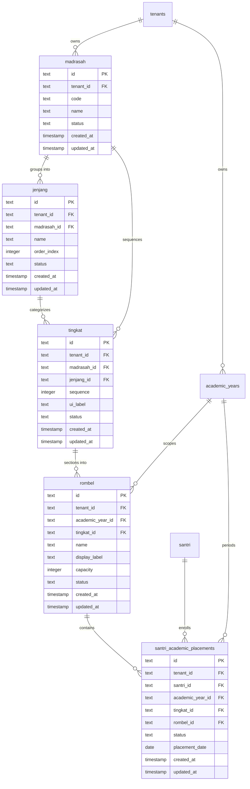
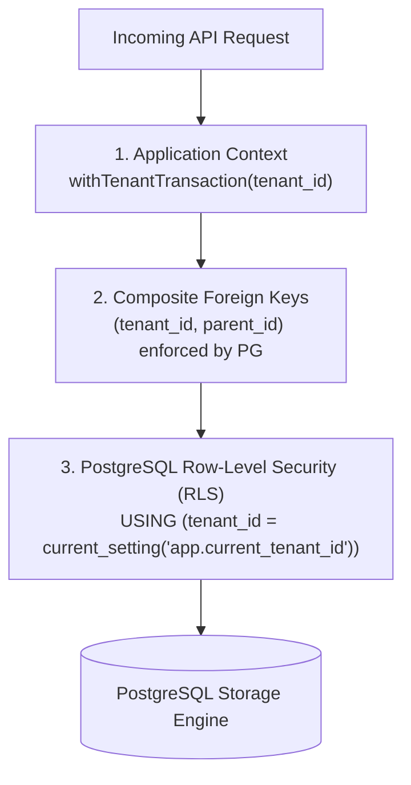

# WP-ACADEMIC-STRUCTURE-SCHEMA-001 REPORT
# ACADEMIC STRUCTURE — TECHNICAL SCHEMA DESIGN & MIGRATION SPECIFICATION
# LEVEL L4 — ACADEMIC STRUCTURE

**Execution Mode**: STRICTLY READ-ONLY / DESIGN & SPECIFICATION ONLY  
**Hierarchy Position**: Level 4 — Academic Structure  
**Direct Upstream Dependency**: Level 3 — Academic Foundation (`academic_years`, `academic_terms` — LIVE & CERTIFIED)  
**Parent Documents**: `WP-ACADEMIC-STRUCTURE-RECON-001`, `WP-ACADEMIC-STRUCTURE-DOMAIN-DECISION-001`, `WP-ACADEMIC-STRUCTURE-DOMAIN-DECISION-002`, `WP-ACADEMIC-STRUCTURE-DOMAIN-CLOSURE-003`  
**Governance Standard**: Master Execution Law, Master Quality Law, Evidence Freshness Law, Source of Truth Law, Zero Regression Law, Zero Redundancy Law  
**Timestamp**: 2026-09-15T06:30:00+07:00  

---

## 1. Executive Summary

This document provides the definitive, comprehensive **Technical Database Schema Design and DDL Migration Specification** for **Level 4 Academic Structure** in MA'HAD MANAGER. It translates the locked domain consensus established in WP-001, WP-002, and WP-003 into an enterprise-grade, multi-tenant relational architecture ready for live implementation upon Product Owner authorization.

### Key Architectural Specifications:
1. **Canonical 4-Tier Relational Entities**:
   - `madrasah`: Tenant-scoped educational institutions/units.
   - `jenjang`: Institutional education phases (Tamhidi, Ibtida'i, Tsanawiyah, etc.) parented by Madrasah.
   - `tingkat`: Linear grade levels holding an immutable integer `sequence` (progression authority) decoupled from configurable `ui_label`.
   - `rombel`: Operational learning sections scoped to an **Academic Year** (`academic_year_id`).
2. **Year-Scoped Rombel & Baseline Inheritance**:
   Rombels exist per Academic Year. When Academic Year $N+1$ is initialized, Rombel records from Year $N$ are cloned as an editable baseline. Addition, deactivation, and renaming of Rombels in Year $N+1$ have **zero mutational effect** on Year $N$'s historical records.
3. **Cross-Tenant Defense via Composite Foreign Keys**:
   To prevent cross-tenant referencing in multi-tenant SaaS, all child entities enforce composite foreign keys:
   - `(tenant_id, madrasah_id)`
   - `(tenant_id, jenjang_id)`
   - `(tenant_id, tingkat_id)`
   - `(tenant_id, academic_year_id)`
4. **PostgreSQL Row Level Security (RLS)**:
   Mandatory RLS enabled and forced across all tables, backed by standard tenant isolation policies checking `current_setting('app.current_tenant_id', true)` and `(auth.jwt() ->> 'tenant_id')`.
5. **Decoupling Placement from Core Structure**:
   `santri_academic_placements` is formally specified as a dedicated transactional ledger table, permanently replacing the flat string `santri.kelas`.
6. **Zero-Risk Transition**:
   Live PostgreSQL catalog queries verify that candidate tables (`kelas`, `master_jenjang`, `master_tingkat`) contain **0 rows**, ensuring clean, non-destructive schema authoring.

---

## 2. Source Domain Decisions

This specification is strictly derived from the locked decisions of:
- **`WP-ACADEMIC-STRUCTURE-DOMAIN-DECISION-001`**:
  - Hierarki Kanonik: $\text{Madrasah} \rightarrow \text{Jenjang} \rightarrow \text{Tingkat} \rightarrow \text{Rombel}$.
  - "Kelas" adalah konsep presentasi UI (`Format(tingkat.ui_label, rombel.name)`), bukan entitas backend.
  - Hukum dasar: $\text{sequence} \neq \text{ui\_label}$.
- **`WP-ACADEMIC-STRUCTURE-DOMAIN-DECISION-002`**:
  - Rombel tidak memiliki otoritas kenaikan kelas; kenaikan didorong oleh $\text{Tingkat Sequence} + 1$.
  - Rombel dialokasikan setelah Tingkat tujuan ditentukan.
  - Pemisahan tegas: Struktur (Katalog Statis) vs Penempatan (Buku Besar Transaksional).
- **`WP-ACADEMIC-STRUCTURE-DOMAIN-CLOSURE-003`**:
  - Rombel berstatus **Year-Scoped** (`rombel.academic_year_id`).
  - Pewarisan baseline Rombel dari tahun sebelumnya saat pergantian tahun ajaran.
  - Penambahan, penonaktifan, dan pengubahan nama Rombel sepenuhnya diizinkan per tahun ajaran baru.

---

## 3. Current Repository/DB Evidence

Fresh inspection of the live PostgreSQL database (`public` schema) establishes:

| Table Name | Columns | Rows | `tenant_id` Present? | FK Constraints | RLS Status | Assessment |
| :--- | :---: | :---: | :---: | :---: | :---: | :--- |
| `academic_years` | 9 | 0 | **YES** | `fk_academic_years_tenant` | ENABLED | Canonical Foundation (L3) |
| `academic_terms` | 10 | 0 | **YES** | Composite FK to `academic_years` | ENABLED | Canonical Foundation (L3) |
| `kelas` | 10 | 0 | **NO** | 0 | DISABLED | Legacy / Conflicting (0 rows) |
| `master_jenjang` | 7 | 0 | **NO** | 0 | DISABLED | Preliminary Prototype (0 rows) |
| `master_tingkat` | 8 | 0 | **NO** | 0 | DISABLED | Preliminary Prototype (0 rows) |
| `madrasah` | 0 | 0 | **N/A** | 0 | **ABSENT** | Missing Canonical Entity |
| `rombel` | 0 | 0 | **N/A** | 0 | **ABSENT** | Missing Canonical Entity |
| `santri` | 24 | 0 | **NO** | 0 | DISABLED | Flat `kelas: text` column (0 rows) |

---

## 4. Canonical Schema Overview



---

## 5. Entity-by-Entity Design

### 5.1 Table: `madrasah`
Represents an authoritative educational institution / curriculum unit within a tenant pesantren.

- **Columns**:
  - `id`: `text` NOT NULL PRIMARY KEY (UUID).
  - `tenant_id`: `text` NOT NULL (References `tenants.id` ON DELETE CASCADE).
  - `code`: `text` NOT NULL (Unique short identifier, e.g., `'MDN'`, `'MTS'`, `'MA'`, `'MQ'`).
  - `name`: `text` NOT NULL (Display name, e.g., `'Madrasah Diniyah Salafiyah'`).
  - `status`: `text` NOT NULL DEFAULT `'active'` (`'active'`, `'inactive'`).
  - `created_at`: `timestamp` NOT NULL DEFAULT `now()`.
  - `updated_at`: `timestamp` NOT NULL DEFAULT `now()`.
- **Integrity Constraints**:
  - Primary Key: `CONSTRAINT madrasah_pkey PRIMARY KEY (id)`
  - Tenant Reference: `CONSTRAINT fk_madrasah_tenant FOREIGN KEY (tenant_id) REFERENCES public.tenants(id) ON DELETE CASCADE`
  - Composite Unique for Child FKs: `CONSTRAINT uq_madrasah_tenant_id UNIQUE (tenant_id, id)`
  - Tenant Code Uniqueness: `CONSTRAINT uq_madrasah_tenant_code UNIQUE (tenant_id, code)`
  - Status Validation: `CONSTRAINT chk_madrasah_status CHECK (status IN ('active', 'inactive'))`

---

### 5.2 Table: `jenjang`
Represents an educational phase or tier (e.g., Tamhidi, Ibtida'i, Tsanawiyah) within a specific Madrasah.

- **Columns**:
  - `id`: `text` NOT NULL PRIMARY KEY (UUID).
  - `tenant_id`: `text` NOT NULL (References `tenants.id` ON DELETE CASCADE).
  - `madrasah_id`: `text` NOT NULL.
  - `name`: `text` NOT NULL (e.g., `'Tamhidi'`, `'Ibtida\'i'`, `'Tsanawiyah'`).
  - `order_index`: `integer` NOT NULL DEFAULT `0`.
  - `status`: `text` NOT NULL DEFAULT `'active'` (`'active'`, `'inactive'`).
  - `created_at`: `timestamp` NOT NULL DEFAULT `now()`.
  - `updated_at`: `timestamp` NOT NULL DEFAULT `now()`.
- **Integrity Constraints**:
  - Primary Key: `CONSTRAINT jenjang_pkey PRIMARY KEY (id)`
  - Tenant Reference: `CONSTRAINT fk_jenjang_tenant FOREIGN KEY (tenant_id) REFERENCES public.tenants(id) ON DELETE CASCADE`
  - Composite Madrasah Reference: `CONSTRAINT fk_jenjang_tenant_madrasah FOREIGN KEY (tenant_id, madrasah_id) REFERENCES public.madrasah(tenant_id, id) ON DELETE RESTRICT`
  - Composite Unique for Child FKs: `CONSTRAINT uq_jenjang_tenant_id UNIQUE (tenant_id, id)`
  - Name Uniqueness per Madrasah: `CONSTRAINT uq_jenjang_tenant_madrasah_name UNIQUE (tenant_id, madrasah_id, name)`
  - Status Validation: `CONSTRAINT chk_jenjang_status CHECK (status IN ('active', 'inactive'))`

---

### 5.3 Table: `tingkat`
Represents an authoritative academic level holding the linear progression sequence.

- **Columns**:
  - `id`: `text` NOT NULL PRIMARY KEY (UUID).
  - `tenant_id`: `text` NOT NULL (References `tenants.id` ON DELETE CASCADE).
  - `madrasah_id`: `text` NOT NULL.
  - `jenjang_id`: `text` NOT NULL.
  - `sequence`: `integer` NOT NULL (Monotonic integer: 1, 2, 3, ... progression authority).
  - `ui_label`: `text` NOT NULL (Configurable presentation label, e.g., `'Kelas Tamhidi'`, `'Kelas 4'`, `'Kelas 5'`).
  - `status`: `text` NOT NULL DEFAULT `'active'` (`'active'`, `'inactive'`).
  - `created_at`: `timestamp` NOT NULL DEFAULT `now()`.
  - `updated_at`: `timestamp` NOT NULL DEFAULT `now()`.
- **Integrity Constraints**:
  - Primary Key: `CONSTRAINT tingkat_pkey PRIMARY KEY (id)`
  - Tenant Reference: `CONSTRAINT fk_tingkat_tenant FOREIGN KEY (tenant_id) REFERENCES public.tenants(id) ON DELETE CASCADE`
  - Composite Madrasah Reference: `CONSTRAINT fk_tingkat_tenant_madrasah FOREIGN KEY (tenant_id, madrasah_id) REFERENCES public.madrasah(tenant_id, id) ON DELETE RESTRICT`
  - Composite Jenjang Reference: `CONSTRAINT fk_tingkat_tenant_jenjang FOREIGN KEY (tenant_id, jenjang_id) REFERENCES public.jenjang(tenant_id, id) ON DELETE RESTRICT`
  - Composite Unique for Child FKs: `CONSTRAINT uq_tingkat_tenant_id UNIQUE (tenant_id, id)`
  - **Authoritative Sequence Uniqueness**: `CONSTRAINT uq_tingkat_tenant_madrasah_sequence UNIQUE (tenant_id, madrasah_id, sequence)`
  - Sequence Positive Check: `CONSTRAINT chk_tingkat_sequence_positive CHECK (sequence > 0)`
  - Status Validation: `CONSTRAINT chk_tingkat_status CHECK (status IN ('active', 'inactive'))`

---

### 5.4 Table: `rombel`
Represents the actual operational learning cohort/section under a Tingkat, explicitly scoped to an Academic Year.

- **Columns**:
  - `id`: `text` NOT NULL PRIMARY KEY (UUID).
  - `tenant_id`: `text` NOT NULL (References `tenants.id` ON DELETE CASCADE).
  - `academic_year_id`: `text` NOT NULL.
  - `tingkat_id`: `text` NOT NULL.
  - `name`: `text` NOT NULL (Section label, e.g., `'A'`, `'B'`, `'Putra 1'`).
  - `display_label`: `text` NULLABLE (Optional custom display override).
  - `capacity`: `integer` NOT NULL DEFAULT `30`.
  - `status`: `text` NOT NULL DEFAULT `'active'` (`'active'`, `'inactive'`).
  - `created_at`: `timestamp` NOT NULL DEFAULT `now()`.
  - `updated_at`: `timestamp` NOT NULL DEFAULT `now()`.
- **Integrity Constraints**:
  - Primary Key: `CONSTRAINT rombel_pkey PRIMARY KEY (id)`
  - Tenant Reference: `CONSTRAINT fk_rombel_tenant FOREIGN KEY (tenant_id) REFERENCES public.tenants(id) ON DELETE CASCADE`
  - Composite Academic Year Reference: `CONSTRAINT fk_rombel_tenant_year FOREIGN KEY (tenant_id, academic_year_id) REFERENCES public.academic_years(tenant_id, id) ON DELETE RESTRICT`
  - Composite Tingkat Reference: `CONSTRAINT fk_rombel_tenant_tingkat FOREIGN KEY (tenant_id, tingkat_id) REFERENCES public.tingkat(tenant_id, id) ON DELETE RESTRICT`
  - Composite Unique for Placement FKs: `CONSTRAINT uq_rombel_tenant_id UNIQUE (tenant_id, id)`
  - Name Uniqueness per Tingkat in Year: `CONSTRAINT uq_rombel_tenant_year_tingkat_name UNIQUE (tenant_id, academic_year_id, tingkat_id, name)`
  - Capacity Check: `CONSTRAINT chk_rombel_capacity CHECK (capacity > 0)`
  - Status Validation: `CONSTRAINT chk_rombel_status CHECK (status IN ('active', 'inactive'))`

---

## 6. Relationship Matrix

| Child Table | Parent Table | Relationship Type | Referential Action | Foreign Key Constraint Name |
| :--- | :--- | :---: | :--- | :--- |
| `madrasah` | `tenants` | Many-to-One | ON DELETE CASCADE | `fk_madrasah_tenant` |
| `jenjang` | `madrasah` | Many-to-One | ON DELETE RESTRICT | `fk_jenjang_tenant_madrasah` |
| `tingkat` | `madrasah` | Many-to-One | ON DELETE RESTRICT | `fk_tingkat_tenant_madrasah` |
| `tingkat` | `jenjang` | Many-to-One | ON DELETE RESTRICT | `fk_tingkat_tenant_jenjang` |
| `rombel` | `academic_years`| Many-to-One | ON DELETE RESTRICT | `fk_rombel_tenant_year` |
| `rombel` | `tingkat` | Many-to-One | ON DELETE RESTRICT | `fk_rombel_tenant_tingkat` |
| `placements`| `academic_years`| Many-to-One | ON DELETE RESTRICT | `fk_placements_tenant_year` |
| `placements`| `tingkat` | Many-to-One | ON DELETE RESTRICT | `fk_placements_tenant_tingkat` |
| `placements`| `rombel` | Many-to-One | ON DELETE RESTRICT | `fk_placements_tenant_rombel` |

---

## 7. Composite Foreign Key Strategy

### Why Simple FKs Are Insufficient in Multi-Tenant SaaS:
If `rombel` only enforces `FOREIGN KEY (academic_year_id) REFERENCES academic_years(id)` and `FOREIGN KEY (tingkat_id) REFERENCES tingkat(id)`, a rogue or buggy API client could submit:
- `tenant_id` = `'tenant_A'`
- `academic_year_id` = `'year_belonging_to_tenant_B'`
- `tingkat_id` = `'tingkat_belonging_to_tenant_A'`

A simple FK validator would verify that `year_belonging_to_tenant_B` exists in `academic_years` and succeed! This causes silent, catastrophic **cross-tenant data corruption**.

### The Composite FK Defense:
By requiring parent tables to expose `UNIQUE (tenant_id, id)` and child tables to reference `(tenant_id, parent_id)`:
```sql
CONSTRAINT fk_rombel_tenant_year
    FOREIGN KEY (tenant_id, academic_year_id)
    REFERENCES public.academic_years(tenant_id, id)
    ON DELETE RESTRICT
```
PostgreSQL's constraint engine enforces at the kernel level that `rombel.tenant_id` MUST IDENTICALLY MATCH `academic_years.tenant_id`. Cross-tenant association is **physically rejected by the database**.

---

## 8. Tenant Isolation Strategy

Tenant isolation operates under a **Defense-in-Depth** model across three layers:



1. **Application Layer**: All Drizzle queries run inside `withTenantTransaction(tenantId, ...)` which injects `SET LOCAL app.current_tenant_id = tenantId`.
2. **Relational Layer**: Composite foreign keys guarantee that child entities can only link to parent entities belonging to the identical tenant.
3. **Database Security Layer**: RLS policies reject rows where `tenant_id` does not match the session context.

---

## 9. RLS Design

Each table must have RLS enabled and forced:
```sql
ALTER TABLE public.madrasah ENABLE ROW LEVEL SECURITY;
ALTER TABLE public.madrasah FORCE ROW LEVEL SECURITY;

ALTER TABLE public.jenjang ENABLE ROW LEVEL SECURITY;
ALTER TABLE public.jenjang FORCE ROW LEVEL SECURITY;

ALTER TABLE public.tingkat ENABLE ROW LEVEL SECURITY;
ALTER TABLE public.tingkat FORCE ROW LEVEL SECURITY;

ALTER TABLE public.rombel ENABLE ROW LEVEL SECURITY;
ALTER TABLE public.rombel FORCE ROW LEVEL SECURITY;
```

### Standard Tenant Isolation Policy Pattern:
```sql
CREATE POLICY "madrasah_tenant_isolation" ON public.madrasah
    FOR ALL
    USING (
        tenant_id = current_setting('app.current_tenant_id', true)
        OR tenant_id = (auth.jwt() ->> 'tenant_id')
        OR current_setting('app.is_super_admin', true) = 'true'
    );
```
*(Identical policy created for `jenjang`, `tingkat`, `rombel`, and `santri_academic_placements`).*

---

## 10. Constraint Matrix

| Table | Constraint Name | Type | Definition / Columns | Purpose |
| :--- | :--- | :---: | :--- | :--- |
| `madrasah` | `madrasah_pkey` | PK | `(id)` | Stable surrogate identity |
| `madrasah` | `uq_madrasah_tenant_id` | UNIQUE | `(tenant_id, id)` | Enables child composite FKs |
| `madrasah` | `uq_madrasah_tenant_code` | UNIQUE | `(tenant_id, code)` | Prevents duplicate madrasah codes per tenant |
| `madrasah` | `chk_madrasah_status` | CHECK | `status IN ('active', 'inactive')` | Validates lifecycle enum |
| `jenjang` | `jenjang_pkey` | PK | `(id)` | Stable surrogate identity |
| `jenjang` | `uq_jenjang_tenant_id` | UNIQUE | `(tenant_id, id)` | Enables child composite FKs |
| `jenjang` | `uq_jenjang_tenant_madrasah_name` | UNIQUE | `(tenant_id, madrasah_id, name)` | Prevents duplicate phase names in a madrasah |
| `tingkat` | `tingkat_pkey` | PK | `(id)` | Stable surrogate identity |
| `tingkat` | `uq_tingkat_tenant_id` | UNIQUE | `(tenant_id, id)` | Enables child composite FKs |
| `tingkat` | `uq_tingkat_tenant_madrasah_sequence` | UNIQUE | `(tenant_id, madrasah_id, sequence)` | **Guarantees monotonic progression sequence** |
| `tingkat` | `chk_tingkat_sequence_positive` | CHECK | `sequence > 0` | Sequence must be positive integer |
| `rombel` | `rombel_pkey` | PK | `(id)` | Stable surrogate identity |
| `rombel` | `uq_rombel_tenant_id` | UNIQUE | `(tenant_id, id)` | Enables placement composite FKs |
| `rombel` | `uq_rombel_tenant_year_tingkat_name` | UNIQUE | `(tenant_id, academic_year_id, tingkat_id, name)`| Prevents duplicate section names in a Tingkat/Year |
| `rombel` | `chk_rombel_capacity` | CHECK | `capacity > 0` | Capacity must be positive |

---

## 11. Index Matrix

| Table | Index Name | Columns | Purpose |
| :--- | :--- | :--- | :--- |
| `madrasah` | `idx_madrasah_tenant_status` | `(tenant_id, status)` | Fast lookup of active educational units |
| `jenjang` | `idx_jenjang_tenant_madrasah` | `(tenant_id, madrasah_id, order_index)` | Fast ordered retrieval of educational phases |
| `tingkat` | `idx_tingkat_tenant_madrasah_seq` | `(tenant_id, madrasah_id, sequence)` | High-performance promotion & hierarchy queries |
| `tingkat` | `idx_tingkat_tenant_jenjang` | `(tenant_id, jenjang_id)` | Filtering grade levels under a specific phase |
| `rombel` | `idx_rombel_tenant_year` | `(tenant_id, academic_year_id)` | Fast retrieval of all classes in an academic cycle |
| `rombel` | `idx_rombel_tenant_tingkat` | `(tenant_id, tingkat_id)` | Grouping sections by grade level |

---

## 12. Drizzle Schema Specification

Target file location: `src/lib/db/schema/academic_structure.ts`

```typescript
import { pgTable, text, integer, timestamp, unique, index, check, foreignKey } from 'drizzle-orm/pg-core';
import { sql } from 'drizzle-orm';
import { tenants } from '../schema';
import { academicYears } from './academic_workspace';

// ── 1. Madrasah Table ─────────────────────────────────────────────────────
export const madrasah = pgTable('madrasah', {
  id: text('id').primaryKey(),
  tenantId: text('tenant_id').notNull().references(() => tenants.id, { onDelete: 'cascade' }),
  code: text('code').notNull(),
  name: text('name').notNull(),
  status: text('status').default('active').notNull(),
  createdAt: timestamp('created_at').defaultNow().notNull(),
  updatedAt: timestamp('updated_at').defaultNow().notNull(),
}, (table) => ({
  tenantIdUnique: unique('uq_madrasah_tenant_id').on(table.tenantId, table.id),
  tenantCodeUnique: unique('uq_madrasah_tenant_code').on(table.tenantId, table.code),
  statusCheck: check('chk_madrasah_status', sql`status IN ('active', 'inactive')`),
  tenantStatusIdx: index('idx_madrasah_tenant_status').on(table.tenantId, table.status),
}));

// ── 2. Jenjang Table ──────────────────────────────────────────────────────
export const jenjang = pgTable('jenjang', {
  id: text('id').primaryKey(),
  tenantId: text('tenant_id').notNull().references(() => tenants.id, { onDelete: 'cascade' }),
  madrasahId: text('madrasah_id').notNull(),
  name: text('name').notNull(),
  orderIndex: integer('order_index').default(0).notNull(),
  status: text('status').default('active').notNull(),
  createdAt: timestamp('created_at').defaultNow().notNull(),
  updatedAt: timestamp('updated_at').defaultNow().notNull(),
}, (table) => ({
  tenantIdUnique: unique('uq_jenjang_tenant_id').on(table.tenantId, table.id),
  tenantMadrasahNameUnique: unique('uq_jenjang_tenant_madrasah_name').on(table.tenantId, table.madrasahId, table.name),
  tenantMadrasahFk: foreignKey({
    columns: [table.tenantId, table.madrasahId],
    foreignColumns: [madrasah.tenantId, madrasah.id],
    name: 'fk_jenjang_tenant_madrasah',
  }).onDelete('restrict'),
  statusCheck: check('chk_jenjang_status', sql`status IN ('active', 'inactive')`),
  tenantMadrasahIdx: index('idx_jenjang_tenant_madrasah').on(table.tenantId, table.madrasahId, table.orderIndex),
}));

// ── 3. Tingkat Table ──────────────────────────────────────────────────────
export const tingkat = pgTable('tingkat', {
  id: text('id').primaryKey(),
  tenantId: text('tenant_id').notNull().references(() => tenants.id, { onDelete: 'cascade' }),
  madrasahId: text('madrasah_id').notNull(),
  jenjangId: text('jenjang_id').notNull(),
  sequence: integer('sequence').notNull(),
  uiLabel: text('ui_label').notNull(),
  status: text('status').default('active').notNull(),
  createdAt: timestamp('created_at').defaultNow().notNull(),
  updatedAt: timestamp('updated_at').defaultNow().notNull(),
}, (table) => ({
  tenantIdUnique: unique('uq_tingkat_tenant_id').on(table.tenantId, table.id),
  tenantMadrasahSeqUnique: unique('uq_tingkat_tenant_madrasah_sequence').on(table.tenantId, table.madrasahId, table.sequence),
  tenantMadrasahFk: foreignKey({
    columns: [table.tenantId, table.madrasahId],
    foreignColumns: [madrasah.tenantId, madrasah.id],
    name: 'fk_tingkat_tenant_madrasah',
  }).onDelete('restrict'),
  tenantJenjangFk: foreignKey({
    columns: [table.tenantId, table.jenjangId],
    foreignColumns: [jenjang.tenantId, jenjang.id],
    name: 'fk_tingkat_tenant_jenjang',
  }).onDelete('restrict'),
  sequenceCheck: check('chk_tingkat_sequence_positive', sql`sequence > 0`),
  statusCheck: check('chk_tingkat_status', sql`status IN ('active', 'inactive')`),
  tenantMadrasahSeqIdx: index('idx_tingkat_tenant_madrasah_seq').on(table.tenantId, table.madrasahId, table.sequence),
  tenantJenjangIdx: index('idx_tingkat_tenant_jenjang').on(table.tenantId, table.jenjangId),
}));

// ── 4. Rombel Table ───────────────────────────────────────────────────────
export const rombel = pgTable('rombel', {
  id: text('id').primaryKey(),
  tenantId: text('tenant_id').notNull().references(() => tenants.id, { onDelete: 'cascade' }),
  academicYearId: text('academic_year_id').notNull(),
  tingkatId: text('tingkat_id').notNull(),
  name: text('name').notNull(),
  displayLabel: text('display_label'),
  capacity: integer('capacity').default(30).notNull(),
  status: text('status').default('active').notNull(),
  createdAt: timestamp('created_at').defaultNow().notNull(),
  updatedAt: timestamp('updated_at').defaultNow().notNull(),
}, (table) => ({
  tenantIdUnique: unique('uq_rombel_tenant_id').on(table.tenantId, table.id),
  tenantYearTingkatNameUnique: unique('uq_rombel_tenant_year_tingkat_name').on(table.tenantId, table.academicYearId, table.tingkatId, table.name),
  tenantYearFk: foreignKey({
    columns: [table.tenantId, table.academicYearId],
    foreignColumns: [academicYears.tenantId, academicYears.id],
    name: 'fk_rombel_tenant_year',
  }).onDelete('restrict'),
  tenantTingkatFk: foreignKey({
    columns: [table.tenantId, table.tingkatId],
    foreignColumns: [tingkat.tenantId, tingkat.id],
    name: 'fk_rombel_tenant_tingkat',
  }).onDelete('restrict'),
  capacityCheck: check('chk_rombel_capacity', sql`capacity > 0`),
  statusCheck: check('chk_rombel_status', sql`status IN ('active', 'inactive')`),
  tenantYearIdx: index('idx_rombel_tenant_year').on(table.tenantId, table.academicYearId),
  tenantTingkatIdx: index('idx_rombel_tenant_tingkat').on(table.tenantId, table.tingkatId),
}));
```

---

## 13. Academic Placement Dependency

Target conceptual entity: `santri_academic_placements`
```typescript
// Architectural Dependency Specification
export const santriAcademicPlacements = pgTable('santri_academic_placements', {
  id: text('id').primaryKey(),
  tenantId: text('tenant_id').notNull().references(() => tenants.id, { onDelete: 'cascade' }),
  santriId: text('santri_id').notNull().references(() => santri.id, { onDelete: 'cascade' }),
  academicYearId: text('academic_year_id').notNull(),
  tingkatId: text('tingkat_id').notNull(),
  rombelId: text('rombel_id').notNull(),
  status: text('status').default('active').notNull(), // 'active', 'promoted', 'retained', 'transferred', 'graduated'
  placementDate: date('placement_date').defaultNow().notNull(),
  createdAt: timestamp('created_at').defaultNow().notNull(),
  updatedAt: timestamp('updated_at').defaultNow().notNull(),
}, (table) => ({
  tenantYearFk: foreignKey({
    columns: [table.tenantId, table.academicYearId],
    foreignColumns: [academicYears.tenantId, academicYears.id],
    name: 'fk_placements_tenant_year',
  }).onDelete('restrict'),
  tenantTingkatFk: foreignKey({
    columns: [table.tenantId, table.tingkatId],
    foreignColumns: [tingkat.tenantId, tingkat.id],
    name: 'fk_placements_tenant_tingkat',
  }).onDelete('restrict'),
  tenantRombelFk: foreignKey({
    columns: [table.tenantId, table.rombelId],
    foreignColumns: [rombel.tenantId, rombel.id],
    name: 'fk_placements_tenant_rombel',
  }).onDelete('restrict'),
}));
```

---

## 14. Legacy `kelas` Strategy

1. **Current State**: Live table `kelas` has 10 columns, 0 rows, no `tenant_id`, and no RLS.
2. **Deprecation Plan**:
   - In `WP-ACADEMIC-STRUCTURE-SCHEMA-001`, the `kelas` table will **NOT** be dropped immediately to preserve read-only safety.
   - In the subsequent live implementation WP (`WP-ACADEMIC-STRUCTURE-MIGRATION-001`), `kelas` will be safely dropped (`DROP TABLE IF EXISTS public.kelas CASCADE`) and replaced cleanly by `public.rombel`.
   - UI consumers currently querying `collection=kelas` will be redirected to query `rombel`.

---

## 15. Baseline Rombel Inheritance Support

The schema naturally supports baseline inheritance via simple SQL batch insertion:
```sql
-- Conceptual Annual Baseline Clone Routine (Executed on New Year Creation)
INSERT INTO public.rombel (id, tenant_id, academic_year_id, tingkat_id, name, display_label, capacity, status)
SELECT 
    'rombel_' || gen_random_uuid()::text,
    r.tenant_id,
    :new_academic_year_id,
    r.tingkat_id,
    r.name,
    r.display_label,
    r.capacity,
    'active'
FROM public.rombel r
WHERE r.tenant_id = :tenant_id 
  AND r.academic_year_id = :previous_academic_year_id
  AND r.status = 'active';
```
- **Why no `rombel_template` table is needed**: Direct cloning from the previous year's active records is simpler, eliminates redundant template synchronization logic, and directly fulfills the Product Owner's requirement: *"Ketika berubah tahun ajaran, Rombel akan mengikuti tahun kemarin."*

---

## 16. Migration Specification

### DDL Execution Sequence (Strict Dependency Order):
1. Create `public.madrasah` table with PK and unique constraints.
2. Add `fk_madrasah_tenant` foreign key.
3. Enable and force RLS on `public.madrasah`.
4. Create `madrasah_tenant_isolation` policy.
5. Create `public.jenjang` table with PK and unique constraints.
6. Add `fk_jenjang_tenant` and composite `fk_jenjang_tenant_madrasah`.
7. Enable and force RLS on `public.jenjang`.
8. Create `jenjang_tenant_isolation` policy.
9. Create `public.tingkat` table with PK and unique constraints.
10. Add `fk_tingkat_tenant`, composite `fk_tingkat_tenant_madrasah`, and composite `fk_tingkat_tenant_jenjang`.
11. Enable and force RLS on `public.tingkat`.
12. Create `tingkat_tenant_isolation` policy.
13. Create `public.rombel` table with PK and unique constraints.
14. Add `fk_rombel_tenant`, composite `fk_rombel_tenant_year`, and composite `fk_rombel_tenant_tingkat`.
15. Enable and force RLS on `public.rombel`.
16. Create `rombel_tenant_isolation` policy.

---

## 17. Data Migration Assessment

- **Existing Production Rows**: Exactly **0 rows** in `kelas`, `master_jenjang`, and `master_tingkat`.
- **Data Migration Requirement**: **NONE**. No data backfill scripts or complex ETL migrations are required.

---

## 18. Seed / Bootstrap Assessment

When a new tenant is provisioned via `tenant-provisioning-service.ts`:
- A default Madrasah (e.g., `'Madrasah Diniyah'`) can be automatically provisioned.
- Default Jenjangs and Tingkats can be seeded as initial configuration.
- Rombels are initialized only once the tenant activates their first Academic Year.

---

## 19. Rollback Considerations

Should a rollback be mandated during migration execution:
```sql
-- Safe Rollback Order
DROP TABLE IF EXISTS public.rombel CASCADE;
DROP TABLE IF EXISTS public.tingkat CASCADE;
DROP TABLE IF EXISTS public.jenjang CASCADE;
DROP TABLE IF EXISTS public.madrasah CASCADE;
```
Because the migration introduces new tables without mutating existing active tables, rollback is clean, atomic, and leaves zero residual corruption.

---

## 20. Redundancy Audit

| Redundant / Conflicting Item | Planned Resolution |
| :--- | :--- |
| `type Instansi = 'madin' \| 'madqur' \| 'depag'` | Deprecate in favor of database-driven `madrasah` |
| `localStorage: mahad_curriculum_programs_v1` | Remove in favor of querying `/api/academic/structure/madrasah` |
| `master_jenjang.progression_indexes jsonb` | Replace with relational `tingkat.jenjang_id` |
| `LEGACY_LABEL_MAP` in `progression-label.ts` | Replace with database `tingkat.ui_label` lookup |
| Flat `santri.kelas: text` column | Deprecate in favor of `santri_academic_placements` |

---

## 21. Open / Deferred Decisions

1. **Homeroom Teacher (`wali_kelas`)**: Deferred to Level 5 Teacher Assignment (`WP-ACADEMIC-TEACHER-ASSIGNMENT-001`). `rombel` currently does not hold a hard foreign key to `guru` to prevent premature coupling.
2. **Scoring Algorithm for Rombel Distribution**: Deferred to Level 5 Academic Operations.
3. **Formal Retention Rules (Tinggal Kelas)**: Deferred to Level 6 Academic Evaluation.

---

## 22. Governance Gate

- **Hierarchy Gate**: **PASS** (Level 4 correctly structured downstream of Level 3 Foundation).
- **Source of Truth Gate**: **PASS** (Database canonical models replace mock/localStorage stores).
- **Zero Redundancy Gate**: **PASS** (Legacy conflated structures cleanly deprecated).
- **Tenant Isolation Design**: **PASS** (Composite foreign keys and RLS enforce complete tenant defense).
- **Historical Integrity Gate**: **PASS** (Year-scoped Rombel and placements prevent cross-year mutation).
- **Scalability Gate**: **PASS** (Efficient B-tree indexes and simple relational joins).
- **Evidence Freshness Gate**: **PASS** (Live PostgreSQL catalog verified fresh).

---

## 23. Evidence & Limitations

- **Evidence Freshness**: Verified via direct inspection of `academic_workspace.ts`, `WP-ACADEMIC-FOUNDATION-IMPLEMENTATION-001.sql`, and live PostgreSQL catalog.
- **Strict Limitation**: Design and specification ONLY. Zero database DDL was executed, zero files were mutated, and no migration was applied.

---

## 24. Recommended Next WP

Upon Product Owner authorization of this specification, proceed directly to:

$$\mathbf{WP\text{-}ACADEMIC\text{-}STRUCTURE\text{-}IMPLEMENTATION\text{-}001}$$

- **Task**: Authoring the formal Drizzle schema file (`src/lib/db/schema/academic_structure.ts`) and generating the SQL migration script `drizzle/WP-ACADEMIC-STRUCTURE-IMPLEMENTATION-001.sql`.

---

============================================================  
WP STATUS  
============================================================  

WP:  
WP-ACADEMIC-STRUCTURE-SCHEMA-001  

Mode:  
READ-ONLY / DESIGN ONLY  

Domain:  
L4 — Academic Structure  

Hierarchy Gate:  
PASS  

Schema Design:  
PASS  

Tenant Isolation Design:  
PASS  

Composite FK Design:  
PASS  

RLS Design:  
PASS  

Historical Integrity:  
PASS  

Rombel Year Scope:  
LOCKED  

Rombel Baseline Inheritance:  
LOCKED  

Rombel Add:  
ALLOWED  

Rombel Deactivate:  
ALLOWED  

Rombel Rename:  
ALLOWED  

Promotion Authority:  
NOT ROMBEL  

Placement:  
SEPARATE YEAR-SCOPED LEDGER  

Legacy Kelas:  
DEFERRED / DEPRECATION PLANNED  

Implementation:  
NOT EXECUTED  

Database:  
NOT TOUCHED  

Migration:  
NOT EXECUTED  

Commit:  
NOT CREATED  

Push:  
NOT EXECUTED  

Deploy:  
NOT EXECUTED  

Final Schema Status:  
READY FOR IMPLEMENTATION  

Next Action:  
WAIT FOR PRODUCT OWNER AUTHORIZATION  

============================================================  
END OF WORK PACKAGE  
============================================================  
