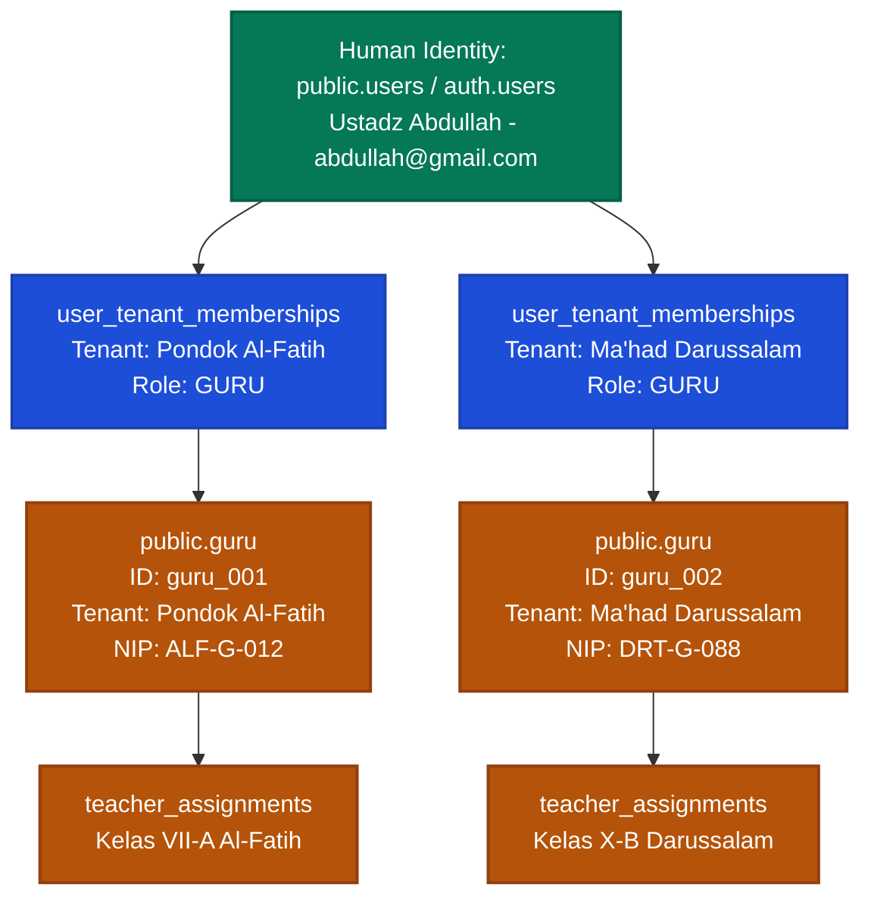
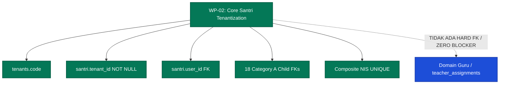

# EEOS — CORE SANTRI TENANTIZATION & NIS REMEDIATION
# GATE 3: GURU / USTADZ TENANT BOUNDARY DECISION & RATIFICATION REPORT

```text
WORK PACKAGE:           WP-GATE03-GURU-TENANT-BOUNDARY-DECISION-001
GOVERNANCE GATE:        EEOS PRODUCT OWNER ARCHITECTURE DECISION GATE #3
OPERATING MODE:         READ-ONLY / ARCHITECTURE ANALYSIS / DECISION RATIFICATION (ZERO MUTATION)
DATABASE ENVIRONMENT:   LIVE TARGET DATABASE (PostgreSQL 17.6 / Supabase) — UNTOUCHED
APPLICATION CODE:       UNTOUCHED (ZERO MUTATION)
DATE:                   2026-09-20
EEOS AUDITORS:          Senior Principal Systems Architect, Database Architect, Security Architect
DECISION RATIFIED:      GURU-2 (DEFERRED TO WP-CORE-GURU-TENANTIZATION-001)
GOVERNANCE VERDICT:     GATE 3 RATIFIED — ARCHITECTURALLY CLOSED — GATE 4 REMAINS OPEN
```

---

## 1. GOVERNANCE HEADER

Dokumen ini merupakan catatan arsitektural resmi (*official architectural decision & ratification record*) atas pelaksanaan **Product Owner Architecture Decision Gate #3 — Guru / Ustadz Tenant Boundary**.

Evaluasi ini bertujuan menetapkan batasan cakupan (*scope boundary*) implementasi fisik tenantisasi Guru/Ustadz terhadap siklus migrasi Core Santri saat ini, memisahkan secara tegas antara aturan bisnis permanen (*locked business invariant*) dengan jadwal pelaksanaan teknis (*migration phasing*).

---

## 2. CURRENT GURU ARCHITECTURE

Berdasarkan audit forensik *read-only* terhadap basis data aktual (PostgreSQL 17.6) dan skema repositori Drizzle ([`src/lib/db/schema.ts:166-179`](file:///e:/Projects/Os_Darta/src/lib/db/schema.ts#L166-L179)), arsitektur entitas Guru saat ini direkonstruksi sebagai berikut:

```text
┌────────────────────────────────────────────────────────────────────────────────────────┐
│                        REKONSTRUKSI SKEMA AKTUAL: public.guru                         │
├───────────────────┬─────────────────────┬──────────┬───────────────────────────────────┤
│ Nama Kolom        │ Tipe Data           │ Nullable │ Keterangan / Default              │
├───────────────────┼─────────────────────┼──────────┼───────────────────────────────────┤
│ id                │ text                │ NOT NULL │ Primary Key (e.g. 'guru_001')     │
│ tenant_id         │ text                │ NOT NULL │ Default 'default'                 │
│ name              │ text                │ NOT NULL │ Nama Lengkap Guru / Ustadz        │
│ nip               │ text                │ NOT NULL │ Nomor Induk Pegawai / Guru        │
│ ranah_instansi    │ text                │ NOT NULL │ Instansi Pengampu (e.g. 'MA')     │
│ status            │ text                │ NOT NULL │ Default 'aktif'                   │
│ email             │ text                │ NULL     │ Alamat Email Kontak               │
│ no_wa             │ text                │ NULL     │ Nomor WhatsApp Guru               │
│ alamat            │ text                │ NULL     │ Alamat Domisili                   │
│ user_id           │ text                │ NULL     │ Identity Bridge ke public.users   │
│ created_at        │ timestamp           │ NOT NULL │ Default now()                     │
│ updated_at        │ timestamp           │ NOT NULL │ Default now()                     │
└───────────────────┴─────────────────────┴──────────┴───────────────────────────────────┘
```

### Temuan Arsitektural Kunci pada Skema Eksisting:
1. **Keberadaan `tenant_id`**: Tabel `public.guru` **sudah memiliki kolom `tenant_id`**, namun belum memiliki foreign key constraint formal ke `public.tenants(id)` dan belum memiliki constraint unik komposit.
2. **Keberadaan `user_id`**: Tabel `public.guru` **sudah memiliki kolom `user_id`**, disiapkan sebagai tautan ke `public.users(id)`.
3. **Ketiadaan Constraint Unik NIP**: `nip` tidak memiliki constraint unik global maupun tenant-scoped.
4. **Ketiadaan Foreign Key Komposit**: Tidak terdapat `UNIQUE (tenant_id, id)` yang memungkinkan child tables memverifikasi integritas tenant boundary di level basis data.

---

## 3. EXISTING EVIDENCE & REPOSITORY TRACING

Pelacakan repositori dilakukan secara komprehensif melintasi lapisan Schema, Repository, Service, API, dan UI:

```text
┌─────────────────────────┬───────────────────────────┬──────────────────────────────────────────┐
│ Komponen Sistem         │ Lokasi File               │ Temuan Faktual / Status Relasi           │
├─────────────────────────┼───────────────────────────┼──────────────────────────────────────────┤
│ Skema Tabel Guru        │ src/lib/db/schema.ts:166  │ Ada field `tenant_id` & `user_id`.       │
│ Skema Penugasan Guru    │ src/lib/db/schema.ts:154  │ Tabel `teacher_assignments` menyimpan    │
│                         │                           │ denormalisasi `guru_name: text`. Tidak   │
│                         │                           │ ada kolom FK `guru_id`.                  │
│ Service Layer           │ src/lib/db/services/      │ Menggunakan wrapper `createTenantService`│
│                         │ guru.ts:4                 │ berdasar klausa WHERE tenant_id.         │
│ Role / RBAC             │ src/lib/db/schema/        │ Role code `'GURU'` terdaftar di          │
│                         │ identity.ts:48            │ `tenant_roles.role_code`.                │
│ Struktur Akademik       │ src/lib/db/schema/        │ Rombel & Kelas mengaitkan homeroom       │
│                         │ academic_structure.ts     │ teacher via string atau ID opsional.     │
│ Database Catalog        │ Live DB (PostgreSQL 17.6) │ Record `public.guru` = 0 baris (bersih). │
└─────────────────────────┴───────────────────────────┴──────────────────────────────────────────┘
```

---

## 4. OPTION GURU-1 ANALYSIS — CONCURRENT INCLUSION

### 4.1 Definisi
Menyelesaikan tenantisasi `public.guru` secara bersamaan dalam siklus migrasi aktif saat ini (bergabung dengan paket WP-02 hingga WP-07).

### 4.2 Analisis Karakteristik
- **Domain Ownership**: Setiap baris `public.guru` diikat secara ketat ke satu tenant melalui `tenant_id NOT NULL REFERENCES public.tenants(id)` dan constraint `UNIQUE (tenant_id, id)`. NIP bersifat unik per tenant: `UNIQUE (tenant_id, nip)`.
- **Identitas & Multi-Tenant**: Seorang guru manusia yang mengajar di 2 pesantren memiliki 1 akun di `public.users(id)`, 2 baris keanggotaan di `user_tenant_memberships` (satu per tenant), dan 2 baris terpisah di `public.guru` (satu per tenant).
- **Penugasan Akademik**: Tabel `teacher_assignments` dinormalisasi untuk menggantikan `guru_name: text` dengan composite foreign key `(tenant_id, guru_id) REFERENCES public.guru(tenant_id, id)`.
- **Kebutuhan Migrasi**:
  - Penambahan FK `tenants(id)` pada `guru`.
  - Penambahan constraint `UNIQUE (tenant_id, id)` dan `UNIQUE (tenant_id, nip)`.
  - Migrasi skema `teacher_assignments` (penambahan `guru_id` dan penghapusan kolom denormalisasi nama).
  - Sinkronisasi Drizzle ORM schema dan test suite guru.
- **Konsekuensi Teknis**:
  - *Sisi Positif*: Seluruh entitas manusia utama (Santri dan Asatidz) mencapai kematangan isolasi multi-tenant di basis data secara bersamaan; menutup celah cross-tenant assignment (`ATTACK-11`) segera.
  - *Konsekuensi Beban*: Memperluas area dampak migrasi (*migration blast radius*), meningkatkan durasi penguncian tabel (*table lock acquisition*), serta menambah kompleksitas pengujian regresi pada modul KBM/akademik secara simultan.

---

## 5. OPTION GURU-2 ANALYSIS — FORMAL DEFERRAL

### 5.1 Definisi
Mengunci aturan bisnis permanen bahwa `One guru record belongs to exactly one tenant` (**LDEC-02**), namun menunda implementasi fisik pengetatan skema, migrasi constraint komposit, dan normalisasi penugasan guru ke paket kerja terdedikasi terpisah (**`WP-CORE-GURU-TENANTIZATION-001`**).

### 5.2 Analisis Karakteristik
- **Fokus Siklus Aktif**: Siklus aktif saat ini difokuskan secara murni dan terlokalisasi pada penyelesaian Core Santri Tenantization, penanganan duplikasi NIS lintas tenant, dan implementasi BFF Login Native MB-06.
- **Status Entitas Guru Saat Ini**: Tabel `public.guru` tetap berada pada kondisi skema saat ini (memiliki kolom `tenant_id` dan `user_id` tanpa pengubahan DDL mayor).
- **Isolasi Sementara**: Isolasi data guru tetap berjalan pada level aplikasi melalui klausa `tenant_id = :tenant_id` pada service layer (`src/lib/db/services/guru.ts`).
- **Konsekuensi Teknis**:
  - *Sisi Positif*: Meminimalkan risiko regresi pada eksekusi WP-02 Core Santri; menyederhanakan *rollback boundary*; memungkinkan rilis fitur login santri native lebih cepat dan terverifikasi.
  - *Konsekuensi Beban*: Menunda penguatan constraint basis data untuk entitas guru; penugasan guru pada `teacher_assignments` masih menggunakan string denormalisasi hingga paket `WP-CORE-GURU-TENANTIZATION-001` dieksekusi.

---

## 6. SECURITY ANALYSIS (THREAT MATRIX T-G01 s/d T-G08)

Evaluasi perilaku keamanan sistem terhadap 8 skenario ancaman spesifik pada kedua opsi:

```text
┌────────┬────────────────────────────────┬──────────────────────┬──────────────────────┬────────────────────────────┐
│ Threat │ Skenario Ancaman               │ Perilaku GURU-1      │ Perilaku GURU-2      │ Pengendalian yang Wajib    │
├────────┼────────────────────────────────┼──────────────────────┼──────────────────────┼────────────────────────────┤
│ T-G01  │ Guru Tenant A mencoba          │ DITOLAK MUTLAK       │ DITOLAK              │ Validasi keanggotaan aktif │
│        │ mengakses data Tenant B        │ (DB Constraint + RLS)│ (Application Layer)  │ di Gateway & RLS.          │
├────────┼────────────────────────────────┼──────────────────────┼──────────────────────┼────────────────────────────┤
│ T-G02  │ Guru memiliki user account sah,│ DITOLAK (HTTP 403)   │ DITOLAK (HTTP 403)   │ Fail-closed membership     │
│        │ namun membership nonaktif/batal│ (Gateway check)      │ (Gateway check)      │ check pada request gateway.│
├────────┼────────────────────────────────┼──────────────────────┼──────────────────────┼────────────────────────────┤
│ T-G03  │ Guru ditugaskan mengajar di    │ DITOLAK DI LEVEL DB  │ DITANGANI DI SERVICE │ Composite FK pada penugasan│
│        │ madrasah milik Tenant lain     │ (Composite FK)       │ (Validasi App Layer) │ guru (GURU-1 atau WP-GURU).│
├────────┼────────────────────────────────┼──────────────────────┼──────────────────────┼────────────────────────────┤
│ T-G04  │ Request memanipulasi parameter │ DITIMPA SERVER       │ DITIMPA SERVER       │ Gateway mengabaikan client │
│        │ `tenant_id` pada API guru      │ (Zero-Trust Stamping)│ (Zero-Trust Stamping)│ header/body parameter.     │
├────────┼────────────────────────────────┼──────────────────────┼──────────────────────┼────────────────────────────┤
│ T-G05  │ Request memanipulasi parameter │ DITOLAK              │ DITOLAK              │ Pengecekan kepemilikan guru│
│        │ `guru_id` antar-tenant         │ (Composite Lookup)   │ (Tenant Scoped Query)│ dalam tenant aktif.        │
├────────┼────────────────────────────────┼──────────────────────┼──────────────────────┼────────────────────────────┤
│ T-G06  │ Guru mengajar di 2 pesantren   │ AMAN TERISOLASI      │ AMAN TERISOLASI      │ 2 record domain guru       │
│        │ (Multi-Tenant Teacher)         │ (2 baris guru di DB) │ (2 baris guru di DB) │ terhubung ke 1 user_id.    │
├────────┼────────────────────────────────┼──────────────────────┼──────────────────────┼────────────────────────────┤
│ T-G07  │ Guru dinonaktifkan/dihapus     │ RESTRICT / CASCADE   │ SOFT DELETE STATUS   │ Foreign key integrity      │
│        │ dari satu pesantren            │ TERISOLASI PER TENANT│ TERISOLASI PER TENANT│ tanpa merusak tenant lain. │
├────────┼────────────────────────────────┼──────────────────────┼──────────────────────┼────────────────────────────┤
│ T-G08  │ Akun user aktif, namun status  │ DITOLAK AKSES KBM    │ DITOLAK AKSES KBM    │ Pengecekan status status = │
│        │ record guru = 'nonaktif'       │ (Service & RLS)      │ (Service Layer)      │ 'aktif' pada domain guru.  │
└────────┴────────────────────────────────┴──────────────────────┴──────────────────────┴────────────────────────────┘
```

---

## 7. IDENTITY ANALYSIS

Pemisahan identitas manusia (*Person Identity*) terhadap rekaman domain guru (*Tenant Domain Record*):



### Prinsip Identitas Guru:
1. **Nol Duplikasi Akun Manusia**: Satu individu guru hanya memiliki 1 baris di `public.users` dan 1 entitas di `auth.users`.
2. **Kemandirian Record Domain**: Guru memiliki record `public.guru` yang berbeda pada setiap lembaga tempat ia mengajar. Setiap record memiliki NIP yang diterbitkan oleh masing-masing pesantren.
3. **Kompatibilitas Penuh**: Model ini kompatibel 100% dengan TIR-009, skema `user_tenant_memberships`, dan alur multi-tenant switching yang disahkan pada MB-06.

---

## 8. TENANT BOUNDARY ANALYSIS

> **Pertanyaan Arsitektural**: *Apakah satu Guru/Ustadz boleh memiliki record domain Guru pada lebih dari satu Tenant?*

### Jawaban Tegas Berdasarkan Evidence: **YA, DIPERBOLEHKAN.**
- **Bukan Duplikasi Identitas**: Hal ini bukan duplikasi akun, melainkan representasi hubungan ketenagakerjaan (*employment relation*) yang sah pada lembaga pendidikan yang berbeda.
- **Pemisahan Hak Akses**: Guru yang mengajar di Pesantren A tidak otomatis berhak melihat absensi atau nilai santri di Pesantren B. Konteks sesi guru selalu terikat pada tenant yang aktif saat ia login atau beralih lembaga.

---

## 9. CORE SANTRI DEPENDENCY CHECK

Pemeriksaan ketergantungan membuktikan hubungan struktural berikut:



### Kesimpulan Dependensi:
* Tabel `public.santri` dan 18 tabel anak operasionalnya **tidak memiliki satupun foreign key constraint yang mengarah ke `public.guru`**.
* Kolom kedisiplinan dan asrama mencatat reporter/musyrif sebagai teks bebas (*unconstrained text name*).
* **VERIFIKASI FAKTUAL**: **GURU BUKAN BLOCKING DEPENDENCY BAGI CORE SANTRI TENANTIZATION.**

---

## 10. RLS DEPENDENCY

Keputusan Gate 3 memiliki relasi ketergantungan terhadap Gate 4 (Database RLS Architecture) sebagai berikut:

* **Pada GURU-1**: Memerlukan pembuatan policy RLS tenant-aware untuk `public.guru` dan penugasan guru bersamaan dengan policy santri pada Gate 4.
* **Pada GURU-2**: Policy RLS untuk `public.guru` tetap menggunakan policy isolasi standar eksisting (`guru_isolation` pada migrasi 0002) atau ditangani formal pada `WP-CORE-GURU-TENANTIZATION-001`.
* **STATUS**: Ketergantungan terhadap Gate 4 tercatat secara transparan. Gate 3 tidak mengambil keputusan prematur untuk Gate 4.

---

## 11. MIGRATION IMPACT

### Dampak Migrasi jika GURU-1 (Concurrent):
- Penambahan DDL pada WP-02: `ALTER TABLE public.guru ADD CONSTRAINT fk_guru_tenant FOREIGN KEY (tenant_id) REFERENCES tenants(id)`.
- Penambahan constraint: `UNIQUE (tenant_id, id)` dan `UNIQUE (tenant_id, nip)`.
- Penulisan ulang skema `teacher_assignments` (penambahan `guru_id`, migrasi data nama).
- Penambahan 4 file service dan unit test guru pada sprint aktif.

### Dampak Migrasi jika GURU-2 (Deferred):
- DDL WP-02 tetap ramping dan terfokus murni pada `tenants.code`, `santri.tenant_id`, `santri.user_id`, dan 18 child tables santri.
- Skema `public.guru` tidak disentuh pada WP-02.
- Spesifikasi teknis untuk guru diarsipkan ke dalam blueprint persiapan `WP-CORE-GURU-TENANTIZATION-001`.

---

## 12. SIDE-BY-SIDE COMPARISON (UNRANKED & NEUTRAL)

Perbandingan objektif tanpa pemberian skor atau peringkat:

| Dimensi Evaluasi | Opsi GURU-1: CONCURRENT | Opsi GURU-2: DEFERRED |
| :--- | :--- | :--- |
| **Cakupan Kerja Siklus Ini** | Santri + NIS + Login Native + Guru + Teacher Assignment. | Core Santri + NIS + Login Native (Guru ditunda). |
| **Batas Kepemilikan Domain** | Ditegakkan langsung di level constraint basis data. | Aturan LDEC-02 dikunci; constraint DB dibuat pada WP berikutnya. |
| **Model Identitas Guru** | 1 Human (`users`) terhubung ke N Record `guru`. | 1 Human (`users`) terhubung ke N Record `guru`. |
| **Penugasan Multi-Tenant** | Dinormalisasi via `teacher_assignments(guru_id)`. | Menggunakan string nama hingga paket guru dieksekusi. |
| **Kompleksitas Migrasi WP-02**| Lebih tinggi (Luas tabel & lock acquisition bertambah).| Lebih rendah (Terfokus murni pada domain Santri). |
| **Ketergantungan Core Santri**| Mandiri (Bukan hard blocker bagi santri). | Mandiri (Core santri dapat berjalan 100% terisolasi). |
| **Risiko Regresi Rilis** | Lebih tersebar melintasi modul KBM/akademik. | Terisolasi ketat pada modul kesiswaan/santri. |
| **Jadwal Eksekusi Guru** | Selesai bersamaan dengan WP-02 s/d WP-07. | Dijadwalkan terpisah pada `WP-CORE-GURU-TENANTIZATION-001`. |

---

## 13. PRODUCT OWNER DECISION GATE

Product Owner telah disajikan pilihan formal:

```text
================================================================================
PRODUCT OWNER DECISION GATE #3
GURU / USTADZ TENANT BOUNDARY
================================================================================

[GURU-1] CONCURRENT
  Makna: Selesaikan tenantisasi Guru/Ustadz secara bersamaan dalam siklus migrasi
         aktif saat ini.

[GURU-2] DEFERRED
  Makna: Tunda implementasi fisik tenantisasi Guru/Ustadz ke work package terpisah
         (WP-CORE-GURU-TENANTIZATION-001); siklus saat ini difokuskan secara murni
         pada Core Santri dan MB-06 Native Login.
================================================================================
```

---

## 14. RATIFICATION RECORD

Berdasarkan keputusan eksplisit yang ditetapkan oleh Product Owner:

```text
================================================================================
OFFICIAL RATIFICATION RECORD (GATE 3)
================================================================================
PILIHAN RESMI:           [GURU-2] DEFERRED
STATUS KEPUTUSAN:        RATIFIED & LOCKED
WORK PACKAGE LANJUTAN:   WP-CORE-GURU-TENANTIZATION-001 (DEFERRED EXECUTION)

Rasional Bisnis & Arsitektural:
1. Memastikan fokus dan kecepatan penyelesaian siklus migrasi Core Santri,
   remediasi duplikasi NIS lintas tenant, dan kesiapan rilis MB-06 Native App.
2. Meminimalkan blast radius dan risiko regresi pada tabel akademik/KBM.
3. Aturan arsitektural LDEC-02 (One guru record belongs to exactly one tenant)
   tetap terkunci sebagai invariant sistem.
================================================================================
```

---

## 15. CROSS-DOMAIN CONSISTENCY CHECK

Pemeriksaan konsistensi pasca ratifikasi GURU-2 terhadap seluruh domain sistem:

```text
┌────┬─────────────────────────────┬────────────────────────────────┬──────────────────────────────┬───────────┐
│ No │ Domain Sistem               │ Parameter Eksisting Terkunci   │ Dampak Ratifikasi GURU-2     │ Konflik?  │
├────┼─────────────────────────────┼────────────────────────────────┼──────────────────────────────┼───────────┤
│ 1  │ Santri Tenantization        │ UNIQUE (tenant_id, nis)        │ Nol dampak; WP-02 mandiri    │ **TIDAK** │
│ 2  │ Tenant Code MB-06           │ VARCHAR(10) UNIQUE             │ Nol dampak terhadap login    │ **TIDAK** │
│ 3  │ NIS Tenant Scoping          │ Tenant-scoped pure domain      │ Nol dampak; santri terisolasi│ **TIDAK** │
│ 4  │ Identitas & Membership      │ Multi-membership via users.id  │ Kompatibel penuh multi-guru  │ **TIDAK** │
│ 5  │ PSB Penerimaan Santri       │ Automated NIS sequential       │ Nol keterkaitan ke guru      │ **TIDAK** │
│ 6  │ Alumni Network              │ TIR-009 consolidation ledger   │ Nol keterkaitan ke guru      │ **TIDAK** │
│ 7  │ Struktur Akademik (KBM)     │ Rombel & Kelas                 │ Tetap berjalan via app layer │ **TIDAK** │
│ 8  │ Teacher Assignment          │ Penugasan guru                 │ Ditunda ke WP-GURU-001       │ **TIDAK** │
│ 9  │ Database RLS (Gate 4)       │ Menunggu Gate 4                │ RLS santri fokus di Gate 4   │ **TIDAK** │
│ 10 │ Native Mobile Login         │ BFF /api/auth/login-nis        │ Fokus santri, nol regresi    │ **TIDAK** │
└────┴─────────────────────────────┴────────────────────────────────┴──────────────────────────────┴───────────┘
```

**Hasil Audit:** **100% KONSISTEN. NOL KONTRADIKSI ARSITEKTURAL.**

---

## 16. REMAINING OPEN GATES

Dengan ditetapkannya keputusan Gate 3, status gerbang kendali EEOS adalah sebagai berikut:

```text
┌─────────────────────────────────┬───────────────────┬──────────────────────────────────────────┐
│ Gerbang Kendali Tata Kelola     │ Status Saat Ini   │ Catatan Eksekusi                         │
├─────────────────────────────────┼───────────────────┼──────────────────────────────────────────┤
│ Gate 1: Clean Slate Execution   │ READY TO EXECUTE  │ Runbook pengosongan dummy siap dieksekusi│
│ Gate 2: MB-06 Native Resolution │ RATIFIED (CLOSED) │ Opsi C, tenants.code(10), Consolidated   │
│ Gate 3: Guru Scope Boundary     │ RATIFIED (CLOSED) │ GURU-2 (Deferred to WP-GURU-001)         │
│ Gate 4: Database RLS Strategy   │ OPEN (DECISION 4) │ RLS-1 (FORCE RLS) vs RLS-2 (Dedicated)   │
└─────────────────────────────────┴───────────────────┴──────────────────────────────────────────┘
```

---

## 17. FINAL VERDICT

```text
================================================================================
EEOS GOVERNANCE FINAL VERDICT (GATE 3)
================================================================================
STATUS RESMI:
  GATE 3 RATIFIED
  ARCHITECTURALLY CLOSED
  READY FOR CORE SANTRI IMPLEMENTATION PLANNING

STATUS MUTASI:
  DATABASE MUTATION:        0 (TIDAK ADA PERUBAHAN BASIS DATA)
  MIGRATION EXECUTED:       0 (TIDAK ADA MIGRASI DIJALANKAN)
  CODE MODIFICATION:        0 (TIDAK ADA KODE APLIKASI DIUBAH)
  GIT COMMIT / PUSH:        0 (TIDAK ADA REPOSITORY MUTATION)
================================================================================
```

---

## 18. ABSOLUTE STOP CONDITION & SIGN-OFF

Sesuai aturan tata kelola mutlak EEOS (*Governance Rule Section 28*):
- [x] Rekonstruksi arsitektur aktual Guru telah didokumentasikan berdasarkan bukti faktual.
- [x] Analisis perbandingan GURU-1 vs GURU-2 telah disajikan secara netral dan objektif.
- [x] Keputusan eksplisit Product Owner (`GURU-2 DEFERRED`) telah dicatat dan diratifikasi.
- [x] Audit konsistensi lintas domain telah diverifikasi dengan hasil nol konflik.
- [x] Seluruh proses modifikasi basis data, eksekusi migrasi, dan pengubahan kode **DIBEKUKAN**.

**PROSES DIHENTIKAN SECARA MUTLAK (ABSOLUTE STOP).**  
Sistem menunggu arahan Product Owner untuk membuka Gate 4 (Database RLS Architecture) dan otorisasi eksekusi migrasi.
